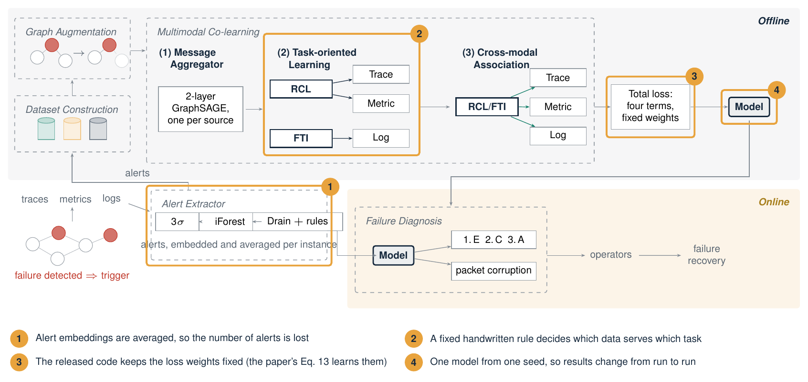
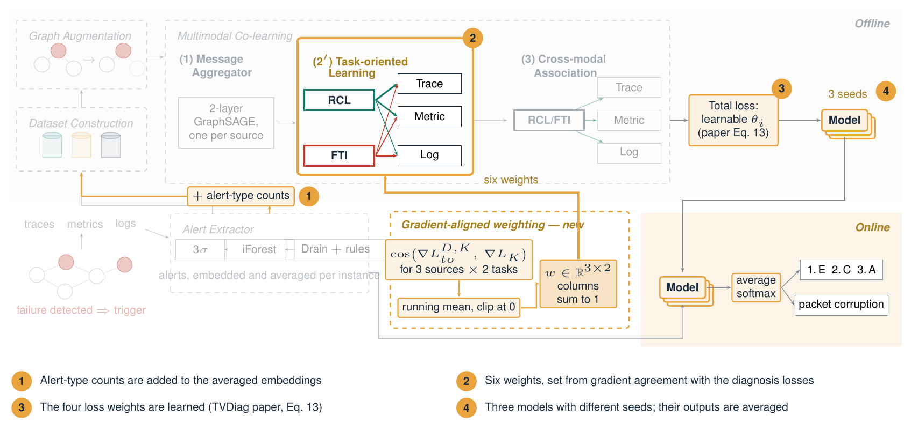
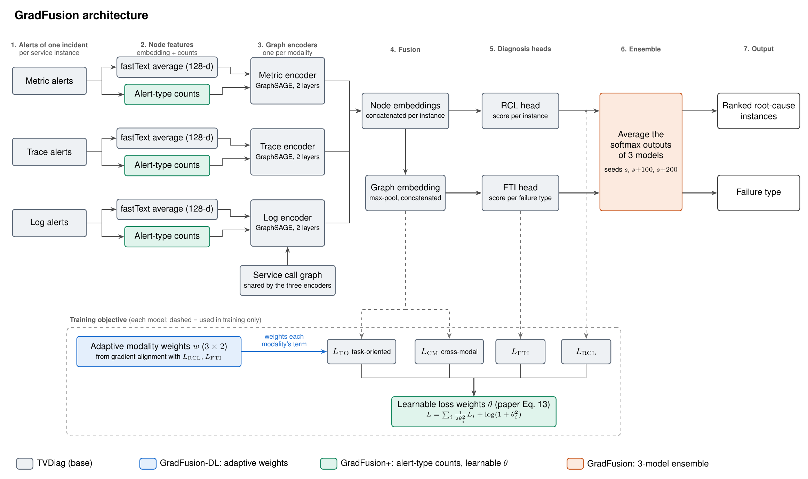

# GradFusion

[](https://github.com/ShehreyarRashid/AdaDiag/actions/workflows/tests.yml)
[](LICENSE)

**Adaptive multimodal failure diagnosis for microservices.** GradFusion finds the root-cause
service instance (RCL) and the failure type (FTI) of an incident from its metric, trace and
log alerts. It is built on [TVDiag](https://github.com/WHU-AISE/TVDiag) (ACM TOSEM 35(2),
Art. 40, 2026) and uses TVDiag's released data.

Shehreyar Rashid (26I-9004), FAST-NUCES · Research Topics in Cloud Computing

GradFusion was called AdaDiag++ before v2.1; the repository keeps its old name.

## Figures

**Figure 1. TVDiag, with the four areas this work looks at.**



**Figure 2. GradFusion: what changed.** The parts in colour are new; the grey parts are TVDiag's.



**Figure 3. GradFusion in detail.**



## 1. What GradFusion adds to TVDiag

| Part | What it does | Where |
|---|---|---|
| Adaptive modality weights | Weights each modality's contrastive term per task, from how well its gradient agrees with the diagnosis losses | `src/gradfusion/weighting.py`, `train.py` |
| Alert-type counts | Adds, per instance, how many alerts of each type fired. TVDiag averages alert embeddings, which loses this | `src/gradfusion/alerts.py` |
| Learnable loss weights | Learns the weights of the four losses (TVDiag paper, Eq. 13) | `src/gradfusion/losses.py` |
| Ensemble of three | Trains three models with different seeds and averages their outputs | `src/gradfusion/ensemble.py` |

The graph encoders, the heads and the data are TVDiag's.

## 2. Results

Means over ten seeds (5–9 and 30–34), HR@1 / F1. All rows except the first were run in this
repository under the same conditions.

| Method | A · GAIA | C · Sock Shop | D · Hotel |
|---|---|---|---|
| TVDiag, published (one run) | 0.759 / 0.936 | 0.863 / 0.636 | 0.821 / 0.822 |
| TVDiag, re-run | 0.738 / 0.921 | 0.869 / 0.552 | 0.821 / 0.781 |
| **GradFusion** | **0.767 / 0.948** | **0.871 / 0.648** | **0.841 / 0.860** |

Gain of GradFusion over TVDiag re-run (paired over the same ten seeds):

| Dataset | HR@1 | F1 |
|---|---|---|
| A · GAIA | +0.029 † | +0.026 † |
| C · Sock Shop | +0.002 | +0.096 † |
| D · Hotel | +0.021 † | +0.078 † |

† significant (paired t-test, p < 0.05, after Holm correction over the six cells).

- Tables 4 and 5 in the TVDiag paper's format:
  [`results/paper_tables/multimodal/tables_mm.pdf`](results/paper_tables/multimodal/tables_mm.pdf).
- Full results, per failure type: [`results/plus2/PLUS2.md`](results/plus2/PLUS2.md).
- Dataset B (AIOps-22) is not released by TVDiag, so it is not evaluated.

## 3. Limits

- **Cost.** Three training runs and three forward passes per diagnosis.
- **Part of the gain comes from the ensemble alone.** Averaging three TVDiag models also
  helps TVDiag. Against that control (seeds 30–34), GradFusion leads on F1 for all three
  datasets (+0.022, +0.054, +0.025) and ties on HR@1.
- **Sock Shop HR@1 is a tie** with TVDiag (+0.002).
- **Published TVDiag numbers are single runs.** GradFusion's ten-seed means are higher on all
  six cells, but the margins on GAIA HR@1 and on Sock Shop are small.
- **Weak spot.** Network-delay faults on Hotel (HR@1 0.37).
- **One test split.** The configuration was chosen in several rounds on the same split. Each
  round fixed its rule first and was confirmed on seeds not used before.

## 4. Data

TVDiag's released data, unchanged ([`data/README.md`](data/README.md)).

| Dataset | System | Incidents | Instances | Failure types | Train / test |
|---|---|---|---|---|---|
| A | GAIA (MicroSS) | 1,099 | 10 | 5 | 160 / 939 |
| C | Sock Shop | 489 | 21 | 7 | 248 / 241 |
| D | Hotel Reservation | 200 | 18 | 5 | 122 / 78 |

## 5. Run it

```bash
pip install torch --index-url https://download.pytorch.org/whl/cpu
pip install -r requirements.txt
pytest -q                                              # 36 tests

python scripts/run_gradfusion.py --dataset hotel --seed 5   # trains and evaluates GradFusion
```

CPU only, no GPU needed. One GradFusion run takes roughly 5–8 minutes on Hotel, 7 on GAIA
and 19 on Sock Shop (one core).

In Python:

```python
from gradfusion import config, data
from gradfusion.alerts import with_alert_bag
from gradfusion.ensemble import predict
from gradfusion.train import train

ds = with_alert_bag(data.load("hotel"))
cfg = config.get("hotel", isolate_weighting_rng=True, alert_bag=True, awl_learnable=True)
models = [train("v5_align", seed, ds, cfg)[1] for seed in (5, 105, 205)]
node_scores, type_scores = predict(models, ds, ds.test_idx)
```

## 6. Reproduce the results

```bash
python scripts/plus2.py --stage confirm      # seeds 30-34: TVDiag, GradFusion-DL, GradFusion+, members
python scripts/plus2.py --stage seeds5-9     # seeds 5-9
python scripts/make_plus2_report.py          # results/plus2/PLUS2.md
python scripts/make_multimodal_tables.py     # Tables 4-5 (needs pdflatex)
```

Finished runs are skipped, so these commands only re-run what is missing. Start two copies
of a stage to use two cores. Runs are deterministic by seed.

## 7. Repository layout

```
src/gradfusion/     the method (model, training, alert counts, ensemble)
scripts/         run_gradfusion.py, the experiment (plus2.py), reports and tables
tests/           36 tests
data/            TVDiag's released datasets A, C, D
results/         every run behind the tables (see results/README.md)
docs/            architecture.md, HISTORY.md, figures/
```

## 8. How this version was chosen

[`docs/HISTORY.md`](docs/HISTORY.md) gives the short story. The selection rule and each
decision are in [`results/plus2/PLAN.md`](results/plus2/PLAN.md), written before the
confirmation runs. Earlier versions and their full research log are in this repository's
git history (the versions before v2.0), under the old name AdaDiag.

## 9. Cite

See [`CITATION.cff`](CITATION.cff). Please also cite TVDiag:

> S. Xie, J. Wang, H. He, Z. Wang, Y. Zhao, N. Zhang, B. Li. "TVDiag: A Task-oriented and
> View-invariant Failure Diagnosis Framework for Microservice-based Systems with Multimodal
> Data." ACM TOSEM 35(2), Art. 40, 2026. doi:10.1145/3734868

Code: MIT ([`LICENSE`](LICENSE)). Data: TVDiag's MIT licence
([`data/LICENSE-TVDiag`](data/LICENSE-TVDiag)).
