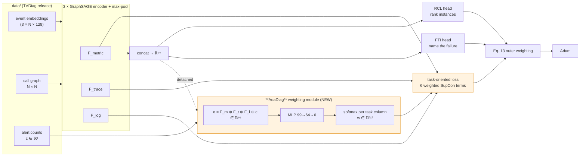

# AdaDiag — Learning who to listen to

[](https://github.com/ShehreyarRashid/AdaDiag/actions/workflows/tests.yml)
[](LICENSE)

**Adaptive modality × task weighting for multimodal microservice failure diagnosis.**

A controlled study of whether the fixed modality→task mapping inside
[TVDiag](https://github.com/WHU-AISE/TVDiag) (ACM TOSEM 35(2), Art. 40, 2026) can be
replaced by one that is *learned per incident* — and a measurement of why, on the public
benchmarks, it cannot.

> **Headline result, stated up front.** AdaDiag is implementable in ~10⁴ parameters with
> zero inference cost, and it **does not improve on TVDiag's hand-written prior** on GAIA or
> Hotel Reservation. There are two reasons, and the second is the stronger one:
>
> 1. **The lever is weak.** The loss term AdaDiag reweights supplies only **1.7 – 12.5 %** of
>    the encoder gradient (§6.4) — 1.7 % on the dataset where the prior is most wrong — so no
>    reallocation inside it can move the end metrics.
> 2. **The lever is also misaimed.** The weighting module receives **exactly zero gradient
>    from both diagnosis losses** — its only learning signal is the auxiliary contrastive
>    term, in which the objective is *linear*, so on a simplex its minimiser is a **vertex**.
>    The graded "who to listen to" the method is built around is not a solution of the
>    objective as written; one-hot collapse is (§6.6). Both claims are asserted in `tests/`.
> 3. **So the extra capacity goes unused.** Tested directly: the "per-incident" matrix varies
>    by at most **0.0037** across the five failure classes (§6.7). It is, to three decimals,
>    one constant matrix — which is what TVDiag already had.
> 4. **Ablations agree, and locate where the premise does hold** (§6.8, 169 runs, two
>    datasets). Deleting the reweighted term costs nothing. Removing each source shows that
>    RCL's useful source *does* vary by failure class, and FTI's by dataset — TVDiag's
>    `log → FTI` is right on GAIA and wrong on Hotel. AdaDiag captures neither. Its one
>    significant win (+0.080 F1) comes when the term is made strong enough to hurt the
>    fixed prior; it protects against that damage but never beats TVDiag's default.
> 5. **Set beside the paper, the re-implementation holds up and the paper agrees with point 1**
>    (§6.9). TVDiag's published HR@1 is reproduced within 0.03 on all three released
>    datasets, and its modality ablations within 0.05. The paper's own Table 6 and Fig. 16,
>    re-run over three seeds, show the term AdaDiag reweights contributes nothing measurable:
>    removing TO, CM or the dynamic weights changes nothing, and no contrastive loss at all
>    (ω = 0) is as good as the default.
>
> The contribution of this repository is that diagnosis, reproducibly — a negative result
> with a mechanism, rather than an unexplained flat table.

---

## 1. Problem statement

A microservice failure leaves three kinds of trace: **logs** (sentences a program writes),
**metrics** (numbers sampled over time) and **traces** (who called whom, and how long it
took). Two questions must be answered about every incident — *which instance is the root
cause* (RCL) and *what kind of failure is this* (FTI).

TVDiag answers them with a task-oriented contrastive loss that pushes each data source
toward the task it is assumed to serve. **That assumption is hard-coded.** From
`core/TVDiag.py`:

```python
if 'metric' in modalities:
    l_to += supConLoss(fs['metric'], instance_labels)   # metric -> RCL
    # l_to += supConLoss(fs['metric'], type_labels)     # <- the authors' own metric->FTI, switched off
if 'log' in modalities:
    l_to += supConLoss(fs['log'], type_labels)          # log    -> FTI
if 'trace' in modalities:
    l_to += supConLoss(fs['trace'], instance_labels)    # trace  -> RCL
```

Three terms, an `if`/`else` on the data type, summed with equal weight — the same rule for
every system, every failure class and every incident. But the data says the right source
*changes*. On Hotel Reservation, for `container-kill`, `pod-failure` and `pod-kill` (120 of
200 incidents) one single Drain3 log template fires in **40 of 40** incidents of each
class — the logs report *that* a container died, never *which kind* — while a distinct
metric signature separates them. On GAIA `[login failure]`, the reverse holds.

**AdaDiag** replaces the fixed rule with a small module that learns a 3×2 weight matrix,
per incident, trained by the diagnosis losses themselves:

```
l_to = Σ_m Σ_t  w[m, t] · L_supcon(f_m, y_t)        softmax down each task column
```

Everything else is held identical.

### Why the columns are simplex-constrained

An unconstrained positive weight is **unidentifiable**: the outer scale (σ, and the Eq. 13
term) absorbs any uniform rescaling of **w**, so the optimiser can lower the loss by
shrinking every weight instead of reallocating between them. Constraining each task column
to sum to one separates the two degrees of freedom — *σ decides how loud the loss is, **w**
decides who speaks.*

---

## 2. Workflow



The orange path exists **only during training**. The contrastive terms are not on the
forward path that produces predictions, so AdaDiag adds **zero inference cost**.

---

## 3. Methodology → code mapping

| # | Methodology step | File | Key function / class |
|---|---|---|---|
| 1 | Load alerts, graphs, labels, official splits | `src/adadiag/data.py` | `load()`, `Dataset` |
| 2 | Graph augmentation (drop non-root instances) | `src/adadiag/augment.py` | `drop_non_root()` |
| 3 | Per-modality graph encoders + readout | `src/adadiag/encoders.py` | `SAGEEncoder`, `max_pool()` |
| 4 | The two diagnosis heads | `src/adadiag/heads.py` | `Locator`, `TypeClassifier` |
| 5 | Losses (per-sample SupCon, CM, Eq. 13) | `src/adadiag/losses.py` | `supcon_per_sample()`, `uspcon()`, `AutomaticWeightedLoss` |
| **6** | **The contribution: the 3×2 weighting module and all arms** | **`src/adadiag/weighting.py`** | **`WeightingModule`** |
| 7 | Training loop; the replaced task-oriented block | `src/adadiag/train.py` | `task_oriented_loss()`, `train()` |
| 8 | Evaluation (HR@k, MRR@3, F1, per class) | `src/adadiag/evaluate.py` | `evaluate()`, `per_class()` |
| 9 | Gradient-share diagnostic | `src/adadiag/diagnostics.py` | `gradient_shares()` |
| 10 | Identifiability: gradient paths + vertex collapse | `src/adadiag/identifiability.py` | `measure_gradient_paths()`, `measure_collapse()` |
| 11 | Ablation studies (4 groups, 22 configurations) | `src/adadiag/ablation.py` | `ABLATIONS`, `run_one()`, `gradient_snapshot()` |
| 12 | Comparison with the TVDiag paper (Tables 3–7, Figs. 11, 13–18) | `src/adadiag/paper_compare.py`, `src/adadiag/paper_numbers.py` | `per_class_k()`, `modality_shapley()`, `to_agreement()`, `VARIANTS` |
| — | Hyperparameters, transcribed from TVDiag | `src/adadiag/config.py` | `get()` |
| — | Re-run committed experiments, compare to results/ | `scripts/verify_results.py` | `main()` |
| — | Tests (35; 30 need no data, 5 check data/) | `tests/test_supcon_equivalence.py`, `tests/test_weighting_identifiability.py`, `tests/test_ablation_switches.py`, `tests/test_paper_compare.py`, `tests/test_data_integrity.py` | `pytest -q` |

Model assembly lives in `src/adadiag/model.py`; the runnable entry points are in `scripts/`.

---

## 4. Dataset

The three datasets TVDiag releases are **included in [`data/`](data/)** (48 MB, 27 files),
copied byte-for-byte from TVDiag's repository at commit `cf6f334` under its MIT licence.
Clone this repository and every script runs with no other download. Provenance, layout and
SHA-256 checksums are in [`data/README.md`](data/README.md); `pytest` verifies the
checksums. The extracted alerts and the pre-computed 128-d event embeddings are included,
so Drain3 and fastText do **not** need to be re-run.

TVDiag's own description of the datasets, quoted verbatim from its README ("we" and "us"
are the TVDiag authors, who deployed the systems and hold the raw data):

> We conducted experiments on two datasets:
>
> - [GAIA](https://github.com/CloudWise-OpenSource/GAIA-DataSet). GAIA dataset records
>   metrics, traces, and logs of the MicroSS simulation system in July 2021, which consists
>   of ten microservices and some middleware such as Redis, MySQL, and Zookeeper. The
>   extracted events of GAIA can be accessible on [DiagFusion](https://arxiv.org/abs/2302.10512).
> - [AIOps-22](https://competition.aiops-challenge.com). The AIOps-22 dataset is derived from
>   the training data released by the AIOps 2022 Challenge, where failures at three levels
>   (node, service, and instance) were injected into a Web-based e-commerce platform
>   [Online-boutique](https://github.com/GoogleCloudPlatform/microservices-demo).
> - Sockshop and HotelReservation. We deployed two well-known microservice-based systems:
>   [Sockshop](https://github.com/microservices-demo/microservices-demo) and
>   [HotelReservation](https://github.com/delimitrou/DeathStarBench/tree/master/hotelReservation)
>   in a Kubernetes cluster. We induced diverse application failures using Chaos Mesh and
>   gathered system telemetry data for testing. Due to storage constraints, we only provide
>   extracted alert datasets. You may contact us via email to request the raw data of two
>   systems.

DiagFusion is published as Zhang et al., *IEEE Transactions on Services Computing* 16(6),
3851–3864, 2023, [doi:10.1109/TSC.2023.3290018](https://doi.org/10.1109/TSC.2023.3290018).

| dataset | in `data/` | incidents | instances | types | train / test | used in this repo |
|---|---|---|---|---|---|---|
| **GAIA** (MicroSS) | `data/gaia/` | 1099 | 10 | 5 | 160 / 939 | sweeps, diagnostics, ablations A/B/D |
| **Hotel Reservation** | `data/hotel/` | 200 | 18 | 5 | 122 / 78 | sweeps, diagnostics, per-class, all ablations |
| **Sock Shop** | `data/sockshop/` | 489 | 21 | 7 | 248 / 241 | loader supported and asserted; not run |
| **AIOps-22** | **not included** | — | — | 9 | — | not distributed by TVDiag (see below) |

Per dataset the loader reads `data/<ds>/tmp/{metric,trace,log}.pkl` (embeddings),
`data/<ds>/raw/{nodes,edges}.json` (topology), `data/<ds>/raw/{metrics,traces,logs}.json`
(alerts, used for **c**) and `data/<ds>/label.csv` (ground truth + split).

> **AIOps-22 is configured in TVDiag but its data is not distributed.** To add it you must
> obtain the AIOps 2022 Challenge data and re-run TVDiag's `extractor/` (3σ for metrics,
> isolation forest over 30 s windows for traces, Drain3 for logs) followed by
> [DiagFusion](https://github.com/AIOps-Lab-NKU/DiagFusion)'s fastText event embedding.
> `config.py` already carries its hyperparameters (`ft_num=9`, `patience=20`).

> **Sock Shop quirk:** its `label.csv` has an unnamed leading index column, and a few rows
> name an instance absent from that incident's node list. `data.py` handles both.

---

## 5. Setup and run

```bash
git clone https://github.com/ShehreyarRashid/AdaDiag.git && cd AdaDiag
pip install -r requirements.txt            # or: conda env create -f environment.yml

pytest -q                                  # 35 tests, incl. checksums of data/; run first

# the five-arm, five-seed sweep (2 CPU cores, no GPU: ~16 min Hotel, ~34 min GAIA)
python scripts/run_sweep.py       --dataset gaia
python scripts/run_sweep.py       --dataset hotel

# per-failure-class breakdown and the learned weight matrix per class
python scripts/run_perclass.py    --dataset hotel

# why the learned arms cannot work as specified (§6.6) -- takes seconds for part 1
python scripts/run_identifiability.py --dataset hotel

# ablation studies (§6.8): list them, run them, render the tables
python scripts/run_ablation.py --list
python scripts/run_ablation.py --dataset hotel --seeds 5
python scripts/make_ablation_report.py results/ablation_hotel*.json

# why a null is a null: the gradient-share measurement
python scripts/run_diagnostics.py --dataset hotel

# render the tables below
python scripts/make_report.py results/hotel.json --dataset hotel

# the comparison with the TVDiag paper (§6.9): every run, in lanes, then the report
bash scripts/paper_comparison_runs.sh main          # and sweep0..5, ada, gaia_abl, ...
python scripts/make_paper_comparison.py
```

**CPU only. No GPU, no CUDA, and no DGL.** The incident graphs have 10–21 nodes, so the
GraphSAGE layers use dense batched matmuls — which removes the single hardest
version-pinning problem in reproducing TVDiag.

### Reproducing the committed results

Every table in §6 is rendered from `results/*.json` by `scripts/make_report.py`, and every
JSON can be regenerated from the code and `data/`. To check that claim yourself:

```bash
python scripts/verify_results.py --threads 2          # Hotel, every arm, seed 0, ~4 min
python scripts/verify_results.py --dataset gaia --arms v0_simplex v3_incident --threads 2
```

Each run is retrained from scratch and printed next to the committed number. On the
environment in [`results/ENVIRONMENT.md`](results/ENVIRONMENT.md) (2 CPU threads, PyTorch
2.15; exact pins in `requirements-lock.txt`) the match is **bit-for-bit**. Verified on a
clean copy of this repository: all six Hotel arms and GAIA's prior and AdaDiag (seed 0;
every metric and epoch count identical), both Hotel gradient-share measurements
(`hotel_gradshare.json`) and the full per-class table (`hotel_perclass.json`). On other hardware,
PyTorch versions or thread counts the floating-point summation order differs, single seeds
drift by a few points, and the five-seed means and paired tests are what should agree.
New result records carry an `env` field (PyTorch version, thread count) for this reason.

---

## 6. Results

### 6.1 Fidelity — does the re-implementation reproduce TVDiag?

| dataset | metric | TVDiag (reported) | V0-raw (here, 5 seeds) | gap |
|---|---|---|---|---|
| GAIA | HR@1 | 0.759 | 0.731 ± 0.021 | −0.028 |
| GAIA | F1 | 0.936 | 0.918 ± 0.013 | −0.018 |
| Hotel | HR@1 | 0.821 | **0.836 ± 0.011** | +0.015 |
| Hotel | F1 | 0.822 | 0.796 ± 0.019 | −0.026 |
| Sock Shop | HR@1 | 0.863 | **0.868 ± 0.012** | +0.005 |
| Sock Shop | F1 | 0.636 | 0.572 ± 0.014 | −0.064 |

HR@1 within 3 points on all three datasets, from a clean-room dense re-implementation;
F1 2–6 points lower. Close enough for arm-to-arm comparison. Every other table and figure of
the paper's evaluation is set beside this re-implementation in §6.9.

### 6.2 The five arms — GAIA (5 seeds, identical splits and seeds)

| arm | HR@1 | HR@3 | MRR@3 | F1 | macro-F1 |
|---|---|---|---|---|---|
| V0-raw (TVDiag as shipped) | 0.731 ± 0.021 | 0.892 ± 0.011 | 0.804 ± 0.015 | 0.918 ± 0.013 | 0.571 ± 0.005 |
| V0-simplex (prior) | 0.744 ± 0.010 | 0.897 ± 0.009 | 0.814 ± 0.008 | 0.932 ± 0.009 | 0.573 ± 0.006 |
| V1-uniform (⅓ each) | 0.746 ± 0.020 | 0.900 ± 0.007 | 0.815 ± 0.012 | 0.930 ± 0.011 | 0.558 ± 0.019 |
| V2-global (learned matrix) | 0.733 ± 0.024 | 0.896 ± 0.013 | 0.807 ± 0.017 | 0.922 ± 0.015 | 0.561 ± 0.020 |
| V3-incident (**AdaDiag**) | 0.747 ± 0.013 | 0.896 ± 0.007 | 0.814 ± 0.008 | 0.935 ± 0.012 | 0.576 ± 0.024 |

Paired t-tests against V0-simplex, same seeds:

| arm | Δ HR@1 | Δ MRR@3 | Δ macro-F1 |
|---|---|---|---|
| V0-raw | −0.013 (p=0.13) | −0.010 (p=0.11) | −0.001 (p=0.55) |
| V1-uniform | +0.002 (p=0.84) | +0.002 (p=0.82) | −0.015 (p=0.10) |
| V2-global | −0.011 (p=0.39) | −0.007 (p=0.44) | −0.012 (p=0.17) |
| V3-incident (**AdaDiag**) | **+0.003 (p=0.59)** | +0.001 (p=0.84) | +0.004 (p=0.74) |

V3 vs V0-simplex: **+0.003 HR@1, p = 0.59**. Nothing is significant at any threshold.

### 6.3 The five arms — Hotel Reservation, where the prior should fail

| arm | HR@1 | HR@3 | MRR@3 | F1 | macro-F1 |
|---|---|---|---|---|---|
| V0-raw (TVDiag as shipped) | **0.836 ± 0.011** | 0.921 ± 0.011 | **0.874 ± 0.010** | 0.796 ± 0.019 | 0.782 ± 0.027 |
| V0-simplex (prior) | 0.833 ± 0.013 | 0.918 ± 0.007 | 0.871 ± 0.008 | **0.804 ± 0.015** | **0.791 ± 0.022** |
| V1-uniform (⅓ each) | **0.836 ± 0.011** | 0.921 ± 0.017 | **0.874 ± 0.011** | 0.793 ± 0.021 | 0.784 ± 0.026 |
| V2-global (learned matrix) | 0.833 ± 0.009 | 0.923 ± 0.009 | 0.872 ± 0.007 | 0.791 ± 0.028 | 0.782 ± 0.033 |
| V3-incident (**AdaDiag**) | 0.828 ± 0.015 | 0.923 ± 0.009 | 0.869 ± 0.012 | 0.781 ± 0.032 | 0.766 ± 0.042 |
| V4-fusion (exploratory) | 0.808 ± 0.027 | — | 0.843 ± 0.025 | 0.760 ± 0.044 | 0.742 ± 0.055 |

Paired t-tests against V0-simplex, same seeds:

| arm | Δ HR@1 | Δ MRR@3 | Δ macro-F1 |
|---|---|---|---|
| V0-raw | +0.003 (p=0.37) | +0.003 (p=0.18) | −0.009 (p=0.53) |
| V1-uniform | +0.003 (p=0.37) | +0.003 (p=0.44) | −0.008 (p=0.39) |
| V2-global | +0.000 (p=1.00) | +0.001 (p=0.73) | −0.010 (p=0.49) |
| V3-incident (**AdaDiag**) | **−0.005 (p=0.48)** | −0.002 (p=0.69) | −0.026 (p=0.18) |

V3 vs V0-simplex: **−0.005 HR@1, p = 0.48** — directionally *worse*, and the weakest arm of
the five on HR@1, MRR@3, F1 and macro-F1 alike. Nothing is significant, so the correct
reading is "no effect", not "a loss". But this is the dataset chosen because TVDiag's mapping
should be most wrong here, and **the prediction is falsified**: the adaptive arm does not
beat the hand-written prior, and no arm separates from any other.

### 6.4 Why the result is a null, and how we know

The weights move a long way with no effect on accuracy — on GAIA, V3 converges to ~0.98/1.00
on logs, close to the *opposite* of the prior, and scores the same. Weights that free mean
the objective is **under-determined in w**. There are two independent reasons; this section
covers the first (the term is too weak to matter) and §6.6 the second and sharper one (the
module gets no task gradient at all, and its objective is minimised at a corner).

The gradient-share diagnostic shows the first:

| term | GAIA V0-simplex | GAIA V3 | Hotel V0-simplex | Hotel V3 |
|---|---|---|---|---|
| `l_rcl` | 57.1 % | 56.1 % | 44.0 % | 44.1 % |
| `l_fti` | 23.0 % | 23.7 % | 51.1 % | 49.0 % |
| **`σ · l_to`** (what AdaDiag reweights) | **11.6 %** | **12.5 %** | **1.7 %** | **3.6 %** |
| `σ · l_cm` | 8.3 % | 7.7 % | 3.2 % | 3.4 % |

Measured for the prior *and* for AdaDiag, so this is not an artefact of one arm. On the
dataset where the mapping is *most* wrong, the term AdaDiag reweights is the *weakest*
contributor — 1.7 % against the two diagnosis losses' 95 %. Learning the weights raises its
share slightly (1.7 → 3.6 %) but nowhere near enough to matter. With σ = 0.1 fixed by
TVDiag's config, that ceiling is structural.

### 6.5 Why V4 exists, and why it also fails

If `l_rcl + l_fti` carry 80–95 % of the gradient, the obvious correction is to move the
weights onto *that* path. `v4_fusion` applies the identical per-incident 3×2 matrix to the
fused representation feeding the two heads, leaving TVDiag's task-oriented loss intact. It
is **worse on every metric** (−0.026 HR@1, −0.028 MRR@3, −0.044 F1, −0.049 macro-F1 against
V0-simplex) and inflates the seed variance by **2.1–3.0×**. A plausible
but untested reading: a per-incident multiplicative gate is a nuisance the heads must undo,
and 122 training incidents are not enough to absorb it.

### 6.6 The deeper problem: the simplex fixes the wrong degree of freedom

§6.4 says the lever is weak. This section says it also points the wrong way, and this is the
part that generalises beyond TVDiag — it would apply to any method that learns modality
weights on an *auxiliary* loss.

**(1) No diagnosis gradient reaches the weighting module.** `w` is used in exactly one place,
the task-oriented contrastive term. It is deliberately *not* on the forward path that
produces node or type logits — that is what makes AdaDiag free at inference time. The
consequence is that

```
∂l_rcl / ∂θ_w  =  0        ∂l_fti / ∂θ_w  =  0        exactly, not approximately
```

Measured, on Hotel, `v3_incident`:

| term | total ‖grad‖ at the weighting parameters |
|---|---|
| `l_rcl` | **0.000000e+00** |
| `l_fti` | **0.000000e+00** |
| `σ · l_to` | 9.477373e+00 |

The module's entire learning signal is an auxiliary loss. Nothing in the objective tells it
what *diagnosis accuracy* prefers.

**(2) `l_to` is linear in `w`, so the minimiser is a vertex.** With
`l_to = Σ_m Σ_t w[m,t] · L_{m,t}` and each task column on the simplex, the objective is a
linear function on a simplex — minimised at a **corner**. Smooth graded allocations are not
minimisers; they are points the optimiser passes through on the way to a corner. Observed on
every GAIA seed:

| seed | `v3_incident` RCL | `v3_incident` FTI | HR@1 | | `v2_global` RCL | `v2_global` FTI |
|---|---|---|---|---|---|---|
| 0 | log **0.999** | log **1.000** | 0.743 | | log 0.366 | log 0.375 |
| 1 | log **0.988** | log **1.000** | 0.729 | | log 0.463 | log 0.595 |
| 2 | log **0.979** | log **1.000** | 0.753 | | log 0.407 | log 0.491 |
| 3 | log **0.989** | log **0.992** | 0.764 | | log 0.426 | log 0.546 |
| 4 | log **0.986** | log **1.000** | 0.745 | | log 0.458 | log 0.610 |

Mean largest column weight: **0.993** for `v3_incident` (1.0 = fully collapsed, ⅓ = uniform),
0.524 for `v2_global`. Every one of GAIA's ten columns is above 0.979.

Hotel shows the same pull with one honest wrinkle. Its RCL column collapses onto `metric` on
**all five seeds** (0.957–1.000), and its FTI column prefers `log` on all five — but reaches
a corner on only two of them (0.997, 0.997) and stalls near 0.55 on the other three. Mean
largest weight 0.861. So the *direction* is unanimous across seeds and datasets; the *degree*
of collapse is not. The vertex is where the objective pulls, not somewhere every run arrives.

The chosen corner is also seed- and dataset-dependent in a way task utility is not: GAIA
picks `log` for RCL (contradicting TVDiag's prior, which gives `log` weight zero there),
while Hotel picks `metric` for RCL (agreeing with the prior in direction, but discarding
`trace` entirely). Two datasets, two opposite answers to "who should RCL listen to", and no
accuracy difference from either.

`v3_incident` collapses onto a single modality for both tasks on **every seed** — including
**RCL, the task TVDiag assigns `log` a weight of exactly zero** — and scores the same as the
prior anyway. `v2_global`, which has one matrix for the whole dataset and no per-incident
capacity, drifts in the same direction but cannot reach a corner. That contrast is itself
evidence for the mechanism: the arm with more capacity to reach a vertex reaches one.

**(3) So the simplex solved the wrong problem.** It was introduced to make `w` identifiable
against the outer scale σ (§1, "Why the columns are simplex-constrained"), and it does that
correctly. But identifiability is not *alignment*. By (1) no task gradient reaches the
module, so the corner it picks is selected by the auxiliary loss landscape, not by
usefulness. Per-incident conditioning therefore does not buy a graded "who to listen to" —
it buys a per-incident choice of **one modality per task**, which is the same *kind* of rule
as TVDiag's hard-coded mapping, just chosen by convenience rather than by domain knowledge.

**What is and is not claimed.** (1) is exact and (2) is universal across our seeds; both are
asserted in `tests/test_weighting_identifiability.py`. We do **not** claim the chosen corner
is always `argmin L_{m,t}` — measured after training it matches on RCL but not on FTI, where
the three terms sit within 3 % of each other and the encoders have co-adapted to whatever
`w` became. The collapse is the robust finding; which corner wins is not.

**What a real fix would require.** Any correction has to get task gradient into the module
*without* putting `w` on the prediction path — `v4_fusion` does the latter and is worse
(§6.5). Three candidates, none tested here because each changes TVDiag's objective and so
breaks the controlled comparison:

- a **bi-level / hypergradient** step, updating `w` against held-out *task* loss rather than
  against `l_to`;
- an **entropy or temperature penalty** on the columns — this would prevent collapse, but by
  overriding the objective rather than repairing it;
- **raising σ** so `l_to` has enough influence for its allocation to matter at all; §6.4
  puts it at 11.6 % (GAIA) and 1.7 % (Hotel), so there is very little to reallocate.

This is the honest next step, not a result claimed here.

### 6.7 The premise, tested directly

Everything above is about aggregate metrics. But the premise of this work is narrower and
sharper: *the useful source varies by failure class, so condition the weights on the
incident.* An aggregate table can neither confirm nor refute that. This one can
(`scripts/run_perclass.py`, Hotel, `v3_incident`):

| failure class | RCL: metric / trace / log | FTI: metric / trace / log |
|---|---|---|
| container-kill | 1.000 / 0.000 / 0.000 | 0.000 / 0.000 / 1.000 |
| network-delay | 0.999 / 0.000 / 0.001 | 0.002 / 0.002 / 0.996 |
| network-loss | 1.000 / 0.000 / 0.000 | 0.000 / 0.000 / 0.999 |
| pod-failure | 1.000 / 0.000 / 0.000 | 0.000 / 0.000 / 1.000 |
| pod-kill | 1.000 / 0.000 / 0.000 | 0.000 / 0.000 / 1.000 |

**Maximum spread across the five classes: 0.0037.** The per-incident matrix is, to three
decimal places, the *same matrix* for every failure class. Per-incident conditioning — the
MLP, the 99-d descriptor, the ~10⁴ parameters — buys an allocation indistinguishable from a
single global constant that happens to sit at a vertex.

And there was room to do better. The same run shows where the headroom is:

| failure class | n | RCL HR@1 | FTI recall |
|---|---|---|---|
| container-kill | 22 | 1.000 | **0.500** |
| network-delay | 14 | **0.357** | 0.857 |
| network-loss | 13 | 0.769 | 1.000 |
| pod-failure | 15 | 1.000 | 0.800 |
| pod-kill | 14 | 1.000 | 0.786 |

Three of five classes are already at HR@1 = 1.000, so almost all the available gain sits in
`network-delay` (0.357) and in `container-kill`'s type recall (0.500) — exactly the kind of
class-specific weakness adaptive weighting was supposed to address. It did not move either.

As a control, `v2_global` produces a spread of exactly 0.0000, as it must — one matrix for
the whole dataset. That the two arms are nearly indistinguishable on this table is the
clearest single statement of the result: **AdaDiag's extra capacity is not being used.**

### 6.8 Ablation studies

Each group tests a claim made above, rather than ablating for its own sake
(`src/adadiag/ablation.py`, `scripts/run_ablation.py`):

| group | what is changed | applied to | claim it tests |
|---|---|---|---|
| **A** TVDiag's components | w/o AUG · w/o TO · w/o CM · w/o TO and CM | prior (V0-simplex) | §6.4 — if removing TO entirely barely moves the metrics, no reweighting of it can |
| **B** Modalities | drop one source · keep one source; per failure class | prior (V0-simplex) | the premise — which source each task and class actually depends on |
| **C** AdaDiag's design | no simplex (softplus) · no detach · descriptor = embeddings only / counts only · entropy penalty λ ∈ {0.01, 0.1} | AdaDiag (V3) | §1 (simplex for identifiability) and §6.6 (does stopping the collapse change accuracy?) |
| **D** Strength of l_to | σ_to ∈ {0.5, 1, 2}, CM kept at 0.1 | prior and AdaDiag | §8 — do the arms separate once l_to carries real weight? |

Protocol: TVDiag's hyperparameters throughout; every configuration shares seeds with its
reference (same arm, all switches off), so every Δ is a paired difference. Every run also
records per-class metrics, the share of the encoder gradient per loss term on the trained
model, and the learned weight matrix. Hotel runs all four groups with 5 seeds; GAIA runs
A, B and D with 3 seeds.

Three caveats. Early stopping is TVDiag's rule (on training loss), so removing a loss term
also moves where training stops — as in TVDiag's own ablation. Removing a modality in
group B also removes its contrastive terms, and the prior renormalises over what remains
(without `log`, FTI's term moves to metric + trace), so B measures the source as a whole,
not only its input to the heads. And ablations run one
process per CPU core; thread count changes floating-point reduction order, so the
references here differ from §6.2/6.3 in the last decimals. Comparisons are only ever made
within the ablation runs.

Every switch defaults to the method: with all of them off, four arms reproduce the
pre-ablation code bit-for-bit (metrics, learned weights and parameter sums; 12-epoch
check on Hotel, seed 0), and
`tests/test_ablation_switches.py` checks the switches themselves without data.

#### Results — Hotel Reservation

Every table below is printed by `scripts/make_ablation_report.py` from
`results/ablation_*.json`; the full tables (MRR@3, standard deviations, raw and adjusted
p-values, learned weights) are in [`results/ABLATIONS.md`](results/ABLATIONS.md).

**hotel** — 5 seeds. Δ vs reference, (Holm-adjusted p); **bold** = significant.

| group | configuration | HR@1 | F1 | Δ HR@1 | Δ F1 | Δ macro-F1 | σ·l_to share |
|---|---|---|---|---|---|---|---|
| ref | *TVDiag prior (V0-simplex), full model* | 0.838 | 0.800 | — | — | — | 4.6 % |
| ref | *AdaDiag (V3-incident), full model* | 0.828 | 0.781 | — | — | — | 9.4 % |
| A | w/o AUG | 0.821 | 0.770 | -0.018 (0.37) | -0.030 (1.00) | -0.018 (1.00) | 4.6 % |
| A | w/o TO (the term AdaDiag reweights) | 0.833 | 0.808 | -0.005 (1.00) | +0.008 (1.00) | +0.010 (1.00) | 0.0 % |
| A | w/o CM | 0.831 | 0.806 | -0.008 (0.92) | +0.006 (1.00) | +0.006 (1.00) | 4.8 % |
| A | w/o TO and CM (diagnosis losses + AUG only) | 0.833 | 0.809 | -0.005 (1.00) | +0.009 (1.00) | +0.008 (1.00) | 0.0 % |
| B | w/o metric | 0.767 | 0.445 | **-0.072** (0.014) | **-0.355** (0.000) | **-0.332** (0.000) | 2.1 % |
| B | w/o trace | 0.800 | 0.792 | -0.038 (0.24) | -0.008 (1.00) | -0.004 (1.00) | 6.5 % |
| B | w/o log | 0.800 | 0.703 | -0.038 (0.37) | -0.097 (1.00) | -0.089 (1.00) | 4.7 % |
| B | metric only | 0.785 | 0.745 | **-0.054** (0.007) | **-0.055** (0.002) | -0.044 (0.10) | 7.0 % |
| B | trace only | 0.254 | 0.346 | **-0.585** (0.000) | **-0.455** (0.000) | **-0.413** (0.001) | 3.9 % |
| B | log only | 0.705 | 0.349 | **-0.133** (0.000) | **-0.451** (0.001) | **-0.456** (0.001) | 21.9 % |
| C | no simplex (unconstrained positive weights) | 0.836 | 0.798 | +0.008 (0.92) | **+0.016** (0.016) | **+0.019** (0.026) | 0.0 % |
| C | descriptor not detached | 0.831 | 0.782 | +0.003 (1.00) | +0.001 (1.00) | +0.002 (1.00) | 9.4 % |
| C | descriptor: embeddings only | 0.831 | 0.782 | +0.003 (1.00) | +0.001 (1.00) | +0.002 (1.00) | 9.6 % |
| C | descriptor: alert counts only | 0.836 | 0.785 | +0.008 (0.92) | +0.004 (1.00) | +0.005 (1.00) | 8.1 % |
| C | + entropy penalty, lambda=0.01 | 0.836 | 0.793 | +0.008 (0.92) | +0.012 (1.00) | +0.013 (1.00) | 6.9 % |
| C | + entropy penalty, lambda=0.1 | 0.836 | 0.787 | +0.008 (0.92) | +0.006 (1.00) | +0.010 (1.00) | 4.3 % |
| D | prior, sigma_to=0.5 | 0.833 | 0.758 | -0.005 (1.00) | -0.042 (0.82) | -0.053 (0.80) | 34.1 % |
| D | prior, sigma_to=1 | 0.838 | 0.723 | +0.000 (1.00) | -0.077 (0.075) | **-0.088** (0.040) | 38.1 % |
| D | prior, sigma_to=2 | 0.810 | 0.697 | -0.028 (0.33) | **-0.104** (0.011) | **-0.121** (0.007) | 50.2 % |
| D | AdaDiag, sigma_to=0.5 | 0.823 | 0.771 | -0.005 (1.00) | -0.010 (1.00) | -0.004 (1.00) | 44.9 % |
| D | AdaDiag, sigma_to=1 | 0.826 | 0.774 | -0.003 (1.00) | -0.007 (1.00) | +0.001 (1.00) | 54.7 % |
| D | AdaDiag, sigma_to=2 | 0.800 | 0.776 | -0.028 (0.72) | -0.005 (1.00) | +0.004 (1.00) | 75.0 % |

**A — the term AdaDiag reweights can be deleted at no cost.** No TVDiag component is
significant after correction. Removing the task-oriented term entirely changes HR@1 by
−0.005 and F1 by +0.008 — an independent confirmation of §6.4: if deleting `l_to` does not
matter, no reweighting of it can. AUG is the largest effect (−0.018 HR@1), in line with
TVDiag's own ablation, but it does not survive correction on 5 seeds.

**B — which source each task actually depends on.** `metric` is indispensable (without it
F1 falls by 0.355), and no single source is enough on its own. Per failure class:

RCL HR@1:

| failure class | n | full model | w/o metric | w/o trace | w/o log |
|---|---|---|---|---|---|
| container-kill | 22 | 1.000 | +0.000 | +0.000 | **-0.055** |
| network-delay | 14 | 0.343 | **-0.243** | -0.043 | -0.029 |
| network-loss | 13 | 0.738 | -0.154 | **-0.169** | -0.108 |
| pod-failure | 15 | 1.000 | -0.013 | -0.013 | +0.000 |
| pod-kill | 14 | 1.000 | +0.000 | +0.000 | +0.000 |

FTI recall:

| failure class | n | full model | w/o metric | w/o trace | w/o log |
|---|---|---|---|---|---|
| container-kill | 22 | 0.573 | **-0.473** | +0.109 | -0.064 |
| network-delay | 14 | 0.900 | **-0.186** | -0.029 | +0.029 |
| network-loss | 13 | 0.969 | **-0.277** | -0.108 | -0.031 |
| pod-failure | 15 | 0.827 | **-0.533** | -0.013 | -0.280 |
| pod-kill | 14 | 0.757 | **-0.100** | -0.029 | -0.071 |

For **RCL the useful source varies by class** — `log` for container-kill, `metric` for
network-delay, `trace` for network-loss (pod-failure and pod-kill are at ceiling with any
source). For **FTI it does not**: every class depends on `metric` most. TVDiag's prior
routes FTI's contrastive term to `log` alone — the source FTI depends on least here
(Hotel's logs are 95 % empty: only 5.1 % of instance embeddings are non-zero). The
`log only` row's zero variance has the same cause: in 56 of 78 test incidents the culprit
is the instance that logged an alert, and every seed learns exactly that rule (55/78).

**C — AdaDiag's own design.** Three results, all consistent with §1 and §6.6:

- *Without the simplex the optimiser switches the term off.* Unconstrained weights shrink
  to 0.000 in both columns, exactly as the identifiability argument in §1 predicts — and
  F1 rises by 0.016 (significant). AdaDiag improves by silencing its own lever, which is
  group A's finding seen from the other side.
- *The descriptor and the detach do not matter.* Not detaching, or conditioning on the
  embeddings alone, leaves the learned weights essentially unchanged (largest RCL / FTI
  weight 0.992–0.994 / 0.729–0.731) and the metrics within 0.003.
- *Stopping the collapse changes nothing.* An entropy penalty pulls the largest weight from
  0.994 to 0.544 (λ = 0.01) and to 0.349 — uniform — (λ = 0.1), with no significant change
  in any metric. The collapse is not what holds AdaDiag back; at TVDiag's σ the weights
  barely touch the predictions.

**D — the one place AdaDiag separates from the prior.** Raising σ_to lifts `l_to`'s share
of the encoder gradient from 4.6 % to 50 % (prior) and 75 % (AdaDiag). Head to head at
each σ_to (Δ = AdaDiag − prior, same seeds):

| σ_to | σ·l_to share (prior) | prior HR@1 | AdaDiag HR@1 | Δ HR@1 | prior F1 | AdaDiag F1 | Δ F1 |
|---|---|---|---|---|---|---|---|
| 0.1 | 4.6 % | 0.838 | 0.828 | -0.010 (p=0.18, Holm 0.53) | 0.800 | 0.781 | -0.019 (p=0.16, Holm 0.32) |
| 0.5 | 34.1 % | 0.833 | 0.823 | -0.010 (p=0.24, Holm 0.53) | 0.758 | 0.771 | +0.013 (p=0.38, Holm 0.38) |
| 1.0 | 38.1 % | 0.838 | 0.826 | -0.013 (p=0.034, Holm 0.14) | 0.723 | 0.774 | +0.051 (p=0.034, Holm 0.10) |
| 2.0 | 50.2 % | 0.810 | 0.800 | -0.010 (p=0.41, Holm 0.53) | 0.697 | 0.776 | **+0.080** (p=0.006, Holm 0.023) |

The prior degrades on FTI as `l_to` strengthens (−0.104 against its own default at
σ_to = 2, significant). GAIA below shows the same damage even where the prior's mapping is
the right one, so it comes from over-weighting a fixed contrastive routing, not only from
routing to the wrong source. AdaDiag's F1 holds steady; at σ_to ≥ 0.5 its columns flip, on
every seed, to RCL → `log` and FTI → `metric`. At σ_to = 2 it beats the prior by
**+0.080 F1 (Holm p = 0.023)**; HR@1 never separates.

#### Results — GAIA

49 of 54 runs: AdaDiag at σ_to = 1 and 2 did not complete (the jobs hit the 2-hour limit on
background runs), so those rows are omitted rather than reported on fewer seeds.

**gaia** — 3 seeds. Δ vs reference, (Holm-adjusted p); **bold** = significant.

| group | configuration | HR@1 | F1 | Δ HR@1 | Δ F1 | Δ macro-F1 | σ·l_to share |
|---|---|---|---|---|---|---|---|
| ref | *TVDiag prior (V0-simplex), full model* | 0.733 | 0.937 | — | — | — | 17.3 % |
| ref | *AdaDiag (V3-incident), full model* | 0.740 | 0.932 | — | — | — | 16.4 % |
| A | w/o AUG | 0.603 | 0.888 | -0.130 (0.35) | -0.049 (0.099) | -0.016 (0.29) | 36.6 % |
| A | w/o TO (the term AdaDiag reweights) | 0.737 | 0.938 | +0.004 (1.00) | +0.001 (1.00) | -0.021 (0.27) | 0.0 % |
| A | w/o CM | 0.744 | 0.937 | +0.011 (1.00) | +0.000 (1.00) | +0.021 (0.29) | 23.9 % |
| A | w/o TO and CM (diagnosis losses + AUG only) | 0.738 | 0.933 | +0.005 (1.00) | -0.004 (1.00) | -0.043 (0.35) | 0.0 % |
| B | w/o metric | 0.461 | 0.949 | -0.272 (0.052) | +0.012 (0.080) | +0.014 (0.29) | 9.6 % |
| B | w/o trace | 0.473 | 0.913 | -0.261 (0.070) | -0.024 (0.080) | +0.002 (0.90) | 10.3 % |
| B | w/o log | 0.678 | 0.763 | -0.055 (0.14) | **-0.174** (0.039) | -0.208 (0.092) | 6.4 % |
| B | metric only | 0.419 | 0.637 | **-0.315** (0.002) | **-0.300** (0.012) | **-0.310** (0.010) | 4.4 % |
| B | trace only | 0.402 | 0.741 | **-0.332** (0.032) | **-0.196** (0.005) | **-0.216** (0.021) | 12.2 % |
| B | log only | 0.337 | 0.945 | **-0.396** (0.007) | +0.008 (0.92) | +0.011 (0.27) | 6.8 % |
| D | prior, sigma_to=0.5 | 0.715 | 0.876 | -0.018 (0.59) | -0.061 (0.080) | -0.027 (0.29) | 68.5 % |
| D | prior, sigma_to=1 | 0.706 | 0.850 | -0.027 (0.84) | **-0.087** (0.013) | -0.050 (0.29) | 80.7 % |
| D | prior, sigma_to=2 | 0.711 | 0.833 | -0.022 (1.00) | -0.104 (0.050) | -0.054 (0.11) | 84.9 % |
| D | AdaDiag, sigma_to=0.5 | 0.742 | 0.908 | +0.002 (1.00) | -0.024 (0.099) | **-0.023** (0.027) | 47.2 % |

*Not reported (incomplete — fewer seeds than the rest): AdaDiag, sigma_to=1 (1/3 seeds), AdaDiag, sigma_to=2 (0/3 seeds).*

**A — the same answer as Hotel.** Removing the task-oriented term costs nothing (+0.004
HR@1, +0.001 F1). AUG is again the largest effect (−0.130 HR@1), not significant on 3 seeds.

**B — on GAIA, TVDiag's mapping is the right one.** RCL needs `metric` and `trace`
(removing either costs 0.27 / 0.26 HR@1); FTI needs `log` (without it F1 falls by 0.174,
significant, and `log` alone reaches F1 0.945, as high as the full model). That is exactly
the prior's metric + trace → RCL, log → FTI. Per failure class:

RCL HR@1:

| failure class | n | full model | w/o metric | w/o trace | w/o log |
|---|---|---|---|---|---|
| [access permission denied exception] | 15 | 0.133 | -0.044 | -0.111 | **-0.133** |
| [file moving program] | 27 | 0.926 | +0.000 | -0.025 | **-0.296** |
| [login failure] | 458 | 0.830 | -0.027 | **-0.592** | -0.105 |
| [memory_anomalies] | 426 | 0.660 | **-0.573** | +0.067 | +0.015 |
| [normal memory freed label] | 13 | 0.026 | +0.128 | +0.026 | -0.026 |

FTI recall:

| failure class | n | full model | w/o metric | w/o trace | w/o log |
|---|---|---|---|---|---|
| [access permission denied exception] | 15 | 0.000 | +0.000 | +0.000 | +0.000 |
| [file moving program] | 27 | 0.889 | +0.086 | +0.000 | **-0.753** |
| [login failure] | 458 | 0.972 | +0.023 | -0.050 | **-0.233** |
| [memory_anomalies] | 426 | 0.991 | -0.005 | -0.007 | **-0.099** |
| [normal memory freed label] | 13 | 0.000 | +0.000 | +0.051 | +0.026 |

RCL's source again **varies by class** — `trace` for login failure, `metric` for memory
anomalies, `log` for the file-moving program — while FTI depends on `log` for every class
the model can recognise at all.

**D — the same pattern as Hotel.** A stronger `l_to` hurts the prior's F1 (−0.087 at
σ_to = 1, significant) even though its mapping is right here:

| σ_to | σ·l_to share (prior) | prior HR@1 | AdaDiag HR@1 | Δ HR@1 | prior F1 | AdaDiag F1 | Δ F1 |
|---|---|---|---|---|---|---|---|
| 0.1 | 17.3 % | 0.733 | 0.740 | +0.006 (p=0.37, Holm 0.37) | 0.937 | 0.932 | -0.005 (p=0.34, Holm 0.34) |
| 0.5 | 68.5 % | 0.715 | 0.742 | +0.027 (p=0.045, Holm 0.091) | 0.876 | 0.908 | **+0.032** (p=0.024, Holm 0.049) |

AdaDiag's weights do not move on GAIA (`log` for both tasks at σ_to = 0.1 and 0.5), so here
the robustness is not a flip to a better source. A plausible, untested reading: AdaDiag
puts the strong contrastive term on one encoder and leaves the other two to the diagnosis
heads, while the prior's strong terms reshape all three.

#### What the ablations add up to

1. **The term AdaDiag reweights does not matter at TVDiag's σ, on either dataset** —
   deleting it costs nothing (A), and AdaDiag gets slightly better when it is allowed to
   silence it (C).
2. **The premise is real, at a granularity AdaDiag does not capture.** RCL's useful source
   varies *by failure class* on both datasets; FTI's varies *by dataset* (metric on Hotel,
   log on GAIA). AdaDiag's learned matrix is constant across classes (§6.7: spread 0.0037),
   and the corners it picks contradict group B — FTI → `log` on Hotel, RCL → `log` on GAIA —
   as expected of a module that receives no task gradient (§6.6).
3. **Where AdaDiag helps, it protects rather than improves.** With a strong `l_to`, the fixed
   prior loses F1 on both datasets and AdaDiag loses much less (head to head: +0.080 F1 on
   Hotel at σ_to = 2, +0.032 on GAIA at σ_to = 0.5), but neither beats TVDiag's default.

The direction this points to is a weighting that is trained on the diagnosis losses
(§6.6) and conditioned on failure class for RCL — not on the incident descriptor used here.

### 6.9 Against the paper — Tables 3–7 and Figures 11, 13–18

Every table and figure of TVDiag's evaluation that can be recomputed from the released
data, set beside this re-implementation and AdaDiag. Full tables, all figures and the method
behind each: **[`results/paper_comparison/PAPER_COMPARISON.md`](results/paper_comparison/PAPER_COMPARISON.md)**.
The paper's dataset A is GAIA, C is Sock Shop, D is Hotel Reservation; B (AIOps-22) is not
distributed. The paper's baselines are not re-run. Values the paper only plots (Figs.
15–18) were read off its figures, to ± 0.005.

| Dataset |  | HR@1 | HR@3 | Avg@3 | MRR@3 | F1 |
| --- | --- | ---: | ---: | ---: | ---: | ---: |
| A · GAIA | TVDiag, paper | 0.759 | 0.909 | 0.844 | 0.827 | 0.936 |
|  | TVDiag, re-run | 0.731 | 0.892 | 0.823 | 0.804 | 0.918 |
|  | AdaDiag | 0.747 | 0.896 | 0.832 | 0.814 | 0.935 |
| C · Sock Shop | TVDiag, paper | 0.863 | 0.954 | 0.913 | 0.903 | 0.636 |
|  | TVDiag, re-run | 0.868 | 0.948 | 0.913 | 0.904 | 0.572 |
|  | AdaDiag | 0.871 | 0.949 | 0.917 | 0.907 | 0.575 |
| D · Hotel Reservation | TVDiag, paper | 0.821 | 0.923 | 0.876 | 0.866 | 0.822 |
|  | TVDiag, re-run | 0.836 | 0.921 | 0.883 | 0.874 | 0.796 |
|  | AdaDiag | 0.828 | 0.923 | 0.878 | 0.869 | 0.781 |

**What the comparison shows.** Numbers are GAIA (A) unless a dataset is named; *re-run* is
TVDiag as shipped, 3–5 seeds.

1. **The published numbers reproduce for localisation, less so for failure type**
   (Tables 4–5). HR@1 lands within 0.03 of the paper on all three datasets (A −0.028, C
   +0.005, D +0.015); F1 is 0.02–0.06 lower. The re-run still beats every published baseline on both
   tasks on all three.
2. **Table 5 compares two different F1s.** TVDiag's F1 is the harmonic mean of its
   weighted precision and recall, exactly, on all four datasets; 18 of the 24 baseline
   rows print an F1 more than 0.005 below that quantity. The comparison flatters TVDiag by
   roughly the gap between the two definitions (0.002–0.025 on the re-run).
3. **Of the four training components, only augmentation matters** (Table 6). Without AUG
   HR@1 falls 0.111 (paper: 0.084). Removing TO, CM or DW changes nothing measurable —
   +0.011, +0.010, +0.003 here; −0.005, −0.002, −0.002 in the paper, from single runs. On
   Hotel, which the paper's Table 6 does not cover, none of the four matters, AUG included.
4. **The contrastive terms do not help** (Fig. 16b). ω = 0 — no TO, no CM — is as good as
   the default, and F1 falls steadily as ω grows (−0.050 at ω = 0.9, p = 0.011); the paper
   reports ω = 0.1 as best. Too large an inactivation probability hurts, as the paper says
   (p = 0.9: −0.151 HR@1); temperature and depth are flat within seed noise.
5. **The modality ablations reproduce closely** (Fig. 17, Table 7). Dropping metric or
   trace costs 0.265 / 0.253 HR@1 (paper 0.274 / 0.294); dropping log costs 0.173 F1 (paper
   0.216). TVDiag's own single-modality rows in Table 7 match within 0.001 on logs
   (0.337 / 0.638 / 0.518 / 0.945 vs the paper's 0.337 / 0.639 / 0.518 / 0.945) and within
   0.01 on traces.
6. **Per-incident contributions agree for RCL, only partly for FTI** (Fig. 18). RCL's
   ranking — trace > metric > log — matches the paper. For FTI both put logs first, but here
   logs dominate far more (median share 0.55 vs 0.39) and metrics fall to last.
7. **The alert-field ablation reproduces in direction** (Fig. 15, alerts re-embedded with
   TVDiag's own fastText step). Dropping the trace alerts' abnormal type costs the most
   (F1 −0.115; paper −0.120); the operation name and the metric direction matter little.

**For AdaDiag.** Findings 3 and 4 are the paper's own evaluation confirming §6.4 from the
other side: the term AdaDiag reweights contributes nothing measurable at TVDiag's settings,
so there is nothing for a better weighting of it to win. On the paper's numbers AdaDiag
sits within 0.012 HR@1 of TVDiag's published results; its edge over TVDiag as shipped on
GAIA (+0.016 HR@1) is matched by the same fixed rule rescaled (V0-simplex, +0.013). Its
learned matrix sends GAIA's RCL term to `log` (0.99) — the modality with the smallest share
of RCL's predictions (median 0.03, Fig. 18) — and along ω it only loses less F1 than
TVDiag, never exceeding TVDiag's best point (Fig. 16b).

---

## 7. Four findings about the TVDiag artefact

Checkable in minutes, independent of AdaDiag:

1. **The modality→task mapping is three lines of `if`/`else`**, with the authors' own
   `metric → FTI` variant commented out directly above it.
2. **Eq. 13's dynamic weighting is inert in the released code.**
   `AutomaticWeightedLoss` is constructed on line 52, *after* the optimizer on line 50, and
   is never added as a param group — its parameters receive gradients but are never stepped.
   They stay at 1.0, so the term reduces to `0.5·Σlᵢ + 4·log 2`, i.e. plain equal weighting
   plus a constant. Reproduced deliberately (`losses.AutomaticWeightedLoss`, and asserted in
   `tests/`); "fixing" it would mean no longer reproducing TVDiag.
3. **Their F1 is not sklearn's weighted F1** — `helper/eval.py` takes the harmonic mean of
   *weighted* precision and *weighted* recall. The published figures are that quantity, so
   `evaluate.py` reports it their way and `f1_sklearn_weighted` alongside. The paper's
   Table 5 mixes the two: TVDiag's F1 equals the harmonic mean of its P and R on all four
   datasets, while 18 of the 24 baseline rows print an F1 below theirs — a comparison that
   favours TVDiag (§6.9).
4. **Fig. 15's `w/o abDirection` is a no-op on two of the three released datasets.** The
   embedding code drops field index 3 of a metric alert, which is the direction on GAIA's
   4-field alerts but does not exist on Hotel's and Sock Shop's 3-field ones
   (`scripts/reembed_alerts.py` drops the last field instead).

---

## 8. Honest scope

- The arm comparison and the ablations cover two datasets (GAIA, Hotel Reservation). Sock
  Shop is run only for the paper comparison (§6.9: TVDiag, V0-simplex and AdaDiag at the
  default settings, 5 seeds). AIOps-22 is not distributed (§4).
- **The paper comparison (§6.9)** re-runs TVDiag, not its baselines; the baselines' numbers
  are the paper's. Values the paper only plots were read off its figures (± 0.005). Its
  Table 7 rows for DiagFusion's extractors need raw telemetry the release omits. The
  hyper-parameter sweeps use six of the paper's nine points per parameter, 3 seeds; the
  p-values in Fig. 16's notes are uncorrected.
- These are **this re-implementation's** numbers, not the paper's. The defensible claim is
  the *difference between arms* under identical splits, seeds and hyperparameters; absolute
  values are anchored by §6.1 and no further.
- GAIA's 160/939 split makes a small training set — seed variance is wide and single-point
  differences mean nothing. That is why every table is five seeds with paired tests.
- The null is specific to **reweighting the task-oriented contrastive term under TVDiag's
  σ = 0.1**. An untested follow-up is to sweep σ upward and see whether the arms separate
  once the term carries real weight.
- §6.6's claim (1) — zero task gradient to the weighting module — is exact and holds for any
  σ. Claim (2), vertex collapse, is an analytic property of a linear objective on a simplex,
  verified on our seeds but not proved to be reached from every initialisation.
- The three fixes listed in §6.6 are **not implemented**. Each changes TVDiag's objective,
  which would end the controlled comparison this repository is built around; they are named
  so the next person does not repeat the arm that cannot work.
- `v4_fusion` is exploratory and was run on Hotel only, where the prior is most wrong. Its
  negative result should not be read as a general claim about gating fused representations.
- **Ablations (§6.8).** Hotel runs every group with 5 seeds; GAIA runs groups A, B and D
  with 3 seeds, and group C (AdaDiag's internals) on Hotel only. Group D deliberately
  changes TVDiag's objective (σ_to), so it sits outside the controlled comparison of
  §6.2–6.3: it answers "what if l_to mattered?", not "is AdaDiag better than TVDiag?".
  Per-class tables rest on 13–22 incidents per class.
- **Multiple comparisons.** The ablation tables (§6.8) mark significance only after
  Holm–Bonferroni correction over every comparison of a metric. The main arm tables (§6.2,
  §6.3) report raw paired-t p-values for four comparisons each; none is below 0.05 even
  before correction, so correcting would not change any conclusion.
- §6.7's per-class table is **one seed on one dataset**. The 0.0037 spread is a strong
  negative for that run and is consistent with the five-seed collapse in §6.6, but the
  per-class breakdown has not been repeated across seeds or on GAIA.

---

## 9. Related work

| method | weighting | tasks | venue |
|---|---|---|---|
| [DiagFusion](https://github.com/AIOps-Lab-NKU/DiagFusion) | none (equal fusion) | both | IEEE TSC 2023 |
| [Eadro](https://github.com/BEbillionaireUSD/Eadro) | none (equal fusion) | both | ICSE 2023 |
| Medicine | adaptive, per modality, **global** | FTI only | ASE 2024 |
| **TVDiag** | fixed per task, hand-written | both | ACM TOSEM 2026 |
| [TransTVDiag](https://github.com/aron123/TransTVDiag) | inherits TVDiag's fixed mapping | both | IJCAC 2026 |
| **AdaDiag (this work)** | learned, per task **and** per incident | both | — |

Medicine is the closest prior work and the most instructive: it balances *learning pace*
across modalities by manipulating gradients on the **main** objective. The measurement in
§6.4 suggests that is the right place to act, and that AdaDiag's lever — an auxiliary term
worth 2–10 % of the gradient — is not.

[AIOpsLab](https://github.com/microsoft/AIOpsLab) is used only as corroboration for the
fault taxonomy: its library separates an `ApplicationFaultInjector` (faults that announce
themselves in log text) from a `SymptomFaultInjector` (faults that do not), which is the
distinction that predicts when the fixed mapping should hold.

---

## 10. Citing

To cite this repository, use GitHub's **"Cite this repository"** button (generated from
[`CITATION.cff`](CITATION.cff)). AdaDiag builds on TVDiag's method and released data, so
please cite TVDiag as well:

```bibtex
@article{xie2026tvdiag,
  author  = {Xie, Shuaiyu and Wang, Jian and He, Hanbin and Wang, Zhihao and
             Zhao, Yuqi and Zhang, Neng and Li, Bing},
  title   = {{TVDiag}: A Task-oriented and View-invariant Failure Diagnosis Framework
             for Microservice-based Systems with Multimodal Data},
  journal = {ACM Transactions on Software Engineering and Methodology},
  volume  = {35},
  number  = {2},
  pages   = {1--39},
  year    = {2026},
  doi     = {10.1145/3734868}
}
```

## License

MIT for the code in this repository. The datasets and the TVDiag implementation remain
under their own licences.
