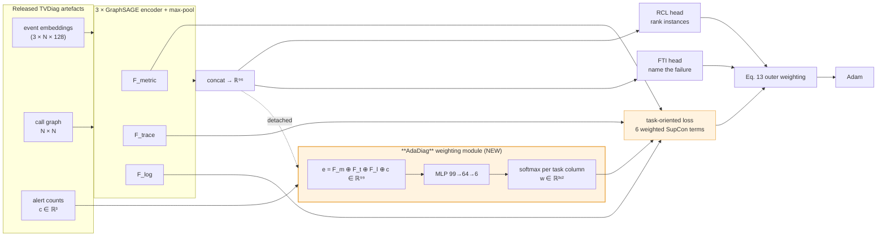

# AdaDiag — Learning who to listen to

**Adaptive modality × task weighting for multimodal microservice failure diagnosis.**

A controlled study of whether the fixed modality→task mapping inside
[TVDiag](https://github.com/WHU-AISE/TVDiag) (ACM TOSEM 35(2), Art. 40, 2026) can be
replaced by one that is *learned per incident* — and a measurement of why, on the public
benchmarks, it cannot.

> **Headline result, stated up front.** AdaDiag is implementable in ~10⁴ parameters with
> zero inference cost, and it **does not improve on TVDiag's hand-written prior** on GAIA or
> Hotel Reservation. There are two reasons, and the second is the stronger one:
>
> 1. **The lever is weak.** The loss term AdaDiag reweights supplies only **1.7 – 10.4 %** of
>    the encoder gradient (§6.4), so no reallocation inside it can move the end metrics.
> 2. **The lever is also misaimed.** The weighting module receives **exactly zero gradient
>    from both diagnosis losses** — its only learning signal is the auxiliary contrastive
>    term, in which the objective is *linear*, so on a simplex its minimiser is a **vertex**.
>    The graded "who to listen to" the method is built around is not a solution of the
>    objective as written; one-hot collapse is (§6.6). Both claims are asserted in `tests/`.
>
> The contribution of this repository is that diagnosis, reproducibly — a negative result
> with a mechanism, rather than an unexplained flat table.

---

## 1. Problem statement

A microservice failure leaves three kinds of trace: **logs** (sentences a program writes),
**metrics** (numbers sampled over time) and **traces** (who called whom, and how long it
took). Two questions must be answered about every incident — *which instance is the root
cause* (RCL) and *what kind of failure is this* (FTI).

TVDiag answers them with a task-oriented contrastive loss that pushes each data source
toward the task it is assumed to serve. **That assumption is hard-coded.** From
`core/TVDiag.py`:

```python
if 'metric' in modalities:
    l_to += supConLoss(fs['metric'], instance_labels)   # metric -> RCL
    # l_to += supConLoss(fs['metric'], type_labels)     # <- the authors' own metric->FTI, switched off
if 'log' in modalities:
    l_to += supConLoss(fs['log'], type_labels)          # log    -> FTI
if 'trace' in modalities:
    l_to += supConLoss(fs['trace'], instance_labels)    # trace  -> RCL
```

Three terms, an `if`/`else` on the data type, summed with equal weight — the same rule for
every system, every failure class and every incident. But the data says the right source
*changes*. On Hotel Reservation, for `container-kill`, `pod-failure` and `pod-kill` (120 of
200 incidents) one single Drain3 log template fires in **40 of 40** incidents of each
class — the logs report *that* a container died, never *which kind* — while a distinct
metric signature separates them. On GAIA `[login failure]`, the reverse holds.

**AdaDiag** replaces the fixed rule with a small module that learns a 3×2 weight matrix,
per incident, trained by the diagnosis losses themselves:

```
l_to = Σ_m Σ_t  w[m, t] · L_supcon(f_m, y_t)        softmax down each task column
```

Everything else is held identical.

### Why the columns are simplex-constrained

An unconstrained positive weight is **unidentifiable**: the outer scale (σ, and the Eq. 13
term) absorbs any uniform rescaling of **w**, so the optimiser can lower the loss by
shrinking every weight instead of reallocating between them. Constraining each task column
to sum to one separates the two degrees of freedom — *σ decides how loud the loss is, **w**
decides who speaks.*

---

## 2. Workflow



The orange path exists **only during training**. The contrastive terms are not on the
forward path that produces predictions, so AdaDiag adds **zero inference cost**.

---

## 3. Methodology → code mapping

| # | Methodology step | File | Key function / class |
|---|---|---|---|
| 1 | Load alerts, graphs, labels, official splits | `src/adadiag/data.py` | `load()`, `Dataset` |
| 2 | Graph augmentation (drop non-root instances) | `src/adadiag/augment.py` | `drop_non_root()` |
| 3 | Per-modality graph encoders + readout | `src/adadiag/encoders.py` | `SAGEEncoder`, `max_pool()` |
| 4 | The two diagnosis heads | `src/adadiag/heads.py` | `Locator`, `TypeClassifier` |
| 5 | Losses (per-sample SupCon, CM, Eq. 13) | `src/adadiag/losses.py` | `supcon_per_sample()`, `uspcon()`, `AutomaticWeightedLoss` |
| **6** | **The contribution: the 3×2 weighting module and all arms** | **`src/adadiag/weighting.py`** | **`WeightingModule`** |
| 7 | Training loop; the replaced task-oriented block | `src/adadiag/train.py` | `task_oriented_loss()`, `train()` |
| 8 | Evaluation (HR@k, MRR@3, F1, per class) | `src/adadiag/evaluate.py` | `evaluate()`, `per_class()` |
| 9 | Gradient-share diagnostic | `src/adadiag/diagnostics.py` | `gradient_shares()` |
| 10 | Identifiability: gradient paths + vertex collapse | `src/adadiag/identifiability.py` | `measure_gradient_paths()`, `measure_collapse()` |
| — | Hyperparameters, transcribed from TVDiag | `src/adadiag/config.py` | `get()` |
| — | Equivalence + invariant tests | `tests/test_supcon_equivalence.py` | `pytest -q` |

Model assembly lives in `src/adadiag/model.py`; the runnable entry points are in `scripts/`.

---

## 4. Data

**No dataset is committed here.** Everything is read from a TVDiag checkout, which already
ships the extracted alerts and the pre-computed 128-d event embeddings — Drain3 and
fastText do **not** need to be re-run.

```bash
git clone https://github.com/WHU-AISE/TVDiag.git
```

| dataset | in TVDiag repo | incidents | instances | types | train / test | source |
|---|---|---|---|---|---|---|
| **GAIA** (MicroSS) | yes | 1099 | 10 | 5 | 160 / 939 | [CloudWise GAIA-DataSet](https://github.com/CloudWise-OpenSource/GAIA-DataSet) |
| **Sock Shop** | yes | 489 | 21 | 7 | 248 / 241 | [microservices-demo](https://github.com/microservices-demo/microservices-demo) |
| **Hotel Reservation** | yes | 200 | 18 | 5 | 122 / 78 | [DeathStarBench](https://github.com/delimitrou/DeathStarBench) |
| **AIOps-22** | **no** | — | — | 9 | — | AIOps 2022 Challenge (Online-Boutique) |

Per dataset the loader reads `data/<ds>/tmp/{metric,trace,log}.pkl` (embeddings),
`data/<ds>/raw/{nodes,edges}.json` (topology), `data/<ds>/raw/{metrics,traces,logs}.json`
(alerts, used for **c**) and `data/<ds>/label.csv` (ground truth + split).

> **AIOps-22 is configured in TVDiag but its data is not distributed.** To add it you must
> obtain the AIOps 2022 Challenge data and re-run TVDiag's `extractor/` (3σ for metrics,
> isolation forest over 30 s windows for traces, Drain3 for logs) followed by
> [DiagFusion](https://github.com/AIOps-Lab-NKU/DiagFusion)'s fastText event embedding.
> `config.py` already carries its hyperparameters (`ft_num=9`, `patience=20`).

> **Sock Shop quirk:** its `label.csv` has an unnamed leading index column, and a few rows
> name an instance absent from that incident's node list. `data.py` handles both.

---

## 5. Setup and run

```bash
git clone https://github.com/<you>/AdaDiag.git && cd AdaDiag
pip install -r requirements.txt            # or: conda env create -f environment.yml
git clone https://github.com/WHU-AISE/TVDiag.git ../TVDiag

pytest -q                                  # 6 tests; run these first

# the full five-arm, five-seed sweep (~6 min on 2 CPU cores for GAIA)
python scripts/run_sweep.py       --dataset gaia  --repo ../TVDiag
python scripts/run_sweep.py       --dataset hotel --repo ../TVDiag

# per-failure-class breakdown and the learned weight matrix per class
python scripts/run_perclass.py    --dataset hotel --repo ../TVDiag

# why the learned arms cannot work as specified (§6.6) -- takes seconds for part 1
python scripts/run_identifiability.py --dataset hotel --repo ../TVDiag

# why a null is a null: the gradient-share measurement
python scripts/run_diagnostics.py --dataset hotel --repo ../TVDiag

# render the tables below
python scripts/make_report.py results/hotel.json --dataset hotel
```

**CPU only. No GPU, no CUDA, and no DGL.** The incident graphs have 10–21 nodes, so the
GraphSAGE layers use dense batched matmuls — which removes the single hardest
version-pinning problem in reproducing TVDiag.

---

## 6. Results

### 6.1 Fidelity — does the re-implementation reproduce TVDiag?

| dataset | metric | TVDiag (reported) | V0-raw (here, 5 seeds) | gap |
|---|---|---|---|---|
| GAIA | HR@1 | 0.759 | 0.731 ± 0.021 | −0.028 |
| GAIA | F1 | 0.936 | 0.918 ± 0.013 | −0.018 |
| Hotel | HR@1 | 0.821 | **0.831 ± 0.017** | +0.010 |
| Hotel | F1 | 0.822 | 0.799 ± 0.016 | −0.023 |

Within ~3 points on both datasets, from a clean-room dense re-implementation. Close enough
for arm-to-arm comparison.

### 6.2 The five arms — GAIA (5 seeds, identical splits and seeds)

| arm | HR@1 | HR@3 | MRR@3 | F1 | macro-F1 |
|---|---|---|---|---|---|
| V0-raw (TVDiag as shipped) | 0.731 ± 0.021 | 0.892 ± 0.011 | 0.804 ± 0.015 | 0.918 ± 0.013 | 0.571 ± 0.005 |
| V0-simplex (prior) | 0.744 ± 0.010 | 0.897 ± 0.009 | 0.814 ± 0.008 | 0.932 ± 0.009 | 0.573 ± 0.006 |
| V1-uniform (⅓ each) | 0.746 ± 0.020 | 0.900 ± 0.007 | 0.815 ± 0.012 | 0.930 ± 0.011 | 0.558 ± 0.019 |
| V2-global (learned matrix) | 0.733 ± 0.024 | 0.896 ± 0.013 | 0.807 ± 0.017 | 0.922 ± 0.015 | 0.561 ± 0.020 |
| V3-incident (**AdaDiag**) | 0.747 ± 0.013 | 0.896 ± 0.007 | 0.814 ± 0.008 | 0.935 ± 0.012 | 0.576 ± 0.024 |

Paired t-tests against V0-simplex, same seeds:

| arm | Δ HR@1 | Δ MRR@3 | Δ macro-F1 |
|---|---|---|---|
| V0-raw | −0.013 (p=0.13) | −0.010 (p=0.11) | −0.001 (p=0.55) |
| V1-uniform | +0.002 (p=0.84) | +0.002 (p=0.82) | −0.015 (p=0.10) |
| V2-global | −0.011 (p=0.39) | −0.007 (p=0.44) | −0.012 (p=0.17) |
| V3-incident (**AdaDiag**) | **+0.003 (p=0.59)** | +0.001 (p=0.84) | +0.004 (p=0.74) |

V3 vs V0-simplex: **+0.003 HR@1, p = 0.59**. Nothing is significant at any threshold.

### 6.3 The five arms — Hotel Reservation, where the prior should fail

| arm | HR@1 | MRR@3 | F1 | macro-F1 |
|---|---|---|---|---|
| V0-raw | 0.831 ± 0.017 | 0.867 | 0.799 | 0.784 |
| **V0-simplex (prior)** | **0.833 ± 0.020** | **0.871** | **0.811** | **0.797** |
| V1-uniform | 0.828 ± 0.015 | 0.866 | 0.786 | 0.772 |
| V2-global | 0.828 ± 0.015 | 0.866 | 0.786 | 0.771 |
| V3-incident (**AdaDiag**) | 0.833 ± 0.016 | 0.870 | 0.794 | 0.777 |
| V4-fusion (exploratory) | 0.810 ± 0.021 | 0.845 | 0.776 ± 0.052 | 0.761 ± 0.060 |

V3 vs V0-simplex: **+0.000 HR@1, p = 1.00**. The hand-written prior is the best arm on
every metric. **This falsifies the prediction** that a gain would appear where the mapping
inverts.

### 6.4 Why the result is a null, and how we know

The weights move a long way with no effect on accuracy — on GAIA, V3 converges to ~0.98/1.00
on logs, close to the *opposite* of the prior, and scores the same. Weights that free mean
the objective is **under-determined in w**. There are two independent reasons; this section
covers the first (the term is too weak to matter) and §6.6 the second and sharper one (the
module gets no task gradient at all, and its objective is minimised at a corner).

The gradient-share diagnostic shows the first:

| term | GAIA share | Hotel share |
|---|---|---|
| `l_rcl` | 58.0 % | 45.4 % |
| `l_fti` | 23.8 % | 49.7 % |
| **`σ · l_to`** (what AdaDiag reweights) | **10.4 %** | **1.7 %** |
| `σ · l_cm` | 7.8 % | 3.2 % |

On the dataset where the mapping is *most* wrong, the term AdaDiag reweights is the
*weakest* contributor. With σ = 0.1 fixed by TVDiag's config, that ceiling is structural.

### 6.5 Why V4 exists, and why it also fails

If `l_rcl + l_fti` carry 82–95 % of the gradient, the obvious correction is to move the
weights onto *that* path. `v4_fusion` applies the identical per-incident 3×2 matrix to the
fused representation feeding the two heads, leaving TVDiag's task-oriented loss intact. It
is **worse** (−0.023 HR@1, −0.037 macro-F1) and roughly triples the variance. A plausible
but untested reading: a per-incident multiplicative gate is a nuisance the heads must undo,
and 122 training incidents are not enough to absorb it.

### 6.6 The deeper problem: the simplex fixes the wrong degree of freedom

§6.4 says the lever is weak. This section says it also points the wrong way, and this is the
part that generalises beyond TVDiag — it would apply to any method that learns modality
weights on an *auxiliary* loss.

**(1) No diagnosis gradient reaches the weighting module.** `w` is used in exactly one place,
the task-oriented contrastive term. It is deliberately *not* on the forward path that
produces node or type logits — that is what makes AdaDiag free at inference time. The
consequence is that

```
∂l_rcl / ∂θ_w  =  0        ∂l_fti / ∂θ_w  =  0        exactly, not approximately
```

Measured, on Hotel, `v3_incident`:

| term | total ‖grad‖ at the weighting parameters |
|---|---|
| `l_rcl` | **0.000000e+00** |
| `l_fti` | **0.000000e+00** |
| `σ · l_to` | 9.477373e+00 |

The module's entire learning signal is an auxiliary loss. Nothing in the objective tells it
what *diagnosis accuracy* prefers.

**(2) `l_to` is linear in `w`, so the minimiser is a vertex.** With
`l_to = Σ_m Σ_t w[m,t] · L_{m,t}` and each task column on the simplex, the objective is a
linear function on a simplex — minimised at a **corner**. Smooth graded allocations are not
minimisers; they are points the optimiser passes through on the way to a corner. Observed on
every GAIA seed:

| seed | `v3_incident` RCL | `v3_incident` FTI | HR@1 | | `v2_global` RCL | `v2_global` FTI |
|---|---|---|---|---|---|---|
| 0 | log **0.999** | log **1.000** | 0.743 | | log 0.366 | log 0.375 |
| 1 | log **0.988** | log **1.000** | 0.729 | | log 0.463 | log 0.595 |
| 2 | log **0.979** | log **1.000** | 0.753 | | log 0.407 | log 0.491 |
| 3 | log **0.989** | log **0.992** | 0.764 | | log 0.426 | log 0.546 |
| 4 | log **0.986** | log **1.000** | 0.745 | | log 0.458 | log 0.610 |

Mean largest column weight: **0.998** for `v3_incident` (1.0 = fully collapsed, ⅓ = uniform),
0.524 for `v2_global`. Hotel behaves the same way — 0.998 on both tasks.

`v3_incident` collapses onto a single modality for both tasks on **every seed** — including
**RCL, the task TVDiag assigns `log` a weight of exactly zero** — and scores the same as the
prior anyway. `v2_global`, which has one matrix for the whole dataset and no per-incident
capacity, drifts in the same direction but cannot reach a corner. That contrast is itself
evidence for the mechanism: the arm with more capacity to reach a vertex reaches one.

**(3) So the simplex solved the wrong problem.** It was introduced to make `w` identifiable
against the outer scale σ (§1, "Why the columns are simplex-constrained"), and it does that
correctly. But identifiability is not *alignment*. By (1) no task gradient reaches the
module, so the corner it picks is selected by the auxiliary loss landscape, not by
usefulness. Per-incident conditioning therefore does not buy a graded "who to listen to" —
it buys a per-incident choice of **one modality per task**, which is the same *kind* of rule
as TVDiag's hard-coded mapping, just chosen by convenience rather than by domain knowledge.

**What is and is not claimed.** (1) is exact and (2) is universal across our seeds; both are
asserted in `tests/test_weighting_identifiability.py`. We do **not** claim the chosen corner
is always `argmin L_{m,t}` — measured after training it matches on RCL but not on FTI, where
the three terms sit within 3 % of each other and the encoders have co-adapted to whatever
`w` became. The collapse is the robust finding; which corner wins is not.

**What a real fix would require.** Any correction has to get task gradient into the module
*without* putting `w` on the prediction path — `v4_fusion` does the latter and is worse
(§6.5). Three candidates, none tested here because each changes TVDiag's objective and so
breaks the controlled comparison:

- a **bi-level / hypergradient** step, updating `w` against held-out *task* loss rather than
  against `l_to`;
- an **entropy or temperature penalty** on the columns — this would prevent collapse, but by
  overriding the objective rather than repairing it;
- **raising σ** so `l_to` has enough influence for its allocation to matter at all; §6.4
  puts it at 10.4 % (GAIA) and 1.7 % (Hotel), so there is very little to reallocate.

This is the honest next step, not a result claimed here.

---

## 7. Three findings about the TVDiag artefact

Checkable in minutes, independent of AdaDiag:

1. **The modality→task mapping is three lines of `if`/`else`**, with the authors' own
   `metric → FTI` variant commented out directly above it.
2. **Eq. 13's dynamic weighting is inert in the released code.**
   `AutomaticWeightedLoss` is constructed on line 52, *after* the optimizer on line 50, and
   is never added as a param group — its parameters receive gradients but are never stepped.
   They stay at 1.0, so the term reduces to `0.5·Σlᵢ + 4·log 2`, i.e. plain equal weighting
   plus a constant. Reproduced deliberately (`losses.AutomaticWeightedLoss`, and asserted in
   `tests/`); "fixing" it would mean no longer reproducing TVDiag.
3. **Their F1 is not sklearn's weighted F1** — `helper/eval.py` takes the harmonic mean of
   *weighted* precision and *weighted* recall. The published figures are that quantity, so
   `evaluate.py` reports it their way and `f1_sklearn_weighted` alongside.

---

## 8. Honest scope

- Two datasets completed (GAIA, Hotel Reservation); Sock Shop is the third shipped dataset
  and AIOps-22 is not distributed (§4).
- These are **this re-implementation's** numbers, not the paper's. The defensible claim is
  the *difference between arms* under identical splits, seeds and hyperparameters; absolute
  values are anchored by §6.1 and no further.
- GAIA's 160/939 split makes a small training set — seed variance is wide and single-point
  differences mean nothing. That is why every table is five seeds with paired tests.
- The null is specific to **reweighting the task-oriented contrastive term under TVDiag's
  σ = 0.1**. An untested follow-up is to sweep σ upward and see whether the arms separate
  once the term carries real weight.
- §6.6's claim (1) — zero task gradient to the weighting module — is exact and holds for any
  σ. Claim (2), vertex collapse, is an analytic property of a linear objective on a simplex,
  verified on our seeds but not proved to be reached from every initialisation.
- The three fixes listed in §6.6 are **not implemented**. Each changes TVDiag's objective,
  which would end the controlled comparison this repository is built around; they are named
  so the next person does not repeat the arm that cannot work.
- `v4_fusion` is exploratory and was run on Hotel only, where the prior is most wrong. Its
  negative result should not be read as a general claim about gating fused representations.

---

## 9. Related work

| method | weighting | tasks | venue |
|---|---|---|---|
| [DiagFusion](https://github.com/AIOps-Lab-NKU/DiagFusion) | none (equal fusion) | both | IEEE TSC 2023 |
| [Eadro](https://github.com/BEbillionaireUSD/Eadro) | none (equal fusion) | both | ICSE 2023 |
| Medicine | adaptive, per modality, **global** | FTI only | ASE 2024 |
| **TVDiag** | fixed per task, hand-written | both | ACM TOSEM 2026 |
| [TransTVDiag](https://github.com/aron123/TransTVDiag) | inherits TVDiag's fixed mapping | both | IJCAC 2026 |
| **AdaDiag (this work)** | learned, per task **and** per incident | both | — |

Medicine is the closest prior work and the most instructive: it balances *learning pace*
across modalities by manipulating gradients on the **main** objective. The measurement in
§6.4 suggests that is the right place to act, and that AdaDiag's lever — an auxiliary term
worth 2–10 % of the gradient — is not.

[AIOpsLab](https://github.com/microsoft/AIOpsLab) is used only as corroboration for the
fault taxonomy: its library separates an `ApplicationFaultInjector` (faults that announce
themselves in log text) from a `SymptomFaultInjector` (faults that do not), which is the
distinction that predicts when the fixed mapping should hold.

---

## 10. Citing the base work

```bibtex
@article{xie2026tvdiag,
  title   = {TVDiag: A Task-oriented and View-invariant Failure Diagnosis Framework with Multimodal Data},
  journal = {ACM Transactions on Software Engineering and Methodology},
  volume  = {35}, number = {2}, articleno = {40}, year = {2026}
}
```

## License

MIT for the code in this repository. The datasets and the TVDiag implementation remain
under their own licences.
