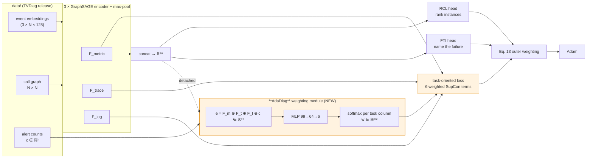
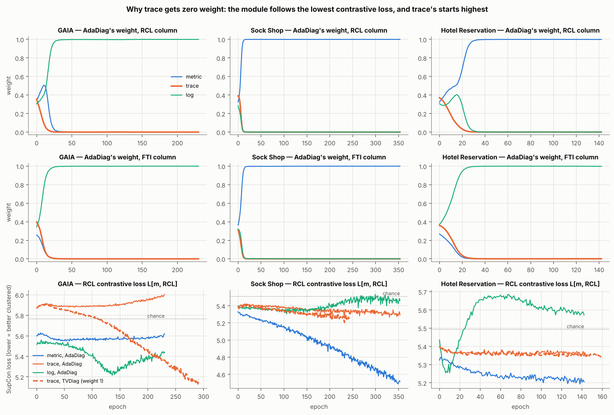
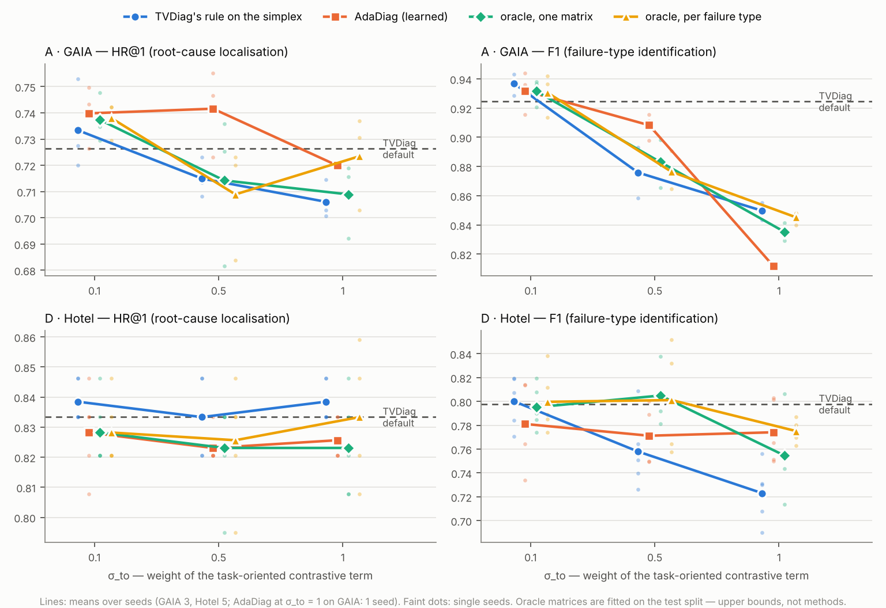
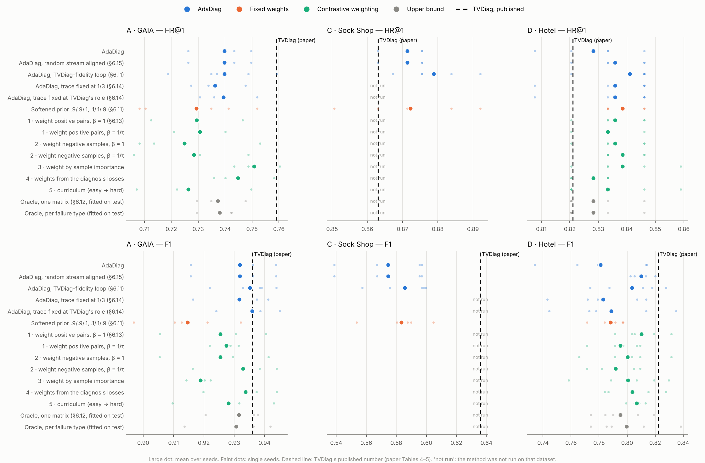
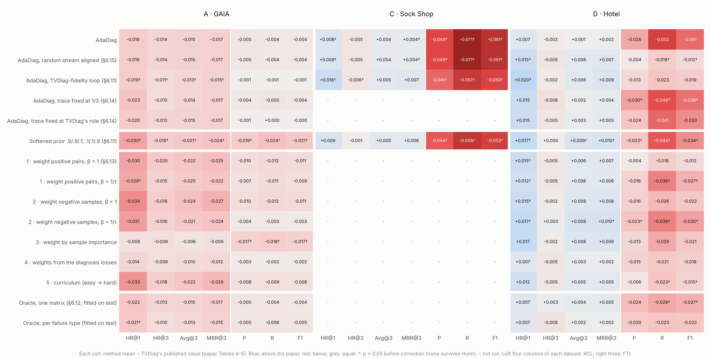
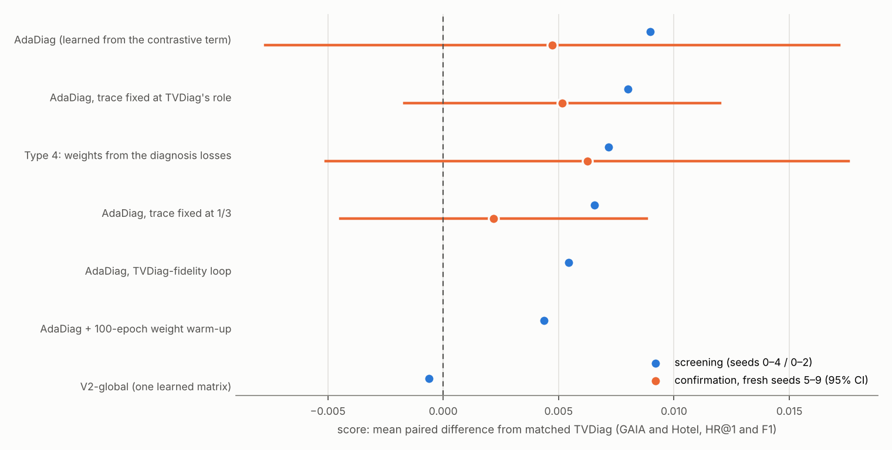
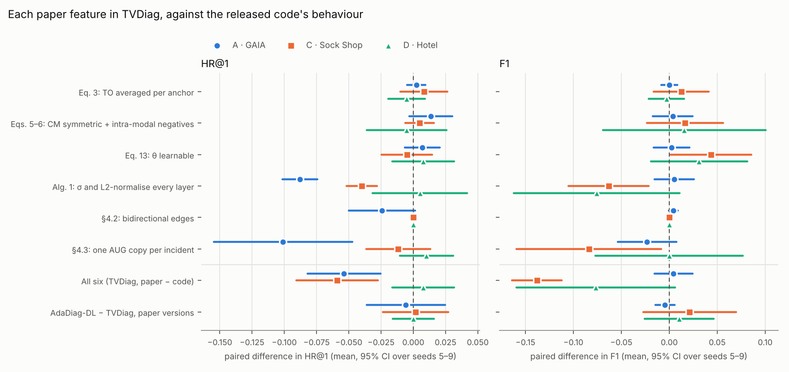
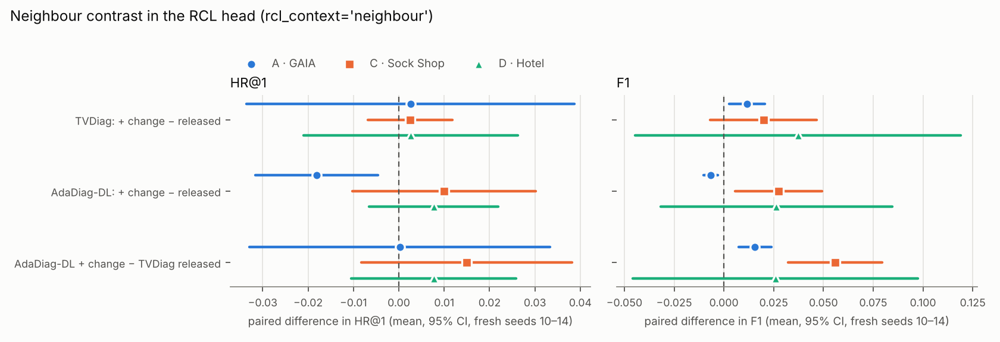

# AdaDiag — Learning who to listen to

[](https://github.com/ShehreyarRashid/AdaDiag/actions/workflows/tests.yml)
[](LICENSE)

**Adaptive modality × task weighting for multimodal microservice failure diagnosis.**

A controlled study of whether the fixed modality→task mapping inside
[TVDiag](https://github.com/WHU-AISE/TVDiag) (ACM TOSEM 35(2), Art. 40, 2026) can be
replaced by one that is *learned per incident* — and a measurement of why, on the public
benchmarks, it cannot.

> **Headline result, stated up front.** AdaDiag is implementable in ~10⁴ parameters with
> zero inference cost, and it **does not improve on TVDiag's hand-written prior** on GAIA or
> Hotel Reservation. There are two reasons, and the second is the stronger one:
>
> 1. **The lever is weak.** The loss term AdaDiag reweights supplies only **1.7 – 12.5 %** of
>    the encoder gradient (§6.4) — 1.7 % on the dataset where the prior is most wrong — so no
>    reallocation inside it can move the end metrics.
> 2. **The lever is also misaimed.** The weighting module receives **exactly zero gradient
>    from both diagnosis losses** — its only learning signal is the auxiliary contrastive
>    term, in which the objective is *linear*, so on a simplex its minimiser is a **vertex**.
>    The graded "who to listen to" the method is built around is not a solution of the
>    objective as written; one-hot collapse is (§6.6). Both claims are asserted in `tests/`.
>    It is why `trace` gets **zero weight in every column on every dataset**: its
>    contrastive loss starts highest (or second-highest), and the module commits within 9–25
>    epochs, before trace is trained — even though trace carries the largest share of RCL's
>    predictions on GAIA (§6.10; audited, not a bug).
> 3. **So the extra capacity goes unused.** Tested directly: the "per-incident" matrix varies
>    by at most **0.0037** across the five failure classes (§6.7). It is, to three decimals,
>    one constant matrix — which is what TVDiag already had.
> 4. **Ablations agree, and locate where the premise does hold** (§6.8, 169 runs, two
>    datasets). Deleting the reweighted term costs nothing. Removing each source shows that
>    RCL's useful source *does* vary by failure class, and FTI's by dataset — TVDiag's
>    `log → FTI` is right on GAIA and wrong on Hotel. AdaDiag captures neither. Its one
>    significant win (+0.080 F1) comes when the term is made strong enough to hurt the
>    fixed prior; it protects against that damage but never beats TVDiag's default.
> 5. **Set beside the paper, the re-implementation holds up and the paper agrees with point 1**
>    (§6.9). TVDiag's published HR@1 is reproduced within 0.03 on all three released
>    datasets, and its modality ablations within 0.05. The paper's own Table 6 and Fig. 16,
>    re-run over three seeds, show the term AdaDiag reweights contributes nothing measurable:
>    removing TO, CM or the dynamic weights changes nothing, and no contrastive loss at all
>    (ω = 0) is as good as the default.
> 6. **A code review found three departures from TVDiag's training loop** — missing
>    self-loops, how the augmented half of a batch is drawn, which epoch is evaluated — and
>    no error in the formulas against TVDiag's code (where that code departs from its own
>    paper is §6.19). Re-running with all three fixed changes no conclusion, and a
>    softened version of TVDiag's rule (.9 / .9 / .1, .1 / .1 / .9) scores the same as every
>    other weighting (§6.11).
> 7. **Even the right weights don't help** (§6.12). An oracle matrix read off the test-set
>    ablations, one per dataset or one per failure type, at three strengths of the term,
>    beats TVDiag's default by at most +0.012, inside seed noise. The term AdaDiag reweights
>    has no headroom on these benchmarks, so a better way of learning its weights is
>    unlikely to pay off.
> 8. **Nor does weighting the term in other ways** (§6.13). Weighting positive pairs,
>    negative samples or incidents by importance, a curriculum, and a matrix learned from the
>    diagnosis losses all score as TVDiag does: 0 of 215 comparisons significant. The last
>    one fixes AdaDiag's mechanism (graded weights, trace no longer zero, Hotel's FTI moved
>    to metric as the oracle suggests), but not its result.
> 9. **Holding trace's weight fixed doesn't help either** (§6.14). With trace kept at 1/3,
>    or at TVDiag's role, and only metric and log learned, AdaDiag scores as before (every
>    difference within ±0.008). The learned part collapses onto metric or log instead.
> 10. **Outside the TO block, TVDiag and AdaDiag are now verified identical** (§6.15). A
>     review found one other difference: AdaDiag's network shifted the random stream, so
>     Hotel's dropout masks differed (worth up to 0.044 F1 with no TO term at all). With the
>     stream aligned, the two arms match bit-for-bit when the TO term is off. AdaDiag on Hotel
>     then moves from −0.017 to +0.012 F1 against TVDiag, still not significant.
> 11. **Against the paper's own numbers, no method beats TVDiag** (§6.16). On all seven
>     published metrics and three datasets, none of 238 comparisons survives correction.
>     Every method shares the same offset from the paper as this repository's TVDiag re-run:
>     below on GAIA, above on RCL but below on FTI on Sock Shop and Hotel.
> 12. **The best AdaDiag, chosen without fooling ourselves** (§6.17). Seven variants were
>     screened against TVDiag under identical settings. A rule and four finalists were fixed in
>     advance and confirmed on fresh seeds. None beats TVDiag (Holm p ≥ 0.42), and they tie
>     with each other. The rule picks **Type 4** on mechanism: it learns its weights from the
>     diagnosis losses, and they stay graded. Post-hoc checks show its GAIA edge is training
>     length and that it costs rare failure types. The trace-fixed variant is the safest set
>     of numbers.
> 13. **The LSTM aggregator the paper describes does not help** (§6.18). It is now
>     implemented, matching dgl's reducer, and given to both arms. TVDiag with it is no better
>     than with mean, the released code's choice. AdaDiag-DL with it partly repairs the F1 that
>     LSTM costs TVDiag on Sock Shop and Hotel. One gain survives correction, Sock Shop F1
>     +0.057, but part of it is training length, and AdaDiag-DL-LSTM is no better than
>     AdaDiag-DL with mean. It trains up to 13× slower, so AdaDiag keeps the mean aggregator.
> 14. **TVDiag as its paper describes it does worse than its released code** (§6.19). Six
>     features the paper specifies and the code omits are now switches. Together they cost
>     HR@1 on GAIA (−0.054) and Sock Shop (−0.059), and F1 on Sock Shop (−0.138) and Hotel
>     (−0.076), and they move the re-run further from the published numbers. Algorithm 1's
>     per-layer normalisation and the single AUG copy cause most of it; only Eq. 13's
>     learnable weights do not hurt. AdaDiag-DL still ties TVDiag under the paper's
>     specification. With Eq. 13 alone switched on, AdaDiag-DL reaches its best F1 (0.941 /
>     0.601 / 0.837), but TVDiag gains nearly as much from it and the two still tie. So
>     AdaDiag keeps the released code's defaults, plus learnable θ for new runs.
> 15. **The paper's last two result tables, re-run** (§6.20). Table 8's inter-task affinity is
>     zero both ways when computed as Eq. 17 defines it. The published FTI → RCL value comes
>     from a bug that re-evaluates the wrong model copy. Table 9: AdaDiag costs nothing at
>     inference, and an epoch takes 1.4–2.7× as long to train.
> 16. **Improving RCL and FTI** (§6.21). Eight changes were screened on development seeds,
>     by a rule fixed in advance. The winner, scoring each instance against its neighbours'
>     mean in the RCL head, was confirmed on fresh seeds. It raises TVDiag's F1 on all
>     three datasets (+0.012 / +0.020 / +0.037) and costs nothing, but leaves HR@1 where it
>     was. With AdaDiag-DL it reaches Sock Shop F1 0.619, against the paper's 0.636 and the
>     released re-run's 0.563, at the cost of GAIA's rare types. RCL appears limited by the
>     released features.
>
> The contribution of this repository is that diagnosis, reproducibly — a negative result
> with a mechanism, rather than an unexplained flat table.

---

## 1. Problem statement

A microservice failure leaves three kinds of trace: **logs** (sentences a program writes),
**metrics** (numbers sampled over time) and **traces** (who called whom, and how long it
took). Two questions must be answered about every incident — *which instance is the root
cause* (RCL) and *what kind of failure is this* (FTI).

TVDiag answers them with a task-oriented contrastive loss that pushes each data source
toward the task it is assumed to serve. **That assumption is hard-coded.** From
`core/TVDiag.py`:

```python
if 'metric' in modalities:
    l_to += supConLoss(fs['metric'], instance_labels)   # metric -> RCL
    # l_to += supConLoss(fs['metric'], type_labels)     # <- the authors' own metric->FTI, switched off
if 'log' in modalities:
    l_to += supConLoss(fs['log'], type_labels)          # log    -> FTI
if 'trace' in modalities:
    l_to += supConLoss(fs['trace'], instance_labels)    # trace  -> RCL
```

Three terms, an `if`/`else` on the data type, summed with equal weight — the same rule for
every system, every failure class and every incident. But the data says the right source
*changes*. On Hotel Reservation, for `container-kill`, `pod-failure` and `pod-kill` (120 of
200 incidents) one single Drain3 log template fires in **40 of 40** incidents of each
class — the logs report *that* a container died, never *which kind* — while a distinct
metric signature separates them. On GAIA `[login failure]`, the reverse holds.

**AdaDiag** replaces the fixed rule with a small module that learns a 3×2 weight matrix,
per incident, trained by the diagnosis losses themselves:

```
l_to = Σ_m Σ_t  w[m, t] · L_supcon(f_m, y_t)        softmax down each task column
```

Everything else is held identical.

### Why the columns are simplex-constrained

An unconstrained positive weight is **unidentifiable**: the outer scale (σ, and the Eq. 13
term) absorbs any uniform rescaling of **w**, so the optimiser can lower the loss by
shrinking every weight instead of reallocating between them. Constraining each task column
to sum to one separates the two degrees of freedom — *σ decides how loud the loss is, **w**
decides who speaks.*

---

## 2. Workflow



The orange path exists **only during training**. The contrastive terms are not on the
forward path that produces predictions, so AdaDiag adds **zero inference cost**.

---

## 3. Methodology → code mapping

| # | Methodology step | File | Key function / class |
|---|---|---|---|
| 1 | Load alerts, graphs, labels, official splits | `src/adadiag/data.py` | `load()`, `Dataset` |
| 2 | Graph augmentation (drop non-root instances) | `src/adadiag/augment.py` | `drop_non_root()` |
| 3 | Per-modality graph encoders + readout (mean aggregator, or the paper's LSTM aggregator, §6.18; the paper's Algorithm 1, `sage_alg1`, §6.19) | `src/adadiag/encoders.py` | `SAGEEncoder`, `lstm_neighbours()`, `max_pool()` |
| 4 | The two diagnosis heads | `src/adadiag/heads.py` | `Locator`, `TypeClassifier` |
| 5 | Losses (per-sample SupCon, CM, Eq. 13; SupCon with pair/anchor weights, §6.13; Eqs. 3, 5–6 as the paper writes them, §6.19) | `src/adadiag/losses.py` | `supcon_per_sample()`, `supcon_weighted()`, `supcon_anchor_mean()`, `uspcon()`, `cm_paper()`, `AutomaticWeightedLoss` |
| **6** | **The contribution: the 3×2 weighting module and all arms** (incl. the softened prior `v0_soft`, §6.11; the oracle `v0_oracle`, §6.12; `v5_align`, §6.13; trace held fixed, `fixed_trace`, §6.14) | **`src/adadiag/weighting.py`** | **`WeightingModule`** |
| 7 | Training loop; the replaced task-oriented block; weights from the diagnosis losses (§6.13) | `src/adadiag/train.py` | `task_oriented_loss()`, `align_weights()`, `train()` |
| 8 | Evaluation (HR@k, MRR@3, F1, per class) | `src/adadiag/evaluate.py` | `evaluate()`, `per_class()` |
| 9 | Gradient-share diagnostic | `src/adadiag/diagnostics.py` | `gradient_shares()` |
| 10 | Identifiability: gradient paths + vertex collapse; why trace gets zero weight (§6.10) | `src/adadiag/identifiability.py` | `measure_gradient_paths()`, `measure_collapse()`, `trace_audit()` |
| 11 | Ablation studies (4 groups, 22 configurations) | `src/adadiag/ablation.py` | `ABLATIONS`, `run_one()`, `gradient_snapshot()` |
| 12 | Comparison with the TVDiag paper (Tables 3–7, Figs. 11, 13–18) | `src/adadiag/paper_compare.py`, `src/adadiag/paper_numbers.py` | `per_class_k()`, `modality_shapley()`, `to_agreement()`, `VARIANTS` |
| — | Hyperparameters, transcribed from TVDiag | `src/adadiag/config.py` | `get()` |
| — | Is everything but the TO block the same? (§6.15) | `scripts/check_controlled.py`, `src/adadiag/model.py` | `isolate_weighting_rng` |
| — | Every method against the TVDiag paper's Tables 4–5 (§6.16) | `scripts/make_paper_vs_methods.py` | `METHODS`, `collect()` |
| — | The paper's Tables 4–5 in its own layout, with AdaDiag rows (§6.16) | `scripts/make_paper_tables.py` | `tex_table()`, `tex_paired()` |
| — | Which AdaDiag is best: screening, pre-registered rule, fresh-seed confirmation (§6.17) | `scripts/select_adadiag.py`, `scripts/make_selection_report.py` | `VARIANTS`, `SELECTION_RULE` |
| — | What the TVDiag paper specifies and its code does not do, as switches (§6.19) | `src/adadiag/config.py`, `scripts/make_paper_features_report.py` | `PAPER`, `to_term()`, `make_batch_union()` |
| — | The paper's Tables 8–9: inter-task affinity (Eq. 17, and as TVDiag computes it) and efficiency (§6.20) | `src/adadiag/affinity.py`, `scripts/run_tables_8_9.py` | `task_affinity()` |
| — | Improving RCL and FTI: eight switches, screened then confirmed on fresh seeds (§6.21) | `scripts/improve.py`, `scripts/make_improve_report.py`, `src/adadiag/model.py`, `src/adadiag/augment.py` | `CANDIDATES`, `RULE`, `rcl_context`, `fti_readout`, `drop_modality()`, `fti_class_weights()` |
| — | Re-run committed experiments, compare to results/ | `scripts/verify_results.py` | `main()` |
| — | Tests (100; 87 need no data, 13 use data/) | `tests/test_supcon_equivalence.py`, `tests/test_weighting_identifiability.py`, `tests/test_ablation_switches.py`, `tests/test_paper_compare.py`, `tests/test_trace_weight.py`, `tests/test_fidelity.py`, `tests/test_oracle.py`, `tests/test_cl_variants.py`, `tests/test_fixed_trace.py`, `tests/test_controlled.py`, `tests/test_lstm_aggregator.py`, `tests/test_paper_features.py`, `tests/test_affinity.py`, `tests/test_improve.py`, `tests/test_data_integrity.py` | `pytest -q` |

Model assembly lives in `src/adadiag/model.py`; the runnable entry points are in `scripts/`.

---

## 4. Dataset

The three datasets TVDiag releases are **included in [`data/`](data/)** (48 MB, 27 files),
copied byte-for-byte from TVDiag's repository at commit `cf6f334` under its MIT licence.
Clone this repository and every script runs with no other download. Provenance, layout and
SHA-256 checksums are in [`data/README.md`](data/README.md); `pytest` verifies the
checksums. The extracted alerts and the pre-computed 128-d event embeddings are included,
so Drain3 and fastText do **not** need to be re-run.

TVDiag's own description of the datasets, quoted verbatim from its README ("we" and "us"
are the TVDiag authors, who deployed the systems and hold the raw data):

> We conducted experiments on two datasets:
>
> - [GAIA](https://github.com/CloudWise-OpenSource/GAIA-DataSet). GAIA dataset records
>   metrics, traces, and logs of the MicroSS simulation system in July 2021, which consists
>   of ten microservices and some middleware such as Redis, MySQL, and Zookeeper. The
>   extracted events of GAIA can be accessible on [DiagFusion](https://arxiv.org/abs/2302.10512).
> - [AIOps-22](https://competition.aiops-challenge.com). The AIOps-22 dataset is derived from
>   the training data released by the AIOps 2022 Challenge, where failures at three levels
>   (node, service, and instance) were injected into a Web-based e-commerce platform
>   [Online-boutique](https://github.com/GoogleCloudPlatform/microservices-demo).
> - Sockshop and HotelReservation. We deployed two well-known microservice-based systems:
>   [Sockshop](https://github.com/microservices-demo/microservices-demo) and
>   [HotelReservation](https://github.com/delimitrou/DeathStarBench/tree/master/hotelReservation)
>   in a Kubernetes cluster. We induced diverse application failures using Chaos Mesh and
>   gathered system telemetry data for testing. Due to storage constraints, we only provide
>   extracted alert datasets. You may contact us via email to request the raw data of two
>   systems.

DiagFusion is published as Zhang et al., *IEEE Transactions on Services Computing* 16(6),
3851–3864, 2023, [doi:10.1109/TSC.2023.3290018](https://doi.org/10.1109/TSC.2023.3290018).

| dataset | in `data/` | incidents | instances | types | train / test | used in this repo |
|---|---|---|---|---|---|---|
| **GAIA** (MicroSS) | `data/gaia/` | 1099 | 10 | 5 | 160 / 939 | sweeps, diagnostics, ablations A/B/D |
| **Hotel Reservation** | `data/hotel/` | 200 | 18 | 5 | 122 / 78 | sweeps, diagnostics, per-class, all ablations |
| **Sock Shop** | `data/sockshop/` | 489 | 21 | 7 | 248 / 241 | loader supported and asserted; not run |
| **AIOps-22** | **not included** | — | — | 9 | — | not distributed by TVDiag (see below) |

Per dataset the loader reads `data/<ds>/tmp/{metric,trace,log}.pkl` (embeddings),
`data/<ds>/raw/{nodes,edges}.json` (topology), `data/<ds>/raw/{metrics,traces,logs}.json`
(alerts, used for **c**) and `data/<ds>/label.csv` (ground truth + split).

> **AIOps-22 is configured in TVDiag but its data is not distributed.** To add it you must
> obtain the AIOps 2022 Challenge data and re-run TVDiag's `extractor/` (3σ for metrics,
> isolation forest over 30 s windows for traces, Drain3 for logs) followed by
> [DiagFusion](https://github.com/AIOps-Lab-NKU/DiagFusion)'s fastText event embedding.
> `config.py` already carries its hyperparameters (`ft_num=9`, `patience=20`).

> **Sock Shop quirk:** its `label.csv` has an unnamed leading index column, and a few rows
> name an instance absent from that incident's node list. `data.py` handles both.

---

## 5. Setup and run

```bash
git clone https://github.com/ShehreyarRashid/AdaDiag.git && cd AdaDiag
pip install -r requirements.txt            # or: conda env create -f environment.yml

pytest -q                                  # 100 tests, incl. checksums of data/; run first

# the five-arm, five-seed sweep (2 CPU cores, no GPU: ~16 min Hotel, ~34 min GAIA)
python scripts/run_sweep.py       --dataset gaia
python scripts/run_sweep.py       --dataset hotel

# per-failure-class breakdown and the learned weight matrix per class
python scripts/run_perclass.py    --dataset hotel

# why the learned arms cannot work as specified (§6.6) -- takes seconds for part 1
python scripts/run_identifiability.py --dataset hotel

# ablation studies (§6.8): list them, run them, render the tables
python scripts/run_ablation.py --list
python scripts/run_ablation.py --dataset hotel --seeds 5
python scripts/make_ablation_report.py results/ablation_hotel*.json

# why a null is a null: the gradient-share measurement
python scripts/run_diagnostics.py --dataset hotel

# render the tables below
python scripts/make_report.py results/hotel.json --dataset hotel

# the softened prior and the TVDiag-fidelity fixes (§6.11): ~80 min on 2 cores
bash scripts/fidelity_runs.sh soft && (bash scripts/fidelity_runs.sh fid0 & bash scripts/fidelity_runs.sh fid1; wait)
python scripts/make_fidelity_report.py

# why AdaDiag gives trace zero weight (§6.10): ~50 min, then the figure and tables
python scripts/run_trace_audit.py --threads 2 && python scripts/make_trace_report.py

# the comparison with the TVDiag paper (§6.9): every run, in lanes, then the report
bash scripts/paper_comparison_runs.sh main          # and sweep0..5, ada, gaia_abl, ...
python scripts/make_paper_comparison.py

# the oracle headroom check (§6.12): ~50 min per dataset, 1 thread each
python scripts/make_oracle_weights.py               # needs the §6.8 ablation records
python scripts/run_oracle.py --dataset hotel --seeds 5 --check-prior
python scripts/run_oracle.py --dataset gaia  --seeds 3
python scripts/make_oracle_report.py

# five ways to weight the contrastive term (§6.13): ~1 h Hotel, ~1.5 h GAIA
python scripts/run_cl_variants.py --dataset hotel --seeds 5 --check
python scripts/run_cl_variants.py --dataset gaia  --seeds 3 --check
python scripts/make_cl_report.py

# AdaDiag with trace held fixed (§6.14): ~15 min per dataset
python scripts/run_cl_variants.py --dataset hotel --seeds 5 --variants trace_third,trace_tvdiag \
    --check-adadiag --out results/trace_fixed/runs_hotel_a.json
python scripts/run_cl_variants.py --dataset gaia --seeds 3 --variants trace_third,trace_tvdiag \
    --check-adadiag --out results/trace_fixed/runs_gaia.json
python scripts/make_trace_fixed_report.py

# is everything but the TO block the same? (§6.15): ~25 min
python scripts/check_controlled.py --part null   --dataset hotel     # and --dataset gaia
python scripts/check_controlled.py --part rng    --dataset hotel --seeds 5
python scripts/check_controlled.py --part length --dataset hotel --seeds 5 --epochs-from rng
python scripts/check_controlled.py --part length --dataset gaia  --seeds 3
python scripts/make_controlled_report.py

# every method against the TVDiag paper only (§6.16): seconds, no training
python scripts/make_paper_vs_methods.py

# which AdaDiag is best (§6.17): screening ~25 min, confirmation ~1.5 h on 2 cores
python scripts/select_adadiag.py --stage screen  --dataset hotel     # and --dataset gaia
python scripts/select_adadiag.py --stage confirm --dataset gaia  --variants tvdiag,adadiag,align,trace_tvdiag,trace_third
python scripts/select_adadiag.py --stage confirm --dataset hotel --variants tvdiag,adadiag,align,trace_tvdiag,trace_third
python scripts/select_adadiag.py --stage length  --dataset gaia  --variants align,adadiag,trace_tvdiag,trace_third
python scripts/make_selection_report.py

# the paper's Tables 4-5 in its own layout, with AdaDiag rows (needs the confirmation runs,
# plus Sock Shop: --stage confirm --dataset sockshop --variants tvdiag,adadiag,align)
python scripts/make_paper_tables.py                # writes results/paper_tables/tables.pdf

# the LSTM aggregator (§6.18): 3-13x slower than mean; ~6 h for all three datasets on 2 cores
python scripts/select_adadiag.py --stage confirm --dataset gaia --variants tvdiag_lstm,align_lstm
python scripts/select_adadiag.py --stage length  --dataset gaia --variants align_lstm
python scripts/make_lstm_report.py                 # and --dataset sockshop / hotel above

# what the TVDiag paper specifies and its code does not do (§6.19): ~3 h on 2 cores
python scripts/select_adadiag.py --stage confirm --dataset gaia --variants tvdiag_paper,align_paper
python scripts/select_adadiag.py --stage confirm --dataset gaia \
    --variants tvdiag+to_norm,tvdiag+cm_mode,tvdiag+awl_learnable,tvdiag+sage_alg1,tvdiag+bidirectional,tvdiag+aug_mode
python scripts/select_adadiag.py --stage length  --dataset gaia --variants align_paper
python scripts/select_adadiag.py --stage confirm --dataset gaia --variants tvdiag_noes,align+awl_learnable
python scripts/select_adadiag.py --stage length  --dataset gaia --variants align+awl_learnable
python scripts/make_paper_features_report.py       # and --dataset sockshop / hotel above

# the paper's Tables 8-9 (§6.20): affinity takes one epoch per seed; ~5 min in all
python scripts/run_tables_8_9.py

# improving RCL and FTI (§6.21): screen ~1.5 h, confirmation ~1.5 h on 2 cores
python scripts/improve.py --stage screen  --dataset gaia        # and sockshop, hotel
python scripts/improve.py --stage combine                       # writes PLAN.md: rule + decision
python scripts/improve.py --stage screen  --dataset gaia --variants combination
python scripts/improve.py --stage confirm --dataset gaia        # fresh seeds 10-14
python scripts/make_improve_report.py
```

**CPU only. No GPU, no CUDA, and no DGL.** The incident graphs have 10–21 nodes, so the
GraphSAGE layers use dense batched matmuls — which removes the single hardest
version-pinning problem in reproducing TVDiag.

### Reproducing the committed results

Every table in §6 is rendered from `results/*.json` by `scripts/make_report.py`, and every
JSON can be regenerated from the code and `data/`. To check that claim yourself:

```bash
python scripts/verify_results.py --threads 2          # Hotel, every arm, seed 0, ~4 min
python scripts/verify_results.py --dataset gaia --arms v0_simplex v3_incident --threads 2
```

Each run is retrained from scratch and printed next to the committed number. On the
environment in [`results/ENVIRONMENT.md`](results/ENVIRONMENT.md) (2 CPU threads, PyTorch
2.15; exact pins in `requirements-lock.txt`) the match is **bit-for-bit**. Verified on a
clean copy of this repository: all six Hotel arms and GAIA's prior and AdaDiag (seed 0;
every metric and epoch count identical), both Hotel gradient-share measurements
(`hotel_gradshare.json`) and the full per-class table (`hotel_perclass.json`). On other hardware,
PyTorch versions or thread counts the floating-point summation order differs, single seeds
drift by a few points, and the five-seed means and paired tests are what should agree.
New result records carry an `env` field (PyTorch version, thread count) for this reason.

---

## 6. Results

### 6.1 Fidelity — does the re-implementation reproduce TVDiag?

| dataset | metric | TVDiag (reported) | V0-raw (here, 5 seeds) | gap |
|---|---|---|---|---|
| GAIA | HR@1 | 0.759 | 0.731 ± 0.021 | −0.028 |
| GAIA | F1 | 0.936 | 0.918 ± 0.013 | −0.018 |
| Hotel | HR@1 | 0.821 | **0.836 ± 0.011** | +0.015 |
| Hotel | F1 | 0.822 | 0.796 ± 0.019 | −0.026 |
| Sock Shop | HR@1 | 0.863 | **0.868 ± 0.012** | +0.005 |
| Sock Shop | F1 | 0.636 | 0.572 ± 0.014 | −0.064 |

HR@1 within 3 points on all three datasets, from a clean-room dense re-implementation;
F1 2–6 points lower. Close enough for arm-to-arm comparison. Every other table and figure of
the paper's evaluation is set beside this re-implementation in §6.9.

### 6.2 The five arms — GAIA (5 seeds, identical splits and seeds)

| arm | HR@1 | HR@3 | MRR@3 | F1 | macro-F1 |
|---|---|---|---|---|---|
| V0-raw (TVDiag as shipped) | 0.731 ± 0.021 | 0.892 ± 0.011 | 0.804 ± 0.015 | 0.918 ± 0.013 | 0.571 ± 0.005 |
| V0-simplex (prior) | 0.744 ± 0.010 | 0.897 ± 0.009 | 0.814 ± 0.008 | 0.932 ± 0.009 | 0.573 ± 0.006 |
| V1-uniform (⅓ each) | 0.746 ± 0.020 | 0.900 ± 0.007 | 0.815 ± 0.012 | 0.930 ± 0.011 | 0.558 ± 0.019 |
| V2-global (learned matrix) | 0.733 ± 0.024 | 0.896 ± 0.013 | 0.807 ± 0.017 | 0.922 ± 0.015 | 0.561 ± 0.020 |
| V3-incident (**AdaDiag**) | 0.747 ± 0.013 | 0.896 ± 0.007 | 0.814 ± 0.008 | 0.935 ± 0.012 | 0.576 ± 0.024 |

Paired t-tests against V0-simplex, same seeds:

| arm | Δ HR@1 | Δ MRR@3 | Δ macro-F1 |
|---|---|---|---|
| V0-raw | −0.013 (p=0.13) | −0.010 (p=0.11) | −0.001 (p=0.55) |
| V1-uniform | +0.002 (p=0.84) | +0.002 (p=0.82) | −0.015 (p=0.10) |
| V2-global | −0.011 (p=0.39) | −0.007 (p=0.44) | −0.012 (p=0.17) |
| V3-incident (**AdaDiag**) | **+0.003 (p=0.59)** | +0.001 (p=0.84) | +0.004 (p=0.74) |

V3 vs V0-simplex: **+0.003 HR@1, p = 0.59**. Nothing is significant at any threshold.

### 6.3 The five arms — Hotel Reservation, where the prior should fail

| arm | HR@1 | HR@3 | MRR@3 | F1 | macro-F1 |
|---|---|---|---|---|---|
| V0-raw (TVDiag as shipped) | **0.836 ± 0.011** | 0.921 ± 0.011 | **0.874 ± 0.010** | 0.796 ± 0.019 | 0.782 ± 0.027 |
| V0-simplex (prior) | 0.833 ± 0.013 | 0.918 ± 0.007 | 0.871 ± 0.008 | **0.804 ± 0.015** | **0.791 ± 0.022** |
| V1-uniform (⅓ each) | **0.836 ± 0.011** | 0.921 ± 0.017 | **0.874 ± 0.011** | 0.793 ± 0.021 | 0.784 ± 0.026 |
| V2-global (learned matrix) | 0.833 ± 0.009 | 0.923 ± 0.009 | 0.872 ± 0.007 | 0.791 ± 0.028 | 0.782 ± 0.033 |
| V3-incident (**AdaDiag**) | 0.828 ± 0.015 | 0.923 ± 0.009 | 0.869 ± 0.012 | 0.781 ± 0.032 | 0.766 ± 0.042 |
| V4-fusion (exploratory) | 0.808 ± 0.027 | — | 0.843 ± 0.025 | 0.760 ± 0.044 | 0.742 ± 0.055 |

Paired t-tests against V0-simplex, same seeds:

| arm | Δ HR@1 | Δ MRR@3 | Δ macro-F1 |
|---|---|---|---|
| V0-raw | +0.003 (p=0.37) | +0.003 (p=0.18) | −0.009 (p=0.53) |
| V1-uniform | +0.003 (p=0.37) | +0.003 (p=0.44) | −0.008 (p=0.39) |
| V2-global | +0.000 (p=1.00) | +0.001 (p=0.73) | −0.010 (p=0.49) |
| V3-incident (**AdaDiag**) | **−0.005 (p=0.48)** | −0.002 (p=0.69) | −0.026 (p=0.18) |

V3 vs V0-simplex: **−0.005 HR@1, p = 0.48** — directionally *worse*, and the weakest arm of
the five on HR@1, MRR@3, F1 and macro-F1 alike. Nothing is significant, so the correct
reading is "no effect", not "a loss". But this is the dataset chosen because TVDiag's mapping
should be most wrong here, and **the prediction is falsified**: the adaptive arm does not
beat the hand-written prior, and no arm separates from any other.

*Correction (§6.15):* part of V3's weakness on Hotel is not the method. Building its network
shifted the random stream, so its dropout masks differed from the other arms' for the same
seed. With the stream aligned, AdaDiag − V0-simplex on Hotel is −0.003 HR@1 / +0.010 F1,
still not significant. GAIA has no dropout and is unaffected.

### 6.4 Why the result is a null, and how we know

The weights move a long way with no effect on accuracy — on GAIA, V3 converges to ~0.98/1.00
on logs, close to the *opposite* of the prior, and scores the same. Weights that free mean
the objective is **under-determined in w**. There are two independent reasons; this section
covers the first (the term is too weak to matter) and §6.6 the second and sharper one (the
module gets no task gradient at all, and its objective is minimised at a corner).

The gradient-share diagnostic shows the first:

| term | GAIA V0-simplex | GAIA V3 | Hotel V0-simplex | Hotel V3 |
|---|---|---|---|---|
| `l_rcl` | 57.1 % | 56.1 % | 44.0 % | 44.1 % |
| `l_fti` | 23.0 % | 23.7 % | 51.1 % | 49.0 % |
| **`σ · l_to`** (what AdaDiag reweights) | **11.6 %** | **12.5 %** | **1.7 %** | **3.6 %** |
| `σ · l_cm` | 8.3 % | 7.7 % | 3.2 % | 3.4 % |

Measured for the prior *and* for AdaDiag, so this is not an artefact of one arm. On the
dataset where the mapping is *most* wrong, the term AdaDiag reweights is the *weakest*
contributor — 1.7 % against the two diagnosis losses' 95 %. Learning the weights raises its
share slightly (1.7 → 3.6 %) but nowhere near enough to matter. With σ = 0.1 fixed by
TVDiag's config, that ceiling is structural.

### 6.5 Why V4 exists, and why it also fails

If `l_rcl + l_fti` carry 80–95 % of the gradient, the obvious correction is to move the
weights onto *that* path. `v4_fusion` applies the identical per-incident 3×2 matrix to the
fused representation feeding the two heads, leaving TVDiag's task-oriented loss intact. It
is **worse on every metric** (−0.026 HR@1, −0.028 MRR@3, −0.044 F1, −0.049 macro-F1 against
V0-simplex) and inflates the seed variance by **2.1–3.0×**. A plausible
but untested reading: a per-incident multiplicative gate is a nuisance the heads must undo,
and 122 training incidents are not enough to absorb it.

### 6.6 The deeper problem: the simplex fixes the wrong degree of freedom

§6.4 says the lever is weak. This section says it also points the wrong way, and this is the
part that generalises beyond TVDiag — it would apply to any method that learns modality
weights on an *auxiliary* loss.

**(1) No diagnosis gradient reaches the weighting module.** `w` is used in exactly one place,
the task-oriented contrastive term. It is deliberately *not* on the forward path that
produces node or type logits — that is what makes AdaDiag free at inference time. The
consequence is that

```
∂l_rcl / ∂θ_w  =  0        ∂l_fti / ∂θ_w  =  0        exactly, not approximately
```

Measured, on Hotel, `v3_incident`:

| term | total ‖grad‖ at the weighting parameters |
|---|---|
| `l_rcl` | **0.000000e+00** |
| `l_fti` | **0.000000e+00** |
| `σ · l_to` | 9.477373e+00 |

The module's entire learning signal is an auxiliary loss. Nothing in the objective tells it
what *diagnosis accuracy* prefers.

**(2) `l_to` is linear in `w`, so the minimiser is a vertex.** With
`l_to = Σ_m Σ_t w[m,t] · L_{m,t}` and each task column on the simplex, the objective is a
linear function on a simplex — minimised at a **corner**. Smooth graded allocations are not
minimisers; they are points the optimiser passes through on the way to a corner. Observed on
every GAIA seed:

| seed | `v3_incident` RCL | `v3_incident` FTI | HR@1 | | `v2_global` RCL | `v2_global` FTI |
|---|---|---|---|---|---|---|
| 0 | log **0.999** | log **1.000** | 0.743 | | log 0.366 | log 0.375 |
| 1 | log **0.988** | log **1.000** | 0.729 | | log 0.463 | log 0.595 |
| 2 | log **0.979** | log **1.000** | 0.753 | | log 0.407 | log 0.491 |
| 3 | log **0.989** | log **0.992** | 0.764 | | log 0.426 | log 0.546 |
| 4 | log **0.986** | log **1.000** | 0.745 | | log 0.458 | log 0.610 |

Mean largest column weight: **0.993** for `v3_incident` (1.0 = fully collapsed, ⅓ = uniform),
0.524 for `v2_global`. Every one of GAIA's ten columns is above 0.979.

Hotel shows the same pull with one honest wrinkle. Its RCL column collapses onto `metric` on
**all five seeds** (0.957–1.000), and its FTI column prefers `log` on all five — but reaches
a corner on only two of them (0.997, 0.997) and stalls near 0.55 on the other three. Mean
largest weight 0.861. So the *direction* is unanimous across seeds and datasets; the *degree*
of collapse is not. The vertex is where the objective pulls, not somewhere every run arrives.

The chosen corner is also seed- and dataset-dependent in a way task utility is not: GAIA
picks `log` for RCL (contradicting TVDiag's prior, which gives `log` weight zero there),
while Hotel picks `metric` for RCL (agreeing with the prior in direction, but discarding
`trace` entirely). Two datasets, two opposite answers to "who should RCL listen to", and no
accuracy difference from either.

`v3_incident` collapses onto a single modality for both tasks on **every seed** — including
**RCL, the task TVDiag assigns `log` a weight of exactly zero** — and scores the same as the
prior anyway. `v2_global`, which has one matrix for the whole dataset and no per-incident
capacity, drifts in the same direction but cannot reach a corner. That contrast is itself
evidence for the mechanism: the arm with more capacity to reach a vertex reaches one.

**(3) So the simplex solved the wrong problem.** It was introduced to make `w` identifiable
against the outer scale σ (§1, "Why the columns are simplex-constrained"), and it does that
correctly. But identifiability is not *alignment*. By (1) no task gradient reaches the
module, so the corner it picks is selected by the auxiliary loss landscape, not by
usefulness. Per-incident conditioning therefore does not buy a graded "who to listen to" —
it buys a per-incident choice of **one modality per task**, which is the same *kind* of rule
as TVDiag's hard-coded mapping, just chosen by convenience rather than by domain knowledge.

**What is and is not claimed.** (1) is exact and (2) is universal across our seeds; both are
asserted in `tests/test_weighting_identifiability.py`. Which corner wins is decided **early**:
§6.10 traces every column to the modality whose contrastive loss is lowest during the first
9–25 epochs, which is why `trace` — highest from the first step on every dataset — always
loses. Measured only after training, the argmin can differ (an encoder keeps learning for the
term it was given and stops for the ones it lost), which is why an end-of-training check
matched on RCL but not on FTI.

**What a real fix would require.** Any correction has to get task gradient into the module
*without* putting `w` on the prediction path — `v4_fusion` does the latter and is worse
(§6.5). Three candidates, none tested here because each changes TVDiag's objective and so
breaks the controlled comparison:

- a **bi-level / hypergradient** step, updating `w` against held-out *task* loss rather than
  against `l_to`;
- an **entropy or temperature penalty** on the columns — this would prevent collapse, but by
  overriding the objective rather than repairing it;
- **raising σ** so `l_to` has enough influence for its allocation to matter at all; §6.4
  puts it at 11.6 % (GAIA) and 1.7 % (Hotel), so there is very little to reallocate.

This is the honest next step, not a result claimed here.

### 6.7 The premise, tested directly

Everything above is about aggregate metrics. But the premise of this work is narrower and
sharper: *the useful source varies by failure class, so condition the weights on the
incident.* An aggregate table can neither confirm nor refute that. This one can
(`scripts/run_perclass.py`, Hotel, `v3_incident`):

| failure class | RCL: metric / trace / log | FTI: metric / trace / log |
|---|---|---|
| container-kill | 1.000 / 0.000 / 0.000 | 0.000 / 0.000 / 1.000 |
| network-delay | 0.999 / 0.000 / 0.001 | 0.002 / 0.002 / 0.996 |
| network-loss | 1.000 / 0.000 / 0.000 | 0.000 / 0.000 / 0.999 |
| pod-failure | 1.000 / 0.000 / 0.000 | 0.000 / 0.000 / 1.000 |
| pod-kill | 1.000 / 0.000 / 0.000 | 0.000 / 0.000 / 1.000 |

**Maximum spread across the five classes: 0.0037.** The per-incident matrix is, to three
decimal places, the *same matrix* for every failure class. Per-incident conditioning — the
MLP, the 99-d descriptor, the ~10⁴ parameters — buys an allocation indistinguishable from a
single global constant that happens to sit at a vertex.

And there was room to do better. The same run shows where the headroom is:

| failure class | n | RCL HR@1 | FTI recall |
|---|---|---|---|
| container-kill | 22 | 1.000 | **0.500** |
| network-delay | 14 | **0.357** | 0.857 |
| network-loss | 13 | 0.769 | 1.000 |
| pod-failure | 15 | 1.000 | 0.800 |
| pod-kill | 14 | 1.000 | 0.786 |

Three of five classes are already at HR@1 = 1.000, so almost all the available gain sits in
`network-delay` (0.357) and in `container-kill`'s type recall (0.500) — exactly the kind of
class-specific weakness adaptive weighting was supposed to address. It did not move either.

As a control, `v2_global` produces a spread of exactly 0.0000, as it must — one matrix for
the whole dataset. That the two arms are nearly indistinguishable on this table is the
clearest single statement of the result: **AdaDiag's extra capacity is not being used.**

### 6.8 Ablation studies

Each group tests a claim made above, rather than ablating for its own sake
(`src/adadiag/ablation.py`, `scripts/run_ablation.py`):

| group | what is changed | applied to | claim it tests |
|---|---|---|---|
| **A** TVDiag's components | w/o AUG · w/o TO · w/o CM · w/o TO and CM | prior (V0-simplex) | §6.4 — if removing TO entirely barely moves the metrics, no reweighting of it can |
| **B** Modalities | drop one source · keep one source; per failure class | prior (V0-simplex) | the premise — which source each task and class actually depends on |
| **C** AdaDiag's design | no simplex (softplus) · no detach · descriptor = embeddings only / counts only · entropy penalty λ ∈ {0.01, 0.1} | AdaDiag (V3) | §1 (simplex for identifiability) and §6.6 (does stopping the collapse change accuracy?) |
| **D** Strength of l_to | σ_to ∈ {0.5, 1, 2}, CM kept at 0.1 | prior and AdaDiag | §8 — do the arms separate once l_to carries real weight? |

Protocol: TVDiag's hyperparameters throughout; every configuration shares seeds with its
reference (same arm, all switches off), so every Δ is a paired difference. Every run also
records per-class metrics, the share of the encoder gradient per loss term on the trained
model, and the learned weight matrix. Hotel runs all four groups with 5 seeds; GAIA runs
A, B and D with 3 seeds.

Three caveats. Early stopping is TVDiag's rule (on training loss), so removing a loss term
also moves where training stops — as in TVDiag's own ablation. Removing a modality in
group B also removes its contrastive terms, and the prior renormalises over what remains
(without `log`, FTI's term moves to metric + trace), so B measures the source as a whole,
not only its input to the heads. And ablations run one
process per CPU core; thread count changes floating-point reduction order, so the
references here differ from §6.2/6.3 in the last decimals. Comparisons are only ever made
within the ablation runs.

Every switch defaults to the method: with all of them off, four arms reproduce the
pre-ablation code bit-for-bit (metrics, learned weights and parameter sums; 12-epoch
check on Hotel, seed 0), and
`tests/test_ablation_switches.py` checks the switches themselves without data.

#### Results — Hotel Reservation

Every table below is printed by `scripts/make_ablation_report.py` from
`results/ablation_*.json`; the full tables (MRR@3, standard deviations, raw and adjusted
p-values, learned weights) are in [`results/ABLATIONS.md`](results/ABLATIONS.md).

**hotel** — 5 seeds. Δ vs reference, (Holm-adjusted p); **bold** = significant.

| group | configuration | HR@1 | F1 | Δ HR@1 | Δ F1 | Δ macro-F1 | σ·l_to share |
|---|---|---|---|---|---|---|---|
| ref | *TVDiag prior (V0-simplex), full model* | 0.838 | 0.800 | — | — | — | 4.6 % |
| ref | *AdaDiag (V3-incident), full model* | 0.828 | 0.781 | — | — | — | 9.4 % |
| A | w/o AUG | 0.821 | 0.770 | -0.018 (0.37) | -0.030 (1.00) | -0.018 (1.00) | 4.6 % |
| A | w/o TO (the term AdaDiag reweights) | 0.833 | 0.808 | -0.005 (1.00) | +0.008 (1.00) | +0.010 (1.00) | 0.0 % |
| A | w/o CM | 0.831 | 0.806 | -0.008 (0.92) | +0.006 (1.00) | +0.006 (1.00) | 4.8 % |
| A | w/o TO and CM (diagnosis losses + AUG only) | 0.833 | 0.809 | -0.005 (1.00) | +0.009 (1.00) | +0.008 (1.00) | 0.0 % |
| B | w/o metric | 0.767 | 0.445 | **-0.072** (0.014) | **-0.355** (0.000) | **-0.332** (0.000) | 2.1 % |
| B | w/o trace | 0.800 | 0.792 | -0.038 (0.24) | -0.008 (1.00) | -0.004 (1.00) | 6.5 % |
| B | w/o log | 0.800 | 0.703 | -0.038 (0.37) | -0.097 (1.00) | -0.089 (1.00) | 4.7 % |
| B | metric only | 0.785 | 0.745 | **-0.054** (0.007) | **-0.055** (0.002) | -0.044 (0.10) | 7.0 % |
| B | trace only | 0.254 | 0.346 | **-0.585** (0.000) | **-0.455** (0.000) | **-0.413** (0.001) | 3.9 % |
| B | log only | 0.705 | 0.349 | **-0.133** (0.000) | **-0.451** (0.001) | **-0.456** (0.001) | 21.9 % |
| C | no simplex (unconstrained positive weights) | 0.836 | 0.798 | +0.008 (0.92) | **+0.016** (0.016) | **+0.019** (0.026) | 0.0 % |
| C | descriptor not detached | 0.831 | 0.782 | +0.003 (1.00) | +0.001 (1.00) | +0.002 (1.00) | 9.4 % |
| C | descriptor: embeddings only | 0.831 | 0.782 | +0.003 (1.00) | +0.001 (1.00) | +0.002 (1.00) | 9.6 % |
| C | descriptor: alert counts only | 0.836 | 0.785 | +0.008 (0.92) | +0.004 (1.00) | +0.005 (1.00) | 8.1 % |
| C | + entropy penalty, lambda=0.01 | 0.836 | 0.793 | +0.008 (0.92) | +0.012 (1.00) | +0.013 (1.00) | 6.9 % |
| C | + entropy penalty, lambda=0.1 | 0.836 | 0.787 | +0.008 (0.92) | +0.006 (1.00) | +0.010 (1.00) | 4.3 % |
| D | prior, sigma_to=0.5 | 0.833 | 0.758 | -0.005 (1.00) | -0.042 (0.82) | -0.053 (0.80) | 34.1 % |
| D | prior, sigma_to=1 | 0.838 | 0.723 | +0.000 (1.00) | -0.077 (0.075) | **-0.088** (0.040) | 38.1 % |
| D | prior, sigma_to=2 | 0.810 | 0.697 | -0.028 (0.33) | **-0.104** (0.011) | **-0.121** (0.007) | 50.2 % |
| D | AdaDiag, sigma_to=0.5 | 0.823 | 0.771 | -0.005 (1.00) | -0.010 (1.00) | -0.004 (1.00) | 44.9 % |
| D | AdaDiag, sigma_to=1 | 0.826 | 0.774 | -0.003 (1.00) | -0.007 (1.00) | +0.001 (1.00) | 54.7 % |
| D | AdaDiag, sigma_to=2 | 0.800 | 0.776 | -0.028 (0.72) | -0.005 (1.00) | +0.004 (1.00) | 75.0 % |

**A — the term AdaDiag reweights can be deleted at no cost.** No TVDiag component is
significant after correction. Removing the task-oriented term entirely changes HR@1 by
−0.005 and F1 by +0.008 — an independent confirmation of §6.4: if deleting `l_to` does not
matter, no reweighting of it can. AUG is the largest effect (−0.018 HR@1), in line with
TVDiag's own ablation, but it does not survive correction on 5 seeds.

**B — which source each task actually depends on.** `metric` is indispensable (without it
F1 falls by 0.355), and no single source is enough on its own. Per failure class:

RCL HR@1:

| failure class | n | full model | w/o metric | w/o trace | w/o log |
|---|---|---|---|---|---|
| container-kill | 22 | 1.000 | +0.000 | +0.000 | **-0.055** |
| network-delay | 14 | 0.343 | **-0.243** | -0.043 | -0.029 |
| network-loss | 13 | 0.738 | -0.154 | **-0.169** | -0.108 |
| pod-failure | 15 | 1.000 | -0.013 | -0.013 | +0.000 |
| pod-kill | 14 | 1.000 | +0.000 | +0.000 | +0.000 |

FTI recall:

| failure class | n | full model | w/o metric | w/o trace | w/o log |
|---|---|---|---|---|---|
| container-kill | 22 | 0.573 | **-0.473** | +0.109 | -0.064 |
| network-delay | 14 | 0.900 | **-0.186** | -0.029 | +0.029 |
| network-loss | 13 | 0.969 | **-0.277** | -0.108 | -0.031 |
| pod-failure | 15 | 0.827 | **-0.533** | -0.013 | -0.280 |
| pod-kill | 14 | 0.757 | **-0.100** | -0.029 | -0.071 |

For **RCL the useful source varies by class** — `log` for container-kill, `metric` for
network-delay, `trace` for network-loss (pod-failure and pod-kill are at ceiling with any
source). For **FTI it does not**: every class depends on `metric` most. TVDiag's prior
routes FTI's contrastive term to `log` alone — the source FTI depends on least here
(Hotel's logs are 95 % empty: only 5.1 % of instance embeddings are non-zero). The
`log only` row's zero variance has the same cause: in 56 of 78 test incidents the culprit
is the instance that logged an alert, and every seed learns exactly that rule (55/78).

**C — AdaDiag's own design.** Three results, all consistent with §1 and §6.6:

- *Without the simplex the optimiser switches the term off.* Unconstrained weights shrink
  to 0.000 in both columns, exactly as the identifiability argument in §1 predicts — and
  F1 rises by 0.016 (significant). AdaDiag improves by silencing its own lever, which is
  group A's finding seen from the other side.
- *The descriptor and the detach do not matter.* Not detaching, or conditioning on the
  embeddings alone, leaves the learned weights essentially unchanged (largest RCL / FTI
  weight 0.992–0.994 / 0.729–0.731) and the metrics within 0.003.
- *Stopping the collapse changes nothing.* An entropy penalty pulls the largest weight from
  0.994 to 0.544 (λ = 0.01) and to 0.349 — uniform — (λ = 0.1), with no significant change
  in any metric. The collapse is not what holds AdaDiag back; at TVDiag's σ the weights
  barely touch the predictions.

**D — the one place AdaDiag separates from the prior.** Raising σ_to lifts `l_to`'s share
of the encoder gradient from 4.6 % to 50 % (prior) and 75 % (AdaDiag). Head to head at
each σ_to (Δ = AdaDiag − prior, same seeds):

| σ_to | σ·l_to share (prior) | prior HR@1 | AdaDiag HR@1 | Δ HR@1 | prior F1 | AdaDiag F1 | Δ F1 |
|---|---|---|---|---|---|---|---|
| 0.1 | 4.6 % | 0.838 | 0.828 | -0.010 (p=0.18, Holm 0.53) | 0.800 | 0.781 | -0.019 (p=0.16, Holm 0.32) |
| 0.5 | 34.1 % | 0.833 | 0.823 | -0.010 (p=0.24, Holm 0.53) | 0.758 | 0.771 | +0.013 (p=0.38, Holm 0.38) |
| 1.0 | 38.1 % | 0.838 | 0.826 | -0.013 (p=0.034, Holm 0.14) | 0.723 | 0.774 | +0.051 (p=0.034, Holm 0.10) |
| 2.0 | 50.2 % | 0.810 | 0.800 | -0.010 (p=0.41, Holm 0.53) | 0.697 | 0.776 | **+0.080** (p=0.006, Holm 0.023) |

The prior degrades on FTI as `l_to` strengthens (−0.104 against its own default at
σ_to = 2, significant). GAIA below shows the same damage even where the prior's mapping is
the right one, so it comes from over-weighting a fixed contrastive routing, not only from
routing to the wrong source. AdaDiag's F1 holds steady; at σ_to ≥ 0.5 its columns flip, on
every seed, to RCL → `log` and FTI → `metric`. At σ_to = 2 it beats the prior by
**+0.080 F1 (Holm p = 0.023)**; HR@1 never separates.

#### Results — GAIA

49 of 54 runs: AdaDiag at σ_to = 1 and 2 did not complete (the jobs hit the 2-hour limit on
background runs), so those rows are omitted rather than reported on fewer seeds.

**gaia** — 3 seeds. Δ vs reference, (Holm-adjusted p); **bold** = significant.

| group | configuration | HR@1 | F1 | Δ HR@1 | Δ F1 | Δ macro-F1 | σ·l_to share |
|---|---|---|---|---|---|---|---|
| ref | *TVDiag prior (V0-simplex), full model* | 0.733 | 0.937 | — | — | — | 17.3 % |
| ref | *AdaDiag (V3-incident), full model* | 0.740 | 0.932 | — | — | — | 16.4 % |
| A | w/o AUG | 0.603 | 0.888 | -0.130 (0.35) | -0.049 (0.099) | -0.016 (0.29) | 36.6 % |
| A | w/o TO (the term AdaDiag reweights) | 0.737 | 0.938 | +0.004 (1.00) | +0.001 (1.00) | -0.021 (0.27) | 0.0 % |
| A | w/o CM | 0.744 | 0.937 | +0.011 (1.00) | +0.000 (1.00) | +0.021 (0.29) | 23.9 % |
| A | w/o TO and CM (diagnosis losses + AUG only) | 0.738 | 0.933 | +0.005 (1.00) | -0.004 (1.00) | -0.043 (0.35) | 0.0 % |
| B | w/o metric | 0.461 | 0.949 | -0.272 (0.052) | +0.012 (0.080) | +0.014 (0.29) | 9.6 % |
| B | w/o trace | 0.473 | 0.913 | -0.261 (0.070) | -0.024 (0.080) | +0.002 (0.90) | 10.3 % |
| B | w/o log | 0.678 | 0.763 | -0.055 (0.14) | **-0.174** (0.039) | -0.208 (0.092) | 6.4 % |
| B | metric only | 0.419 | 0.637 | **-0.315** (0.002) | **-0.300** (0.012) | **-0.310** (0.010) | 4.4 % |
| B | trace only | 0.402 | 0.741 | **-0.332** (0.032) | **-0.196** (0.005) | **-0.216** (0.021) | 12.2 % |
| B | log only | 0.337 | 0.945 | **-0.396** (0.007) | +0.008 (0.92) | +0.011 (0.27) | 6.8 % |
| D | prior, sigma_to=0.5 | 0.715 | 0.876 | -0.018 (0.59) | -0.061 (0.080) | -0.027 (0.29) | 68.5 % |
| D | prior, sigma_to=1 | 0.706 | 0.850 | -0.027 (0.84) | **-0.087** (0.013) | -0.050 (0.29) | 80.7 % |
| D | prior, sigma_to=2 | 0.711 | 0.833 | -0.022 (1.00) | -0.104 (0.050) | -0.054 (0.11) | 84.9 % |
| D | AdaDiag, sigma_to=0.5 | 0.742 | 0.908 | +0.002 (1.00) | -0.024 (0.099) | **-0.023** (0.027) | 47.2 % |

*Not reported (incomplete — fewer seeds than the rest): AdaDiag, sigma_to=1 (1/3 seeds), AdaDiag, sigma_to=2 (0/3 seeds).*

**A — the same answer as Hotel.** Removing the task-oriented term costs nothing (+0.004
HR@1, +0.001 F1). AUG is again the largest effect (−0.130 HR@1), not significant on 3 seeds.

**B — on GAIA, TVDiag's mapping is the right one.** RCL needs `metric` and `trace`
(removing either costs 0.27 / 0.26 HR@1); FTI needs `log` (without it F1 falls by 0.174,
significant, and `log` alone reaches F1 0.945, as high as the full model). That is exactly
the prior's metric + trace → RCL, log → FTI. Per failure class:

RCL HR@1:

| failure class | n | full model | w/o metric | w/o trace | w/o log |
|---|---|---|---|---|---|
| [access permission denied exception] | 15 | 0.133 | -0.044 | -0.111 | **-0.133** |
| [file moving program] | 27 | 0.926 | +0.000 | -0.025 | **-0.296** |
| [login failure] | 458 | 0.830 | -0.027 | **-0.592** | -0.105 |
| [memory_anomalies] | 426 | 0.660 | **-0.573** | +0.067 | +0.015 |
| [normal memory freed label] | 13 | 0.026 | +0.128 | +0.026 | -0.026 |

FTI recall:

| failure class | n | full model | w/o metric | w/o trace | w/o log |
|---|---|---|---|---|---|
| [access permission denied exception] | 15 | 0.000 | +0.000 | +0.000 | +0.000 |
| [file moving program] | 27 | 0.889 | +0.086 | +0.000 | **-0.753** |
| [login failure] | 458 | 0.972 | +0.023 | -0.050 | **-0.233** |
| [memory_anomalies] | 426 | 0.991 | -0.005 | -0.007 | **-0.099** |
| [normal memory freed label] | 13 | 0.000 | +0.000 | +0.051 | +0.026 |

RCL's source again **varies by class** — `trace` for login failure, `metric` for memory
anomalies, `log` for the file-moving program — while FTI depends on `log` for every class
the model can recognise at all.

**D — the same pattern as Hotel.** A stronger `l_to` hurts the prior's F1 (−0.087 at
σ_to = 1, significant) even though its mapping is right here:

| σ_to | σ·l_to share (prior) | prior HR@1 | AdaDiag HR@1 | Δ HR@1 | prior F1 | AdaDiag F1 | Δ F1 |
|---|---|---|---|---|---|---|---|
| 0.1 | 17.3 % | 0.733 | 0.740 | +0.006 (p=0.37, Holm 0.37) | 0.937 | 0.932 | -0.005 (p=0.34, Holm 0.34) |
| 0.5 | 68.5 % | 0.715 | 0.742 | +0.027 (p=0.045, Holm 0.091) | 0.876 | 0.908 | **+0.032** (p=0.024, Holm 0.049) |

AdaDiag's weights do not move on GAIA (`log` for both tasks at σ_to = 0.1 and 0.5), so here
the robustness is not a flip to a better source. A plausible, untested reading: AdaDiag
puts the strong contrastive term on one encoder and leaves the other two to the diagnosis
heads, while the prior's strong terms reshape all three.

#### What the ablations add up to

1. **The term AdaDiag reweights does not matter at TVDiag's σ, on either dataset** —
   deleting it costs nothing (A), and AdaDiag gets slightly better when it is allowed to
   silence it (C).
2. **The premise is real, at a granularity AdaDiag does not capture.** RCL's useful source
   varies *by failure class* on both datasets; FTI's varies *by dataset* (metric on Hotel,
   log on GAIA). AdaDiag's learned matrix is constant across classes (§6.7: spread 0.0037),
   and the corners it picks contradict group B — FTI → `log` on Hotel, RCL → `log` on GAIA —
   as expected of a module that receives no task gradient (§6.6).
3. **Where AdaDiag helps, it protects rather than improves.** With a strong `l_to`, the fixed
   prior loses F1 on both datasets and AdaDiag loses much less (head to head: +0.080 F1 on
   Hotel at σ_to = 2, +0.032 on GAIA at σ_to = 0.5), but neither beats TVDiag's default.

The direction this points to is a weighting that is trained on the diagnosis losses
(§6.6) and conditioned on failure class for RCL — not on the incident descriptor used here.

### 6.9 Against the paper — Tables 3–7 and Figures 11, 13–18

Every table and figure of TVDiag's evaluation that can be recomputed from the released
data, set beside this re-implementation and AdaDiag. Full tables, all figures and the method
behind each: **[`results/paper_comparison/PAPER_COMPARISON.md`](results/paper_comparison/PAPER_COMPARISON.md)**.
The paper's dataset A is GAIA, C is Sock Shop, D is Hotel Reservation; B (AIOps-22) is not
distributed. The paper's baselines are not re-run. Values the paper only plots (Figs.
15–18) were read off its figures, to ± 0.005.

| Dataset |  | HR@1 | HR@3 | Avg@3 | MRR@3 | F1 |
| --- | --- | ---: | ---: | ---: | ---: | ---: |
| A · GAIA | TVDiag, paper | 0.759 | 0.909 | 0.844 | 0.827 | 0.936 |
|  | TVDiag, re-run | 0.731 | 0.892 | 0.823 | 0.804 | 0.918 |
|  | AdaDiag | 0.747 | 0.896 | 0.832 | 0.814 | 0.935 |
| C · Sock Shop | TVDiag, paper | 0.863 | 0.954 | 0.913 | 0.903 | 0.636 |
|  | TVDiag, re-run | 0.868 | 0.948 | 0.913 | 0.904 | 0.572 |
|  | AdaDiag | 0.871 | 0.949 | 0.917 | 0.907 | 0.575 |
| D · Hotel Reservation | TVDiag, paper | 0.821 | 0.923 | 0.876 | 0.866 | 0.822 |
|  | TVDiag, re-run | 0.836 | 0.921 | 0.883 | 0.874 | 0.796 |
|  | AdaDiag | 0.828 | 0.923 | 0.878 | 0.869 | 0.781 |

**What the comparison shows.** Numbers are GAIA (A) unless a dataset is named; *re-run* is
TVDiag as shipped, 3–5 seeds.

1. **The published numbers reproduce for localisation, less so for failure type**
   (Tables 4–5). HR@1 lands within 0.03 of the paper on all three datasets (A −0.028, C
   +0.005, D +0.015); F1 is 0.02–0.06 lower. The re-run still beats every published baseline on both
   tasks on all three.
2. **Table 5 compares two different F1s.** TVDiag's F1 is the harmonic mean of its
   weighted precision and recall, exactly, on all four datasets; 18 of the 24 baseline
   rows print an F1 more than 0.005 below that quantity. The comparison flatters TVDiag by
   roughly the gap between the two definitions (0.002–0.025 on the re-run).
3. **Of the four training components, only augmentation matters** (Table 6). Without AUG
   HR@1 falls 0.111 (paper: 0.084). Removing TO, CM or DW changes nothing measurable —
   +0.011, +0.010, +0.003 here; −0.005, −0.002, −0.002 in the paper, from single runs. On
   Hotel, which the paper's Table 6 does not cover, none of the four matters, AUG included.
4. **The contrastive terms do not help** (Fig. 16b). ω = 0 — no TO, no CM — is as good as
   the default, and F1 falls steadily as ω grows (−0.050 at ω = 0.9, p = 0.011); the paper
   reports ω = 0.1 as best. Too large an inactivation probability hurts, as the paper says
   (p = 0.9: −0.151 HR@1); temperature and depth are flat within seed noise.
5. **The modality ablations reproduce closely** (Fig. 17, Table 7). Dropping metric or
   trace costs 0.265 / 0.253 HR@1 (paper 0.274 / 0.294); dropping log costs 0.173 F1 (paper
   0.216). TVDiag's own single-modality rows in Table 7 match within 0.001 on logs
   (0.337 / 0.638 / 0.518 / 0.945 vs the paper's 0.337 / 0.639 / 0.518 / 0.945) and within
   0.01 on traces.
6. **Per-incident contributions agree for RCL, only partly for FTI** (Fig. 18). RCL's
   ranking — trace > metric > log — matches the paper. For FTI both put logs first, but here
   logs dominate far more (median share 0.55 vs 0.39) and metrics fall to last.
7. **The alert-field ablation reproduces in direction** (Fig. 15, alerts re-embedded with
   TVDiag's own fastText step). Dropping the trace alerts' abnormal type costs the most
   (F1 −0.115; paper −0.120); the operation name and the metric direction matter little.

**For AdaDiag.** Findings 3 and 4 are the paper's own evaluation confirming §6.4 from the
other side: the term AdaDiag reweights contributes nothing measurable at TVDiag's settings,
so there is nothing for a better weighting of it to win. On the paper's numbers AdaDiag
sits within 0.012 HR@1 of TVDiag's published results; its edge over TVDiag as shipped on
GAIA (+0.016 HR@1) is matched by the same fixed rule rescaled (V0-simplex, +0.013). Its
learned matrix sends GAIA's RCL term to `log` (0.99) — the modality with the smallest share
of RCL's predictions (median 0.03, Fig. 18) — and along ω it only loses less F1 than
TVDiag, never exceeding TVDiag's best point (Fig. 16b).

### 6.10 Why the trace weight is zero

On every dataset and seed, AdaDiag's learned matrix gives `trace` near-zero weight in
**both** task columns — at most 0.03 on any of the 15 runs (§6.9, Fig. 11). That looks like a bug, so it was audited as one. It is
not a bug: it is what the objective produces, and the reason sharpens §6.6. Tables and
figure: [`results/TRACE_AUDIT.md`](results/TRACE_AUDIT.md); run with
`python scripts/run_trace_audit.py --threads 2`.



**It is not a wiring error.**
- Trace data are present: only 4.8 % (GAIA), 0.2 % (Sock Shop) and 0 % (Hotel) of incidents
  have no trace alert.
- Slot 1 of the input holds `tmp/trace.pkl`, and row 1 of `w` scales the term computed on it
  (`tests/test_trace_weight.py`).
- **Swapping the trace and metric data between slots moves the zero with the data:** the
  slot that now holds trace data ends at ≤ 0.001 in both columns, on all three datasets.
- The audited runs are the committed runs, bit for bit (the training monitor only reads).

**The mechanism.**
1. The module's only gradient is ∂l_to/∂w[m,t] = L[m,t] (§6.6), so down each softmax column
   the modality with the **highest contrastive loss loses weight** — whatever it is useful
   for (asserted in the tests).
2. **Trace's loss is the highest from the first step.** Before any update, trace has the
   highest FTI loss on all 15 dataset × seed combinations, and the highest or second-highest
   RCL loss on all 15 — on GAIA the highest every time, and above chance (5.87–5.90 vs
   5.77). All six losses sit within 12 % of chance, and trace trails the best modality in its
   column by 0.01–0.43 nats: small differences decide the ranking.
3. Adam turns that small signal into full-size steps: every column passes 0.9 on one
   modality within **9–25 epochs** (seed 0 on each dataset).
4. Once trace's weight is gone, its encoder stops being trained to cluster by either label,
   so its loss never comes down — on GAIA it drifts from 5.88 to 6.00 under AdaDiag. Under
   TVDiag, which keeps trace at weight 1 for RCL, the same loss falls to 5.18 and is the
   **lowest of the three** by epoch 202. The zero is a verdict on an untrained encoder.

**It is also the wrong yardstick.** RCL's contrastive term clusters each modality's
*graph-level* (max-pooled) embedding by root-cause label, but the RCL head ranks instances
from *node-level* embeddings. Trace's value for RCL is local — which instance's calls go
wrong — and pooling over the graph removes exactly that. On GAIA, removing trace costs 0.253
HR@1 and trace carries the largest share of RCL's predictions (median 0.47, §6.9 Fig. 18),
yet AdaDiag hands RCL's term to `log` (0.99), whose removal costs 0.052 and whose share is
0.03. GAIA's failure type partly reveals its root cause (NMI 0.38), so log's type-sorted
embedding also looks root-sorted to the contrastive term.

**Does the zero cost accuracy? No.** TVDiag gives trace weight 1 for RCL, AdaDiag gives 0,
and they score the same (§6.2–6.3). Entropy-regularised AdaDiag (§6.8, λ = 0.1) keeps trace
at 0.33 / 0.32 on Hotel and scores HR@1 0.836, F1 0.787 against 0.828 / 0.781 — not a
significant difference (Holm p ≥ 0.92). The term contributes nothing measurable at σ = 0.1 (§6.9: Table 6,
Fig. 16b), so any allocation inside it is harmless, and none helps.

**The obvious fix, tested: a warm-up.** If the problem were only that the module commits
before trace is trained, letting every encoder train on both labels first should rescue it.
With `weight_warmup = 100` (uniform weights for 100 epochs, then the module chooses; 3 seeds
per dataset) it does not: trace ends at **≤ 0.010 in every column on all three datasets**,
the columns settle on the same modalities as before, and HR@1 and F1 move by at most
0.015 on average against AdaDiag on the same seeds. A hundred epochs at weight ⅓ is not
enough: on GAIA trace needs about 200 epochs at weight 1 before its graph-level loss leads,
and on Hotel and Sock Shop it never leads at all. Any warm-up long enough to change the
outcome would leave the module nothing to decide.

So the zero is not a defect that a patch to AdaDiag can remove. It is the clearest instance
of §6.6: a weighting scored on a graph-level contrastive proxy will keep discarding the
modality whose value is node-local. Giving trace its due needs a weighting scored on the
diagnosis losses themselves — the bi-level option in §6.6.

**What changed in the code.** No correction to the method was needed, and none was made to
any committed result. Added for the audit: a read-only `monitor` hook in `train()`;
`identifiability.trace_audit()`, `initial_losses()` and `permute_modalities()`; the
`weight_warmup` option (default 0, bit-identical to before); `scripts/run_trace_audit.py`,
`scripts/make_trace_report.py`; and six tests in `tests/test_trace_weight.py`.

### 6.11 Code review: three fidelity bugs, and the softened prior

A second review asked two questions: are the formulas right, and would weights like
**RCL = metric .9 / trace .9 / log .1, FTI = .1 / .1 / .9** — TVDiag's rule, softened — do
better? Full tables: [`results/FIDELITY.md`](results/FIDELITY.md).

**The formulas are right.** Every loss was checked against the paper's equations and
TVDiag's released code:

| piece | paper | TVDiag's code | this repository |
|---|---|---|---|
| task-oriented SupCon (Eq. 3–4) | per-anchor mean over positives, summed over anchors | one mean over all positive pairs in the batch | = code (`tests/test_supcon_equivalence.py`) |
| cross-modal term (Eq. 5–7) | symmetric, intra-modal negatives too | one-way InfoNCE, metric as anchor | = code |
| overall loss (Eq. 12–13) | learnable task weights | weights never optimised | = code (§7) |
| RCL / FTI losses (Eq. 10–11), HR@k, MRR@3, F1 | — | per-graph CE; F1 = harmonic mean of weighted P, R | = code |
| GraphSAGE aggregator | LSTM | mean | = code (LSTM available as `aggregator="lstm"`, §6.18) |
| AdaDiag's `l_to` | Σ w[m,t] · L[m,t], columns on the simplex; ∂l_to/∂w = L | — | checked; no sign error |

Where the paper and its code disagree, this repository follows the code, as it must to
reproduce the published numbers.

**Three bugs: places where the training loop departs from TVDiag's code.**
1. **Self-loops.** TVDiag gives every node with no incoming edge a self-loop, in the raw
   graphs and again after AUG drops nodes. This repository did not — 33.5 % of Sock Shop's
   nodes have no incoming edge, and AUG isolates nodes on every dataset.
2. **How the augmented half of a batch is drawn.** TVDiag builds a pool of 10 node-dropped
   copies of every training incident once, then fills each batch's second half with copies
   drawn at random from that pool — mostly *other* incidents. This repository augmented the
   batch's *own* incidents afresh, so every incident's copy sat beside it and was a
   guaranteed positive in every contrastive term.
3. **Which model is evaluated.** TVDiag evaluates the last epoch's model; this repository
   restored the epoch with the lowest training loss. (Also: a 400-epoch cap here, 500 there.)

None of these is in the method AdaDiag modifies, and the committed results were produced
with all three; they stay reproducible because the fixes are switches that default to off
(`config.FIDELITY`, tested in `tests/test_fidelity.py`). Their effect is measured below.

**Results** (5 seeds per arm and dataset; full tables and p-values in `results/FIDELITY.md`).

| | GAIA HR@1 / F1 | Sock Shop HR@1 / F1 | Hotel HR@1 / F1 |
|---|---|---|---|
| *committed settings* | | | |
| TVDiag as shipped (1 / 1 / 0, 0 / 0 / 1) | 0.731 / 0.918 | 0.868 / 0.572 | 0.836 / 0.796 |
| **softened prior (.9 / .9 / .1, .1 / .1 / .9)** | 0.729 / 0.915 | 0.872 / 0.583 | 0.838 / 0.788 |
| AdaDiag (learned) | 0.747 / 0.935 | 0.871 / 0.575 | 0.828 / 0.781 |
| *with the three fixes* | | | |
| TVDiag as shipped | 0.735 / 0.928 | 0.867 / 0.574 | 0.821 / 0.785 |
| **softened prior** | 0.734 / 0.924 | 0.870 / 0.584 | 0.821 / 0.793 |
| AdaDiag (learned) | 0.740 / 0.935 | 0.879 / 0.586 | 0.841 / 0.803 |
| *paper (Tables 4–5)* | 0.759 / 0.936 | 0.863 / 0.636 | 0.821 / 0.822 |

1. **The softened prior performs exactly like TVDiag's rule.** Against TVDiag, the rule on
   the simplex and AdaDiag, on three datasets, five metrics and both settings, no
   difference is significant (every Holm-adjusted p ≥ 0.53; every difference within ±0.021).
   Moving 0.1 of weight onto every other modality changes nothing measurable — the same
   reason as in §6.10: at σ = 0.1 the term these weights scale hardly moves the encoders.
2. **The shape is right for GAIA, not for every dataset.** The ablations (§6.8, §6.9 Fig.
   17) back it on GAIA — RCL needs metric and trace (−0.265 / −0.253 HR@1 without them),
   FTI needs log (−0.173 F1 without it). On Hotel, FTI needs metric instead (−0.353 F1
   without metric, −0.105 without log), so a fixed `.1 / .1 / .9` FTI column points the
   wrong way there — which is AdaDiag's premise. No fixed matrix fits all three.
3. **The fixes move the re-run towards the paper on GAIA and Hotel RCL, not on F1
   everywhere.** GAIA's gap shrinks (HR@1 −0.028 → −0.024, F1 −0.018 → −0.008), Hotel's HR@1
   lands exactly on the paper's 0.821, Sock Shop's F1 gap stays at −0.06.
4. **They do not change AdaDiag's story.** Its learned matrix is the same — trace still
   0.00 in every column — and against TVDiag it is nominally ahead on all three datasets
   (+0.005, +0.012, +0.021 HR@1) but significant on none after correction.

So the review found real bugs, none of them in the formulas and none that changes a
conclusion. The softened prior is a sensible prior, and as good as TVDiag's — but at
TVDiag's settings no weighting of this term, fixed or learned, is measurably better than
another.

### 6.12 Headroom: what if the weights were right?

Before building a better way to *learn* the weights, the obvious check: hand the model the
weights the evidence says are right, and see whether TVDiag improves. If even that fails,
a learning method is unlikely to succeed, because the best it could hope to find is
those weights. Full tables:
[`results/oracle/ORACLE.md`](results/oracle/ORACLE.md).

**The oracle matrices.** Each column is the cost of removing one modality for that task,
taken from the source-removal ablations (§6.8 group B, **measured on the test split**),
clipped at zero and normalised: `w[m,t] ∝ max(0, cost(m,t))`
(`scripts/make_oracle_weights.py`). Two oracles: one matrix per dataset, and one per failure
type, applied by each training incident's true type. Because they are fitted on test
results, they are upper bounds, not methods.

| | RCL: metric / trace / log | FTI: metric / trace / log |
|---|---|---|
| TVDiag's rule, on the simplex | 0.50 / 0.50 / 0.00 | 0.00 / 0.00 / 1.00 |
| GAIA oracle | 0.46 / 0.44 / 0.09 | 0.00 / 0.12 / 0.88 |
| Hotel oracle | 0.48 / 0.26 / 0.26 | **0.77** / 0.02 / 0.21 |

GAIA's oracle is close to TVDiag's rule. Hotel's moves FTI to metric, as §6.8 found.

**Results.** Same seeds, 1 thread and 500-epoch cap as the references, at three strengths
of the term (σ_to; the cross-modal term stays at 0.1). Check: the oracle arm given TVDiag's
own matrix reproduces the §6.8 reference bit-for-bit (`results/oracle/logs/hotel.log`).

| weighting | σ_to | GAIA HR@1 / F1 | Hotel HR@1 / F1 |
|---|---|---|---|
| TVDiag default (1 / 1 / 0, 0 / 0 / 1) | 0.1 | 0.726 / 0.924 | 0.833 / 0.798 |
| TVDiag's rule on the simplex | 0.1 | 0.733 / 0.937 | 0.838 / 0.800 |
| AdaDiag (learned) | 0.1 | 0.740 / 0.932 | 0.828 / 0.781 |
| **oracle, one matrix** | 0.1 | 0.737 / 0.932 | 0.828 / 0.795 |
| **oracle, per failure type** | 0.1 | 0.738 / 0.931 | 0.828 / 0.800 |
| TVDiag's rule on the simplex | 0.5 | 0.715 / 0.876 | 0.833 / 0.758 |
| AdaDiag (learned) | 0.5 | 0.742 / 0.908 | 0.823 / 0.771 |
| **oracle, one matrix** | 0.5 | 0.714 / 0.883 | 0.823 / 0.805 |
| **oracle, per failure type** | 0.5 | 0.709 / 0.876 | 0.826 / 0.801 |
| TVDiag's rule on the simplex | 1 | 0.706 / 0.850 | 0.838 / 0.723 |
| AdaDiag (learned) | 1 | 0.720 / 0.812 (1 seed) | 0.826 / 0.774 |
| **oracle, one matrix** | 1 | 0.709 / 0.835 | 0.823 / 0.755 |
| **oracle, per failure type** | 1 | 0.723 / 0.845 | 0.833 / 0.775 |

**The headroom: the best oracle configuration against TVDiag default**, chosen *after*
seeing the test results, which makes it optimistic:

| dataset | metric | TVDiag default | best oracle | gain | 95% CI | Holm p |
|---|---|---|---|---|---|---|
| GAIA | HR@1 | 0.726 | per type, σ_to 0.1: 0.738 | +0.012 | [−0.032, +0.055] | 1.00 |
| GAIA | F1 | 0.924 | one matrix, σ_to 0.1: 0.932 | +0.007 | [−0.015, +0.029] | 1.00 |
| Hotel | HR@1 | 0.833 | per type, σ_to 1: 0.833 | +0.000 | [−0.025, +0.025] | 1.00 |
| Hotel | F1 | 0.798 | one matrix, σ_to 0.5: 0.805 | +0.007 | [−0.034, +0.048] | 1.00 |

1. **There is no headroom.** The best oracle is within +0.012 of TVDiag on all five metrics,
   every interval includes zero, and of 120 Holm-corrected comparisons the only
   significant one goes *against* the oracle (GAIA F1 at σ_to 0.5, per type: −0.048).
2. **Per-failure-type weights don't help either.** At σ = 0.1 the per-type oracle is within
   0.005 of the one-matrix oracle. §6.8 showed that RCL's useful source does vary by failure type,
   but weighting the contrastive term that way changes nothing measurable.
3. **What the right weights do buy is protection, not improvement.** With a strong term,
   the oracle avoids the prior's F1 damage on Hotel (+0.047 against the prior at σ_to 0.5),
   which brings it back to TVDiag's default and no higher, the same pattern as AdaDiag in
   §6.8. On GAIA, where TVDiag's rule is already close to the oracle, it protects nothing.

So the null of §6.2–6.11 is not because AdaDiag learns the wrong weights. Even the right
weights, read off the test set, leave TVDiag where it is. **The lever this repository
reweights has no headroom on these benchmarks**, so a better way of learning the weights
is unlikely to pay off here.



### 6.13 Five ways to weight the contrastive term

§6.12 tested the modality × task matrix. Contrastive learning offers other places to put
weights, and five candidates were tested, each built from TVDiag's own SupCon formula with no
outside method (`losses.supcon_weighted`, `train.align_weights`). Each is switched on alone,
on top of TVDiag's default, with one setting fixed before any run. Full tables:
[`results/cl_variants/CL_VARIANTS.md`](results/cl_variants/CL_VARIANTS.md).

| # | weighting | what changes in TVDiag's term | setting |
|---|---|---|---|
| 1 | positive pairs | a positive pair counts more the further apart the encoder still holds it | u ∝ exp(−β·cos), β = 1 (and 1/τ) |
| 2 | negative samples | a negative counts more the closer it already sits | v ∝ exp(β·cos), β = 1 (and 1/τ) |
| 3 | sample importance | each incident counts in proportion to its current diagnosis loss | a = CE / mean CE |
| 4 | learned dynamically | the 3×2 matrix is set from the **diagnosis losses**: w[m,t] ∝ max(0, running mean of cos(∇L_t, ∇L_term)) on modality m's encoder, i.e. whether a step on the term also lowers its task's loss | running mean 0.9 |
| 5 | curriculum | only the easiest incidents count at first: 50 % → 100 % over 50 epochs | — |

All weights average one, so the term keeps its scale. Every switch off gives TVDiag back
bit-for-bit (`tests/test_cl_variants.py`); each run lane first re-trains TVDiag and checks
this (`results/cl_variants/logs/`).

**Results at TVDiag's σ = 0.1** (GAIA 3 seeds, Hotel 5; value, difference from TVDiag):

| weighting | GAIA HR@1 | GAIA F1 | Hotel HR@1 | Hotel F1 |
|---|---|---|---|---|
| TVDiag default | 0.726 | 0.924 | 0.833 | 0.798 |
| AdaDiag (current) | 0.740 (+0.013) | 0.932 (+0.007) | 0.828 (−0.005) | 0.781 (−0.017) |
| 1 · positive pairs, β = 1 | 0.729 (+0.003) | 0.925 (+0.001) | 0.836 (+0.003) | 0.810 (+0.013) |
| 1 · positive pairs, β = 1/τ | 0.731 (+0.004) | 0.927 (+0.003) | 0.833 (+0.000) | 0.795 (−0.002) |
| 2 · negative samples, β = 1 | 0.725 (−0.001) | 0.925 (+0.001) | 0.836 (+0.003) | 0.800 (+0.003) |
| 2 · negative samples, β = 1/τ | 0.728 (+0.002) | 0.933 (+0.008) | 0.838 (+0.005) | 0.792 (−0.006) |
| 3 · sample importance | 0.751 (+0.024) | 0.919 (−0.006) | 0.838 (+0.005) | 0.801 (+0.003) |
| 4 · learned from the diagnosis losses | 0.745 (+0.018) | 0.934 (+0.009) | 0.828 (−0.005) | 0.804 (+0.006) |
| 5 · curriculum | 0.726 (+0.000) | 0.928 (+0.004) | 0.833 (+0.000) | 0.807 (+0.009) |

1. **None improves on TVDiag.** None of 215 comparisons is significant after Holm
   correction (95 against TVDiag's default, 95 against AdaDiag, 25 against TVDiag at the
   same σ_to). The largest differences, types 3 and 4 on GAIA
   HR@1, are not the weighting's doing: both change the training loss, so TVDiag's stopping rule
   ends training 2–5× sooner (56–151 epochs against 191–292). TVDiag stopped at the same
   epoch, seed by seed, scores the same: type 3 − TVDiag at its epochs = −0.004 HR@1,
   type 4 = +0.005.
2. **The weightings do change the term. The term just doesn't move the model.** Measured on
   a trained TVDiag, type 3 turns the gradient of Hotel's `log → FTI` term around (cosine
   with the unweighted gradient −0.54), and β = 1/τ brings types 1 and 2 down to 0.03–0.34
   on that term. The end metrics stay put anyway, because the term is 1.7–12.5 % of the
   encoder gradient (§6.4) and §6.12 showed it has no headroom.
3. **Type 4 fixes AdaDiag's mechanism, not its result.** Trained on the diagnosis losses,
   the matrix no longer collapses to a vertex (§6.6) or zeroes trace (§6.10):

   | Hotel | RCL: metric / trace / log | FTI: metric / trace / log |
   |---|---|---|
   | AdaDiag (current) | 0.99 / 0.00 / 0.00 | 0.27 / 0.00 / 0.73 |
   | **4 · from the diagnosis losses** | 0.49 / 0.44 / 0.08 | **0.50** / 0.21 / 0.29 |
   | oracle (§6.12) | 0.48 / 0.26 / 0.26 | **0.77** / 0.02 / 0.21 |

   On Hotel it moves FTI toward metric, as the oracle does. On GAIA it moves FTI to metric
   too (0.76), where the oracle says log (0.88): gradient alignment measures whether the
   *term* helps the task right now, not whether the *source* matters.
4. **With a stronger term (Hotel, σ_to = 0.5) the weightings only decide how much damage
   is done.** Raising σ_to costs TVDiag's own rule 0.070 F1 (0.798 → 0.728). Types 1, 2
   and 5 change nothing (F1 within 0.005 of the rule at the same σ_to), and type 3 loses a
   little more (−0.018). Type 4 wins back about half (0.765, +0.037, p = 0.12), close to
   AdaDiag (0.771) and below the oracle (0.805), but none climbs above TVDiag's default.

**Which one suits AdaDiag?** As a design, **type 4**: it is the only one that learns from
the diagnosis losses, and the only one whose weights behave as AdaDiag's premise says they
should (graded, and per dataset). As a way to improve results on these benchmarks, **none
of the five**, for the reason §6.12 gives: the term they all act on has no headroom.
A side observation: on GAIA, TVDiag simply stopped earlier (56–151 epochs instead of its
191–292) scores +0.013 to +0.028 HR@1 (3 seeds, p ≥ 0.08), more than any weighting moves it.

### 6.14 Trace held fixed, metric and log learned

AdaDiag gives trace zero weight everywhere (§6.10). The direct fix: never let it. Trace's
weight in each task column is held at a fixed value t and not learned, and AdaDiag's module
learns only how to split the remaining 1 − t between metric and log
(`WeightingModule(fixed_trace=[t_RCL, t_FTI])`, `tests/test_fixed_trace.py`). Two values of
t: **1/3 in both columns**, trace's equal share, and **TVDiag's own role**, RCL 0.5 and
FTI 0. Same seeds and settings as before; each lane first re-trains AdaDiag itself and
checks it bit-for-bit. Full tables:
[`results/trace_fixed/TRACE_FIXED.md`](results/trace_fixed/TRACE_FIXED.md).

| weighting | σ_to | GAIA HR@1 / F1 | Hotel HR@1 / F1 |
|---|---|---|---|
| TVDiag default | 0.1 | 0.726 / 0.924 | 0.833 / 0.798 |
| AdaDiag (current) | 0.1 | 0.740 / 0.932 | 0.828 / 0.781 |
| **AdaDiag, trace fixed at 1/3** | 0.1 | 0.736 / 0.932 | 0.836 / 0.783 |
| **AdaDiag, trace fixed at TVDiag's role** | 0.1 | 0.739 / 0.936 | 0.836 / 0.789 |
| TVDiag's rule | 0.5 | — | 0.836 / 0.728 |
| AdaDiag (current) | 0.5 | — | 0.823 / 0.771 |
| **AdaDiag, trace fixed at 1/3** | 0.5 | — | 0.821 / 0.770 |
| **AdaDiag, trace fixed at TVDiag's role** | 0.5 | — | 0.828 / 0.765 |

| learned matrix (mean over seeds) | RCL: metric / trace / log | FTI: metric / trace / log |
|---|---|---|
| GAIA, AdaDiag (current) | 0.01 / 0.00 / 0.99 | 0.00 / 0.00 / 1.00 |
| GAIA, trace fixed at 1/3 | 0.01 / **0.33** / 0.66 | 0.01 / **0.33** / 0.66 |
| Hotel, AdaDiag (current) | 0.99 / 0.00 / 0.00 | 0.27 / 0.00 / 0.73 |
| Hotel, trace fixed at 1/3 | 0.66 / **0.33** / 0.00 | 0.25 / **0.33** / 0.42 |

1. **Trace is in, and nothing changes.** Every HR@1 and F1 difference from AdaDiag is
   within ±0.008, and from TVDiag within ±0.032. None of 60 Holm-corrected comparisons is
   significant.
2. **The collapse just moves to metric and log.** At σ = 0.1 the module still puts what
   it learns on one of the two: the larger takes 98–100 % of the learned share in every RCL
   column and in GAIA's FTI column. Only Hotel's FTI column is split (63–73 % on the
   larger). It is the
   same vertex as §6.6, now inside the 1 − t left over, because the module still learns from
   the contrastive term alone. On GAIA it also still drops metric for RCL, where the oracle
   puts 0.46.
3. **So trace's zero was a symptom, not the cause.** Forcing it back fixes the symptom. The
   cause is the learning signal (§6.6), which type 4 addresses (§6.13), and the headroom
   (§6.12), which neither can create.

### 6.15 Is everything but the TO block the same?

The comparison is only controlled if TVDiag and AdaDiag differ in the task-oriented (TO)
block and nowhere else. Every place the code depends on the arm was reviewed, then tested
directly. Full tables: [`results/controlled/CONTROLLED.md`](results/controlled/CONTROLLED.md).

| component | TVDiag vs AdaDiag |
|---|---|
| data, splits, seeds, hyper-parameters | same |
| encoders, readout, heads, and their initialisation | same (built before the weighting module; `tests/test_controlled.py`) |
| batch order (numpy), AUG node drops (Python `random`) | same |
| **encoder dropout masks (torch's random stream)** | **different on Hotel**: AdaDiag's MLP initialisation advances the stream, so every later dropout mask shifts. GAIA has no dropout |
| cross-modal term, RCL / FTI losses, Eq. 13 (inert) | same |
| optimiser (Adam, lr, weight decay); no clipping, no scheduler | same |
| early stopping (training loss, patience 10) | same rule, but it watches a loss that includes the TO term |
| best-epoch restore, evaluation, metrics | same; the module is not on the prediction path |
| **the TO block** | different, by design. TVDiag: 3 unit-weight terms (total weight 3). AdaDiag: 6 terms on the simplex (total 2), hence the equal-mass reference V0-simplex |

**The null test.** With the TO term switched off, the two arms must train identically.
(Seed 0, full training, `scripts/check_controlled.py --part null`.)

| dataset | rewind the stream (`isolate_weighting_rng`) | TVDiag, TO off: HR@1 / F1 (epochs) | AdaDiag, TO off | every parameter identical? |
|---|---|---|---|---|
| GAIA | off | 0.724 / 0.932 (189) | 0.724 / 0.932 (189) | **yes** |
| Hotel | off | 0.833 / 0.797 (117) | 0.846 / 0.753 (143) | no |
| Hotel | on | 0.833 / 0.797 (117) | 0.833 / 0.797 (117) | **yes** |

So there is exactly one difference outside the TO block, and it was real: with no TO term
at all, the shifted dropout masks alone moved Hotel's F1 by 0.044. The new switch
`isolate_weighting_rng` rewinds the stream after the module is built. The module's own
initialisation is unchanged, and the two arms then match bit-for-bit. It is off by default
so the committed results still reproduce. It affects only the arms with an MLP (V3 AdaDiag,
V4); every fixed arm, V2 (zero-initialised) and type 4 (§6.13) never shifted the stream.

**What it did to the committed comparison** (AdaDiag re-trained with the stream aligned,
paired with the same seeds):

| dataset | AdaDiag run | HR@1 | F1 | − TVDiag: HR@1 / F1 | − V0-simplex: HR@1 / F1 |
|---|---|---|---|---|---|
| GAIA (3 seeds) | committed | 0.740 ± 0.012 | 0.932 ± 0.015 | +0.013 / +0.007 | +0.006 / −0.005 |
| GAIA | **stream aligned** | identical, bit for bit | | | |
| Hotel (5 seeds) | committed | 0.828 ± 0.015 | 0.781 ± 0.034 | −0.005 / −0.017 | −0.010 / −0.019 |
| Hotel | **stream aligned** | 0.836 ± 0.011 | 0.810 ± 0.007 | +0.003 / +0.012 | −0.003 / +0.010 |

1. **On Hotel the earlier deficit was noise.** AdaDiag goes from −0.005 HR@1 / −0.017 F1
   against TVDiag to +0.003 / +0.012, and its seed spread on F1 drops from ±0.034 to
   ±0.007. Neither is significant (Holm p = 1.00). GAIA is unchanged, bit-for-bit.
2. **Training length is the other thing the TO block moves.** TVDiag's stopping rule
   watches a loss that includes the TO term. On GAIA, TVDiag stopped at AdaDiag's epoch
   closes about half of AdaDiag's +0.013 HR@1 (0.726 → 0.734, against AdaDiag's 0.740). On
   Hotel it explains nothing (0.831 / 0.804 against 0.836 / 0.810).

So, verified bit-for-bit, AdaDiag and TVDiag now differ only in the TO block, and the
conclusion does not change: AdaDiag is within noise of TVDiag on both datasets. The Hotel
numbers for V3 and V4 in §6.3, §6.8 and §6.12–6.14 carry the dropout-mask noise described
here (up to ±0.04 F1 per seed). For new runs, set `isolate_weighting_rng=True`.

### 6.16 Every method against the TVDiag paper

The same methods, compared this time **with the paper's published TVDiag numbers only**:
its Table 4 (RCL: HR@1, HR@3, Avg@3, MRR@3) and Table 5 (FTI: P, R, F1). Nothing is
re-trained, and no re-run of TVDiag is used as the reference. Full tables, one per dataset
with all seven metrics: [`results/paper_vs_methods/PAPER_VS_METHODS.md`](results/paper_vs_methods/PAPER_VS_METHODS.md).
They also come as LaTeX (`table_A.tex`, `table_C.tex`, `table_D.tex`) and as a CSV with every
p-value.

**Gap to the paper, HR@1 / F1** (method mean − published TVDiag; † p < 0.05 before
correction, one-sample t-test over seeds; none survives Holm over the 238 cells):

| method | A · GAIA | C · Sock Shop | D · Hotel |
|---|---|---|---|
| **TVDiag (paper)** | **0.759 / 0.936** | **0.863 / 0.636** | **0.821 / 0.822** |
| AdaDiag | −0.019 / −0.004 | +0.008 † / −0.061 † | +0.007 / −0.041 |
| AdaDiag, random stream aligned (§6.15) | −0.019 / −0.004 | +0.008 † / −0.061 † | +0.015 † / −0.012 † |
| AdaDiag, TVDiag-fidelity loop (§6.11) | −0.019 † / −0.001 | +0.016 † / −0.050 † | +0.020 † / −0.019 |
| AdaDiag, trace fixed at 1/3 (§6.14) | −0.023 / −0.004 | — | +0.015 / −0.039 † |
| AdaDiag, trace fixed at TVDiag's role (§6.14) | −0.020 / −0.000 | — | +0.015 / −0.033 |
| Softened prior .9/.9/.1, .1/.1/.9 (§6.11) | −0.030 † / −0.021 † | +0.009 / −0.053 † | +0.017 † / −0.034 † |
| 1 · weight positive pairs, β = 1 (§6.13) | −0.030 / −0.011 | — | +0.015 † / −0.012 |
| 1 · weight positive pairs, β = 1/τ | −0.028 † / −0.009 | — | +0.012 † / −0.027 † |
| 2 · weight negative samples, β = 1 | −0.034 / −0.011 | — | +0.015 † / −0.022 |
| 2 · weight negative samples, β = 1/τ | −0.031 / −0.003 | — | +0.017 † / −0.030 † |
| 3 · weight by sample importance | −0.008 / −0.017 † | — | +0.017 / −0.021 |
| 4 · weights from the diagnosis losses | −0.014 / −0.002 | — | +0.007 / −0.018 |
| 5 · curriculum (easy → hard) | −0.033 / −0.008 | — | +0.012 / −0.015 † |
| Oracle, one matrix (§6.12, fitted on test) | −0.022 / −0.004 | — | +0.007 / −0.027 † |
| Oracle, per failure type (fitted on test) | −0.021 † / −0.005 | — | +0.007 / −0.022 |

1. **No method beats the paper's TVDiag.** No cell differs from the paper after Holm
   correction (0 of 238). Before correction, 15 cells are above and 46 below.
2. **Every method shows the same pattern, set by the dataset:**
   - **GAIA:** all below the paper on every metric (HR@1 −0.008 to −0.034, F1 −0.000 to
     −0.021).
   - **Sock Shop:** RCL at or above the paper (HR@1 +0.008 to +0.016), FTI well below (F1
     −0.050 to −0.061).
   - **Hotel:** the same pattern, milder: HR@1 +0.007 to +0.020, F1 −0.012 to −0.041.
3. **That pattern is the re-implementation's, not any method's.** This repository's own
   TVDiag re-run shows it too: −0.033 / −0.012 on GAIA, +0.005 / −0.064 on Sock Shop and
   +0.012 / −0.024 on Hotel (HR@1 / F1). The methods cluster around those offsets. On GAIA
   HR@1, from −0.034 to −0.008 around the re-run's −0.033. On Sock Shop F1, from −0.061 to
   −0.050 around −0.064. On Hotel F1, from −0.041 to −0.012 around −0.024. The differences
   between methods, measured with paired seeds, are in §6.12–6.15. The shared offset is how
   far this re-implementation sits from the published numbers.
4. **The closest to the paper are explained elsewhere.** On GAIA, type 3 (−0.008 HR@1) gets
   there by stopping earlier (§6.13). The fidelity-loop AdaDiag and the trace-fixed variant
   come within 0.001 on F1. On Hotel, the aligned AdaDiag and type 1 get within −0.012 F1.





**The paper's own Tables 4 and 5, with AdaDiag added.**
[`results/paper_tables/tables.pdf`](results/paper_tables/tables.pdf) reproduces both tables
in the paper's layout: every published baseline and TVDiag, the ⇑ improvement-rate columns,
and bests in bold. Below a dashed line, it adds this repository's rows for each released
dataset: TVDiag (re-run), AdaDiag-CL (weights learned from the contrastive term, as
proposed) and AdaDiag-DL (weights learned from the diagnosis losses, selected in §6.17);
then the same pair with the paper's LSTM aggregator (-LSTM, §6.18) and with the six
features the paper specifies and its code omits (-Spec, §6.19). All come from the same
fresh seeds 5–9 and the same code. A Table 6 gives the paired comparison with the matching
re-run, plus a block with Eq. 13's learnable weights alone (-θ, §6.19). LaTeX
sources: `table4.tex`, `table5.tex`, `table6.tex`, `tables.tex`
(`scripts/make_paper_tables.py`).

### 6.17 Which AdaDiag is best?

Seven learned variants of AdaDiag were built in §6.2–6.15, and their differences are small,
so picking the best on the runs that produced them would mostly pick seed noise. The
selection was done in three steps, all in
[`results/selection/SELECTION.md`](results/selection/SELECTION.md):

1. **Screen** every variant against TVDiag trained under identical settings (same loop,
   threads, epoch cap and seeds). Hotel runs are re-done with the random stream aligned
   (§6.15).
2. **Fix the rule and the finalists before confirming** ([`PLAN.md`](results/selection/PLAN.md),
   timestamped). The score is the mean of the four paired differences from TVDiag (GAIA and
   Hotel, HR@1 and F1). If no score is significantly above zero, performance is a tie and
   mechanism decides: learning from the diagnosis losses with graded weights.
3. **Confirm** the four finalists on fresh seeds 5–9, never used to rank anything.

**Screening** (seeds 0–4 Hotel, 0–2 GAIA):

| variant | score | worst cell |
|---|---|---|
| AdaDiag (learned from the contrastive term) | +0.0090 | +0.003 |
| AdaDiag, trace fixed at TVDiag's role (§6.14) | +0.0080 | +0.000 |
| Type 4: weights from the diagnosis losses (§6.13) | +0.0072 | −0.005 |
| AdaDiag, trace fixed at 1/3 (§6.14) | +0.0065 | +0.003 |
| AdaDiag, TVDiag-fidelity loop (§6.11) | +0.0054 | −0.003 |
| AdaDiag + 100-epoch weight warm-up (§6.10) | +0.0044 | +0.000 |
| V2-global, one learned matrix | −0.0006 | −0.005 |

Finalists: AdaDiag and Type 4 by design, plus the two best of the rest.

**Confirmation on fresh seeds** (5 seeds per dataset; differences from TVDiag):

| finalist | score (p, Holm) | GAIA HR@1 / F1 | Hotel HR@1 / F1 | GAIA macro-F1 (not scored) |
|---|---|---|---|---|
| Type 4: weights from the diagnosis losses | +0.0062 (0.20, 0.60) | +0.011 / +0.015 | −0.008 / +0.006 | −0.019 (p 0.05) |
| AdaDiag, trace fixed at TVDiag's role | +0.0051 (0.10, 0.42) | +0.008 / +0.010 | −0.005 / +0.008 | +0.005 |
| AdaDiag | +0.0047 (0.35, 0.70) | +0.005 / +0.014 | +0.000 / −0.000 | +0.012 |
| AdaDiag, trace fixed at 1/3 | +0.0022 (0.41, 0.70) | +0.011 / +0.009 | −0.010 / −0.001 | +0.002 |

**Training length on GAIA** (TVDiag stopped, seed by seed, at the finalist's epoch):

| finalist | epochs (finalist / TVDiag) | − TVDiag stopped at the same epoch: HR@1 / F1 |
|---|---|---|
| Type 4 | 152 / 242 | **−0.014 (p 0.04)** / +0.002 |
| AdaDiag | 243 / 242 | −0.001 / +0.012 |
| AdaDiag, trace fixed at TVDiag's role | 252 / 242 | +0.008 / +0.010 |
| AdaDiag, trace fixed at 1/3 | 250 / 242 | +0.011 / +0.009 |



1. **No AdaDiag is better than TVDiag, and the finalists cannot be told apart.** Every
   fresh-seed interval includes zero (Holm p ≥ 0.42).
2. **Screening scores shrink on fresh seeds, as expected when the best is picked from
   noise.** AdaDiag ranked first in screening (+0.0090) and third on fresh seeds (+0.0047).
3. **By the rule fixed in advance, the selection is Type 4.** Performance is a tie, and
   Type 4 is the only finalist that learns its weights from the diagnosis losses and keeps
   them graded. It is also the only one with trace weight it learned (0.08–0.44), and on
   Hotel it moves FTI toward metric, as the oracle does (§6.13).
4. **Three checks made afterwards cut against Type 4**, each uncorrected:
   - Its GAIA lead comes from stopping earlier: against TVDiag stopped at the same epoch it
     is −0.014 HR@1 (p 0.04).
   - It is the only finalist that lowers GAIA macro-F1 (−0.019, p 0.05). The cost falls on a
     rare failure type: "file moving program", 27 incidents, FTI recall −0.24.
   - It trains about 2.5× slower than TVDiag, against about 1.5× for AdaDiag (timings taken
     with two jobs sharing the CPU).
   The variant whose small gains survive every check is **AdaDiag with trace fixed at
   TVDiag's role**: no length effect, no macro-F1 loss, positive in three of four cells.

**So, which AdaDiag?** As the *method*, Type 4: it is the version that does what AdaDiag
claims, learning per-task weights from the tasks themselves, and it was chosen by a rule set
before the deciding runs. As a *result*, none: all four tie with TVDiag. If a single
configuration has to be reported for its numbers, the trace-fixed variant is the safest,
because nothing it gains depends on when training stops.

### 6.18 The LSTM aggregator

TVDiag's paper specifies GraphSAGE with an **LSTM aggregator**; its released code, and so
every run above, uses **mean**. `aggregator="lstm"` now reproduces dgl's LSTM reducer. Each
node's in-neighbours are fed, in index order, through an LSTM with hidden size equal to input
size, and its final state replaces the mean; nodes with no in-neighbour get zero
(`encoders.lstm_neighbours`, checked against a node-by-node loop in
`tests/test_lstm_aggregator.py`). The default stays mean, so nothing above changes. Both
arms get the same aggregator, so the comparison stays controlled. TVDiag and AdaDiag-DL (the
variant selected in §6.17) were run on the fresh seeds 5–9 of all three datasets, with the
same settings as §6.17. Full tables:
[`results/selection/LSTM.md`](results/selection/LSTM.md); the LSTM rows are also in the
paper-format Tables 4–6 (`results/paper_tables/tables.pdf`).

| dataset | TVDiag, mean | TVDiag-LSTM | AdaDiag-DL, mean | AdaDiag-DL-LSTM |
|---|---|---|---|---|
| A · GAIA | 0.738 / 0.921 | 0.714 / 0.944 | 0.749 / 0.936 | 0.742 / 0.934 |
| C · Sock Shop | 0.869 / 0.554 | 0.851 / 0.510 | 0.872 / 0.564 | 0.829 / 0.567 |
| D · Hotel | 0.818 / 0.783 | 0.818 / 0.757 | 0.810 / 0.789 | 0.821 / 0.783 |

HR@1 / F1, mean over seeds 5–9. Paired differences (uncorrected p in parentheses):

| dataset | metric | LSTM vs mean, TVDiag | AdaDiag-DL-LSTM − TVDiag-LSTM | − TVDiag-LSTM stopped at the same epoch |
|---|---|---|---|---|
| A · GAIA | HR@1 | −0.024 (0.23) | +0.028 (0.15) | +0.014 (0.02) |
| A · GAIA | F1 | +0.023 (0.05) | −0.010 (0.02) | −0.004 (0.02) |
| C · Sock Shop | HR@1 | −0.018 (0.11) | −0.022 (0.08) | −0.016 (0.04) |
| C · Sock Shop | F1 | −0.043 (0.01) | +0.057 (0.01) | +0.040 (0.11) |
| D · Hotel | HR@1 | +0.000 (1.00) | +0.003 (0.70) | (same epochs) |
| D · Hotel | F1 | −0.026 (0.39) | +0.027 (0.09) | (same epochs) |

1. **The LSTM aggregator does not help TVDiag.** It raises GAIA's F1 (+0.023) and lowers
   Sock Shop's (−0.043) and Hotel's (−0.026); HR@1 falls or stays put everywhere. The paper's
   stated configuration is not better than its released one on these data.
2. **With LSTM, AdaDiag-DL partly repairs what the aggregator breaks, and pays for it
   elsewhere.** Against TVDiag-LSTM it wins F1 where LSTM cost TVDiag F1 (Sock Shop +0.057,
   Hotel +0.027) and HR@1 on GAIA. It loses F1 on GAIA (−0.010) and HR@1 on Sock Shop. Part
   of each gain is training length: on GAIA and Sock Shop, AdaDiag-DL-LSTM stops at 118 and
   136 epochs on average, where TVDiag-LSTM runs 195 and 199. With TVDiag-LSTM stopped at the same epoch, the gains shrink to +0.014
   HR@1 on GAIA and +0.040 F1 on Sock Shop. **One difference survives Holm correction**
   over the six comparisons: Sock Shop F1, +0.057 (adjusted p = 0.04). About a third of it
   is training length; against the same-epoch control it is +0.040 (p 0.11).
3. **LSTM does not improve AdaDiag either.** On HR@1 and F1, AdaDiag-DL-LSTM is within
   ±0.010 of AdaDiag-DL with mean everywhere except Sock Shop HR@1 (−0.043, p 0.01). It
   trains 3.6× (GAIA) to 13× (Hotel) slower per epoch.

So the LSTM aggregator is available and tested, but **AdaDiag should keep the mean
aggregator**. It is TVDiag's released configuration, it is at least as accurate here, and on
the two dense datasets it is about ten times cheaper. The LSTM results show the same pattern as §6.8 and §6.12:
the learned weighting protects against a configuration that hurts TVDiag, and does not
improve on TVDiag's best configuration.

### 6.19 The TVDiag paper versus its released code

What the paper's text specifies that its released code does not do, checked line by line
against §4.2–4.5, Algorithms 1–2 and Eqs. 2–16. Six features can be applied to the released
data. Each is now a switch, off by default (`config.PAPER` turns on all six), so every result
above is unchanged: the defaults re-train committed records bit for bit
(`results/paper_features/logs/check_defaults.log`), and `tests/test_paper_features.py`
checks each switch against a literal transcription of the paper's equation. Full tables:
[`results/paper_features/PAPER_FEATURES.md`](results/paper_features/PAPER_FEATURES.md).

| # | the paper says | the released code does | switch |
|---|---|---|---|
| 1 | Eq. 3: each anchor's TO loss is the mean over its own positives | one mean over all positive pairs in the batch | `to_norm="paper"` |
| 2 | Eqs. 5–6: CM is symmetric, and same-modality samples are negatives too | one direction, cross-modal negatives only | `cm_mode="paper"` |
| 3 | Eq. 13: θ is learnable | θ is never added to the optimizer (§7, finding 2) | `awl_learnable=True` |
| 4 | Algorithm 1: σ, then L2-normalise, after every layer | ReLU after layer 1 only, no normalisation | `sage_alg1=True` |
| 5 | §4.2: edges are bidirectional | edges as given; 19,462 of GAIA's 38,614 are one-way (Sock Shop and Hotel: none) | `bidirectional=True` |
| 6 | §4.3: one augmented graph per training sample, added to the training set | a pool of 10 copies per sample (the committed loop draws a fresh copy each step, §6.11) | `aug_mode="paper"` |

The LSTM aggregator is the seventh (§6.18). Two things cannot be applied: the alert
extraction of §4.1 (3-sigma, IForest, Drain, the log rules, fastText) needs raw telemetry the
release omits, and dataset B is not released. One reading is ours: Eq. 3 literally sums
over anchors, which would scale the term by the batch size (256–1,024×) against ω = 0.1;
`to_norm="paper"` averages, matching Eq. 5's 1/2n. The paper also disagrees with itself in
two places: its RQ3 text says τ = 0.2 performs best (Fig. 16) while §5.1 and the code use
0.3, and Fig. 16's text calls the contrastive scale δ, Eq. 12's name for the CM weight,
where Eq. 12 calls it ω. Both are left as the code has them.

Fresh seeds 5–9, the §6.17 protocol, HR@1 / F1:

| dataset | TVDiag, published | TVDiag, code | TVDiag, paper | AdaDiag-DL, code | AdaDiag-DL, paper |
|---|---|---|---|---|---|
| A · GAIA | 0.759 / 0.936 | 0.738 / 0.921 | 0.684 / 0.925 | 0.749 / 0.936 | 0.679 / 0.921 |
| C · Sock Shop | 0.863 / 0.636 | 0.869 / 0.554 | 0.810 / 0.416 | 0.872 / 0.564 | 0.812 / 0.437 |
| D · Hotel | 0.821 / 0.822 | 0.818 / 0.783 | 0.826 / 0.707 | 0.810 / 0.789 | 0.826 / 0.717 |

One feature at a time, in TVDiag (difference from TVDiag, code; HR@1 / F1; † survives Holm
over all single-feature cells):

| feature | A · GAIA | C · Sock Shop | D · Hotel |
|---|---|---|---|
| 1 · Eq. 3 per anchor | +0.002 / +0.000 | +0.008 / +0.013 | −0.005 / −0.003 |
| 2 · Eqs. 5–6 symmetric CM | +0.014 / +0.004 | +0.005 / +0.016 | −0.005 / +0.016 |
| 3 · Eq. 13 learnable θ | +0.007 / +0.002 | −0.005 / +0.043 (p 0.05) | +0.008 / +0.031 |
| 4 · Algorithm 1 normalisation | **−0.088**† / +0.005 | **−0.040**† / **−0.063** (p 0.01) | +0.005 / −0.076 (p 0.07) |
| 5 · bidirectional edges | −0.024 (p 0.06) / +0.004 | identical | identical |
| 6 · one AUG copy | **−0.101** (p 0.01) / −0.023 | −0.012 / **−0.084** (p 0.04) | +0.010 / 0.000 |
| all six | **−0.054** (p 0.01) / +0.004 | **−0.059** (p 0.01) / **−0.138** (p < 0.01) | +0.008 / −0.076 (p 0.06) |

1. **TVDiag as its paper specifies it is worse than its released code.** HR@1 falls on GAIA
   and Sock Shop, F1 on Sock Shop and Hotel (p 0.06 on Hotel). Learnable θ keeps the loss falling, so these
   runs train longer (336 epochs on average, against 184), but length is not the cause:
   against the code trained to the same 500-epoch cap, Sock Shop's drops (−0.068 HR@1,
   −0.147 F1) survive Holm and Hotel's F1 drop is −0.069 (adjusted p 0.05). Only GAIA's
   HR@1 gap halves (−0.024, p 0.06), because training the code that long costs GAIA HR@1
   on its own (−0.030). The paper version is further from the published HR@1 / F1 in 5 of
   6 cells, so the published numbers match the released code better than the paper's text.
2. **Two features cause most of the loss.** Algorithm 1's normalisation at every layer
   costs HR@1 on GAIA and Sock Shop (both survive Holm) and F1 on Sock Shop and Hotel. The
   single fixed AUG copy costs GAIA HR@1 and Sock Shop F1. It gives each incident one
   augmented graph for the whole run, where the committed loop draws a new one every step
   and TVDiag's code draws from ten per incident.
   Bidirectional edges lean negative on GAIA. Eqs. 3 and 5–6 change nothing (|Δ| ≤ 0.016),
   consistent with §6.9: the contrastive terms contribute little.
3. **Eq. 13 with learnable θ is the one paper feature that does not hurt.** It moves weight
   from the contrastive terms to the diagnosis losses: 0.5 / θ² ends at 0.7–4.2 for RCL and
   FTI and 0.37–0.51 for TO and CM, where the code leaves all four at 0.5. Against the code
   trained for the same 500 epochs it gains GAIA HR@1 +0.037 and MRR@3 +0.026 (both survive
   Holm over its 12 cells). Its other gains are small and uncorrected.
4. **AdaDiag's verdict does not change.** Under the paper's specification AdaDiag-DL ties
   TVDiag: the one uncorrected difference is GAIA macro-F1, −0.040 (p 0.047, adjusted
   0.56), and with TVDiag stopped at the same epoch nothing reaches p < 0.05.
5. **Eq. 13 alone, for AdaDiag-DL** (`align+awl_learnable`, matched against TVDiag with the
   same switch, HR@1 / F1):

   | dataset | TVDiag, code | TVDiag + θ | AdaDiag-DL, code | AdaDiag-DL + θ |
   |---|---|---|---|---|
   | A · GAIA | 0.738 / 0.921 | 0.745 / 0.923 | 0.749 / 0.936 | 0.749 / 0.941 |
   | C · Sock Shop | 0.869 / 0.554 | 0.864 / 0.597 | 0.872 / 0.564 | 0.877 / 0.601 |
   | D · Hotel | 0.818 / 0.783 | 0.826 / 0.814 | 0.810 / 0.789 | 0.826 / 0.837 |

   It gives AdaDiag-DL its best F1. On Sock Shop and Hotel that is the highest mean F1 of
   every configuration run on seeds 5–9; on GAIA it is second, behind TVDiag-LSTM. θ raises
   F1 in all six arm × dataset cells, though only two are significant on their own (TVDiag
   on Sock Shop and AdaDiag-DL on GAIA, p 0.04–0.05, uncorrected). But the gain is mostly θ's, not AdaDiag's. Against TVDiag + θ,
   AdaDiag-DL + θ changes HR@1 / F1 by +0.004 / +0.018 on GAIA, +0.013 / +0.004 on Sock Shop
   and 0.000 / +0.023 on Hotel. None of these six survives Holm (smallest adjusted p 0.21), and
   against TVDiag + θ stopped at the same epoch nothing reaches p < 0.05.

So **AdaDiag keeps the released code's defaults, with one recommended exception: Eq. 13's
learnable weights.** It is the only paper feature that does not hurt, and with it AdaDiag-DL
reaches its highest F1. It belongs in TVDiag's half of the comparison too, since most of the
gain is θ's: with both arms matched, AdaDiag-DL still ties TVDiag. The committed results
keep θ off so every earlier comparison stays reproducible; `awl_learnable=True` is the
setting for new runs. The -Spec and -θ rows of the paper-format tables
(`results/paper_tables/tables.pdf`; -θ in Table 6) show the same runs.



### 6.20 The paper's Tables 8 and 9: inter-task affinity and efficiency

The two result tables §6.9 left out. Seeds 5–9, TVDiag's settings, 1 CPU thread
(`scripts/run_tables_8_9.py`); full tables in
[`results/tables_8_9/TABLES_8_9.md`](results/tables_8_9/TABLES_8_9.md).

**Table 8, inter-task affinity (Eq. 17).** Take one optimiser step on one task's loss and
measure how much the other task's loss falls, at every step of the first epoch, as TVDiag
does. TVDiag's `core/ita.py` has a bug in the FTI → RCL half: it steps the second model copy
on the FTI loss, then re-evaluates the **first** copy, the one stepped on the RCL loss. So
the published Z_FTI→RCL measures how an RCL step changes the RCL loss. `adadiag.affinity`
computes both; `tests/test_affinity.py` checks the released computation is that quantity.

| dataset | Z_RCL→FTI | Z_FTI→RCL, Eq. 17 | Z_FTI→RCL, as TVDiag computes it | paper |
|---|---|---|---|---|
| A · GAIA | 0.03 ± 2.95 (p 0.98) | −0.20 ± 1.62 (p 0.79) | **24.8 ± 4.4** (p < 0.001) | 9.12 / 87.7 |
| C · Sock Shop | −0.26 ± 0.24 (p 0.08) | −0.34 ± 0.45 (p 0.17) | **28.5 ± 2.1** (p < 0.001) | not reported |
| D · Hotel | 0.31 ± 2.67 (p 0.81) | 1.58 ± 1.38 (p 0.06) | **22.6 ± 3.8** (p < 0.001) | not reported |

×10⁻³, mean ± sd over seeds; p against zero; TVDiag's own loop (§6.11). The committed loop
gives the same picture (`TABLES_8_9.md`).

1. **Computed as Eq. 17 defines it, the affinity is zero in both directions** on all three
   datasets: no mean differs from zero, and none is larger than 0.002.
2. **The as-coded FTI → RCL value is positive on every dataset, and 14× or more above
   either real value**, the same pattern as the paper's Table 8 (87.7 against 9.12 on A). The paper's answer to RQ4,
   that the two tasks "manifest a strong inter-task affinity, ensuring the plausibility of
   joint learning", rests on that quantity.

**Table 9, efficiency.** The paper's offline and online times include alert extraction from
raw telemetry, which the release omits, and were measured on a GPU. What can be compared is
the model's share:

| dataset | | training per epoch (s) | training per run (s) | inference per case (ms) | parameters |
|---|---|---|---|---|---|
| A · GAIA | TVDiag | 0.495 | 120 | 1.18 | 74,246 |
| | AdaDiag-CL | 0.742 (1.5×) | 180 | 1.17 | 81,036 |
| | AdaDiag-DL | 1.321 (2.7×) | 200 | 1.07 | 74,246 |
| C · Sock Shop | TVDiag | 0.661 | 203 | 1.16 | 74,376 |
| | AdaDiag-CL | 1.072 (1.6×) | 269 | 1.25 | 81,166 |
| | AdaDiag-DL | 1.795 (2.7×) | 265 | 1.21 | 74,376 |
| D · Hotel | TVDiag | 0.394 | 52 | 1.13 | 74,246 |
| | AdaDiag-CL | 0.549 (1.4×) | 75 | 1.18 | 81,036 |
| | AdaDiag-DL | 0.908 (2.3×) | 116 | 1.15 | 74,246 |

For comparison, the paper reports 0.654 s per epoch and 3,075 ms online per case on A, the
latter including alert extraction.

3. **AdaDiag adds nothing at inference.** All three run the same prediction network: the
   per-case times agree within timing noise. AdaDiag-CL's weighting module (6,790
   parameters, 8% of the network) is used only in training, and AdaDiag-DL has no trainable weights of its
   own.
4. **It costs training time.** An epoch takes 1.4–1.6× as long for AdaDiag-CL and
   2.3–2.7× for AdaDiag-DL, which computes extra gradients every step to set its weights
   (§6.13). AdaDiag-DL stops earlier on GAIA and Sock Shop, so a whole run costs 1.7× and
   1.3× TVDiag's there, and 2.2× on Hotel.

### 6.21 Improving RCL and FTI

**Where the errors are** (TVDiag, seeds 5–9, per failure type):
- **RCL misses network faults.** Hotel network-delay has HR@1 0.27 and network-loss 0.69,
  and Sock Shop's network-delay and network-loss are about 0.75. Every other type on those
  two datasets is at least 0.88.
- **Sock Shop's FTI is weak for every type** (recall 0.41–0.75), so it is not class
  imbalance.
- **GAIA's two rare types score 0.** One of them has no training example at all.

Eight changes were tried, each a switch that is off by default
(`tests/test_improve.py`):

1. Learnable Eq. 13 weights (`theta`).
2. Early stopping on RCL + FTI instead of the total loss (`es_diag`).
3. Square-root class weights in the FTI loss (`cw_sqrt`).
4. TVDiag's own unused modality-dropout augmentation (`moddrop`).
5. Two augmented copies per incident (`aug2`).
6. RCL scoring each instance with the incident's fused feature as well (`rcl_global`).
7. RCL scoring each instance with its features minus its neighbours' mean (`rcl_neigh`),
   aimed at network faults, which show at the culprit's neighbours.
8. FTI reading the node embeddings pooled by the RCL scores (`fti_root`).

**Protocol** (`scripts/improve.py`, full tables in
[`results/improve/IMPROVE.md`](results/improve/IMPROVE.md)):
- Each change was screened in TVDiag on development seeds 0–2, on all three datasets.
- A rule fixed in advance kept a change if the mean of its HR@1 and F1 gains over the
  datasets exceeded +0.005 and no dataset lost more than 0.015.
- The rule and the decision were written to `PLAN.md` before any confirmation run.
- Two changes were kept: neighbour contrast (+0.013) and modality dropout (+0.006).
  Combined they scored lower (+0.0085), so the **final change is the neighbour contrast
  alone** (`rcl_context="neighbour"`).
- It was then confirmed on **fresh seeds 10–14**, for TVDiag and AdaDiag-DL, each against
  itself as released.

| dataset | TVDiag | TVDiag + change | AdaDiag-DL | AdaDiag-DL + change | published |
|---|---|---|---|---|---|
| A · GAIA | 0.736 / 0.918 | 0.739 / 0.930 | 0.754 / 0.941 | 0.736 / 0.934 | 0.759 / 0.936 |
| C · Sock Shop | 0.865 / 0.563 | 0.867 / 0.583 | 0.870 / 0.591 | 0.880 / 0.619 | 0.863 / 0.636 |
| D · Hotel | 0.828 / 0.789 | 0.831 / 0.826 | 0.828 / 0.788 | 0.836 / 0.815 | 0.821 / 0.822 |

HR@1 / F1, mean over seeds 10–14.

1. **FTI improves; RCL does not.** For TVDiag the change raises F1 on all three datasets:
   +0.012 on GAIA (higher on every seed, p 0.02), +0.020 on Sock Shop and +0.037 on Hotel.
   None of these survives Holm over the six primary cells. HR@1 moves by only +0.002 to
   +0.003, and the ranking metrics by +0.003 to +0.011 (Sock Shop HR@3 +0.011, p 0.03).
   The target did not move: Hotel network-delay HR@1 stays at 0.31. The gain lands on FTI
   instead, presumably through the shared encoders. No dataset gets worse for TVDiag, so
   **TVDiag + neighbour contrast is the safe improvement**.
2. **For AdaDiag-DL the change is mixed.** It helps on Sock Shop (F1 +0.027, p 0.03) and
   Hotel (+0.026, n.s.), and hurts GAIA (HR@1 −0.018, F1 −0.007).
3. **Best numbers.** Against the released TVDiag, AdaDiag-DL + change raises F1 on all
   three datasets; GAIA +0.016 and Sock Shop +0.056 survive Holm. HR@1 is flat (0.000,
   +0.015, +0.008). It closes most of Sock Shop's F1 gap to the paper: 0.619 against the
   published 0.636, where the released re-run gets 0.563. Part of that gain is
   AdaDiag-DL's own, since on these seeds it already leads TVDiag on F1 (GAIA +0.022,
   Sock Shop +0.028). The cost is rare types: GAIA macro-F1 falls 0.040 (p 0.05), as in
   §6.17.
4. **RCL appears limited by the features, not the head.** No change moved HR@1 by more than
   0.019 on any dataset in the screen, and the confirmed one by at most 0.003. Fixing the
   network-fault errors likely needs inputs the release does not have, such as the raw
   traces that alert extraction starts from (§6.19).




---

## 7. Five findings about the TVDiag artefact

Checkable in minutes, independent of AdaDiag:

1. **The modality→task mapping is three lines of `if`/`else`**, with the authors' own
   `metric → FTI` variant commented out directly above it.
2. **Eq. 13's dynamic weighting is inert in the released code.**
   `AutomaticWeightedLoss` is constructed on line 52, *after* the optimizer on line 50, and
   is never added as a param group — its parameters receive gradients but are never stepped.
   They stay at 1.0, so the term reduces to `0.5·Σlᵢ + 4·log 2`, i.e. plain equal weighting
   plus a constant. Reproduced deliberately (`losses.AutomaticWeightedLoss`, and asserted in
   `tests/`); "fixing" it would mean no longer reproducing TVDiag. `awl_learnable=True`
   makes θ learnable, as Eq. 13 states (§6.19). It moves weight to the two diagnosis losses
   and does not hurt.
3. **Their F1 is not sklearn's weighted F1** — `helper/eval.py` takes the harmonic mean of
   *weighted* precision and *weighted* recall. The published figures are that quantity, so
   `evaluate.py` reports it their way and `f1_sklearn_weighted` alongside. The paper's
   Table 5 mixes the two: TVDiag's F1 equals the harmonic mean of its P and R on all four
   datasets, while 18 of the 24 baseline rows print an F1 below theirs — a comparison that
   favours TVDiag (§6.9).
4. **Fig. 15's `w/o abDirection` is a no-op on two of the three released datasets.** The
   embedding code drops field index 3 of a metric alert, which is the direction on GAIA's
   4-field alerts but does not exist on Hotel's and Sock Shop's 3-field ones
   (`scripts/reembed_alerts.py` drops the last field instead).
5. **Table 8's Z_FTI→RCL is computed on the wrong model.** `core/ita.py` steps `model2` on
   the FTI loss and then evaluates `model1`, which was stepped on the RCL loss. Computed as
   Eq. 17 defines it, the affinity is zero both ways; the published value is RCL's response
   to its own step (§6.20).

---

## 8. Honest scope

- The arm comparison and the ablations (§6.2–6.15) cover two datasets (GAIA, Hotel
  Reservation). Sock Shop joins from the paper comparison on (§6.9), and the fresh-seed
  results (§6.16–6.20) cover all three released datasets. AIOps-22 is not distributed (§4).
- **Training-loop fidelity (§6.11).** Every committed result uses a loop with three small
  departures from TVDiag's released code (self-loops, AUG sampling, the evaluated
  checkpoint; also a 400-epoch cap). They are kept so the committed numbers stay
  reproducible; `config.FIDELITY` switches all of them off, and doing so changes no
  conclusion.
- **The paper comparison (§6.9)** re-runs TVDiag, not its baselines; the baselines' numbers
  are the paper's. Values the paper only plots were read off its figures (± 0.005). Its
  Table 7 rows for DiagFusion's extractors need raw telemetry the release omits. The
  hyper-parameter sweeps use six of the paper's nine points per parameter, 3 seeds; the
  p-values in Fig. 16's notes are uncorrected.
- These are **this re-implementation's** numbers, not the paper's. The defensible claim is
  the *difference between arms* under identical splits, seeds and hyperparameters; absolute
  values are anchored by §6.1 and no further.
- GAIA's 160/939 split makes a small training set — seed variance is wide and single-point
  differences mean nothing. That is why every table is five seeds with paired tests.
- The null is specific to **reweighting the task-oriented contrastive term under TVDiag's
  σ = 0.1**. Raising σ_to (§6.8 group D, §6.12, §6.13) makes the term matter, but then no
  weighting of it beats TVDiag's default; the best ones only recover the damage.
- §6.6's claim (1) — zero task gradient to the weighting module — is exact and holds for any
  σ. Claim (2), vertex collapse, is an analytic property of a linear objective on a simplex,
  verified on our seeds but not proved to be reached from every initialisation.
- The three fixes listed in §6.6 are **not implemented**. Each changes TVDiag's objective,
  which would end the controlled comparison this repository is built around; they are named
  so the next person does not repeat the arm that cannot work.
- `v4_fusion` is exploratory and was run on Hotel only, where the prior is most wrong. Its
  negative result should not be read as a general claim about gating fused representations.
- **Ablations (§6.8).** Hotel runs every group with 5 seeds; GAIA runs groups A, B and D
  with 3 seeds, and group C (AdaDiag's internals) on Hotel only. Group D deliberately
  changes TVDiag's objective (σ_to), so it sits outside the controlled comparison of
  §6.2–6.3: it answers "what if l_to mattered?", not "is AdaDiag better than TVDiag?".
  Per-class tables rest on 13–22 incidents per class.
- **Multiple comparisons.** The ablation tables (§6.8) mark significance only after
  Holm–Bonferroni correction over every comparison of a metric. The main arm tables (§6.2,
  §6.3) report raw paired-t p-values for four comparisons each; none is below 0.05 even
  before correction, so correcting would not change any conclusion.
- **The oracle (§6.12)** is the matrix the removal ablations point to, not a search over
  every matrix; a different matrix could in principle do better. Its per-failure-type
  version rests on the same 13–22 incidents per class as §6.8, and GAIA's comparisons on
  3 seeds have wide intervals (±0.04 HR@1).
- **The five weightings (§6.13)** use one setting each, fixed before any run (types 1 and
  2 also at β = 1/τ); none was tuned, so a tuned variant could do better, though §6.12
  bounds how much. Type 4 is a first-order, per-step rule, not a full bilevel optimisation.
  σ_to = 0.5 was run on Hotel only, and the gradient-change table is one seed, one batch.
  The GAIA early-stopping observation is post hoc and not significant on 3 seeds.
- **The random stream (§6.15).** The committed Hotel runs of the arms with an MLP (V3
  AdaDiag, V4, and §6.14's fixed-trace variants) used different dropout masks from the
  other arms for the same seed; only AdaDiag at σ = 0.1 was re-run with the stream aligned.
  Their other Hotel comparisons carry that extra noise (up to ±0.04 F1 per seed). GAIA is
  unaffected.
- **The selection (§6.17)** rests on 5 fresh seeds per dataset and on the one test split
  TVDiag ships; there is no separate validation split, so the fresh seeds control seed
  noise, not the choice of split. The post-hoc checks against Type 4 are uncorrected
  (p 0.04–0.05).
- **The LSTM aggregator (§6.18)** follows dgl's reducer, with neighbours in index order (dgl
  uses edge order; the GraphSAGE paper permutes them randomly). It was run for TVDiag and
  AdaDiag-DL only, on 5 fresh seeds, and not for the other variants or σ_to > 0.1.
- **The paper's features (§6.19)** are implemented from the paper's text, which leaves
  choices open: Eq. 3's sum over anchors is read as a mean, σ in Algorithm 1 as ReLU (the
  code's activation), and θ is kept out of weight decay. In AUG paper mode a step takes
  2 × batch-size graphs from the enlarged training set, as many as the code's batches hold.
  Each feature was run alone for TVDiag, and all six together for TVDiag and AdaDiag-DL, on
  5 fresh seeds; Eq. 13 alone was also run for AdaDiag-DL. Other combinations were not run.
  The Eq. 13 runs for AdaDiag-DL were chosen after the single-feature results, so they are
  exploratory, not a pre-registered test like §6.17.
- **The improvements (§6.21)** were screened on 3 development seeds, at one setting each
  (modality dropout 0.2, no tuning of the others). The rule and the decision were fixed
  before the fresh seeds 10–14 were run, but all runs use TVDiag's single test split, so
  the fresh seeds control seed noise, not the choice of split. Only the final change was
  confirmed; a change the rule dropped could still help with a better setting.
- **Tables 8–9 (§6.20)** compare the model only: alert extraction, and so the paper's
  offline and online totals, cannot be re-run, and times are CPU, not GPU. Affinity is
  measured in the first epoch only, as TVDiag measures it. The baseline is the
  committed loop (§6.11), not TVDiag's 10-copy AUG pool.
- §6.7's per-class table is **one seed on one dataset**. The 0.0037 spread is a strong
  negative for that run and is consistent with the five-seed collapse in §6.6, but the
  per-class breakdown has not been repeated across seeds or on GAIA.

---

## 9. Related work

| method | weighting | tasks | venue |
|---|---|---|---|
| [DiagFusion](https://github.com/AIOps-Lab-NKU/DiagFusion) | none (equal fusion) | both | IEEE TSC 2023 |
| [Eadro](https://github.com/BEbillionaireUSD/Eadro) | none (equal fusion) | both | ICSE 2023 |
| Medicine | adaptive, per modality, **global** | FTI only | ASE 2024 |
| **TVDiag** | fixed per task, hand-written | both | ACM TOSEM 2026 |
| [TransTVDiag](https://github.com/aron123/TransTVDiag) | inherits TVDiag's fixed mapping | both | IJCAC 2026 |
| **AdaDiag (this work)** | learned, per task **and** per incident | both | — |

Medicine is the closest prior work and the most instructive: it balances *learning pace*
across modalities by manipulating gradients on the **main** objective. The measurement in
§6.4 suggests that is the right place to act, and that AdaDiag's lever — an auxiliary term
worth 2–10 % of the gradient — is not.

[AIOpsLab](https://github.com/microsoft/AIOpsLab) is used only as corroboration for the
fault taxonomy: its library separates an `ApplicationFaultInjector` (faults that announce
themselves in log text) from a `SymptomFaultInjector` (faults that do not), which is the
distinction that predicts when the fixed mapping should hold.

---

## 10. Citing

To cite this repository, use GitHub's **"Cite this repository"** button (generated from
[`CITATION.cff`](CITATION.cff)). AdaDiag builds on TVDiag's method and released data, so
please cite TVDiag as well:

```bibtex
@article{xie2026tvdiag,
  author  = {Xie, Shuaiyu and Wang, Jian and He, Hanbin and Wang, Zhihao and
             Zhao, Yuqi and Zhang, Neng and Li, Bing},
  title   = {{TVDiag}: A Task-oriented and View-invariant Failure Diagnosis Framework
             for Microservice-based Systems with Multimodal Data},
  journal = {ACM Transactions on Software Engineering and Methodology},
  volume  = {35},
  number  = {2},
  pages   = {1--39},
  year    = {2026},
  doi     = {10.1145/3734868}
}
```

## License

MIT for the code in this repository. The datasets and the TVDiag implementation remain
under their own licences.
