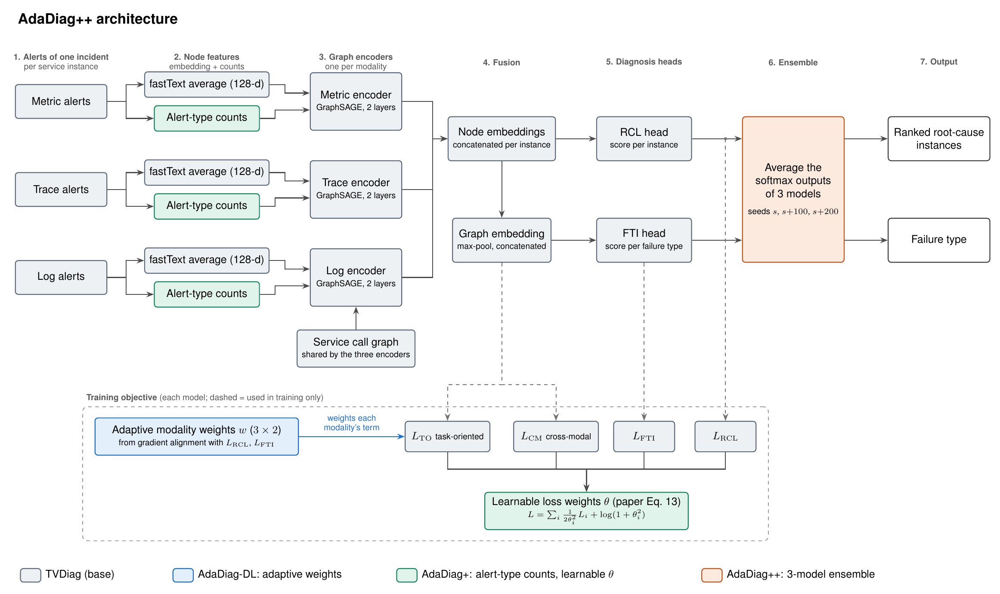

# Architecture notes

## Where AdaDiag sits

TVDiag's forward pass is unchanged. The weighting module reads the graph-level embeddings
the encoders already produce (detached) plus three alert counts, and emits a 3×2 matrix that
scales the six task-oriented contrastive terms. Nothing it produces reaches the heads, so
the inference path is byte-for-byte TVDiag's.

```
                    ┌────────────── training only ──────────────┐
X (3,N,128) ──► GraphSAGE ×3 ──► max-pool ──► F ∈ ℝ⁹⁶ ──┬──► concat ──► RCL head
A (N,N)     ──►                                          │              FTI head
                                                         │
                                            detach ──────┘
                                              + c ∈ ℝ³
                                                 │
                                         MLP 99→64→6
                                                 │
                                  softmax per task column
                                                 │
                                          w ∈ ℝ³ˣ²
                                                 │
                            6 × SupCon(f_m, y_t) · w[m,t]  ──► l_to
```

## Design decisions, and why

**Dense tensors instead of DGL.** Incident graphs have 10–21 nodes. A batched
`(B, N, N) @ (B, N, F)` matmul is faster than a graph library's gather/scatter at this size,
removes the single worst dependency-pinning problem in reproducing TVDiag, and makes the
GraphSAGE update inspectable in four lines. `dgl.SAGEConv(aggregator_type='mean', bias=False)`
is exactly `W_self·h + W_neigh·mean(h_in)`.

**Per-sample contrastive loss.** TVDiag's `SupConLoss` reduces over the batch, so a
per-incident weight cannot multiply it. `losses.supcon_per_sample` returns the per-sample
term and the non-zero count; summing and dividing reproduces the original scalar exactly.
`tests/test_supcon_equivalence.py` asserts this on four shapes — it is the first thing to
run after any change, because a silent divergence there invalidates every arm including the
baseline.

**Simplex columns, not free weights.** See README §1. The short version: σ already sets the
magnitude, so an unconstrained **w** is unidentifiable and the optimiser can "win" by
shrinking everything.

**…but the simplex fixes the wrong degree of freedom.** This is the most important design
note in the repository and it was found by reviewing the finished code, not by planning it.
The simplex removes the *scale* ambiguity, which is real. It does nothing about the
*direction* of the incentive, because `w` is used in exactly one place — the auxiliary
contrastive term — and is deliberately kept off the prediction path so that inference stays
free. The consequence is that `∂l_rcl/∂θ_w = ∂l_fti/∂θ_w = 0` **exactly**: no diagnosis
gradient ever reaches the weighting module. And since `l_to` is *linear* in `w`, a linear
objective on a simplex is minimised at a **vertex** — so one-hot collapse is the solution
and a graded allocation is not. Both facts are asserted in
`tests/test_weighting_identifiability.py` and measured by `identifiability.py`; README §6.6
has the numbers. Anyone extending this work should read that section first: the obvious
extensions (deeper MLP, better descriptor, more conditioning) all leave both problems
untouched.

**Detached descriptor.** The weighting module should choose an allocation given the
incident, not reshape the encoders so its own job gets easier. Removing the detach makes the
module able to co-adapt with the representation, which conflates the two effects.

**Masking after augmentation.** Dropped instances are excluded from the max-pool *and* from
the RCL softmax. Leaving them in the softmax lets a node that is not in the graph compete as
a candidate root cause — a bug that inflates HR@k.

**Ablation switches default to the method.** `drop_modalities`, `use_to`, `use_cm`,
`to_scale`, `w_constraint`, `detach`, `descriptor` and `entropy_reg` are read from the config
with defaults that reproduce the method exactly — checked bit-for-bit against the
pre-ablation code. The loss is assembled in one place (`train.compute_terms`), which the
training loop, the gradient-share diagnostic and the ablation snapshot all call, so the
objective that is measured is always the objective that is trained. A removed modality is
zeroed rather than deleted: its encoder is not run, its slot in the fused vector is zero,
and the fixed priors renormalise over what remains (a column whose only source was removed
becomes uniform over the rest).

## What is deliberately *not* fixed

`AutomaticWeightedLoss` is reproduced **inert**, because that is what TVDiag ships (see
README §7, finding 2). Making it learnable (`awl_learnable=True`) is no longer a
reproduction, so it is off by default. README §6.19 tests it, as one of six features the
paper's text specifies and its code omits; it is the one that does not hurt.

## The paper's version, as switches

`config.PAPER` turns on everything the TVDiag paper specifies that its released code does
not do (README §6.19): Eq. 3 per anchor (`to_norm`), Eqs. 5–6 symmetric CM (`cm_mode`),
learnable Eq. 13 (`awl_learnable`), Algorithm 1's per-layer activation and normalisation
(`sage_alg1`), bidirectional edges (`bidirectional`) and one fixed AUG copy per sample
(`aug_mode="paper"`). The LSTM aggregator (`aggregator="lstm"`, §6.18) is the seventh. Every
switch defaults to the code's behaviour, checked bit for bit against committed runs.
`adadiag.affinity` adds Eq. 17's inter-task affinity (§6.20), measured on model copies so
training is unchanged.

## Changes aimed at RCL and FTI

README §6.21 adds six more switches, all off by default: `early_stop_on`,
`fti_class_weight`, `aug_modality_drop`, `aug_copies`, `rcl_context` (the locator also sees
the incident's fused feature, or each node's difference from its neighbours' mean) and
`fti_readout` (the classifier also reads the node embeddings pooled by the RCL softmax).
The one confirmed on fresh seeds is `rcl_context="neighbour"`; it widens the locator's
input only, so the encoders and their initialisation are unchanged.

## Encoder diagnostics

README §6.23 adds one diagnostic switch, off by default: `no_edges` zeroes the adjacency
before the encoders, so each instance is encoded from its own alerts only. It measures how
much the GraphSAGE encoders use the service graph; it is not a proposed method.

## A stronger AdaDiag

README §6.24 adds five switches, all off by default, so every committed result reproduces:
`alert_bag` (each instance's alert-type counts, read from the released raw alerts by
`src/adadiag/alerts.py`, appended to its embeddings; it needs the widened dataset from
`alerts.with_alert_bag(ds)`), `aggregator="attn"` (GATv2-style attention over neighbours),
`self_res` (a linear skip from an instance's own features to its embedding), `weight_ema`
(evaluate a moving average of the weights) and `root_detach` (with `fti_readout="root_attn"`,
the FTI loss does not reach the RCL scores through the readout). The final configuration,
AdaDiag+, is AdaDiag-DL with `alert_bag=True` and `awl_learnable=True` (Eq. 13's learnable
loss weights, section 6.19); its encoders are TVDiag's, with a wider input.

## AdaDiag++

README §6.25. AdaDiag++ is three AdaDiag+ models trained independently with seeds s, s + 100
and s + 200; `adadiag.ensemble.predict` averages their softmax outputs, over instances for
RCL and over failure types for FTI. Three more switches exist and are off by default because
they failed the screen: `fti_smooth` (label smoothing on the FTI loss), `bag_drop` (dropout
on the alert-type counts) and `bag_head` (the heads also read the raw counts).

## Diagram



Source: `docs/figures/architecture.tex` (TikZ; `pdflatex architecture.tex`). Colours mark what
each version added: TVDiag (grey), AdaDiag-DL (blue), AdaDiag+ (green), AdaDiag++ (orange).
