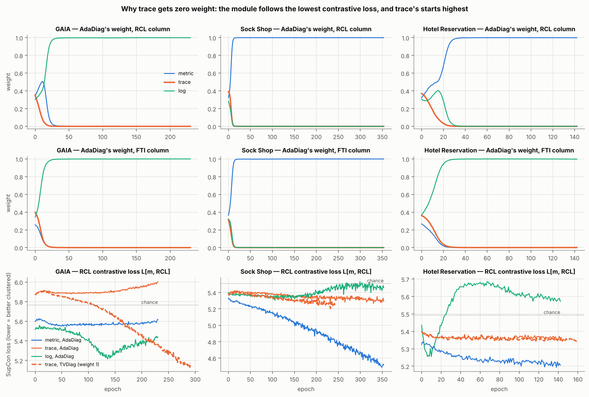

# Why AdaDiag gives the trace modality zero weight — audit

Produced by `scripts/run_trace_audit.py` and `scripts/make_trace_report.py`; discussed in README §6.10.

## 1. It is not a wiring error

| dataset | incidents with no trace alert | audited run = committed run | weight on trace data moved to slot 0, RCL | … FTI |
|---|---|---|---|---|
| GAIA | 4.8% | yes | 0.001 | 0.000 |
| Sock Shop | 0.2% | yes | 0.000 | 0.000 |
| Hotel Reservation | 0.0% | yes | 0.001 | 0.000 |

With the trace and metric data swapped between slots, the zero follows the trace **data** into the other slot. The trace plane holds `tmp/trace.pkl` (`tests/test_trace_weight.py`).

## 2. Trace's contrastive loss is the highest from the first step

| dataset | chance | L RCL m / t / l (seed 0) | L FTI m / t / l | trace's rank, RCL (5 seeds; 1 = highest) | … FTI | epoch a column passes 0.9 (RCL / FTI) |
|---|---|---|---|---|---|---|
| GAIA | 5.77 | 5.60 / 5.88 / 5.52 | 5.28 / 5.52 / 5.09 | 1, 1, 1, 1, 1 | 1, 1, 1, 1, 1 | 21 / 15 |
| Sock Shop | 5.54 | 5.36 / 5.44 / 5.45 | 5.38 / 5.42 / 5.41 | 2, 1, 1, 1, 2 | 1, 1, 1, 1, 1 | 9 / 11 |
| Hotel Reservation | 5.49 | 5.32 / 5.40 / 5.44 | 5.27 / 5.30 / 5.17 | 2, 2, 2, 2, 2 | 1, 1, 1, 1, 1 | 25 / 18 |

## 3. Under TVDiag, trace keeps training — and on GAIA ends up lowest

| dataset | trace L[RCL], TVDiag (weight 1) | … AdaDiag (weight 0) | TVDiag at the end, m / t / l | first epoch trace is lowest (TVDiag) |
|---|---|---|---|---|
| GAIA | 5.88 → 5.18 | 5.88 → 6.00 | 5.29 / 5.18 / 5.66 | 202 |
| Sock Shop | 5.39 → 5.24 | 5.39 → 5.29 | 4.50 / 5.24 / 5.52 | never |
| Hotel Reservation | 5.40 → 5.34 | 5.40 → 5.36 | 5.18 / 5.34 / 5.61 | never |

## 4. The obvious fix: a 100-epoch warm-up

| dataset | seeds | trace weight, RCL | trace weight, FTI | final RCL column m / t / l | final FTI column m / t / l | HR@1 | F1 |
|---|---|---|---|---|---|---|---|
| GAIA | 3 | 0.000 | 0.000 | 0.01 / 0.00 / 0.99 | 0.00 / 0.00 / 1.00 | 0.741 | 0.936 |
| Sock Shop | 3 | 0.000 | 0.000 | 0.98 / 0.00 / 0.02 | 0.14 / 0.00 / 0.86 | 0.871 | 0.573 |
| Hotel Reservation | 3 | 0.010 | 0.001 | 0.98 / 0.01 / 0.01 | 0.47 / 0.00 / 0.53 | 0.842 | 0.786 |
