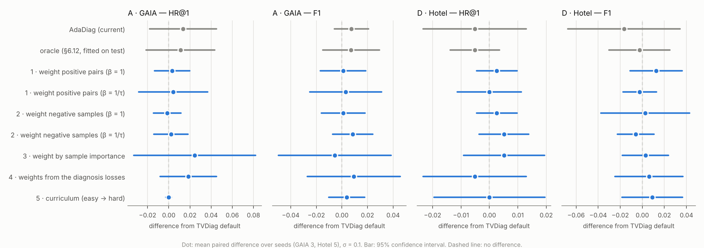

# Five ways to weight the contrastive term (README §6.13)

Each variant changes one thing on top of TVDiag's default, with one setting fixed before any run (`scripts/run_cl_variants.py`); types 1 and 2 are also run at β = 1/τ as a sensitivity check. Same seeds, 1 thread and 500-epoch cap as the references; each lane first re-trains TVDiag default and checks it bit-for-bit (`logs/`).

## Summary — σ = 0.1, value (difference from TVDiag default)

| weighting | GAIA HR@1 | GAIA F1 | Hotel HR@1 | Hotel F1 |
|---|---|---|---|---|
| TVDiag default | 0.726 | 0.924 | 0.833 | 0.798 |
| AdaDiag (current) | 0.740 (+0.013) | 0.932 (+0.007) | 0.828 (-0.005) | 0.781 (-0.017) |
| 1 · weight positive pairs (β = 1) | 0.729 (+0.003) | 0.925 (+0.001) | 0.836 (+0.003) | 0.810 (+0.013) |
| 1 · weight positive pairs (β = 1/τ) | 0.731 (+0.004) | 0.927 (+0.003) | 0.833 (+0.000) | 0.795 (-0.002) |
| 2 · weight negative samples (β = 1) | 0.725 (-0.001) | 0.925 (+0.001) | 0.836 (+0.003) | 0.800 (+0.003) |
| 2 · weight negative samples (β = 1/τ) | 0.728 (+0.002) | 0.933 (+0.008) | 0.838 (+0.005) | 0.792 (-0.006) |
| 3 · weight by sample importance | 0.751 (+0.024) | 0.919 (-0.006) | 0.838 (+0.005) | 0.801 (+0.003) |
| 4 · weights from the diagnosis losses | 0.745 (+0.018) | 0.934 (+0.009) | 0.828 (-0.005) | 0.804 (+0.006) |
| 5 · curriculum (easy → hard) | 0.726 (+0.000) | 0.928 (+0.004) | 0.833 (+0.000) | 0.807 (+0.009) |

## How much each weighting changes the term's gradient

Cosine between the encoder gradient of each of TVDiag's three terms with and without the weighting, after 80 epochs of TVDiag (seed 0, one training batch; `scripts/cl_gradient_change.py`). 1 = no change.

| dataset | term | 1 · pos, β=1 | 1 · pos, β=1/τ | 2 · neg, β=1 | 2 · neg, β=1/τ | 3 · importance | 5 · curriculum at 50 % |
|---|---|---|---|---|---|---|---|
| A · GAIA | metric->rcl | 0.99 | 0.72 | 0.99 | 0.92 | 0.86 | 0.96 |
| A · GAIA | trace->rcl | 0.95 | 0.71 | 0.95 | 0.62 | 0.47 | 0.86 |
| A · GAIA | log->fti | 1.00 | 0.98 | 1.00 | 0.97 | 0.90 | 0.90 |
| D · Hotel | metric->rcl | 0.99 | 0.91 | 0.99 | 0.95 | 0.14 | 0.94 |
| D · Hotel | trace->rcl | 0.98 | 0.83 | 0.98 | 0.84 | 0.51 | 0.68 |
| D · Hotel | log->fti | 0.95 | 0.34 | 0.93 | 0.03 | -0.54 | -0.05 |

## Types 3 and 4 on GAIA: the weighting or the training length?

**3 · weight by sample importance**

| GAIA seed | epochs | variant: HR@1 / F1 | TVDiag, same epochs: HR@1 / F1 | TVDiag default (epochs): HR@1 / F1 |
|---|---|---|---|---|
| 0 | 86 | 0.760 / 0.920 | 0.760 / 0.920 | 0.721 / 0.923 (292) |
| 1 | 103 | 0.743 / 0.922 | 0.741 / 0.935 | 0.707 / 0.912 (292) |
| 2 | 56 | 0.749 / 0.914 | 0.763 / 0.908 | 0.751 / 0.939 (191) |
| mean | | 0.751 / 0.919 | 0.755 / 0.921 | 0.726 / 0.924 |
| variant − same-epoch TVDiag | | -0.004 / -0.002 | | |

**4 · weights from the diagnosis losses**

| GAIA seed | epochs | variant: HR@1 / F1 | TVDiag, same epochs: HR@1 / F1 | TVDiag default (epochs): HR@1 / F1 |
|---|---|---|---|---|
| 0 | 135 | 0.740 / 0.920 | 0.747 / 0.939 | 0.721 / 0.923 (292) |
| 1 | 151 | 0.736 / 0.937 | 0.725 / 0.928 | 0.707 / 0.912 (292) |
| 2 | 149 | 0.758 / 0.944 | 0.748 / 0.944 | 0.751 / 0.939 (191) |
| mean | | 0.745 / 0.934 | 0.740 / 0.937 | 0.726 / 0.924 |
| variant − same-epoch TVDiag | | +0.005 / -0.003 | | |

## The matrix type 4 sets from the diagnosis losses

| dataset | σ_to | matrix | RCL: metric / trace / log | FTI: metric / trace / log |
|---|---|---|---|---|
| A · GAIA | 0.1 | **4 · from the diagnosis losses** (3 seeds) | 0.41 / 0.08 / 0.51 | 0.76 / 0.13 / 0.11 |
| | | AdaDiag (current) | 0.01 / 0.00 / 0.99 | 0.00 / 0.00 / 1.00 |
| | | oracle (§6.12) | 0.46 / 0.44 / 0.09 | 0.00 / 0.12 / 0.88 |
| D · Hotel | 0.1 | **4 · from the diagnosis losses** (5 seeds) | 0.49 / 0.44 / 0.08 | 0.50 / 0.21 / 0.29 |
| | | AdaDiag (current) | 0.99 / 0.00 / 0.00 | 0.27 / 0.00 / 0.73 |
| | | oracle (§6.12) | 0.48 / 0.26 / 0.26 | 0.77 / 0.02 / 0.21 |
| D · Hotel | 0.5 | **4 · from the diagnosis losses** (5 seeds) | 0.26 / 0.74 / 0.00 | 0.49 / 0.23 / 0.28 |
| | | AdaDiag (current) | 0.00 / 0.00 / 1.00 | 1.00 / 0.00 / 0.00 |
| | | oracle (§6.12) | 0.48 / 0.26 / 0.26 | 0.77 / 0.02 / 0.21 |

## Full tables

**A · GAIA, σ_to = 0.1**

| weighting | seeds | HR@1 | HR@3 | MRR@3 | F1 | macro-F1 |
|---|---|---|---|---|---|---|
| TVDiag default (σ = 0.1) | 3 | 0.726 ± 0.022 | 0.889 ± 0.013 | 0.800 ± 0.018 | 0.924 ± 0.014 | 0.573 ± 0.006 |
| TVDiag's rule on the simplex | 3 | 0.733 ± 0.017 | 0.892 ± 0.009 | 0.806 ± 0.013 | 0.937 ± 0.008 | 0.573 ± 0.007 |
| AdaDiag (current: learned from the contrastive term) | 3 | 0.740 ± 0.012 | 0.895 ± 0.011 | 0.810 ± 0.010 | 0.932 ± 0.015 | 0.564 ± 0.020 |
| *oracle, one matrix (§6.12, fitted on test)* | 3 | 0.737 ± 0.009 | 0.896 ± 0.015 | 0.810 ± 0.013 | 0.932 ± 0.010 | 0.576 ± 0.008 |
| **1 · weight positive pairs (β = 1)** | 3 | 0.729 ± 0.017 | 0.889 ± 0.013 | 0.802 ± 0.015 | 0.925 ± 0.018 | 0.573 ± 0.008 |
| **1 · weight positive pairs (β = 1/τ)** | 3 | 0.731 ± 0.010 | 0.894 ± 0.014 | 0.805 ± 0.012 | 0.927 ± 0.005 | 0.574 ± 0.006 |
| **2 · weight negative samples (β = 1)** | 3 | 0.725 ± 0.024 | 0.891 ± 0.016 | 0.800 ± 0.020 | 0.925 ± 0.018 | 0.573 ± 0.008 |
| **2 · weight negative samples (β = 1/τ)** | 3 | 0.728 ± 0.021 | 0.893 ± 0.014 | 0.803 ± 0.017 | 0.933 ± 0.015 | 0.570 ± 0.007 |
| **3 · weight by sample importance** | 3 | 0.751 ± 0.009 | 0.900 ± 0.008 | 0.819 ± 0.008 | 0.919 ± 0.004 | 0.417 ± 0.026 |
| **4 · weights from the diagnosis losses** | 3 | 0.745 ± 0.012 | 0.900 ± 0.007 | 0.815 ± 0.009 | 0.934 ± 0.012 | 0.539 ± 0.039 |
| **5 · curriculum (easy → hard)** | 3 | 0.726 ± 0.022 | 0.891 ± 0.013 | 0.801 ± 0.018 | 0.928 ± 0.017 | 0.574 ± 0.008 |
| control: TVDiag stopped at type 3's epochs | 3 | 0.755 ± 0.012 | 0.901 ± 0.014 | 0.822 ± 0.012 | 0.921 ± 0.013 | 0.448 ± 0.061 |
| control: TVDiag stopped at type 4's epochs | 3 | 0.740 ± 0.013 | 0.895 ± 0.014 | 0.811 ± 0.012 | 0.937 ± 0.009 | 0.564 ± 0.015 |

| difference | HR@1 | HR@3 | MRR@3 | F1 | macro-F1 |
|---|---|---|---|---|---|
| 1 − TVDiag default | +0.003 (p 0.49, Holm 1.00) | -0.001 (p 0.18, Holm 1.00) | +0.002 (p 0.46, Holm 1.00) | +0.001 (p 0.83, Holm 1.00) | +0.000 (p 0.88, Holm 1.00) |
| 1 − AdaDiag | -0.010 (p 0.10, Holm 1.00) | -0.006 (p 0.35, Holm 1.00) | -0.008 (p 0.21, Holm 1.00) | -0.006 (p 0.08, Holm 1.00) | +0.008 (p 0.35, Holm 1.00) |
| 1s − TVDiag default | +0.004 (p 0.63, Holm 1.00) | +0.005 (p 0.14, Holm 1.00) | +0.004 (p 0.42, Holm 1.00) | +0.003 (p 0.69, Holm 1.00) | +0.001 (p 0.50, Holm 1.00) |
| 1s − AdaDiag | -0.009 (p 0.05, Holm 1.00) | -0.001 (p 0.83, Holm 1.00) | -0.006 (p 0.13, Holm 1.00) | -0.005 (p 0.54, Holm 1.00) | +0.009 (p 0.38, Holm 1.00) |
| 2 − TVDiag default | -0.001 (p 0.69, Holm 1.00) | +0.001 (p 0.55, Holm 1.00) | -0.000 (p 0.96, Holm 1.00) | +0.001 (p 0.83, Holm 1.00) | +0.000 (p 0.86, Holm 1.00) |
| 2 − AdaDiag | -0.015 (p 0.26, Holm 1.00) | -0.004 (p 0.63, Holm 1.00) | -0.010 (p 0.35, Holm 1.00) | -0.007 (p 0.10, Holm 1.00) | +0.008 (p 0.34, Holm 1.00) |
| 2s − TVDiag default | +0.002 (p 0.63, Holm 1.00) | +0.004 (p 0.03, Holm 1.00) | +0.003 (p 0.28, Holm 1.00) | +0.008 (p 0.15, Holm 1.00) | -0.003 (p 0.10, Holm 1.00) |
| 2s − AdaDiag | -0.011 (p 0.18, Holm 1.00) | -0.002 (p 0.80, Holm 1.00) | -0.007 (p 0.31, Holm 1.00) | +0.001 (p 0.24, Holm 1.00) | +0.005 (p 0.62, Holm 1.00) |
| 3 − TVDiag default | +0.024 (p 0.21, Holm 1.00) | +0.011 (p 0.11, Holm 1.00) | +0.019 (p 0.17, Holm 1.00) | -0.006 (p 0.64, Holm 1.00) | -0.155 (p 0.01, Holm 1.00) |
| 3 − AdaDiag | +0.011 (p 0.21, Holm 1.00) | +0.005 (p 0.19, Holm 1.00) | +0.009 (p 0.08, Holm 1.00) | -0.013 (p 0.34, Holm 1.00) | -0.147 (p 0.03, Holm 1.00) |
| 4 − TVDiag default | +0.018 (p 0.10, Holm 1.00) | +0.011 (p 0.16, Holm 1.00) | +0.015 (p 0.12, Holm 1.00) | +0.009 (p 0.39, Holm 1.00) | -0.033 (p 0.26, Holm 1.00) |
| 4 − AdaDiag | +0.005 (p 0.35, Holm 1.00) | +0.005 (p 0.15, Holm 1.00) | +0.005 (p 0.18, Holm 1.00) | +0.002 (p 0.88, Holm 1.00) | -0.025 (p 0.41, Holm 1.00) |
| 5 − TVDiag default | +0.000 (p 1.00, Holm 1.00) | +0.002 (p 0.32, Holm 1.00) | +0.001 (p 0.37, Holm 1.00) | +0.004 (p 0.38, Holm 1.00) | +0.001 (p 0.46, Holm 1.00) |
| 5 − AdaDiag | -0.013 (p 0.18, Holm 1.00) | -0.004 (p 0.48, Holm 1.00) | -0.009 (p 0.28, Holm 1.00) | -0.004 (p 0.14, Holm 1.00) | +0.010 (p 0.31, Holm 1.00) |

**D · Hotel, σ_to = 0.1**

| weighting | seeds | HR@1 | HR@3 | MRR@3 | F1 | macro-F1 |
|---|---|---|---|---|---|---|
| TVDiag default (σ = 0.1) | 5 | 0.833 ± 0.013 | 0.918 ± 0.015 | 0.871 ± 0.012 | 0.798 ± 0.018 | 0.784 ± 0.027 |
| TVDiag's rule on the simplex | 5 | 0.838 ± 0.007 | 0.915 ± 0.011 | 0.873 ± 0.008 | 0.800 ± 0.022 | 0.786 ± 0.029 |
| AdaDiag (current: learned from the contrastive term) | 5 | 0.828 ± 0.015 | 0.921 ± 0.011 | 0.868 ± 0.011 | 0.781 ± 0.034 | 0.765 ± 0.043 |
| *oracle, one matrix (§6.12, fitted on test)* | 5 | 0.828 ± 0.011 | 0.926 ± 0.011 | 0.871 ± 0.009 | 0.795 ± 0.018 | 0.787 ± 0.021 |
| **1 · weight positive pairs (β = 1)** | 5 | 0.836 ± 0.011 | 0.918 ± 0.007 | 0.873 ± 0.009 | 0.810 ± 0.016 | 0.796 ± 0.023 |
| **1 · weight positive pairs (β = 1/τ)** | 5 | 0.833 ± 0.009 | 0.918 ± 0.007 | 0.872 ± 0.008 | 0.795 ± 0.015 | 0.779 ± 0.022 |
| **2 · weight negative samples (β = 1)** | 5 | 0.836 ± 0.011 | 0.921 ± 0.011 | 0.874 ± 0.009 | 0.800 ± 0.024 | 0.788 ± 0.026 |
| **2 · weight negative samples (β = 1/τ)** | 5 | 0.838 ± 0.007 | 0.926 ± 0.011 | 0.876 ± 0.008 | 0.792 ± 0.016 | 0.778 ± 0.022 |
| **3 · weight by sample importance** | 5 | 0.838 ± 0.015 | 0.921 ± 0.014 | 0.875 ± 0.011 | 0.801 ± 0.028 | 0.787 ± 0.037 |
| **4 · weights from the diagnosis losses** | 5 | 0.828 ± 0.007 | 0.918 ± 0.011 | 0.868 ± 0.007 | 0.804 ± 0.019 | 0.794 ± 0.017 |
| **5 · curriculum (easy → hard)** | 5 | 0.833 ± 0.018 | 0.918 ± 0.007 | 0.871 ± 0.012 | 0.807 ± 0.005 | 0.792 ± 0.006 |

| difference | HR@1 | HR@3 | MRR@3 | F1 | macro-F1 |
|---|---|---|---|---|---|
| 1 − TVDiag default | +0.003 (p 0.37, Holm 1.00) | +0.000 (p 1.00, Holm 1.00) | +0.001 (p 0.71, Holm 1.00) | +0.013 (p 0.22, Holm 1.00) | +0.012 (p 0.31, Holm 1.00) |
| 1 − AdaDiag | +0.008 (p 0.21, Holm 1.00) | -0.003 (p 0.70, Holm 1.00) | +0.005 (p 0.39, Holm 1.00) | +0.029 (p 0.13, Holm 1.00) | +0.031 (p 0.21, Holm 1.00) |
| 1s − TVDiag default | +0.000 (p 1.00, Holm 1.00) | +0.000 (p 1.00, Holm 1.00) | +0.000 (p 0.91, Holm 1.00) | -0.002 (p 0.68, Holm 1.00) | -0.005 (p 0.48, Holm 1.00) |
| 1s − AdaDiag | +0.005 (p 0.59, Holm 1.00) | -0.003 (p 0.62, Holm 1.00) | +0.004 (p 0.53, Holm 1.00) | +0.014 (p 0.43, Holm 1.00) | +0.013 (p 0.57, Holm 1.00) |
| 2 − TVDiag default | +0.003 (p 0.37, Holm 1.00) | +0.003 (p 0.37, Holm 1.00) | +0.003 (p 0.18, Holm 1.00) | +0.003 (p 0.87, Holm 1.00) | +0.004 (p 0.79, Holm 1.00) |
| 2 − AdaDiag | +0.008 (p 0.21, Holm 1.00) | +0.000 (p 1.00, Holm 1.00) | +0.006 (p 0.25, Holm 1.00) | +0.019 (p 0.15, Holm 1.00) | +0.023 (p 0.23, Holm 1.00) |
| 2s − TVDiag default | +0.005 (p 0.18, Holm 1.00) | +0.008 (p 0.21, Holm 1.00) | +0.005 (p 0.15, Holm 1.00) | -0.006 (p 0.38, Holm 1.00) | -0.006 (p 0.36, Holm 1.00) |
| 2s − AdaDiag | +0.010 (p 0.18, Holm 1.00) | +0.005 (p 0.48, Holm 1.00) | +0.009 (p 0.07, Holm 1.00) | +0.011 (p 0.45, Holm 1.00) | +0.012 (p 0.58, Holm 1.00) |
| 3 − TVDiag default | +0.005 (p 0.37, Holm 1.00) | +0.003 (p 0.70, Holm 1.00) | +0.003 (p 0.40, Holm 1.00) | +0.003 (p 0.72, Holm 1.00) | +0.003 (p 0.79, Holm 1.00) |
| 3 − AdaDiag | +0.010 (p 0.34, Holm 1.00) | +0.000 (p 1.00, Holm 1.00) | +0.007 (p 0.26, Holm 1.00) | +0.019 (p 0.32, Holm 1.00) | +0.021 (p 0.41, Holm 1.00) |
| 4 − TVDiag default | -0.005 (p 0.48, Holm 1.00) | -0.000 (p 1.00, Holm 1.00) | -0.003 (p 0.66, Holm 1.00) | +0.006 (p 0.62, Holm 1.00) | +0.010 (p 0.52, Holm 1.00) |
| 4 − AdaDiag | +0.000 (p 1.00, Holm 1.00) | -0.003 (p 0.37, Holm 1.00) | +0.000 (p 0.92, Holm 1.00) | +0.023 (p 0.22, Holm 1.00) | +0.029 (p 0.21, Holm 1.00) |
| 5 − TVDiag default | -0.000 (p 1.00, Holm 1.00) | +0.000 (p 1.00, Holm 1.00) | +0.000 (p 1.00, Holm 1.00) | +0.009 (p 0.41, Holm 1.00) | +0.008 (p 0.55, Holm 1.00) |
| 5 − AdaDiag | +0.005 (p 0.67, Holm 1.00) | -0.003 (p 0.62, Holm 1.00) | +0.003 (p 0.60, Holm 1.00) | +0.026 (p 0.15, Holm 1.00) | +0.027 (p 0.21, Holm 1.00) |

**D · Hotel, σ_to = 0.5**

| weighting | seeds | HR@1 | HR@3 | MRR@3 | F1 | macro-F1 |
|---|---|---|---|---|---|---|
| TVDiag default (σ = 0.1) | 5 | 0.833 ± 0.013 | 0.918 ± 0.015 | 0.871 ± 0.012 | 0.798 ± 0.018 | 0.784 ± 0.027 |
| TVDiag's rule at σ_to = 0.5 | 5 | 0.836 ± 0.006 | 0.915 ± 0.007 | 0.870 ± 0.005 | 0.728 ± 0.022 | 0.711 ± 0.018 |
| TVDiag's rule on the simplex | 5 | 0.833 ± 0.013 | 0.918 ± 0.007 | 0.871 ± 0.005 | 0.758 ± 0.032 | 0.733 ± 0.043 |
| AdaDiag (current: learned from the contrastive term) | 5 | 0.823 ± 0.006 | 0.915 ± 0.007 | 0.863 ± 0.003 | 0.771 ± 0.023 | 0.762 ± 0.026 |
| *oracle, one matrix (§6.12, fitted on test)* | 5 | 0.823 ± 0.017 | 0.915 ± 0.015 | 0.865 ± 0.008 | 0.805 ± 0.021 | 0.795 ± 0.025 |
| **1 · weight positive pairs (β = 1)** | 5 | 0.833 ± 0.000 | 0.915 ± 0.007 | 0.868 ± 0.002 | 0.728 ± 0.024 | 0.704 ± 0.010 |
| **2 · weight negative samples (β = 1)** | 5 | 0.833 ± 0.009 | 0.910 ± 0.000 | 0.868 ± 0.006 | 0.723 ± 0.030 | 0.705 ± 0.027 |
| **3 · weight by sample importance** | 5 | 0.821 ± 0.016 | 0.923 ± 0.000 | 0.863 ± 0.011 | 0.710 ± 0.036 | 0.680 ± 0.043 |
| **4 · weights from the diagnosis losses** | 5 | 0.815 ± 0.015 | 0.921 ± 0.006 | 0.861 ± 0.009 | 0.765 ± 0.038 | 0.742 ± 0.052 |
| **5 · curriculum (easy → hard)** | 5 | 0.836 ± 0.014 | 0.908 ± 0.006 | 0.869 ± 0.008 | 0.730 ± 0.033 | 0.707 ± 0.032 |

| difference | HR@1 | HR@3 | MRR@3 | F1 | macro-F1 |
|---|---|---|---|---|---|
| 1 − TVDiag default | +0.000 (p 1.00, Holm 1.00) | -0.003 (p 0.75, Holm 1.00) | -0.003 (p 0.65, Holm 1.00) | -0.069 (p 0.01, Holm 0.78) | -0.080 (p 0.00, Holm 0.34) |
| 1 − TVDiag, same σ_to | -0.003 (p 0.37, Holm 1.00) | +0.000 (p 1.00, Holm 1.00) | -0.002 (p 0.48, Holm 1.00) | +0.000 (p 0.96, Holm 1.00) | -0.007 (p 0.21, Holm 1.00) |
| 1 − AdaDiag | +0.010 (p 0.02, Holm 1.00) | +0.000 (p 1.00, Holm 1.00) | +0.006 (p 0.06, Holm 1.00) | -0.043 (p 0.07, Holm 1.00) | -0.058 (p 0.01, Holm 1.00) |
| 2 − TVDiag default | +0.000 (p 1.00, Holm 1.00) | -0.008 (p 0.30, Holm 1.00) | -0.004 (p 0.53, Holm 1.00) | -0.075 (p 0.01, Holm 0.92) | -0.079 (p 0.01, Holm 0.71) |
| 2 − TVDiag, same σ_to | -0.003 (p 0.37, Holm 1.00) | -0.005 (p 0.18, Holm 1.00) | -0.003 (p 0.11, Holm 1.00) | -0.005 (p 0.25, Holm 1.00) | -0.006 (p 0.31, Holm 1.00) |
| 2 − AdaDiag | +0.010 (p 0.10, Holm 1.00) | -0.005 (p 0.18, Holm 1.00) | +0.005 (p 0.15, Holm 1.00) | -0.049 (p 0.04, Holm 1.00) | -0.057 (p 0.02, Holm 1.00) |
| 3 − TVDiag default | -0.013 (p 0.09, Holm 1.00) | +0.005 (p 0.48, Holm 1.00) | -0.009 (p 0.16, Holm 1.00) | -0.087 (p 0.00, Holm 0.31) | -0.104 (p 0.01, Holm 0.56) |
| 3 − TVDiag, same σ_to | -0.015 (p 0.03, Holm 0.82) | +0.008 (p 0.07, Holm 1.00) | -0.007 (p 0.12, Holm 1.00) | -0.018 (p 0.49, Holm 1.00) | -0.031 (p 0.26, Holm 1.00) |
| 3 − AdaDiag | -0.003 (p 0.75, Holm 1.00) | +0.008 (p 0.07, Holm 1.00) | +0.000 (p 1.00, Holm 1.00) | -0.061 (p 0.01, Holm 1.00) | -0.082 (p 0.01, Holm 0.71) |
| 4 − TVDiag default | -0.018 (p 0.08, Holm 1.00) | +0.003 (p 0.75, Holm 1.00) | -0.010 (p 0.17, Holm 1.00) | -0.033 (p 0.10, Holm 1.00) | -0.042 (p 0.10, Holm 1.00) |
| 4 − TVDiag, same σ_to | -0.021 (p 0.03, Holm 0.84) | +0.005 (p 0.18, Holm 1.00) | -0.009 (p 0.13, Holm 1.00) | +0.037 (p 0.12, Holm 1.00) | +0.030 (p 0.24, Holm 1.00) |
| 4 − AdaDiag | -0.008 (p 0.43, Holm 1.00) | +0.005 (p 0.18, Holm 1.00) | -0.002 (p 0.70, Holm 1.00) | -0.006 (p 0.72, Holm 1.00) | -0.020 (p 0.40, Holm 1.00) |
| 5 − TVDiag default | +0.003 (p 0.37, Holm 1.00) | -0.010 (p 0.10, Holm 1.00) | -0.003 (p 0.37, Holm 1.00) | -0.068 (p 0.01, Holm 1.00) | -0.077 (p 0.02, Holm 1.00) |
| 5 − TVDiag, same σ_to | -0.000 (p 1.00, Holm 1.00) | -0.008 (p 0.21, Holm 1.00) | -0.001 (p 0.79, Holm 1.00) | +0.002 (p 0.80, Holm 1.00) | -0.005 (p 0.61, Holm 1.00) |
| 5 − AdaDiag | +0.013 (p 0.19, Holm 1.00) | -0.008 (p 0.07, Holm 1.00) | +0.006 (p 0.26, Holm 1.00) | -0.041 (p 0.08, Holm 1.00) | -0.055 (p 0.03, Holm 1.00) |

Paired t-test over seeds. Holm correction within each reference: 95 comparisons against TVDiag default, 25 comparisons against TVDiag, same σ_to, 95 comparisons against AdaDiag. `1s`/`2s`: β = 1/τ. Bold: significant after correction.

Significant after correction: 0 of 95 against TVDiag default, 0 of 25 against TVDiag, same σ_to, 0 of 95 against AdaDiag.

