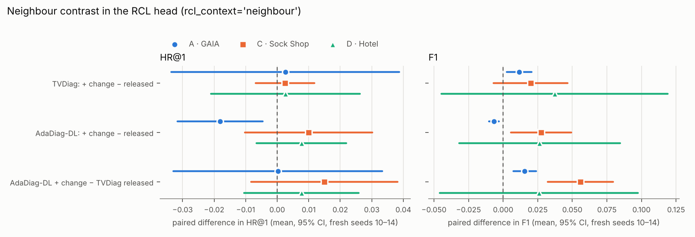

# Improving RCL and FTI (README §6.21)

Screened on development seeds 0–2 with TVDiag; the rule and the final change were written to `PLAN.md` before any confirmation run; confirmed on fresh seeds 10–14 for TVDiag and AdaDiag-DL, each against itself as released. Settings as §6.17.

**Final change:** `{'rcl_context': 'neighbour'}`.

Written 2026-11-04T07:29:22, before any confirmation run.

**Rule.** On the development seeds 0-2, each candidate's score is the mean over the three datasets of (dHR@1 + dF1) / 2, paired against TVDiag on the same seeds. A candidate is kept if its score is above +0.005 and no dataset loses more than 0.015 on HR@1 or F1. The kept candidates are combined (if both RCL-context variants are kept, rcl_context='both'). The combination is screened on the same seeds; the final change is the combination if its score is at least the best kept candidate's, otherwise the best kept candidate alone. If no candidate is kept, nothing is confirmed. The final change is then confirmed on fresh seeds 10-14 for TVDiag and AdaDiag-DL, against each as released.

| candidate | GAIA dHR@1 / dF1 | Sock Shop | Hotel | score | worst | kept |
|---|---|---|---|---|---|---|
| theta | +0.007 / -0.003 | +0.010 / +0.022 | -0.013 / -0.017 | +0.0011 | -0.017 | no |
| es_diag | +0.009 / +0.012 | +0.001 / -0.011 | +0.000 / +0.011 | +0.0037 | -0.011 | no |
| cw_sqrt | -0.007 / -0.002 | +0.015 / -0.020 | -0.004 / -0.016 | -0.0055 | -0.020 | no |
| moddrop | +0.006 / +0.013 | +0.018 / +0.004 | -0.004 / -0.001 | +0.0061 | -0.004 | yes |
| aug2 | -0.009 / -0.006 | +0.001 / +0.003 | +0.009 / -0.017 | -0.0031 | -0.017 | no |
| rcl_global | +0.012 / -0.003 | +0.011 / -0.005 | +0.000 / +0.013 | +0.0048 | -0.005 | no |
| rcl_neigh | +0.006 / +0.016 | +0.012 / +0.013 | -0.009 / +0.041 | +0.0133 | -0.009 | yes |
| fti_root | +0.001 / -0.024 | +0.019 / +0.013 | -0.009 / -0.002 | -0.0003 | -0.024 | no |

Kept: moddrop, rcl_neigh. Combination: `{'aug_modality_drop': 0.2, 'rcl_context': 'neighbour'}`. Best single: rcl_neigh.

**Decision** (2026-11-04T07:40:11, before the improved confirmation runs). Combination on the dev seeds: gaia: -0.020 / +0.013 | sockshop: +0.021 / +0.011 | hotel: -0.013 / +0.038; score +0.0085 (worst -0.020) against the best single, rcl_neigh, +0.0133. Final change: `{'rcl_context': 'neighbour'}`.

## Fresh seeds 10–14 (mean ± sd)

| dataset | arm | HR@1 | HR@3 | Avg@3 | MRR@3 | F1 | macro-F1 | epochs |
|---|---|---|---|---|---|---|---|---|
| A · GAIA | TVDiag, published | 0.759 | 0.909 | 0.844 | 0.827 | 0.936 | — | — |
| A · GAIA | TVDiag | 0.736 ± 0.023 | 0.895 ± 0.007 | 0.828 ± 0.015 | 0.809 ± 0.016 | 0.918 ± 0.010 | 0.571 ± 0.006 | 267 |
| A · GAIA | TVDiag + change | 0.739 ± 0.020 | 0.902 ± 0.006 | 0.835 ± 0.012 | 0.814 ± 0.013 | 0.930 ± 0.004 | 0.582 ± 0.008 | 243 |
| A · GAIA | AdaDiag-DL | 0.754 ± 0.012 | 0.902 ± 0.004 | 0.839 ± 0.007 | 0.821 ± 0.008 | 0.941 ± 0.004 | 0.563 ± 0.018 | 138 |
| A · GAIA | AdaDiag-DL + change | 0.736 ± 0.007 | 0.897 ± 0.008 | 0.828 ± 0.009 | 0.809 ± 0.008 | 0.934 ± 0.004 | 0.531 ± 0.035 | 137 |
| C · Sock Shop | TVDiag, published | 0.863 | 0.954 | 0.913 | 0.903 | 0.636 | — | — |
| C · Sock Shop | TVDiag | 0.865 ± 0.018 | 0.943 ± 0.007 | 0.912 ± 0.008 | 0.902 ± 0.011 | 0.563 ± 0.023 | 0.545 ± 0.021 | 266 |
| C · Sock Shop | TVDiag + change | 0.867 ± 0.019 | 0.954 ± 0.003 | 0.918 ± 0.010 | 0.907 ± 0.012 | 0.583 ± 0.017 | 0.555 ± 0.016 | 171 |
| C · Sock Shop | AdaDiag-DL | 0.870 ± 0.009 | 0.951 ± 0.006 | 0.918 ± 0.005 | 0.907 ± 0.006 | 0.591 ± 0.032 | 0.570 ± 0.033 | 201 |
| C · Sock Shop | AdaDiag-DL + change | 0.880 ± 0.011 | 0.951 ± 0.005 | 0.923 ± 0.006 | 0.913 ± 0.007 | 0.619 ± 0.020 | 0.596 ± 0.023 | 196 |
| D · Hotel | TVDiag, published | 0.821 | 0.923 | 0.876 | 0.866 | 0.822 | — | — |
| D · Hotel | TVDiag | 0.828 ± 0.011 | 0.921 ± 0.006 | 0.877 ± 0.006 | 0.868 ± 0.005 | 0.789 ± 0.046 | 0.773 ± 0.051 | 146 |
| D · Hotel | TVDiag + change | 0.831 ± 0.011 | 0.926 ± 0.011 | 0.880 ± 0.007 | 0.871 ± 0.008 | 0.826 ± 0.034 | 0.819 ± 0.036 | 173 |
| D · Hotel | AdaDiag-DL | 0.828 ± 0.011 | 0.921 ± 0.006 | 0.879 ± 0.007 | 0.869 ± 0.007 | 0.788 ± 0.034 | 0.775 ± 0.037 | 141 |
| D · Hotel | AdaDiag-DL + change | 0.836 ± 0.006 | 0.923 ± 0.018 | 0.885 ± 0.010 | 0.875 ± 0.009 | 0.815 ± 0.025 | 0.809 ± 0.026 | 173 |

## Paired differences (same fresh seeds)

| dataset | metric | **TVDiag: + change − released** | AdaDiag-DL: + change − released | AdaDiag-DL + change − TVDiag + change | AdaDiag-DL + change − TVDiag released |
|---|---|---|---|---|---|
| A · GAIA | HR@1 | +0.003 (p 0.85, 3/5) | **-0.018** (p 0.02, 0/5) | -0.002 (p 0.81, 2/5) | +0.000 (p 0.99, 3/5) |
| A · GAIA | HR@3 | +0.007 (p 0.26, 3/5) | -0.004 (p 0.36, 2/5) | -0.005 (p 0.24, 1/5) | +0.002 (p 0.68, 2/5) |
| A · GAIA | Avg@3 | +0.006 (p 0.52, 3/5) | -0.010 (p 0.10, 1/5) | -0.006 (p 0.35, 2/5) | +0.000 (p 0.99, 3/5) |
| A · GAIA | MRR@3 | +0.005 (p 0.62, 3/5) | -0.012 (p 0.06, 1/5) | -0.005 (p 0.51, 2/5) | +0.000 (p 0.96, 3/5) |
| A · GAIA | F1 | **+0.012** (p 0.02, 5/5) | **-0.007**† (p 0.01, 0/5) | **+0.004**† (p 0.01, 5/5) | **+0.016**† (p 0.01, 5/5) |
| A · GAIA | macro-F1 | +0.011 (p 0.08, 5/5) | -0.032 (p 0.06, 0/5) | -0.051 (p 0.05, 0/5) | -0.040 (p 0.05, 0/5) |
| C · Sock Shop | HR@1 | +0.002 (p 0.50, 2/5) | +0.010 (p 0.24, 4/5) | +0.012 (p 0.19, 3/5) | +0.015 (p 0.15, 4/5) |
| C · Sock Shop | HR@3 | **+0.011** (p 0.03, 4/5) | +0.000 (p 1.00, 2/5) | -0.002 (p 0.43, 1/5) | **+0.008** (p 0.00, 5/5) |
| C · Sock Shop | Avg@3 | +0.006 (p 0.05, 4/5) | +0.005 (p 0.13, 4/5) | +0.004 (p 0.24, 3/5) | **+0.011** (p 0.01, 5/5) |
| C · Sock Shop | MRR@3 | +0.006 (p 0.05, 5/5) | +0.006 (p 0.20, 4/5) | +0.006 (p 0.22, 4/5) | **+0.012** (p 0.03, 5/5) |
| C · Sock Shop | F1 | +0.020 (p 0.11, 4/5) | **+0.027** (p 0.03, 5/5) | **+0.036**† (p 0.01, 5/5) | **+0.056**† (p 0.00, 5/5) |
| C · Sock Shop | macro-F1 | +0.010 (p 0.35, 3/5) | **+0.026** (p 0.04, 5/5) | **+0.041** (p 0.00, 5/5) | **+0.051** (p 0.00, 5/5) |
| D · Hotel | HR@1 | +0.003 (p 0.78, 2/5) | +0.008 (p 0.21, 4/5) | +0.005 (p 0.18, 2/5) | +0.008 (p 0.30, 3/5) |
| D · Hotel | HR@3 | +0.005 (p 0.18, 2/5) | +0.003 (p 0.80, 3/5) | -0.003 (p 0.62, 1/5) | +0.003 (p 0.70, 3/5) |
| D · Hotel | Avg@3 | +0.003 (p 0.48, 2/5) | +0.005 (p 0.41, 3/5) | +0.004 (p 0.09, 3/5) | +0.008 (p 0.26, 3/5) |
| D · Hotel | MRR@3 | +0.003 (p 0.55, 2/5) | +0.006 (p 0.39, 4/5) | **+0.003** (p 0.02, 5/5) | +0.007 (p 0.28, 4/5) |
| D · Hotel | F1 | +0.037 (p 0.28, 3/5) | +0.026 (p 0.28, 4/5) | -0.011 (p 0.27, 1/5) | +0.026 (p 0.37, 3/5) |
| D · Hotel | macro-F1 | +0.046 (p 0.24, 3/5) | +0.034 (p 0.18, 4/5) | -0.009 (p 0.37, 1/5) | +0.037 (p 0.26, 4/5) |

Paired t-test over seeds 10–14 (wins/seeds in brackets); **bold**: p < 0.05 uncorrected; †: survives Holm over the six primary cells of its column (HR@1 and F1 × 3 datasets).

## HR@1 and FTI recall per failure type (TVDiag, released → + change; mean over seeds)

| dataset | failure type | n | HR@1 | FTI recall |
|---|---|---|---|---|
| A · GAIA | [access permission denied exception] | 15 | 0.13 → 0.17 | 0.00 → 0.00 |
| A · GAIA | [file moving program] | 27 | 0.90 → 0.86 | 0.97 → 0.99 |
| A · GAIA | [login failure] | 458 | 0.82 → 0.82 | 0.92 → 0.95 |
| A · GAIA | [memory_anomalies] | 426 | 0.68 → 0.68 | 0.99 → 0.99 |
| A · GAIA | [normal memory freed label] | 13 | 0.02 → 0.00 | 0.00 → 0.02 |
| C · Sock Shop | cpu | 22 | 0.92 → 0.90 | 0.71 → 0.74 |
| C · Sock Shop | memory | 34 | 0.88 → 0.90 | 0.48 → 0.41 |
| C · Sock Shop | network-corrupt | 41 | 0.90 → 0.89 | 0.54 → 0.57 |
| C · Sock Shop | network-delay | 35 | 0.73 → 0.74 | 0.66 → 0.68 |
| C · Sock Shop | network-loss | 37 | 0.77 → 0.78 | 0.50 → 0.54 |
| C · Sock Shop | pod-failure | 40 | 0.96 → 0.94 | 0.47 → 0.46 |
| C · Sock Shop | pod-kill | 32 | 0.91 → 0.93 | 0.55 → 0.59 |
| D · Hotel | container-kill | 22 | 1.00 → 1.00 | 0.53 → 0.63 |
| D · Hotel | network-delay | 14 | 0.31 → 0.31 | 0.86 → 0.93 |
| D · Hotel | network-loss | 13 | 0.72 → 0.72 | 1.00 → 0.98 |
| D · Hotel | pod-failure | 15 | 0.99 → 1.00 | 0.88 → 0.85 |
| D · Hotel | pod-kill | 14 | 1.00 → 1.00 | 0.71 → 0.79 |

