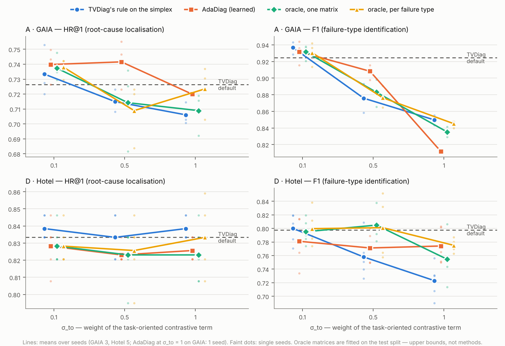

# Oracle headroom check (README §6.12)

Question: if the task-oriented contrastive term were weighted the way the evidence says it should be, would TVDiag do better? If even a matrix fitted on the test split cannot beat TVDiag's default, no weighting learned from training data can, and the weighting is not where the headroom is.

## 1. The oracle matrices

Each column is the cost of removing one modality (README §6.8, group B, measured on the test split against `ref_prior`), clipped at zero and normalised onto the simplex. `scripts/make_oracle_weights.py` → `oracle_weights.json`.

| dataset | task | cost of removing metric | trace | log |
|---|---|---|---|---|
| A · GAIA | RCL (HR@1 lost) | +0.272 | +0.261 | +0.055 |
| | FTI (F1 lost) | -0.012 | +0.024 | +0.174 |
| D · Hotel | RCL (HR@1 lost) | +0.072 | +0.038 | +0.038 |
| | FTI (F1 lost) | +0.355 | +0.008 | +0.097 |

| dataset | matrix | RCL: metric / trace / log | FTI: metric / trace / log |
|---|---|---|---|
| (both) | TVDiag's rule, on the simplex | 0.50 / 0.50 / 0.00 | 0.00 / 0.00 / 1.00 |
| A · GAIA | **oracle, one matrix** | 0.46 / 0.44 / 0.09 | 0.00 / 0.12 / 0.88 |
| | [access permission denied exception] (n = 15) | 0.15 / 0.38 / 0.46 | 0.33 / 0.33 / 0.33 |
| | [file moving program] (n = 27) | 0.00 / 0.08 / 0.92 | 0.00 / 0.00 / 1.00 |
| | [login failure] (n = 458) | 0.04 / 0.82 / 0.14 | 0.00 / 0.18 / 0.82 |
| | [memory_anomalies] (n = 426) | 1.00 / 0.00 / 0.00 | 0.04 / 0.06 / 0.89 |
| | [normal memory freed label] (n = 13) | 0.00 / 0.00 / 1.00 | 0.33 / 0.33 / 0.33 |
| D · Hotel | **oracle, one matrix** | 0.48 / 0.26 / 0.26 | 0.77 / 0.02 / 0.21 |
| | container-kill (n = 22) | 0.00 / 0.00 / 1.00 | 0.88 / 0.00 / 0.12 |
| | network-delay (n = 14) | 0.77 / 0.14 / 0.09 | 0.87 / 0.13 / 0.00 |
| | network-loss (n = 13) | 0.36 / 0.39 / 0.25 | 0.67 / 0.26 / 0.07 |
| | pod-failure (n = 15) | 0.50 / 0.50 / 0.00 | 0.65 / 0.02 / 0.34 |
| | pod-kill (n = 14) | 0.33 / 0.33 / 0.33 | 0.50 / 0.14 / 0.36 |

The per-failure-type matrices are applied during training by each incident's true type (known at training time). The contrastive term is not used at inference, so no label reaches the test predictions through it.

## 2. Results

Every run: 1 thread, 500-epoch cap, TVDiag's early stopping, seeds paired with the references (GAIA 0–2, Hotel 0–4). σ_to scales the task-oriented term only; the cross-modal term stays at σ = 0.1.

**A · GAIA**

| weighting | σ_to | seeds | HR@1 | HR@3 | MRR@3 | F1 | macro-F1 |
|---|---|---|---|---|---|---|---|
| TVDiag default (1 / 1 / 0, 0 / 0 / 1) | 0.1 | 3 | 0.726 ± 0.022 | 0.889 ± 0.013 | 0.800 ± 0.018 | 0.924 ± 0.014 | 0.573 ± 0.006 |
| TVDiag's rule on the simplex | 0.1 | 3 | 0.733 ± 0.017 | 0.892 ± 0.009 | 0.806 ± 0.013 | 0.937 ± 0.008 | 0.573 ± 0.007 |
| AdaDiag (learned) | 0.1 | 3 | 0.740 ± 0.012 | 0.895 ± 0.011 | 0.810 ± 0.010 | 0.932 ± 0.015 | 0.564 ± 0.020 |
| **oracle, one matrix** | 0.1 | 3 | 0.737 ± 0.009 | 0.896 ± 0.015 | 0.810 ± 0.013 | 0.932 ± 0.010 | 0.576 ± 0.008 |
| **oracle, per failure type** | 0.1 | 3 | 0.738 ± 0.007 | 0.899 ± 0.012 | 0.812 ± 0.009 | 0.931 ± 0.015 | 0.577 ± 0.008 |
| TVDiag's rule on the simplex | 0.5 | 3 | 0.715 ± 0.008 | 0.886 ± 0.008 | 0.793 ± 0.008 | 0.876 ± 0.017 | 0.546 ± 0.015 |
| AdaDiag (learned) | 0.5 | 3 | 0.742 ± 0.017 | 0.887 ± 0.008 | 0.808 ± 0.013 | 0.908 ± 0.009 | 0.542 ± 0.021 |
| **oracle, one matrix** | 0.5 | 3 | 0.714 ± 0.029 | 0.891 ± 0.010 | 0.794 ± 0.021 | 0.883 ± 0.016 | 0.556 ± 0.021 |
| **oracle, per failure type** | 0.5 | 3 | 0.709 ± 0.022 | 0.882 ± 0.012 | 0.787 ± 0.018 | 0.876 ± 0.013 | 0.551 ± 0.021 |
| TVDiag's rule on the simplex | 1 | 3 | 0.706 ± 0.007 | 0.885 ± 0.001 | 0.789 ± 0.005 | 0.850 ± 0.006 | 0.523 ± 0.016 |
| AdaDiag (learned) | 1 | 1 | 0.720 | 0.882 | 0.793 | 0.812 | 0.467 |
| **oracle, one matrix** | 1 | 3 | 0.709 ± 0.015 | 0.887 ± 0.009 | 0.789 ± 0.012 | 0.835 ± 0.006 | 0.512 ± 0.011 |
| **oracle, per failure type** | 1 | 3 | 0.723 ± 0.018 | 0.894 ± 0.006 | 0.801 ± 0.012 | 0.845 ± 0.005 | 0.522 ± 0.016 |

| oracle − reference | σ_to | HR@1 | HR@3 | MRR@3 | F1 | macro-F1 |
|---|---|---|---|---|---|---|
| global − TVDiag default | 0.1 | +0.011 (p 0.28, Holm 1.00) | +0.006 (p 0.07, Holm 1.00) | +0.009 (p 0.10, Holm 1.00) | +0.007 (p 0.30, Holm 1.00) | +0.003 (p 0.25, Holm 1.00) |
| global − prior, same σ_to | 0.1 | +0.004 (p 0.49, Holm 1.00) | +0.004 (p 0.43, Holm 1.00) | +0.004 (p 0.01, Holm 1.00) | -0.005 (p 0.13, Holm 1.00) | +0.003 (p 0.59, Holm 1.00) |
| global − TVDiag default | 0.5 | -0.012 (p 0.47, Holm 1.00) | +0.001 (p 0.67, Holm 1.00) | -0.006 (p 0.56, Holm 1.00) | -0.041 (p 0.00, Holm 0.45) | -0.017 (p 0.23, Holm 1.00) |
| global − prior, same σ_to | 0.5 | -0.001 (p 0.96, Holm 1.00) | +0.005 (p 0.14, Holm 1.00) | +0.001 (p 0.93, Holm 1.00) | +0.007 (p 0.02, Holm 1.00) | +0.010 (p 0.38, Holm 1.00) |
| global − TVDiag default | 1 | -0.017 (p 0.16, Holm 1.00) | -0.002 (p 0.42, Holm 1.00) | -0.011 (p 0.13, Holm 1.00) | -0.089 (p 0.00, Holm 0.27) | -0.061 (p 0.01, Holm 0.98) |
| global − prior, same σ_to | 1 | +0.003 (p 0.73, Holm 1.00) | +0.001 (p 0.83, Holm 1.00) | +0.001 (p 0.93, Holm 1.00) | -0.014 (p 0.05, Holm 1.00) | -0.011 (p 0.06, Holm 1.00) |
| class − TVDiag default | 0.1 | +0.012 (p 0.37, Holm 1.00) | +0.010 (p 0.01, Holm 0.59) | +0.011 (p 0.20, Holm 1.00) | +0.006 (p 0.24, Holm 1.00) | +0.004 (p 0.15, Holm 1.00) |
| class − prior, same σ_to | 0.1 | +0.005 (p 0.61, Holm 1.00) | +0.007 (p 0.07, Holm 1.00) | +0.006 (p 0.24, Holm 1.00) | -0.006 (p 0.28, Holm 1.00) | +0.004 (p 0.46, Holm 1.00) |
| class − TVDiag default | 0.5 | -0.017 (p 0.17, Holm 1.00) | -0.007 (p 0.01, Holm 1.00) | -0.013 (p 0.12, Holm 1.00) | **-0.048** (p 0.00, Holm 0.01) | -0.022 (p 0.17, Holm 1.00) |
| class − prior, same σ_to | 0.5 | -0.006 (p 0.59, Holm 1.00) | -0.004 (p 0.53, Holm 1.00) | -0.007 (p 0.37, Holm 1.00) | +0.001 (p 0.87, Holm 1.00) | +0.005 (p 0.68, Holm 1.00) |
| class − TVDiag default | 1 | -0.003 (p 0.72, Holm 1.00) | +0.005 (p 0.45, Holm 1.00) | +0.001 (p 0.88, Holm 1.00) | -0.079 (p 0.01, Holm 0.67) | -0.050 (p 0.02, Holm 1.00) |
| class − prior, same σ_to | 1 | +0.017 (p 0.20, Holm 1.00) | +0.009 (p 0.16, Holm 1.00) | +0.012 (p 0.18, Holm 1.00) | -0.004 (p 0.07, Holm 1.00) | -0.001 (p 0.67, Holm 1.00) |

**D · Hotel**

| weighting | σ_to | seeds | HR@1 | HR@3 | MRR@3 | F1 | macro-F1 |
|---|---|---|---|---|---|---|---|
| TVDiag default (1 / 1 / 0, 0 / 0 / 1) | 0.1 | 5 | 0.833 ± 0.013 | 0.918 ± 0.015 | 0.871 ± 0.012 | 0.798 ± 0.018 | 0.784 ± 0.027 |
| TVDiag's rule on the simplex | 0.1 | 5 | 0.838 ± 0.007 | 0.915 ± 0.011 | 0.873 ± 0.008 | 0.800 ± 0.022 | 0.786 ± 0.029 |
| AdaDiag (learned) | 0.1 | 5 | 0.828 ± 0.015 | 0.921 ± 0.011 | 0.868 ± 0.011 | 0.781 ± 0.034 | 0.765 ± 0.043 |
| **oracle, one matrix** | 0.1 | 5 | 0.828 ± 0.011 | 0.926 ± 0.011 | 0.871 ± 0.009 | 0.795 ± 0.018 | 0.787 ± 0.021 |
| **oracle, per failure type** | 0.1 | 5 | 0.828 ± 0.011 | 0.915 ± 0.011 | 0.868 ± 0.010 | 0.800 ± 0.026 | 0.791 ± 0.028 |
| TVDiag's rule on the simplex | 0.5 | 5 | 0.833 ± 0.013 | 0.918 ± 0.007 | 0.871 ± 0.005 | 0.758 ± 0.032 | 0.733 ± 0.043 |
| AdaDiag (learned) | 0.5 | 5 | 0.823 ± 0.006 | 0.915 ± 0.007 | 0.863 ± 0.003 | 0.771 ± 0.023 | 0.762 ± 0.026 |
| **oracle, one matrix** | 0.5 | 5 | 0.823 ± 0.017 | 0.915 ± 0.015 | 0.865 ± 0.008 | 0.805 ± 0.021 | 0.795 ± 0.025 |
| **oracle, per failure type** | 0.5 | 5 | 0.826 ± 0.019 | 0.915 ± 0.011 | 0.867 ± 0.010 | 0.801 ± 0.041 | 0.788 ± 0.049 |
| TVDiag's rule on the simplex | 1 | 5 | 0.838 ± 0.007 | 0.915 ± 0.007 | 0.871 ± 0.004 | 0.723 ± 0.025 | 0.698 ± 0.023 |
| AdaDiag (learned) | 1 | 5 | 0.826 ± 0.007 | 0.910 ± 0.013 | 0.863 ± 0.009 | 0.774 ± 0.026 | 0.766 ± 0.030 |
| **oracle, one matrix** | 1 | 5 | 0.823 ± 0.017 | 0.921 ± 0.006 | 0.866 ± 0.011 | 0.755 ± 0.033 | 0.746 ± 0.039 |
| **oracle, per failure type** | 1 | 5 | 0.833 ± 0.020 | 0.915 ± 0.011 | 0.869 ± 0.014 | 0.775 ± 0.009 | 0.771 ± 0.012 |

| oracle − reference | σ_to | HR@1 | HR@3 | MRR@3 | F1 | macro-F1 |
|---|---|---|---|---|---|---|
| global − TVDiag default | 0.1 | -0.005 (p 0.18, Holm 1.00) | +0.008 (p 0.21, Holm 1.00) | -0.001 (p 0.79, Holm 1.00) | -0.003 (p 0.81, Holm 1.00) | +0.003 (p 0.79, Holm 1.00) |
| global − prior, same σ_to | 0.1 | -0.010 (p 0.02, Holm 1.00) | +0.010 (p 0.10, Holm 1.00) | -0.002 (p 0.14, Holm 1.00) | -0.005 (p 0.41, Holm 1.00) | +0.001 (p 0.88, Holm 1.00) |
| global − TVDiag default | 0.5 | -0.010 (p 0.24, Holm 1.00) | -0.003 (p 0.78, Holm 1.00) | -0.007 (p 0.14, Holm 1.00) | +0.007 (p 0.65, Holm 1.00) | +0.011 (p 0.58, Holm 1.00) |
| global − prior, same σ_to | 0.5 | -0.010 (p 0.10, Holm 1.00) | -0.003 (p 0.62, Holm 1.00) | -0.006 (p 0.16, Holm 1.00) | +0.047 (p 0.01, Holm 1.00) | +0.062 (p 0.02, Holm 1.00) |
| global − TVDiag default | 1 | -0.010 (p 0.34, Holm 1.00) | +0.003 (p 0.75, Holm 1.00) | -0.006 (p 0.50, Holm 1.00) | -0.043 (p 0.08, Holm 1.00) | -0.038 (p 0.18, Holm 1.00) |
| global − prior, same σ_to | 1 | -0.015 (p 0.11, Holm 1.00) | +0.005 (p 0.37, Holm 1.00) | -0.005 (p 0.39, Holm 1.00) | +0.032 (p 0.21, Holm 1.00) | +0.047 (p 0.13, Holm 1.00) |
| class − TVDiag default | 0.1 | -0.005 (p 0.18, Holm 1.00) | -0.003 (p 0.62, Holm 1.00) | -0.004 (p 0.26, Holm 1.00) | +0.002 (p 0.88, Holm 1.00) | +0.007 (p 0.66, Holm 1.00) |
| class − prior, same σ_to | 0.1 | -0.010 (p 0.02, Holm 1.00) | +0.000 (p 1.00, Holm 1.00) | -0.005 (p 0.14, Holm 1.00) | -0.000 (p 0.95, Holm 1.00) | +0.005 (p 0.67, Holm 1.00) |
| class − TVDiag default | 0.5 | -0.008 (p 0.37, Holm 1.00) | -0.003 (p 0.75, Holm 1.00) | -0.005 (p 0.28, Holm 1.00) | +0.003 (p 0.85, Holm 1.00) | +0.004 (p 0.86, Holm 1.00) |
| class − prior, same σ_to | 0.5 | -0.008 (p 0.21, Holm 1.00) | -0.003 (p 0.70, Holm 1.00) | -0.004 (p 0.34, Holm 1.00) | +0.043 (p 0.08, Holm 1.00) | +0.055 (p 0.06, Holm 1.00) |
| class − TVDiag default | 1 | +0.000 (p 1.00, Holm 1.00) | -0.003 (p 0.62, Holm 1.00) | -0.002 (p 0.75, Holm 1.00) | -0.023 (p 0.02, Holm 1.00) | -0.013 (p 0.30, Holm 1.00) |
| class − prior, same σ_to | 1 | -0.005 (p 0.54, Holm 1.00) | +0.000 (p 1.00, Holm 1.00) | -0.001 (p 0.83, Holm 1.00) | +0.052 (p 0.01, Holm 1.00) | +0.073 (p 0.01, Holm 0.83) |

Paired t-test over seeds; Holm correction over all 120 comparisons in this table (both datasets, both oracles, three σ_to, two references, five metrics). Bold: significant after correction.

Significant after correction: 1 of 120 comparisons, 0 of them in the oracle's favour.

## 3. Headroom — the best oracle against TVDiag default

The best of the six oracle configurations per dataset and metric, chosen after seeing the test results. That choice is itself optimistic, so this gain is an upper bound on what any re-weighting of the task-oriented term can add.

| dataset | metric | TVDiag default | best oracle (chosen on test) | gain | 95% CI | p | Holm |
|---|---|---|---|---|---|---|---|
| A · GAIA | HR@1 | 0.726 | class, σ_to 0.1: 0.738 | +0.012 | [-0.032, +0.055] | 0.37 | 1.00 |
| A · GAIA | F1 | 0.924 | global, σ_to 0.1: 0.932 | +0.007 | [-0.015, +0.029] | 0.30 | 1.00 |
| D · Hotel | HR@1 | 0.833 | class, σ_to 1: 0.833 | +0.000 | [-0.025, +0.025] | 1.00 | 1.00 |
| D · Hotel | F1 | 0.798 | global, σ_to 0.5: 0.805 | +0.007 | [-0.034, +0.048] | 0.65 | 1.00 |

