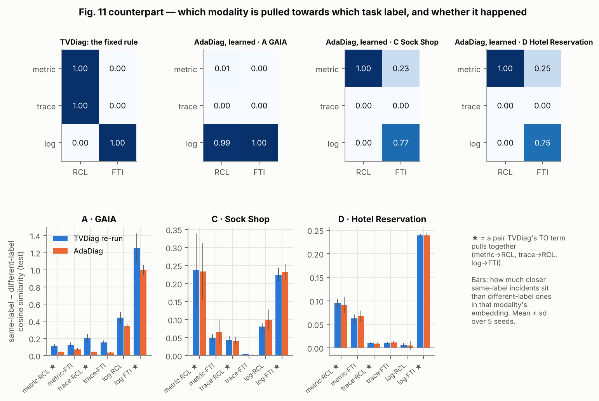
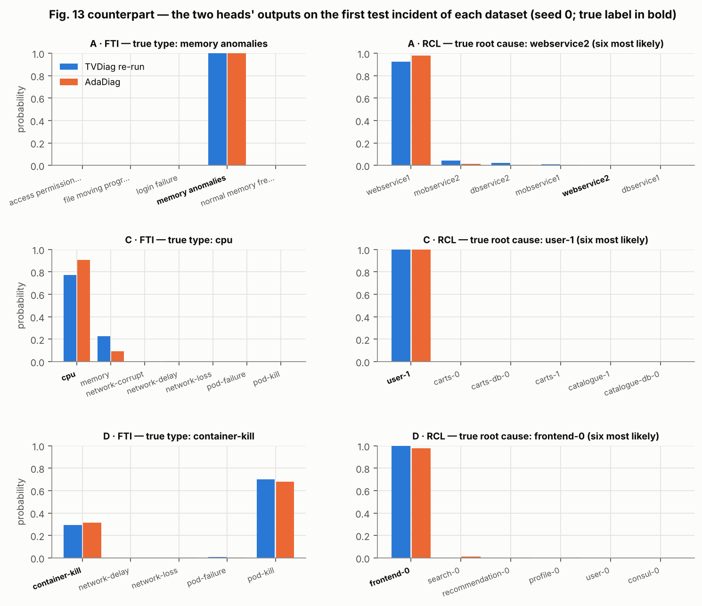
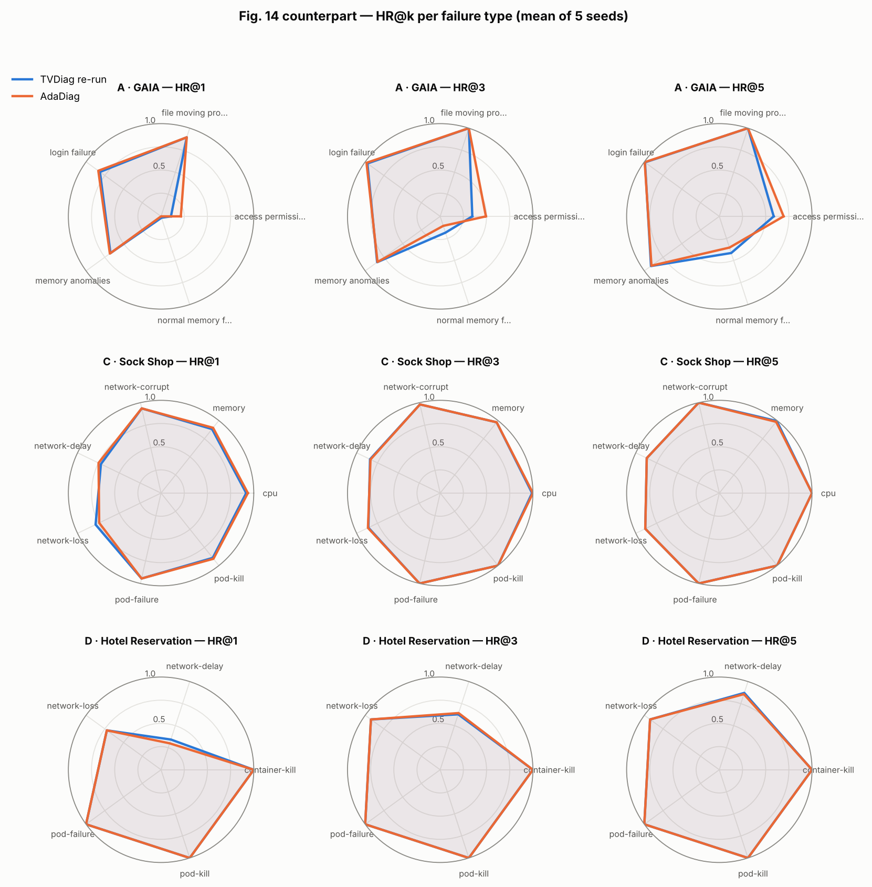
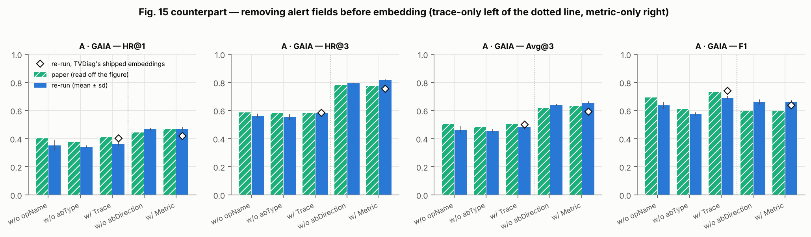
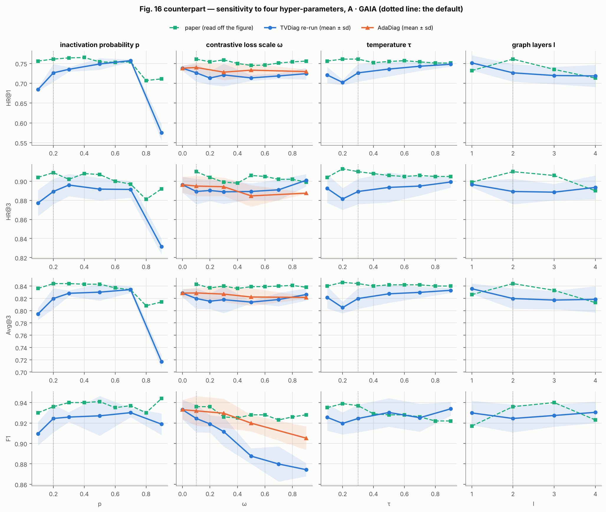
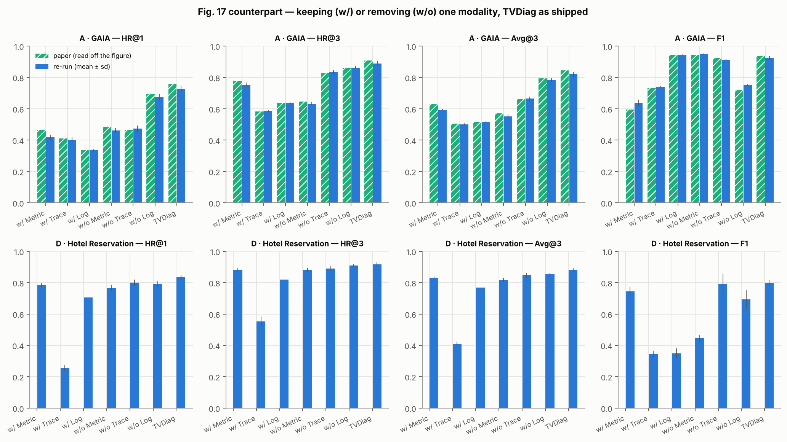
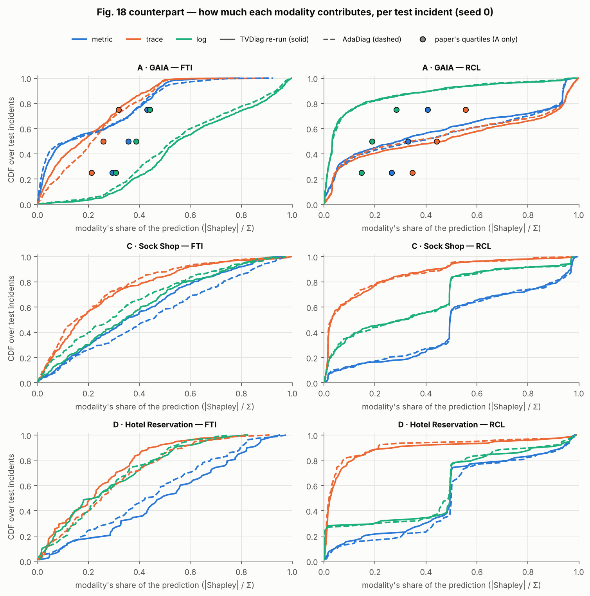

# AdaDiag beside the TVDiag paper

Tables 3–7 and Figures 11 and 13–18 of the TVDiag paper — S. Xie et al., *ACM Transactions on Software Engineering and Methodology* 35(2), Article 40, 2026, doi:[10.1145/3734868](https://doi.org/10.1145/3734868) — each set beside the same measurement made with this repository. Generated by `scripts/make_paper_comparison.py`; the runs are listed in `scripts/paper_comparison_runs.sh`.

## How to read this

- **Datasets.** The paper's A = GAIA, B = AIOps-22, C = Sock Shop, D = Hotel Reservation
  (Sec. 5.1). B is not distributed with TVDiag's code, so it has no re-run anywhere below.
- **What is re-run.** *TVDiag (re-run)* is this repository's re-implementation of TVDiag as
  it ships (`v0_raw`); *AdaDiag* is the proposed method (`v3_incident`); *V0-simplex* is the
  controlled baseline of §6.2–6.3 of the README. The paper's **baselines** (MicroRCA,
  Eadro, DiagFusion, …) are **not** re-run: their numbers are the paper's, shown for context.
- **Paper numbers.** Table values are transcribed as printed. Figures 15–18 print no numbers,
  so their values were **read off the figures** (`adadiag/paper_numbers.py` says how);
  checked against bars the paper also prints in a table, the error is at most 0.003 —
  treat them as ± 0.005.
- **Seeds and threads.** Tables 4–5 and Figures 11, 13, 14 and 18 use 5 seeds and 2 CPU threads
  — the same runs as `results/gaia.json` and `results/hotel.json`, re-trained here and
  checked identical (below). Tables 6–7 and Figures 15–17 use 1 thread, 3 seeds on GAIA and 5
  on Hotel, each with its own TVDiag reference runs under the same setting. Values are
  mean ± sd over seeds; *p* is a paired t-test over seeds, Holm-corrected within a table where
  stated. The paper reports single numbers, without spread.

Re-training check: GAIA TVDiag (re-run): 5 seeds, identical to results/gaia.json; GAIA AdaDiag (V3-incident): 5 seeds, identical to results/gaia.json; Hotel Reservation TVDiag (re-run): 5 seeds, identical to results/hotel.json; Hotel Reservation AdaDiag (V3-incident): 5 seeds, identical to results/hotel.json.

## At a glance

| Paper's claim | Paper's evidence | Re-run | Verdict |
|---|---|---|---|
| RQ1 · TVDiag beats every baseline at RCL (Table 4) | HR@1 ahead of the best baseline (RF-RCL) on A–D | Re-run HR@1 vs best published baseline: A 0.731 vs 0.573; C 0.868 vs 0.622; D 0.836 vs 0.744 | **Holds** |
| RQ1 · TVDiag beats every baseline at FTI (Table 5) | Best F1 on A–D | Re-run F1 vs best published baseline: A 0.918 vs 0.908; C 0.572 vs 0.454; D 0.796 vs 0.764 | **Holds** ³ |
| The published numbers themselves | Tables 4–5, TVDiag rows | Re-run − paper: A: HR@1 -0.028, F1 -0.018; C: HR@1 +0.005, F1 -0.064; D: HR@1 +0.015, F1 -0.026 | **HR@1 reproduced** (within 0.03); **F1 lower** on all three (-0.018 to -0.064) |
| RQ2 · each of AUG, TO, CM, DW contributes (Table 6) | A, Δ HR@1: w/o AUG -0.084; w/o TO -0.005, w/o CM -0.002, w/o DW -0.002 | A, Δ HR@1 — w/o AUG -0.111 (paired p 0.006); w/o TO +0.011, w/o CM +0.010, w/o DW +0.003 | **AUG reproduced**; TO, CM, DW: **no measurable contribution** in either (paper ≥ -0.005, single run; re-run within seed noise) |
| RQ3 · best p = 0.2, ω = 0.1, τ = 0.2, l = 2 (Fig. 16) | Read off the curves; stated in the RQ3 answer | A, vs the default (3 seeds, paired): p = 0.9: HR@1 -0.151 (p 0.013); ω: F1 -0.050 at ω = 0.9, +0.009 at ω = 0; τ, l: no point differs from the default at p < 0.05 | **Large p hurts** (agrees); **ω: the contrastive terms do not help** (ω = 0 is as good, F1 falls as ω grows — disagrees); τ, l: flat within seed noise ⁴ |
| RQ4 · RCL leans on metric and trace, FTI on log (Fig. 17) | A: w/o Metric −0.274, w/o Trace −0.294 HR@1; w/o Log −0.216 F1 | A: w/o Metric -0.265, w/o Trace -0.253 HR@1; w/o Log -0.173 F1 | **Reproduced** (each Δ within 0.043 of the paper's); on D (not in the paper) FTI leans on **metric**, not log: w/o Metric -0.353 F1, w/o Log -0.105 |
| Table 7 · TVDiag's own extractors, one modality at a time | A: trace 0.410 / 0.732, log 0.337 / 0.945 (HR@1 / F1) | A: trace 0.402 / 0.741, log 0.337 / 0.945 | **Reproduced** (all 8 numbers within 0.009); DiagFusion's extractors not reproducible ¹ |
| RQ4 · per-incident contribution (Fig. 18) | A medians: RCL trace 0.44 > metric 0.33 > log 0.19; FTI log 0.39 > metric 0.36 > trace 0.26 | A medians: RCL trace 0.47 > metric 0.29 > log 0.03; FTI log 0.55 > trace 0.17 > metric 0.12 | RCL: same order; FTI: same leader, order differs |

**AdaDiag against each reference** (HR@1 / F1, means of 5 seeds):

| Dataset | AdaDiag | − TVDiag, paper | − TVDiag, re-run | − V0-simplex (same fixed rule, rescaled) |
|---|---|---|---|---|
| A · GAIA | 0.747 / 0.935 | -0.012 / -0.001 | +0.016 / +0.017 | +0.003 / +0.003 |
| C · Sock Shop | 0.871 / 0.575 | +0.008 / -0.061 | +0.003 / +0.002 | -0.001 / -0.005 |
| D · Hotel | 0.828 / 0.781 | +0.007 / -0.041 | -0.008 / -0.015 | -0.005 / -0.023 |

The last column is the controlled comparison (README §6.2–6.3): whatever AdaDiag gains over TVDiag as shipped, the fixed rule written on the simplex gains too, so it is the rescaling, not the learning.

³ The F1 values of most baselines in Table 5 are not computed the way TVDiag's is — see the note under Table 5. ⁴ GAIA's seed-to-seed spread is larger than most differences along these curves — see Figure 16.

## Table 3 — dataset statistics

| Dataset | Source | Micro-services | Instances | Failure types | Incidents (train/test) | Records: metric / trace / log | Types: metric / trace / LogKeys |
| --- | --- | ---: | ---: | ---: | ---: | ---: | ---: |
| A · GAIA | paper | 5 | 10 | 5 | — | 217,461,390 / 3,084,066 / 87,974,577 | 3,320 / 122 / 49 |
|  | this repository (`data/`) | 5 | 10 | 5 | 1099 (160/939) | 49,825 / 12,603 / 17,777 | 479 / 34 / 36 |
| B · AIOps-22 | paper | 10 | 40 | 9 | — | 25,914,595 / 63,283,650 / 95,003,038 | 404 / 63 / 119 |
|  | this repository | not distributed |  |  |  |  |  |
| C · Sock Shop | paper | 14 | 21 | 7 | — | 77,376,704 / 7,297,688 / 20,365,334 | 293 / 143 / 422 |
|  | this repository (`data/`) | 14 | 21 | 7 | 489 (248/241) | 16,471 / 11,866 / 15,827 | 233 / 134 / 295 |
| D · Hotel Reservation | paper | 18 | 18 | 5 | — | 47,809,236 / 1,218,830 / 258,927 | 393 / 12 / 112 |
|  | this repository (`data/`) | 18 | 18 | 5 | 200 (122/78) | 9,201 / 2,091 / 196 | 208 / 26 / 10 |

The paper counts **raw telemetry** records and every metric/trace/log type in it; the release ships only the **extracted alerts** (TVDiag's own extractor output), so the counts here are alerts and alert types — smaller by construction, and not a discrepancy. What must match does: micro-services, instances and failure types agree on A, C and D. Metric types = distinct (instance, metric); trace types = distinct (caller, callee, operation); LogKeys = distinct log-template IDs.

## Table 4 — root cause localisation (RCL)

**A · GAIA**

| Method | Modality | p-value (paper) | HR@1 | HR@3 | Avg@3 | MRR@3 |
| --- | --- | ---: | ---: | ---: | ---: | ---: |
| MicroRCA | Metric | 3.4e-05 | 0.181 | 0.385 | 0.287 | 0.268 |
| MicroHECL | Metric | 2.4e-06 | 0.118 | 0.233 | 0.177 | 0.167 |
| TraceRCA | Trace | 1.3e-05 | 0.192 | 0.364 | 0.291 | 0.270 |
| MicroRank | Trace | 8.6e-05 | 0.192 | 0.419 | 0.308 | 0.288 |
| Eadro | Multimodal | 1.6e-03 | 0.304 | 0.592 | 0.473 | 0.437 |
| DiagFusion | Multimodal | 3.1e-02 | 0.404 | 0.801 | 0.636 | 0.586 |
| RF-RCL | Multimodal | 3.4e-02 | 0.573 | 0.815 | 0.719 | 0.686 |
| **TVDiag (paper)** | Multimodal | - | 0.759 | 0.909 | 0.844 | 0.827 |
| TVDiag (re-run), 5 seeds | Multimodal | — | 0.731 ± 0.021 | 0.892 ± 0.011 | 0.823 ± 0.014 | 0.804 ± 0.015 |
| TVDiag prior on the simplex (V0-simplex), 5 seeds | Multimodal | — | 0.744 ± 0.010 | 0.897 ± 0.009 | 0.832 ± 0.007 | 0.814 ± 0.008 |
| AdaDiag (V3-incident), 5 seeds | Multimodal | — | 0.747 ± 0.013 | 0.896 ± 0.007 | 0.832 ± 0.007 | 0.814 ± 0.008 |
| *re-run − paper* |  |  | -0.028 | -0.017 | -0.021 | -0.023 |
| *AdaDiag − re-run (paired p)* |  |  | +0.016 (0.026) | +0.005 (0.189) | +0.009 (0.056) | +0.011 (0.046) |

**C · Sock Shop**

| Method | Modality | p-value (paper) | HR@1 | HR@3 | Avg@3 | MRR@3 |
| --- | --- | ---: | ---: | ---: | ---: | ---: |
| MicroRCA | Metric | 6.4E-06 | 0.063 | 0.231 | 0.145 | 0.132 |
| MicroHECL | Metric | 1.8E-05 | 0.054 | 0.245 | 0.147 | 0.132 |
| TraceRCA | Trace | 1.3E-07 | 0.116 | 0.220 | 0.171 | 0.161 |
| MicroRank | Trace | 1.7E-06 | 0.054 | 0.200 | 0.140 | 0.121 |
| Eadro | Multimodal | 1.4E-04 | 0.191 | 0.415 | 0.317 | 0.291 |
| DiagFusion | Multimodal | 9.0E-04 | 0.519 | 0.710 | 0.612 | 0.597 |
| RF-RCL | Multimodal | 5.1E-03 | 0.622 | 0.817 | 0.715 | 0.701 |
| **TVDiag (paper)** | Multimodal | - | 0.863 | 0.954 | 0.913 | 0.903 |
| TVDiag (re-run), 5 seeds | Multimodal | — | 0.868 ± 0.012 | 0.948 ± 0.006 | 0.913 ± 0.005 | 0.904 ± 0.007 |
| TVDiag prior on the simplex (V0-simplex), 5 seeds | Multimodal | — | 0.872 ± 0.009 | 0.949 ± 0.005 | 0.916 ± 0.005 | 0.907 ± 0.006 |
| AdaDiag (V3-incident), 5 seeds | Multimodal | — | 0.871 ± 0.005 | 0.949 ± 0.008 | 0.917 ± 0.004 | 0.907 ± 0.003 |
| *re-run − paper* |  |  | +0.005 | -0.006 | -0.000 | +0.001 |
| *AdaDiag − re-run (paired p)* |  |  | +0.003 (0.642) | +0.001 (0.866) | +0.004 (0.222) | +0.003 (0.358) |

**D · Hotel Reservation**

| Method | Modality | p-value (paper) | HR@1 | HR@3 | Avg@3 | MRR@3 |
| --- | --- | ---: | ---: | ---: | ---: | ---: |
| MicroRCA | Metric | 7.9E-04 | 0.150 | 0.460 | 0.317 | 0.285 |
| MicroHECL | Metric | 2.3E-04 | 0.129 | 0.387 | 0.269 | 0.242 |
| TraceRCA | Trace | 2.9E-07 | 0.151 | 0.258 | 0.197 | 0.192 |
| MicroRank | Trace | 1.2E-04 | 0.172 | 0.398 | 0.283 | 0.265 |
| Eadro | Multimodal | 2.6E-03 | 0.244 | 0.590 | 0.419 | 0.389 |
| DiagFusion | Multimodal | 4.5E-03 | 0.513 | 0.744 | 0.645 | 0.618 |
| RF-RCL | Multimodal | 4.6E-02 | 0.744 | 0.872 | 0.804 | 0.795 |
| **TVDiag (paper)** | Multimodal | - | 0.821 | 0.923 | 0.876 | 0.866 |
| TVDiag (re-run), 5 seeds | Multimodal | — | 0.836 ± 0.011 | 0.921 ± 0.011 | 0.883 ± 0.010 | 0.874 ± 0.010 |
| TVDiag prior on the simplex (V0-simplex), 5 seeds | Multimodal | — | 0.833 ± 0.013 | 0.918 ± 0.007 | 0.880 ± 0.009 | 0.871 ± 0.008 |
| AdaDiag (V3-incident), 5 seeds | Multimodal | — | 0.828 ± 0.015 | 0.923 ± 0.009 | 0.878 ± 0.012 | 0.869 ± 0.012 |
| *re-run − paper* |  |  | +0.015 | -0.002 | +0.007 | +0.008 |
| *AdaDiag − re-run (paired p)* |  |  | -0.008 (0.208) | +0.003 (0.621) | -0.005 (0.305) | -0.005 (0.324) |

Avg@3 = (HR@1 + HR@2 + HR@3) / 3 and MRR@3 as in the paper's Eqs. 15–16. *p-value (paper)* is the paper's own test of TVDiag against that baseline.

## Table 5 — failure type identification (FTI)

**A · GAIA**

| Method | Modality | p-value (paper) | Precision | Recall | F1 |
| --- | --- | ---: | ---: | ---: | ---: |
| LogCluster | Log | 1.4E-02 | 0.888 | 0.915 | 0.901 |
| DiagFusion | Multimodal | 3.3E-04 | 0.852 | 0.838 | 0.840 |
| Medicine | Multimodal | 4.1E-06 | 0.669 | 0.667 | 0.648 |
| DT-FTI | Multimodal | 9.4E-03 | 0.889 | 0.892 | 0.890 |
| SVM-FTI | Multimodal | 9.9E-02 | 0.883 | 0.935 | 0.908 |
| LGB-FTI | Multimodal | 5.2E-02 | 0.892 | 0.928 | 0.907 |
| **TVDiag (paper)** | Multimodal | - | 0.925 | 0.948 | 0.936 |
| TVDiag (re-run), 5 seeds | Multimodal | — | 0.909 ± 0.011 | 0.928 ± 0.014 | 0.918 ± 0.013 |
| TVDiag prior on the simplex (V0-simplex), 5 seeds | Multimodal | — | 0.920 ± 0.008 | 0.943 ± 0.010 | 0.932 ± 0.009 |
| AdaDiag (V3-incident), 5 seeds | Multimodal | — | 0.924 ± 0.011 | 0.947 ± 0.013 | 0.935 ± 0.012 |
| *TVDiag (re-run), F1 the baselines' way ²* |  |  |  |  | 0.916 ± 0.014 |
| *re-run − paper* |  |  | -0.016 | -0.020 | -0.018 |
| *AdaDiag − re-run (paired p)* |  |  | +0.015 (0.075) | +0.018 (0.037) | +0.017 (0.052) |

**C · Sock Shop**

| Method | Modality | p-value (paper) | Precision | Recall | F1 |
| --- | --- | ---: | ---: | ---: | ---: |
| LogCluster | Log | 1.9E-06 | 0.233 | 0.228 | 0.213 |
| DiagFusion | Multimodal | 7.9E-05 | 0.338 | 0.332 | 0.328 |
| Medicine | Multimodal | 5.0E-04 | 0.497 | 0.469 | 0.454 |
| DT-FTI | Multimodal | 6.4E-05 | 0.376 | 0.365 | 0.366 |
| SVM-FTI | Multimodal | 3.2E-03 | 0.384 | 0.315 | 0.282 |
| LGB-FTI | Multimodal | 9.7E-04 | 0.442 | 0.390 | 0.388 |
| **TVDiag (paper)** | Multimodal | - | 0.649 | 0.622 | 0.636 |
| TVDiag (re-run), 5 seeds | Multimodal | — | 0.596 ± 0.022 | 0.550 ± 0.011 | 0.572 ± 0.014 |
| TVDiag prior on the simplex (V0-simplex), 5 seeds | Multimodal | — | 0.606 ± 0.009 | 0.556 ± 0.020 | 0.580 ± 0.013 |
| AdaDiag (V3-incident), 5 seeds | Multimodal | — | 0.600 ± 0.026 | 0.551 ± 0.024 | 0.575 ± 0.024 |
| *TVDiag (re-run), F1 the baselines' way ²* |  |  |  |  | 0.555 ± 0.012 |
| *re-run − paper* |  |  | -0.053 | -0.072 | -0.064 |
| *AdaDiag − re-run (paired p)* |  |  | +0.004 (0.614) | +0.001 (0.924) | +0.002 (0.767) |

**D · Hotel Reservation**

| Method | Modality | p-value (paper) | Precision | Recall | F1 |
| --- | --- | ---: | ---: | ---: | ---: |
| LogCluster | Log | 4.5E-03 | 0.396 | 0.282 | 0.212 |
| DiagFusion | Multimodal | 3.2E-05 | 0.618 | 0.603 | 0.600 |
| Medicine | Multimodal | 1.9E-02 | 0.782 | 0.725 | 0.728 |
| DT-FTI | Multimodal | 5.2E-03 | 0.676 | 0.603 | 0.598 |
| SVM-FTI | Multimodal | 9.5E-03 | 0.488 | 0.628 | 0.540 |
| LGB-FTI | Multimodal | 4.1E-02 | 0.809 | 0.769 | 0.764 |
| **TVDiag (paper)** | Multimodal | - | 0.836 | 0.808 | 0.822 |
| TVDiag (re-run), 5 seeds | Multimodal | — | 0.818 ± 0.014 | 0.774 ± 0.027 | 0.796 ± 0.019 |
| TVDiag prior on the simplex (V0-simplex), 5 seeds | Multimodal | — | 0.824 ± 0.008 | 0.785 ± 0.023 | 0.804 ± 0.015 |
| AdaDiag (V3-incident), 5 seeds | Multimodal | — | 0.807 ± 0.022 | 0.756 ± 0.043 | 0.781 ± 0.032 |
| *TVDiag (re-run), F1 the baselines' way ²* |  |  |  |  | 0.771 ± 0.031 |
| *re-run − paper* |  |  | -0.018 | -0.034 | -0.026 |
| *AdaDiag − re-run (paired p)* |  |  | -0.011 (0.342) | -0.018 (0.530) | -0.015 (0.468) |

² **Two F1 definitions in one table.** TVDiag's F1 is the harmonic mean of its weighted precision and recall — exactly, to the printed digit, on all four datasets (largest gap 0.001). For **18 of the 24 baseline rows** the printed F1 is *below* that harmonic mean by more than 0.005 (by up to 0.117), which is what sklearn's weighted F1 gives. The row marked ² shows the re-run under that second definition: comparing TVDiag's F1 with the baselines' therefore favours TVDiag by roughly the difference between the two rows.

## Table 6 — ablation of AUG, TO, CM and DW

**A · GAIA** — re-run: TVDiag as shipped (V0-raw), 3 seeds

| Variant | paper A · HR@1 | paper A · HR@3 | paper A · Avg@3 | paper A · F1 | re-run A · HR@1 | re-run A · HR@3 | re-run A · Avg@3 | re-run A · F1 |
| --- | ---: | ---: | ---: | ---: | ---: | ---: | ---: | ---: |
| w/o AUG | 0.675 (-0.084) | 0.879 (-0.030) | 0.794 (-0.050) | 0.905 (-0.031) | 0.616 (-0.111) | 0.861 (-0.028) | 0.756 (-0.063) | 0.896 (-0.028) |
| w/o TO | 0.754 (-0.005) | 0.911 (+0.002) | 0.843 (-0.001) | 0.920 (-0.016) | 0.737 (+0.011) | 0.900 (+0.011) | 0.828 (+0.009) | 0.938 (+0.013) |
| w/o CM | 0.757 (-0.002) | 0.908 (-0.001) | 0.845 (+0.001) | 0.931 (-0.005) | 0.737 (+0.010) | 0.889 (-0.000) | 0.824 (+0.004) | 0.924 (-0.000) |
| w/o DW | 0.757 (-0.002) | 0.908 (-0.001) | 0.843 (-0.001) | 0.935 (-0.001) | 0.729 (+0.003) | 0.887 (-0.002) | 0.821 (+0.002) | 0.922 (-0.002) |
| TVDiag | 0.759 | 0.909 | 0.844 | 0.936 | 0.726 ± 0.022 | 0.889 ± 0.013 | 0.820 ± 0.017 | 0.924 ± 0.014 |

**D · Hotel Reservation** — re-run: TVDiag as shipped (V0-raw), 5 seeds

| Variant | re-run D · HR@1 | re-run D · HR@3 | re-run D · Avg@3 | re-run D · F1 |
| --- | ---: | ---: | ---: | ---: |
| w/o AUG | 0.828 (-0.005) | 0.918 (+0.000) | 0.872 (-0.009) | 0.775 (-0.023) |
| w/o TO | 0.833 (+0.000) | 0.921 (+0.003) | 0.881 (+0.000) | 0.808 (+0.011) |
| w/o CM | 0.831 (-0.003) | 0.923 (+0.005) | 0.879 (-0.002) | 0.795 (-0.003) |
| w/o DW | 0.836 (+0.003) | 0.921 (+0.003) | 0.882 (+0.001) | 0.802 (+0.004) |
| TVDiag | 0.833 ± 0.013 | 0.918 ± 0.015 | 0.881 ± 0.012 | 0.798 ± 0.018 |

Cells are mean (Δ vs the full model); **bold** Δ = significant after Holm correction over the 16 comparisons of that dataset. *w/o DW* replaces Eq. 13 by static unit weights (`dynamic_weights=False`). In the released code Eq. 13 is inert (README §7), so *w/o DW* changes only the loss scale.

## Table 7 — alert extractors

| Dataset | Extractor | Modality | paper · HR@1 | paper · HR@3 | paper · Avg@3 | paper · F1 | re-run · HR@1 | re-run · HR@3 | re-run · Avg@3 | re-run · F1 |
| --- | --- | --- | ---: | ---: | ---: | ---: | ---: | ---: | ---: | ---: |
| A · GAIA | IForest | Trace | 0.410 | 0.583 | 0.506 | 0.732 | 0.402 ± 0.017 | 0.585 ± 0.007 | 0.501 ± 0.007 | 0.741 ± 0.001 |
| A · GAIA | 3-sigma | Trace | 0.398 | 0.604 | 0.504 | 0.731 | not reproducible ¹ |  |  |  |
| A · GAIA | Rule-based | Log | 0.337 | 0.639 | 0.518 | 0.945 | 0.337 ± 0.007 | 0.638 ± 0.005 | 0.518 ± 0.001 | 0.945 ± 0.001 |
| A · GAIA | Sampling | Log | 0.301 | 0.644 | 0.508 | 0.877 | not reproducible ¹ |  |  |  |
| D · Hotel Reservation | IForest | Trace | — | — | — | — | 0.254 ± 0.019 | 0.554 ± 0.029 | 0.409 ± 0.014 | 0.346 ± 0.020 |
| D · Hotel Reservation | 3-sigma | Trace | — | — | — | — | not reproducible ¹ |  |  |  |
| D · Hotel Reservation | Rule-based | Log | — | — | — | — | 0.705 ± 0.000 | 0.821 ± 0.000 | 0.769 ± 0.000 | 0.349 ± 0.032 |
| D · Hotel Reservation | Sampling | Log | — | — | — | — | not reproducible ¹ |  |  |  |

Each row is TVDiag trained on one modality, with that modality's alerts from the named extractor. The *IForest* (trace) and *rule-based* (log) rows are TVDiag's own extractors — the alerts the release ships — so they are re-run as *w/ Trace* and *w/ Log* (the same runs as Figure 17). ¹ The *3-sigma* and *sampling* rows (DiagFusion's extractors) need the raw traces and logs, which the release does not include: they cannot be reproduced from the published artefacts. The paper's Table 7 covers A and B; the D rows are this repository's only.

## Figure 11 — task-oriented learning

The paper's Fig. 11 is a diagram of TO: same-label samples of a modality are pulled together. Top: which (modality, task) pairs that pull applies to — TVDiag's fixed rule and AdaDiag's learned matrix. Bottom: whether it happened on the test split — how much closer same-label incidents sit than different-label ones in each modality's embedding.

- **A · GAIA** — AdaDiag's learned matrix: RCL ← log 0.99; FTI ← log 1.00.
- **C · Sock Shop** — AdaDiag's learned matrix: RCL ← metric 1.00; FTI ← metric 0.23, log 0.77.
- **D · Hotel** — AdaDiag's learned matrix: RCL ← metric 1.00; FTI ← metric 0.25, log 0.75.
- A: the clearest label structure is in **log for FTI** (gap 1.258, a pair TO targets). The largest AdaDiag − TVDiag change on any pair is -0.260 (log/FTI).
- C: the clearest label structure is in **metric for RCL** (gap 0.237, a pair TO targets). The largest AdaDiag − TVDiag change on any pair is +0.018 (log/RCL).
- D: the clearest label structure is in **log for FTI** (gap 0.239, a pair TO targets). The largest AdaDiag − TVDiag change on any pair is +0.005 (metric/FTI).

## Figure 13 — failure diagnosis from graph- and node-level features

The paper's Fig. 13 illustrates the two heads with made-up probabilities. These are the real outputs on the first test incident of each dataset — not selected.

## Figure 14 — HR@k per failure type

The paper compares TVDiag with Eadro and DiagFusion per failure type; the baselines are not re-run, so the comparison here is TVDiag (re-run) against AdaDiag. The paper prints no numbers for Fig. 14.

- A: hardest type for TVDiag at HR@1 is *normal memory freed label* (0.02); the largest AdaDiag − TVDiag difference is +0.11 on *access permission denied exception*.
- C: hardest type for TVDiag at HR@1 is *network-delay* (0.72); the largest AdaDiag − TVDiag difference is -0.04 on *network-loss*.
- D: hardest type for TVDiag at HR@1 is *network-delay* (0.34); the largest AdaDiag − TVDiag difference is -0.04 on *network-delay*.

## Figure 15 — alert fields

Alerts re-embedded with fields removed (`scripts/reembed_alerts.py`, TVDiag's own fastText step made deterministic), then TVDiag trained on that modality alone. Diamonds: the same single-modality model on TVDiag's shipped embeddings — a fresh fastText model is not identical to theirs, so compare bars with bars.

- **w/o opName** vs w/ Trace: paper HR@1 -0.007, F1 -0.038; re-run HR@1 -0.011, F1 -0.054.
- **w/o abType** vs w/ Trace: paper HR@1 -0.034, F1 -0.120; re-run HR@1 -0.020, F1 -0.115.
- **w/o abDirection** vs w/ Metric: paper HR@1 -0.021, F1 +0.000; re-run HR@1 -0.005, F1 +0.002.
- w/ Trace, re-embedded vs shipped embeddings: F1 0.690 vs 0.741, HR@1 0.362 vs 0.402.
- w/ Metric, re-embedded vs shipped embeddings: F1 0.659 vs 0.637, HR@1 0.470 vs 0.419.

## Figure 16 — hyper-parameters

Shaded band: ± 1 sd over 3 seeds. AdaDiag is swept along ω only — the scale of the contrastive terms it reweights.

- **p** — re-run points that differ from the default (paired, 3 seeds, p < 0.05 uncorrected): p = 0.9: HR@1 -0.151 (p = 0.013); p = 0.1: F1 -0.015 (p = 0.014). The paper's curve spans 0.058 in HR@1 and 0.014 in F1, single runs.
- **ω** — re-run points that differ from the default (paired, 3 seeds, p < 0.05 uncorrected): ω = 0.3: F1 -0.013 (p = 0.031); ω = 0.5: F1 -0.037 (p = 0.009); ω = 0.7: F1 -0.045 (p = 0.023); ω = 0.9: F1 -0.050 (p = 0.011). The paper's curve spans 0.016 in HR@1 and 0.013 in F1, single runs.
- **τ** — re-run points that differ from the default (paired, 3 seeds, p < 0.05 uncorrected): none. The paper's curve spans 0.010 in HR@1 and 0.017 in F1, single runs.
- **l** — re-run points that differ from the default (paired, 3 seeds, p < 0.05 uncorrected): none. The paper's curve spans 0.048 in HR@1 and 0.023 in F1, single runs.
- AdaDiag − TVDiag along ω, F1 (paired p, uncorrected): ω = 0: +0.000 (p = 1.000), ω = 0.1: +0.007 (p = 0.136), ω = 0.3: +0.018 (p < 0.001), ω = 0.5: +0.032 (p = 0.021), ω = 0.9: +0.031 (p = 0.020). Best F1 anywhere on the curve: AdaDiag 0.933, TVDiag 0.933 (both at ω = 0). AdaDiag loses less F1 as ω grows but never beats TVDiag's best point — the protective pattern of the σ_to ablation (README §6.8).

## Figure 17 — discarding modalities

- A, **w/o Metric** vs full: paper HR@1 -0.274, F1 +0.008 · re-run HR@1 -0.265, F1 +0.024.
- A, **w/o Trace** vs full: paper HR@1 -0.294, F1 -0.010 · re-run HR@1 -0.253, F1 -0.012.
- A, **w/o Log** vs full: paper HR@1 -0.065, F1 -0.216 · re-run HR@1 -0.052, F1 -0.173.
- A, **w/ Metric** vs full: paper HR@1 -0.294, F1 -0.341 · re-run HR@1 -0.308, F1 -0.287.
- A, **w/ Trace** vs full: paper HR@1 -0.349, F1 -0.204 · re-run HR@1 -0.324, F1 -0.184.
- A, **w/ Log** vs full: paper HR@1 -0.422, F1 +0.009 · re-run HR@1 -0.389, F1 +0.021.
- D (Hotel, not in the paper's Fig. 17), F1 vs full: w/o Metric -0.353, w/o Trace -0.005, w/o Log -0.105.

## Figure 18 — per-modality contribution (SHAP)

Exact Shapley values with the three modalities as players (`paper_compare.modality_shapley`); the paper averages per-feature SHAP values instead. Both are shares in [0, 1] — the paper's medians sum to ≈ 1 per task — so the scales agree. Dots: the paper's quartiles on A, read off its figure.

- A, RCL medians — paper: metric 0.33, trace 0.44, log 0.19; re-run: metric 0.29, trace 0.47, log 0.03; AdaDiag: metric 0.37, trace 0.34, log 0.03.
- A, FTI medians — paper: metric 0.36, trace 0.26, log 0.39; re-run: metric 0.12, trace 0.17, log 0.55; AdaDiag: metric 0.12, trace 0.22, log 0.53.
- C: the largest median share is **metric** for RCL and **metric** for FTI.
- D: the largest median share is **metric** for RCL and **metric** for FTI.

## What could not be compared

- **Dataset B (AIOps-22)** — not distributed with TVDiag's code.
- **The baselines** in Tables 4–5 and Fig. 14 — not re-run; their numbers are the paper's.
- **Table 7's 3-sigma and sampling extractors** — need raw telemetry the release omits.
- **Table 8** (inter-task affinity) and **Table 9** (efficiency) — outside the set compared here.
