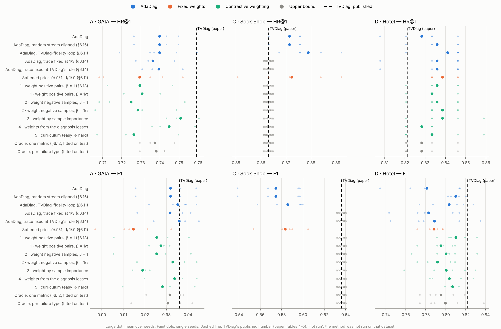
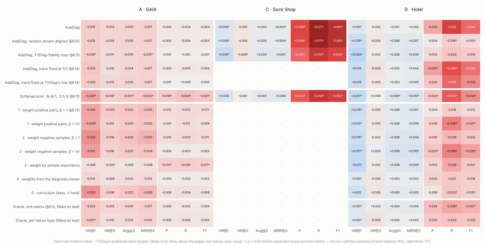

# Every method against the TVDiag paper (README §6.16)

Reference: the **TVDiag row of the paper's Table 4** (RCL: HR@1, HR@3, Avg@3, MRR@3) and **Table 5** (FTI: precision, recall, F1, the paper's definition) only. No re-run of TVDiag is used. Each cell: mean over seeds (gap to the paper). ▲ / ▼: different from the paper after Holm correction over all 238 cells (one-sample t-test over seeds against the published value); †: p < 0.05 before correction.

## Summary: HR@1 and F1 gap to the paper

| method | A · GAIA HR@1 / F1 | C · Sock Shop HR@1 / F1 | D · Hotel HR@1 / F1 |
|---|---|---|---|
| **TVDiag (paper)** | **0.759 / 0.936** | **0.863 / 0.636** | **0.821 / 0.822** |
| AdaDiag | -0.019 / -0.004 | +0.008 † / -0.061 † | +0.007 / -0.041 |
| AdaDiag, random stream aligned (§6.15) | -0.019 / -0.004 | +0.008 † / -0.061 † | +0.015 † / -0.012 † |
| AdaDiag, TVDiag-fidelity loop (§6.11) | -0.019 † / -0.001 | +0.016 † / -0.050 † | +0.020 † / -0.019 |
| AdaDiag, trace fixed at 1/3 (§6.14) | -0.023 / -0.004 | — | +0.015 / -0.039 † |
| AdaDiag, trace fixed at TVDiag's role (§6.14) | -0.020 / -0.000 | — | +0.015 / -0.033 |
| Softened prior .9/.9/.1, .1/.1/.9 (§6.11) | -0.030 † / -0.021 † | +0.009 / -0.053 † | +0.017 † / -0.034 † |
| 1 · weight positive pairs, β = 1 (§6.13) | -0.030 / -0.011 | — | +0.015 † / -0.012 |
| 1 · weight positive pairs, β = 1/τ | -0.028 † / -0.009 | — | +0.012 † / -0.027 † |
| 2 · weight negative samples, β = 1 | -0.034 / -0.011 | — | +0.015 † / -0.022 |
| 2 · weight negative samples, β = 1/τ | -0.031 / -0.003 | — | +0.017 † / -0.030 † |
| 3 · weight by sample importance | -0.008 / -0.017 † | — | +0.017 / -0.021 |
| 4 · weights from the diagnosis losses | -0.014 / -0.002 | — | +0.007 / -0.018 |
| 5 · curriculum (easy → hard) | -0.033 / -0.008 | — | +0.012 / -0.015 † |
| Oracle, one matrix (§6.12, fitted on test) | -0.022 / -0.004 | — | +0.007 / -0.027 † |
| Oracle, per failure type (fitted on test) | -0.021 † / -0.005 | — | +0.007 / -0.022 |

## Full tables (Tables 4 and 5 together, per dataset)

**A · GAIA**

| method | seeds | HR@1 | HR@3 | Avg@3 | MRR@3 | P | R | F1 |
|---|---|---|---|---|---|---|---|---|
| **TVDiag (paper)** | — | **0.759** | **0.909** | **0.844** | **0.827** | **0.925** | **0.948** | **0.936** |
| *AdaDiag* | |  |  |  |  |  |  |  |
| AdaDiag | 3 | 0.740 (-0.019) | 0.895 (-0.014) | 0.829 (-0.015) | 0.810 (-0.017) | 0.920 (-0.005) | 0.944 (-0.004) | 0.932 (-0.004) |
| AdaDiag, random stream aligned (§6.15) | 3 | 0.740 (-0.019) | 0.895 (-0.014) | 0.829 (-0.015) | 0.810 (-0.017) | 0.920 (-0.005) | 0.944 (-0.004) | 0.932 (-0.004) |
| AdaDiag, TVDiag-fidelity loop (§6.11) | 5 | 0.740 (-0.019) † | 0.898 (-0.011) † | 0.831 (-0.013) † | 0.812 (-0.015) † | 0.924 (-0.001) | 0.947 (-0.001) | 0.935 (-0.001) |
| AdaDiag, trace fixed at 1/3 (§6.14) | 3 | 0.736 (-0.023) | 0.899 (-0.010) | 0.830 (-0.014) | 0.810 (-0.017) | 0.921 (-0.004) | 0.943 (-0.005) | 0.932 (-0.004) |
| AdaDiag, trace fixed at TVDiag's role (§6.14) | 3 | 0.739 (-0.020) | 0.896 (-0.013) | 0.829 (-0.015) | 0.810 (-0.017) | 0.924 (-0.001) | 0.948 (+0.000) | 0.936 (-0.000) |
| *Fixed weights* | |  |  |  |  |  |  |  |
| Softened prior .9/.9/.1, .1/.1/.9 (§6.11) | 5 | 0.729 (-0.030) † | 0.891 (-0.018) † | 0.823 (-0.021) † | 0.803 (-0.024) † | 0.906 (-0.019) † | 0.924 (-0.024) † | 0.915 (-0.021) † |
| *Contrastive weighting* | |  |  |  |  |  |  |  |
| 1 · weight positive pairs, β = 1 (§6.13) | 3 | 0.729 (-0.030) | 0.889 (-0.020) | 0.822 (-0.022) | 0.802 (-0.025) | 0.915 (-0.010) | 0.936 (-0.012) | 0.925 (-0.011) |
| 1 · weight positive pairs, β = 1/τ | 3 | 0.731 (-0.028) † | 0.894 (-0.015) | 0.824 (-0.020) | 0.805 (-0.022) | 0.918 (-0.007) | 0.937 (-0.011) | 0.927 (-0.009) |
| 2 · weight negative samples, β = 1 | 3 | 0.725 (-0.034) | 0.891 (-0.018) | 0.820 (-0.024) | 0.800 (-0.027) | 0.915 (-0.010) | 0.936 (-0.012) | 0.925 (-0.011) |
| 2 · weight negative samples, β = 1/τ | 3 | 0.728 (-0.031) | 0.893 (-0.016) | 0.823 (-0.021) | 0.803 (-0.024) | 0.921 (-0.004) | 0.945 (-0.003) | 0.933 (-0.003) |
| 3 · weight by sample importance | 3 | 0.751 (-0.008) | 0.900 (-0.009) | 0.838 (-0.006) | 0.819 (-0.008) | 0.908 (-0.017) † | 0.930 (-0.018) † | 0.919 (-0.017) † |
| 4 · weights from the diagnosis losses | 3 | 0.745 (-0.014) | 0.900 (-0.009) | 0.834 (-0.010) | 0.815 (-0.012) | 0.922 (-0.003) | 0.946 (-0.002) | 0.934 (-0.002) |
| 5 · curriculum (easy → hard) | 3 | 0.726 (-0.033) | 0.891 (-0.018) | 0.822 (-0.022) | 0.801 (-0.026) | 0.917 (-0.008) | 0.939 (-0.009) | 0.928 (-0.008) |
| *Upper bound* | |  |  |  |  |  |  |  |
| Oracle, one matrix (§6.12, fitted on test) | 3 | 0.737 (-0.022) | 0.896 (-0.013) | 0.829 (-0.015) | 0.810 (-0.017) | 0.920 (-0.005) | 0.944 (-0.004) | 0.932 (-0.004) |
| Oracle, per failure type (fitted on test) | 3 | 0.738 (-0.021) † | 0.899 (-0.010) | 0.831 (-0.013) | 0.812 (-0.015) | 0.920 (-0.005) | 0.942 (-0.006) | 0.931 (-0.005) |

**C · Sock Shop**

| method | seeds | HR@1 | HR@3 | Avg@3 | MRR@3 | P | R | F1 |
|---|---|---|---|---|---|---|---|---|
| **TVDiag (paper)** | — | **0.863** | **0.954** | **0.913** | **0.903** | **0.649** | **0.622** | **0.636** |
| *AdaDiag* | |  |  |  |  |  |  |  |
| AdaDiag | 5 | 0.871 (+0.008) † | 0.949 (-0.005) | 0.917 (+0.004) | 0.907 (+0.004) † | 0.600 (-0.049) † | 0.551 (-0.071) † | 0.575 (-0.061) † |
| AdaDiag, random stream aligned (§6.15) | 5 | 0.871 (+0.008) † | 0.949 (-0.005) | 0.917 (+0.004) | 0.907 (+0.004) † | 0.600 (-0.049) † | 0.551 (-0.071) † | 0.575 (-0.061) † |
| AdaDiag, TVDiag-fidelity loop (§6.11) | 5 | 0.879 (+0.016) † | 0.948 (-0.006) † | 0.918 (+0.005) | 0.910 (+0.007) | 0.608 (-0.041) † | 0.565 (-0.057) † | 0.586 (-0.050) † |
| *Fixed weights* | |  |  |  |  |  |  |  |
| Softened prior .9/.9/.1, .1/.1/.9 (§6.11) | 5 | 0.872 (+0.009) | 0.953 (-0.001) | 0.918 (+0.005) | 0.909 (+0.006) | 0.605 (-0.044) † | 0.563 (-0.059) † | 0.583 (-0.053) † |

**D · Hotel**

| method | seeds | HR@1 | HR@3 | Avg@3 | MRR@3 | P | R | F1 |
|---|---|---|---|---|---|---|---|---|
| **TVDiag (paper)** | — | **0.821** | **0.923** | **0.876** | **0.866** | **0.836** | **0.808** | **0.822** |
| *AdaDiag* | |  |  |  |  |  |  |  |
| AdaDiag | 5 | 0.828 (+0.007) | 0.921 (-0.002) | 0.877 (+0.001) | 0.868 (+0.002) | 0.808 (-0.028) | 0.756 (-0.052) | 0.781 (-0.041) |
| AdaDiag, random stream aligned (§6.15) | 5 | 0.836 (+0.015) † | 0.918 (-0.005) | 0.882 (+0.006) | 0.873 (+0.007) | 0.832 (-0.004) | 0.790 (-0.018) † | 0.810 (-0.012) † |
| AdaDiag, TVDiag-fidelity loop (§6.11) | 5 | 0.841 (+0.020) † | 0.921 (-0.002) | 0.882 (+0.006) | 0.875 (+0.009) | 0.823 (-0.013) | 0.785 (-0.023) | 0.803 (-0.019) |
| AdaDiag, trace fixed at 1/3 (§6.14) | 5 | 0.836 (+0.015) | 0.915 (-0.008) | 0.878 (+0.002) | 0.870 (+0.004) | 0.806 (-0.030) † | 0.762 (-0.046) † | 0.783 (-0.039) † |
| AdaDiag, trace fixed at TVDiag's role (§6.14) | 5 | 0.836 (+0.015) | 0.918 (-0.005) | 0.879 (+0.003) | 0.871 (+0.005) | 0.812 (-0.024) | 0.767 (-0.041) | 0.789 (-0.033) |
| *Fixed weights* | |  |  |  |  |  |  |  |
| Softened prior .9/.9/.1, .1/.1/.9 (§6.11) | 5 | 0.838 (+0.017) † | 0.923 (+0.000) | 0.885 (+0.009) † | 0.876 (+0.010) † | 0.814 (-0.022) † | 0.764 (-0.044) † | 0.788 (-0.034) † |
| *Contrastive weighting* | |  |  |  |  |  |  |  |
| 1 · weight positive pairs, β = 1 (§6.13) | 5 | 0.836 (+0.015) † | 0.918 (-0.005) | 0.882 (+0.006) | 0.873 (+0.007) | 0.832 (-0.004) | 0.790 (-0.018) | 0.810 (-0.012) |
| 1 · weight positive pairs, β = 1/τ | 5 | 0.833 (+0.012) † | 0.918 (-0.005) | 0.882 (+0.006) | 0.872 (+0.006) | 0.820 (-0.016) | 0.772 (-0.036) † | 0.795 (-0.027) † |
| 2 · weight negative samples, β = 1 | 5 | 0.836 (+0.015) † | 0.921 (-0.002) | 0.884 (+0.008) | 0.874 (+0.008) | 0.820 (-0.016) | 0.782 (-0.026) | 0.800 (-0.022) |
| 2 · weight negative samples, β = 1/τ | 5 | 0.838 (+0.017) † | 0.926 (+0.003) | 0.885 (+0.009) | 0.876 (+0.010) † | 0.813 (-0.023) † | 0.772 (-0.036) † | 0.792 (-0.030) † |
| 3 · weight by sample importance | 5 | 0.838 (+0.017) | 0.921 (-0.002) | 0.884 (+0.008) | 0.875 (+0.009) | 0.823 (-0.013) | 0.779 (-0.029) | 0.801 (-0.021) |
| 4 · weights from the diagnosis losses | 5 | 0.828 (+0.007) | 0.918 (-0.005) | 0.879 (+0.003) | 0.868 (+0.002) | 0.821 (-0.015) | 0.787 (-0.021) | 0.804 (-0.018) |
| 5 · curriculum (easy → hard) | 5 | 0.833 (+0.012) | 0.918 (-0.005) | 0.881 (+0.005) | 0.871 (+0.005) | 0.830 (-0.006) | 0.785 (-0.023) † | 0.807 (-0.015) † |
| *Upper bound* | |  |  |  |  |  |  |  |
| Oracle, one matrix (§6.12, fitted on test) | 5 | 0.828 (+0.007) | 0.926 (+0.003) | 0.880 (+0.004) | 0.871 (+0.005) | 0.812 (-0.024) | 0.779 (-0.029) † | 0.795 (-0.027) † |
| Oracle, per failure type (fitted on test) | 5 | 0.828 (+0.007) | 0.915 (-0.008) | 0.878 (+0.002) | 0.868 (+0.002) | 0.816 (-0.020) | 0.785 (-0.023) | 0.800 (-0.022) |

## How many of the paper's numbers each method reaches

| method | paper numbers compared | reached (gap ≥ 0) | above the paper: p < 0.05 before (after) Holm | below the paper: p < 0.05 before (after) Holm |
|---|---|---|---|---|
| AdaDiag | 21 | 6 | 2 (0) | 3 (0) |
| AdaDiag, random stream aligned (§6.15) | 21 | 6 | 3 (0) | 5 (0) |
| AdaDiag, TVDiag-fidelity loop (§6.11) | 21 | 6 | 2 (0) | 8 (0) |
| AdaDiag, trace fixed at 1/3 (§6.14) | 14 | 3 | 0 (0) | 3 (0) |
| AdaDiag, trace fixed at TVDiag's role (§6.14) | 14 | 4 | 0 (0) | 0 (0) |
| Softened prior .9/.9/.1, .1/.1/.9 (§6.11) | 21 | 7 | 3 (0) | 13 (0) |
| 1 · weight positive pairs, β = 1 (§6.13) | 14 | 3 | 1 (0) | 0 (0) |
| 1 · weight positive pairs, β = 1/τ | 14 | 3 | 1 (0) | 3 (0) |
| 2 · weight negative samples, β = 1 | 14 | 3 | 1 (0) | 0 (0) |
| 2 · weight negative samples, β = 1/τ | 14 | 4 | 2 (0) | 3 (0) |
| 3 · weight by sample importance | 14 | 3 | 0 (0) | 3 (0) |
| 4 · weights from the diagnosis losses | 14 | 3 | 0 (0) | 0 (0) |
| 5 · curriculum (easy → hard) | 14 | 3 | 0 (0) | 2 (0) |
| Oracle, one matrix (§6.12, fitted on test) | 14 | 4 | 0 (0) | 2 (0) |
| Oracle, per failure type (fitted on test) | 14 | 3 | 0 (0) | 1 (0) |

Across all 238 cells: 0 significantly above the paper and 0 significantly below after Holm correction; before it, 15 above and 46 below (p < 0.05).

## Notes

- **Settings.** GAIA and Hotel rows come from the 1-thread, 500-epoch runs of §6.12–6.15 (GAIA 3 seeds, Hotel 5), except the softened prior (committed settings, 2 threads, 5 seeds) and the fidelity-loop AdaDiag (§6.11, 1 thread, 5 seeds). Sock Shop rows come from §6.9 / §6.11 (5 seeds). Only four methods were run on Sock Shop.
- **The paper's spread is not published**, so the test asks whether a method's seed mean differs from one fixed number. That is generous to both sides: with 3–5 seeds, most gaps under ~0.02 cannot be told from zero.
- **The re-implementation's own gap.** A method's gap to the paper mixes its effect with how closely this repository reproduces TVDiag (§6.1, §6.9): this repository's TVDiag re-run sits at -0.033 HR@1 / -0.012 F1 on GAIA (3 seeds), +0.005 HR@1 / -0.064 F1 on Sock Shop (5 seeds), +0.012 HR@1 / -0.024 F1 on Hotel (5 seeds) against the paper (GAIA and Hotel: the 1-thread runs; Sock Shop: §6.9). It is not a row of the tables, which compare with the paper only. The method-against-method comparisons with the same seeds are in §6.12–6.15.
- **The oracle rows are upper bounds**, fitted on the test split (§6.12), not methods.

LaTeX: `table_A.tex`, `table_C.tex`, `table_D.tex` (need `booktabs`, `amssymb`, `graphicx`). Every cell with its p-values: `all_methods.csv`.
