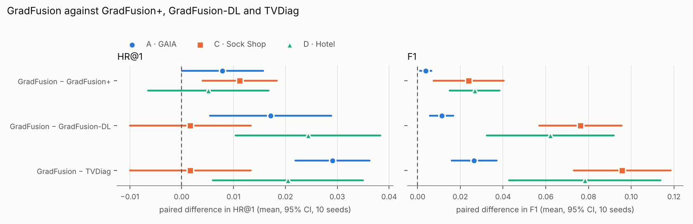

# AdaDiag++: results

Screened on development seeds 0–2 against AdaDiag+; the rule and every decision were written to `PLAN.md` before the confirmation runs; confirmed on fresh seeds 30–34. Settings: 1 thread, 500-epoch cap, `isolate_weighting_rng`.

**Final configuration:** `plus|ens3`.

Rule written 2026-11-12T13:29:22, before any run.

**Rule.** Round 4. Reference: AdaDiag+ (bag+theta) on the development seeds 0-2. Settings as section 6.17. A variant's six differences are dHR@1 and dF1 on the three datasets, paired by seed; its score is their mean. Stage S: smooth, bagdrop and baghead, each added alone to AdaDiag+. A single is kept if its score is at least +0.005 and its smallest difference is at least -0.010. With two or more kept, their combination is screened too (stage C). The single-model configuration is the eligible variant (kept singles, and the combination if its score is at least +0.005 and its smallest difference at least -0.010) whose smallest difference is largest; with none eligible it stays AdaDiag+. Stage E: ens3 of that configuration (seeds s, s+100, s+200; softmax outputs averaged) against the configuration itself on seeds 0-2; the ensemble is adopted if its score is at least +0.005 and its smallest difference at least -0.010. Confirmation: fresh seeds 30-34, never used before, for TVDiag, AdaDiag-DL, AdaDiag+ and the final configuration (and, as a control, ens3 of TVDiag). Paired t-tests, Holm over HR@1 and F1 x 3 datasets per comparison. There is no round 5 on these seeds.

## Stage S (reference: AdaDiag+), 2026-11-12T14:30:41

| variant | GAIA dHR@1 / dF1 | Sock Shop | Hotel | score | smallest | eligible |
|---|---|---|---|---|---|---|
| plus+smooth | -0.008 / +0.006 | +0.004 / +0.012 | +0.004 / -0.032 | -0.0024 | -0.032 | no |
| plus+bagdrop | -0.005 / -0.004 | +0.011 / +0.020 | +0.004 / +0.002 | +0.0048 | -0.005 | no |
| plus+baghead | -0.016 / -0.009 | -0.004 / +0.011 | +0.009 / +0.027 | +0.0029 | -0.016 | no |

Kept: none.

## Single-model configuration, 2026-11-12T14:30:59

No single was kept. Configuration: `plus`.

## Stage E and decision, 2026-11-12T14:59:18 (before any confirmation run)

Reference: `plus`.

| variant | GAIA dHR@1 / dF1 | Sock Shop | Hotel | score | smallest | eligible |
|---|---|---|---|---|---|---|
| plus|ens3 | -0.001 / +0.000 | +0.001 / +0.034 | +0.009 / -0.009 | +0.0057 | -0.009 | yes |

**Final configuration: `plus|ens3`.**

## Fresh seeds 30–34 (mean ± sd)

| dataset | arm | HR@1 | HR@3 | Avg@3 | MRR@3 | F1 | macro-F1 | train s |
|---|---|---|---|---|---|---|---|---|
| A · GAIA | TVDiag, published | 0.759 | 0.909 | 0.844 | 0.827 | 0.936 | — | — |
| A · GAIA | TVDiag | 0.737 ± 0.009 | 0.899 ± 0.003 | 0.829 ± 0.005 | 0.810 ± 0.006 | 0.922 ± 0.012 | 0.577 ± 0.016 | 56 |
| A · GAIA | TVDiag × 3 (control) | 0.753 ± 0.010 | 0.903 ± 0.006 | 0.839 ± 0.006 | 0.821 ± 0.006 | 0.927 ± 0.009 | 0.578 ± 0.003 | 171 |
| A · GAIA | AdaDiag-DL | 0.750 ± 0.017 | 0.903 ± 0.004 | 0.838 ± 0.010 | 0.819 ± 0.011 | 0.937 ± 0.009 | 0.547 ± 0.036 | 94 |
| A · GAIA | AdaDiag+ (v1.21) | 0.764 ± 0.010 | 0.908 ± 0.007 | 0.847 ± 0.008 | 0.829 ± 0.008 | 0.944 ± 0.004 | 0.570 ± 0.014 | 111 |
| A · GAIA | **AdaDiag++** (`plus|ens3`) | 0.765 ± 0.004 | 0.910 ± 0.005 | 0.850 ± 0.004 | 0.832 ± 0.003 | 0.948 ± 0.003 | 0.578 ± 0.005 | 390 |
| C · Sock Shop | TVDiag, published | 0.863 | 0.954 | 0.913 | 0.903 | 0.636 | — | — |
| C · Sock Shop | TVDiag | 0.870 ± 0.005 | 0.954 ± 0.003 | 0.919 ± 0.003 | 0.908 ± 0.003 | 0.550 ± 0.020 | 0.527 ± 0.019 | 113 |
| C · Sock Shop | TVDiag × 3 (control) | 0.874 ± 0.012 | 0.952 ± 0.005 | 0.920 ± 0.003 | 0.910 ± 0.005 | 0.586 ± 0.011 | 0.564 ± 0.010 | 273 |
| C · Sock Shop | AdaDiag-DL | 0.866 ± 0.006 | 0.949 ± 0.005 | 0.914 ± 0.004 | 0.904 ± 0.004 | 0.579 ± 0.008 | 0.553 ± 0.010 | 151 |
| C · Sock Shop | AdaDiag+ (v1.21) | 0.861 ± 0.010 | 0.947 ± 0.005 | 0.911 ± 0.004 | 0.900 ± 0.004 | 0.622 ± 0.023 | 0.599 ± 0.024 | 355 |
| C · Sock Shop | **AdaDiag++** (`plus|ens3`) | 0.872 ± 0.015 | 0.951 ± 0.006 | 0.918 ± 0.007 | 0.908 ± 0.009 | 0.640 ± 0.025 | 0.621 ± 0.025 | 1110 |
| D · Hotel | TVDiag, published | 0.821 | 0.923 | 0.876 | 0.866 | 0.822 | — | — |
| D · Hotel | TVDiag | 0.823 ± 0.021 | 0.918 ± 0.015 | 0.874 ± 0.013 | 0.865 ± 0.015 | 0.780 ± 0.040 | 0.769 ± 0.045 | 24 |
| D · Hotel | TVDiag × 3 (control) | 0.833 ± 0.016 | 0.915 ± 0.007 | 0.878 ± 0.008 | 0.869 ± 0.009 | 0.832 ± 0.013 | 0.824 ± 0.016 | 78 |
| D · Hotel | AdaDiag-DL | 0.823 ± 0.017 | 0.928 ± 0.019 | 0.880 ± 0.019 | 0.869 ± 0.017 | 0.806 ± 0.021 | 0.794 ± 0.024 | 63 |
| D · Hotel | AdaDiag+ (v1.21) | 0.841 ± 0.007 | 0.928 ± 0.007 | 0.887 ± 0.002 | 0.879 ± 0.003 | 0.830 ± 0.013 | 0.821 ± 0.014 | 119 |
| D · Hotel | **AdaDiag++** (`plus|ens3`) | 0.838 ± 0.007 | 0.933 ± 0.006 | 0.891 ± 0.006 | 0.881 ± 0.006 | 0.858 ± 0.019 | 0.851 ± 0.019 | 322 |

## Paired differences, fresh seeds 30–34

| dataset | metric | **AdaDiag++ − AdaDiag+** | AdaDiag++ − AdaDiag-DL | AdaDiag++ − TVDiag | AdaDiag++ − TVDiag × 3 (30–34 only) | TVDiag × 3 − TVDiag (30–34 only) |
|---|---|---|---|---|---|---|
| A · GAIA | HR@1 | +0.002 (p 0.75, 2/5) | +0.016 (p 0.14, 4/5) | **+0.028**† (p 0.00, 5/5) | +0.012 (p 0.12, 3/5) | +0.016 (p 0.06, 4/5) |
| A · GAIA | HR@3 | +0.003 (p 0.09, 4/5) | **+0.007** (p 0.04, 4/5) | **+0.012** (p 0.02, 5/5) | **+0.007** (p 0.03, 5/5) | +0.004 (p 0.28, 3/5) |
| A · GAIA | Avg@3 | +0.003 (p 0.25, 4/5) | **+0.013** (p 0.02, 5/5) | **+0.021** (p 0.00, 5/5) | **+0.011** (p 0.01, 5/5) | **+0.010** (p 0.04, 4/5) |
| A · GAIA | MRR@3 | +0.003 (p 0.42, 4/5) | **+0.013** (p 0.04, 5/5) | **+0.022** (p 0.00, 5/5) | **+0.011** (p 0.02, 5/5) | **+0.011** (p 0.05, 4/5) |
| A · GAIA | F1 | +0.004 (p 0.06, 4/5) | **+0.011** (p 0.03, 5/5) | **+0.026** (p 0.02, 5/5) | **+0.022** (p 0.01, 5/5) | +0.005 (p 0.29, 4/5) |
| A · GAIA | macro-F1 | +0.009 (p 0.17, 4/5) | +0.032 (p 0.12, 4/5) | +0.001 (p 0.92, 4/5) | +0.001 (p 0.84, 2/5) | +0.000 (p 0.96, 4/5) |
| C · Sock Shop | HR@1 | **+0.012** (p 0.02, 5/5) | +0.006 (p 0.53, 2/5) | +0.002 (p 0.77, 2/5) | -0.002 (p 0.75, 2/5) | +0.004 (p 0.45, 2/5) |
| C · Sock Shop | HR@3 | **+0.004** (p 0.03, 4/5) | +0.002 (p 0.69, 2/5) | -0.003 (p 0.41, 1/5) | -0.001 (p 0.78, 1/5) | -0.002 (p 0.43, 2/5) |
| C · Sock Shop | Avg@3 | **+0.007** (p 0.05, 5/5) | +0.004 (p 0.29, 3/5) | -0.001 (p 0.90, 3/5) | -0.001 (p 0.74, 3/5) | +0.001 (p 0.82, 2/5) |
| C · Sock Shop | MRR@3 | **+0.008** (p 0.03, 5/5) | +0.004 (p 0.37, 3/5) | +0.000 (p 1.00, 3/5) | -0.001 (p 0.73, 3/5) | +0.001 (p 0.64, 2/5) |
| C · Sock Shop | F1 | +0.017 (p 0.23, 4/5) | **+0.061** (p 0.01, 5/5) | **+0.089**† (p 0.00, 5/5) | **+0.054**† (p 0.01, 5/5) | **+0.036**† (p 0.01, 5/5) |
| C · Sock Shop | macro-F1 | +0.022 (p 0.14, 4/5) | **+0.068** (p 0.01, 5/5) | **+0.094** (p 0.00, 5/5) | **+0.057** (p 0.00, 5/5) | **+0.037** (p 0.00, 5/5) |
| D · Hotel | HR@1 | -0.003 (p 0.62, 1/5) | +0.015 (p 0.18, 3/5) | +0.015 (p 0.24, 4/5) | +0.005 (p 0.59, 3/5) | +0.010 (p 0.18, 2/5) |
| D · Hotel | HR@3 | +0.005 (p 0.18, 2/5) | +0.005 (p 0.65, 3/5) | +0.015 (p 0.14, 4/5) | **+0.018** (p 0.00, 5/5) | -0.003 (p 0.70, 1/5) |
| D · Hotel | Avg@3 | +0.004 (p 0.30, 3/5) | +0.011 (p 0.37, 3/5) | +0.017 (p 0.10, 4/5) | +0.014 (p 0.09, 4/5) | +0.003 (p 0.41, 3/5) |
| D · Hotel | MRR@3 | +0.002 (p 0.49, 3/5) | +0.012 (p 0.31, 3/5) | +0.016 (p 0.13, 4/5) | +0.012 (p 0.13, 4/5) | +0.005 (p 0.34, 3/5) |
| D · Hotel | F1 | **+0.027**† (p 0.00, 5/5) | **+0.052** (p 0.04, 5/5) | **+0.078** (p 0.03, 4/5) | **+0.025** (p 0.02, 5/5) | +0.053 (p 0.07, 4/5) |
| D · Hotel | macro-F1 | **+0.030** (p 0.00, 5/5) | **+0.057** (p 0.04, 5/5) | **+0.082** (p 0.03, 5/5) | **+0.027** (p 0.02, 5/5) | +0.055 (p 0.09, 4/5) |

Paired t-test over the shared seeds (wins/seeds in brackets); **bold**: p < 0.05 uncorrected; †: survives Holm over the six primary cells of its column (HR@1 and F1 × 3 datasets).

## Seeds 5–9, the paper-format tables' seeds (mean ± sd)

| dataset | arm | HR@1 | HR@3 | Avg@3 | MRR@3 | F1 | macro-F1 | train s |
|---|---|---|---|---|---|---|---|---|
| A · GAIA | TVDiag, published | 0.759 | 0.909 | 0.844 | 0.827 | 0.936 | — | — |
| A · GAIA | TVDiag | 0.738 ± 0.016 | 0.894 ± 0.005 | 0.828 ± 0.008 | 0.809 ± 0.009 | 0.921 ± 0.017 | 0.573 ± 0.009 | 120 |
| A · GAIA | AdaDiag-DL | 0.749 ± 0.017 | 0.901 ± 0.006 | 0.837 ± 0.010 | 0.818 ± 0.011 | 0.936 ± 0.006 | 0.554 ± 0.016 | 200 |
| A · GAIA | AdaDiag+ (v1.21) | 0.754 ± 0.005 | 0.903 ± 0.006 | 0.839 ± 0.004 | 0.821 ± 0.004 | 0.944 ± 0.005 | 0.577 ± 0.019 | 119 |
| A · GAIA | **AdaDiag++** (`plus|ens3`) | 0.768 ± 0.008 | 0.906 ± 0.003 | 0.849 ± 0.004 | 0.832 ± 0.005 | 0.948 ± 0.005 | 0.576 ± 0.014 | 371 |
| C · Sock Shop | TVDiag, published | 0.863 | 0.954 | 0.913 | 0.903 | 0.636 | — | — |
| C · Sock Shop | TVDiag | 0.869 ± 0.019 | 0.948 ± 0.016 | 0.915 ± 0.016 | 0.905 ± 0.016 | 0.554 ± 0.018 | 0.535 ± 0.021 | 203 |
| C · Sock Shop | AdaDiag-DL | 0.872 ± 0.009 | 0.945 ± 0.003 | 0.916 ± 0.004 | 0.906 ± 0.006 | 0.564 ± 0.028 | 0.543 ± 0.031 | 265 |
| C · Sock Shop | AdaDiag+ (v1.21) | 0.859 ± 0.015 | 0.950 ± 0.006 | 0.913 ± 0.009 | 0.901 ± 0.010 | 0.625 ± 0.015 | 0.605 ± 0.011 | 365 |
| C · Sock Shop | **AdaDiag++** (`plus|ens3`) | 0.870 ± 0.009 | 0.954 ± 0.002 | 0.921 ± 0.005 | 0.909 ± 0.005 | 0.656 ± 0.019 | 0.633 ± 0.024 | 1057 |
| D · Hotel | TVDiag, published | 0.821 | 0.923 | 0.876 | 0.866 | 0.822 | — | — |
| D · Hotel | TVDiag | 0.818 ± 0.017 | 0.910 ± 0.009 | 0.864 ± 0.006 | 0.856 ± 0.006 | 0.783 ± 0.057 | 0.772 ± 0.051 | 52 |
| D · Hotel | AdaDiag-DL | 0.810 ± 0.017 | 0.910 ± 0.016 | 0.860 ± 0.010 | 0.852 ± 0.010 | 0.789 ± 0.047 | 0.777 ± 0.041 | 116 |
| D · Hotel | AdaDiag+ (v1.21) | 0.831 ± 0.011 | 0.926 ± 0.019 | 0.880 ± 0.011 | 0.871 ± 0.007 | 0.836 ± 0.022 | 0.827 ± 0.025 | 113 |
| D · Hotel | **AdaDiag++** (`plus|ens3`) | 0.844 ± 0.011 | 0.938 ± 0.006 | 0.892 ± 0.005 | 0.884 ± 0.005 | 0.862 ± 0.007 | 0.856 ± 0.007 | 342 |

## Paired differences, seeds 5–9 and 30–34 pooled (10 seeds)

| dataset | metric | **AdaDiag++ − AdaDiag+** | AdaDiag++ − AdaDiag-DL | AdaDiag++ − TVDiag | AdaDiag++ − TVDiag × 3 (30–34 only) | TVDiag × 3 − TVDiag (30–34 only) |
|---|---|---|---|---|---|---|
| A · GAIA | HR@1 | **+0.008** (p 0.05, 7/10) | **+0.017**† (p 0.01, 9/10) | **+0.029**† (p 0.00, 10/10) | +0.012 (p 0.12, 3/5) | +0.016 (p 0.06, 4/5) |
| A · GAIA | HR@3 | **+0.003** (p 0.01, 8/10) | **+0.006** (p 0.01, 8/10) | **+0.012** (p 0.00, 10/10) | **+0.007** (p 0.03, 5/5) | +0.004 (p 0.28, 3/5) |
| A · GAIA | Avg@3 | **+0.006** (p 0.01, 9/10) | **+0.012** (p 0.00, 9/10) | **+0.021** (p 0.00, 10/10) | **+0.011** (p 0.01, 5/5) | **+0.010** (p 0.04, 4/5) |
| A · GAIA | MRR@3 | **+0.006** (p 0.01, 9/10) | **+0.013** (p 0.00, 10/10) | **+0.022** (p 0.00, 10/10) | **+0.011** (p 0.02, 5/5) | **+0.011** (p 0.05, 4/5) |
| A · GAIA | F1 | **+0.004**† (p 0.01, 8/10) | **+0.011**† (p 0.00, 10/10) | **+0.026**† (p 0.00, 10/10) | **+0.022** (p 0.01, 5/5) | +0.005 (p 0.29, 4/5) |
| A · GAIA | macro-F1 | +0.004 (p 0.46, 7/10) | **+0.027** (p 0.01, 9/10) | +0.002 (p 0.73, 8/10) | +0.001 (p 0.84, 2/5) | +0.000 (p 0.96, 4/5) |
| C · Sock Shop | HR@1 | **+0.011**† (p 0.01, 8/10) | +0.002 (p 0.75, 4/10) | +0.002 (p 0.75, 3/10) | -0.002 (p 0.75, 2/5) | +0.004 (p 0.45, 2/5) |
| C · Sock Shop | HR@3 | **+0.004** (p 0.04, 6/10) | +0.005 (p 0.06, 7/10) | +0.001 (p 0.77, 3/10) | -0.001 (p 0.78, 1/5) | -0.002 (p 0.43, 2/5) |
| C · Sock Shop | Avg@3 | **+0.007** (p 0.02, 8/10) | +0.004 (p 0.10, 7/10) | +0.003 (p 0.54, 7/10) | -0.001 (p 0.74, 3/5) | +0.001 (p 0.82, 2/5) |
| C · Sock Shop | MRR@3 | **+0.008** (p 0.01, 8/10) | +0.004 (p 0.24, 6/10) | +0.002 (p 0.62, 5/10) | -0.001 (p 0.73, 3/5) | +0.001 (p 0.64, 2/5) |
| C · Sock Shop | F1 | **+0.024**† (p 0.01, 9/10) | **+0.076**† (p 0.00, 10/10) | **+0.096**† (p 0.00, 10/10) | **+0.054**† (p 0.01, 5/5) | **+0.036**† (p 0.01, 5/5) |
| C · Sock Shop | macro-F1 | **+0.025** (p 0.01, 8/10) | **+0.079** (p 0.00, 10/10) | **+0.096** (p 0.00, 10/10) | **+0.057** (p 0.00, 5/5) | **+0.037** (p 0.00, 5/5) |
| D · Hotel | HR@1 | +0.005 (p 0.34, 5/10) | **+0.024**† (p 0.00, 8/10) | **+0.021**† (p 0.01, 9/10) | +0.005 (p 0.59, 3/5) | +0.010 (p 0.18, 2/5) |
| D · Hotel | HR@3 | +0.009 (p 0.09, 5/10) | **+0.017** (p 0.05, 8/10) | **+0.022** (p 0.00, 9/10) | **+0.018** (p 0.00, 5/5) | -0.003 (p 0.70, 1/5) |
| D · Hotel | Avg@3 | +0.008 (p 0.05, 7/10) | **+0.022** (p 0.01, 8/10) | **+0.023** (p 0.00, 9/10) | +0.014 (p 0.09, 4/5) | +0.003 (p 0.41, 3/5) |
| D · Hotel | MRR@3 | +0.007 (p 0.06, 7/10) | **+0.022** (p 0.01, 8/10) | **+0.022** (p 0.00, 9/10) | +0.012 (p 0.13, 4/5) | +0.005 (p 0.34, 3/5) |
| D · Hotel | F1 | **+0.027**† (p 0.00, 9/10) | **+0.062**† (p 0.00, 10/10) | **+0.078**† (p 0.00, 9/10) | **+0.025** (p 0.02, 5/5) | +0.053 (p 0.07, 4/5) |
| D · Hotel | macro-F1 | **+0.029** (p 0.00, 9/10) | **+0.068** (p 0.00, 10/10) | **+0.083** (p 0.00, 10/10) | **+0.027** (p 0.02, 5/5) | +0.055 (p 0.09, 4/5) |

Paired t-test over the shared seeds (wins/seeds in brackets); **bold**: p < 0.05 uncorrected; †: survives Holm over the six primary cells of its column (HR@1 and F1 × 3 datasets).

## HR@1 and FTI recall per failure type (AdaDiag+ → AdaDiag++; mean over 10 seeds)

| dataset | failure type | n | HR@1 | FTI recall |
|---|---|---|---|---|
| A · GAIA | [access permission denied exception] | 15 | 0.16 → 0.15 | 0.00 → 0.00 |
| A · GAIA | [file moving program] | 27 | 0.89 → 0.90 | 0.80 → 0.89 |
| A · GAIA | [login failure] | 458 | 0.86 → 0.86 | 0.99 → 0.99 |
| A · GAIA | [memory_anomalies] | 426 | 0.69 → 0.70 | 1.00 → 1.00 |
| A · GAIA | [normal memory freed label] | 13 | 0.03 → 0.00 | 0.02 → 0.00 |
| C · Sock Shop | cpu | 22 | 0.92 → 0.95 | 0.68 → 0.79 |
| C · Sock Shop | memory | 34 | 0.91 → 0.92 | 0.52 → 0.50 |
| C · Sock Shop | network-corrupt | 41 | 0.89 → 0.91 | 0.62 → 0.66 |
| C · Sock Shop | network-delay | 35 | 0.72 → 0.72 | 0.78 → 0.78 |
| C · Sock Shop | network-loss | 37 | 0.75 → 0.76 | 0.49 → 0.51 |
| C · Sock Shop | pod-failure | 40 | 0.94 → 0.95 | 0.56 → 0.57 |
| C · Sock Shop | pod-kill | 32 | 0.90 → 0.90 | 0.63 → 0.65 |
| D · Hotel | container-kill | 22 | 1.00 → 1.00 | 0.71 → 0.73 |
| D · Hotel | network-delay | 14 | 0.36 → 0.37 | 0.93 → 0.93 |
| D · Hotel | network-loss | 13 | 0.70 → 0.72 | 0.95 → 0.99 |
| D · Hotel | pod-failure | 15 | 1.00 → 1.00 | 0.83 → 0.87 |
| D · Hotel | pod-kill | 14 | 1.00 → 1.00 | 0.74 → 0.81 |

## Ensemble size (exploratory, computed after the confirmation; fresh seeds 30–34)

| members | A · GAIA HR@1 / F1 | C · Sock Shop | D · Hotel |
|---|---|---|---|
| 1 | 0.764 / 0.944 | 0.861 / 0.622 | 0.841 / 0.830 |
| 2 | 0.766 / 0.949 | 0.872 / 0.638 | 0.838 / 0.857 |
| 3 | 0.765 / 0.948 | 0.872 / 0.640 | 0.838 / 0.858 |

