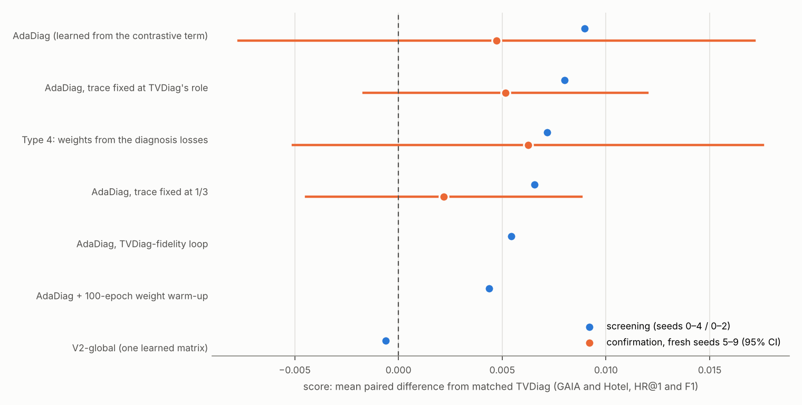

# Which AdaDiag is best? (README §6.17)

## 1. Screening: every variant against TVDiag under identical settings

Score = mean of the four paired differences from the matched TVDiag (GAIA HR@1, GAIA F1, Hotel HR@1, Hotel F1). Hotel runs of the MLP variants are stream-aligned (§6.15).

| candidate | score | worst cell | GAIA HR@1 | GAIA F1 | Hotel HR@1 | Hotel F1 | seeds (GAIA / Hotel) | settings |
|---|---|---|---|---|---|---|---|---|
| AdaDiag (learned from the contrastive term) | **+0.0090** | +0.003 | +0.013 (p 0.21) | +0.007 (p 0.14) | +0.003 (p 0.37) | +0.012 (p 0.26) | 3 / 5 | 1 thread; Hotel: 1 thread, aligned |
| AdaDiag, trace fixed at TVDiag's role | **+0.0080** | +0.000 | +0.013 (p 0.25) | +0.011 (p 0.05) | +0.000 (p 1.00) | +0.007 (p 0.48) | 3 / 5 | 1 thread; Hotel: 1 thread, aligned |
| Type 4: weights from the diagnosis losses | **+0.0072** | -0.005 | +0.018 (p 0.10) | +0.009 (p 0.39) | -0.005 (p 0.48) | +0.006 (p 0.62) | 3 / 5 | 1 thread; Hotel: 1 thread |
| AdaDiag, trace fixed at 1/3 | **+0.0065** | +0.003 | +0.010 (p 0.29) | +0.007 (p 0.20) | +0.003 (p 0.37) | +0.006 (p 0.61) | 3 / 5 | 1 thread; Hotel: 1 thread, aligned |
| AdaDiag, TVDiag-fidelity loop | **+0.0054** | -0.003 | +0.005 (p 0.44) | +0.007 (p 0.12) | -0.003 (p 0.37) | +0.013 (p 0.06) | 5 / 5 | fidelity loop; Hotel: fidelity loop, aligned |
| AdaDiag + 100-epoch weight warm-up | **+0.0044** | +0.000 | +0.009 (p 0.34) | +0.008 (p 0.16) | +0.000 (p 1.00) | +0.001 (p 0.97) | 3 / 5 | 1 thread, aligned; Hotel: 1 thread, aligned |
| V2-global (one learned matrix) | **-0.0006** | -0.005 | +0.002 (p 0.86) | +0.003 (p 0.57) | -0.003 (p 0.37) | -0.005 (p 0.80) | 5 / 5 | 2 threads (§6.2–6.3); Hotel: 2 threads (§6.2–6.3) |

## 2. Mechanism, robustness and cost

| candidate | learns from | weight shape | trace weight | Hotel FTI column | Hotel F1 at σ_to = 0.5 (TVDiag's rule: 0.728) | training time / epoch vs TVDiag (GAIA/Hotel) |
|---|---|---|---|---|---|---|
| AdaDiag | contrastive term only (zero gradient from RCL/FTI, §6.6) | vertex: 0.99–1.00 on one modality | 0.00 | FTI → log 0.73 (oracle: metric 0.77) | 0.771 | ×1.7/1.2 |
| AdaDiag, fidelity loop | contrastive term only | vertex | 0.00 | same as AdaDiag | — | ≈ AdaDiag |
| AdaDiag + warm-up | contrastive term only, after 100 uniform epochs | vertex after warm-up (§6.10) | 0.00 after warm-up | — | — | ≈ AdaDiag |
| AdaDiag, trace fixed | contrastive term only (metric / log) | vertex inside the 1 − t | fixed 1/3 or 0.5 | FTI → log 0.42 (1/3) | 0.770 / 0.765 | ×1.1/1.2 |
| V2-global | contrastive term only | one matrix, vertex | 0.00 | — | — | ≈ TVDiag |
| **Type 4** | **the diagnosis losses** (gradient alignment) | **graded** (larger modality 0.50–0.84 of a column) | **0.08–0.44** | **FTI → metric 0.50** (oracle: metric 0.77) | 0.765 | ×2.8/2.6 |

## 3. Selection rule, fixed before the confirmation runs

Score = mean of the four paired differences from the matched TVDiag (GAIA HR@1, GAIA F1, Hotel HR@1, Hotel F1) on the fresh seeds 5-9. The best AdaDiag is the highest score, provided no cell is significantly worse than TVDiag (paired t, p < 0.05). If no candidate's score is significantly above zero (one-sample t over the 10 per-seed scores, Holm over the finalists), the selection is reported as a tie on performance and decided by mechanism (learns from the diagnosis losses, graded weights), then by training cost.

## 4. Confirmation on fresh seeds 5–9 (never used to rank)

| finalist | reference | score (fresh seeds) | p (score ≠ 0) | Holm | GAIA HR@1 | GAIA F1 | Hotel HR@1 | Hotel F1 | significantly worse cells | macro-F1 GAIA / Hotel (not scored) |
|---|---|---|---|---|---|---|---|---|---|---|
| Type 4: weights from the diagnosis losses | TVDiag | **+0.0062** | 0.20 | 0.60 | +0.011 (p 0.40) | +0.015 (p 0.06) | -0.008 (p 0.37) | +0.006 (p 0.40) | none | -0.019 (p 0.05) / +0.005 (p 0.57) |
| AdaDiag, trace fixed at TVDiag's role | TVDiag | **+0.0051** | 0.10 | 0.42 | +0.008 (p 0.47) | +0.010 (p 0.06) | -0.005 (p 0.37) | +0.008 (p 0.36) | none | +0.005 (p 0.15) / +0.008 (p 0.39) |
| AdaDiag (learned from the contrastive term) | TVDiag | **+0.0047** | 0.35 | 0.70 | +0.005 (p 0.43) | +0.014 (p 0.08) | +0.000 (p 1.00) | -0.000 (p 0.98) | none | +0.012 (p 0.21) / +0.000 (p 0.98) |
| AdaDiag, trace fixed at 1/3 | TVDiag | **+0.0022** | 0.41 | 0.70 | +0.011 (p 0.07) | +0.009 (p 0.02) | -0.010 (p 0.18) | -0.001 (p 0.96) | none | +0.002 (p 0.63) / -0.000 (p 0.99) |

### Training length (GAIA, fresh seeds)

TVDiag's stopping rule watches a loss that includes the TO term, so a finalist can gain on GAIA just by stopping earlier (§6.13). TVDiag stopped, seed by seed, at the finalist's epoch:

| finalist | epochs (finalist / TVDiag) | − TVDiag default: HR@1 / F1 | − TVDiag stopped at the same epoch: HR@1 / F1 |
|---|---|---|---|
| AdaDiag (learned from the contrastive term) | 243 / 242 | +0.005 (p 0.43) / +0.014 (p 0.08) | -0.001 (p 0.64) / +0.012 (p 0.14) |
| Type 4: weights from the diagnosis losses | 152 / 242 | +0.011 (p 0.40) / +0.015 (p 0.06) | -0.014 (p 0.04) / +0.002 (p 0.63) |
| AdaDiag, trace fixed at TVDiag's role | 252 / 242 | +0.008 (p 0.47) / +0.010 (p 0.06) | +0.008 (p 0.47) / +0.010 (p 0.06) |
| AdaDiag, trace fixed at 1/3 | 250 / 242 | +0.011 (p 0.07) / +0.009 (p 0.02) | +0.011 (p 0.07) / +0.009 (p 0.02) |

## 5. Per failure type, fresh seeds (HR@1 / FTI recall, minus TVDiag)

| dataset | failure type | n | TVDiag HR@1 / FTI recall | AdaDiag − TVDiag | Type 4 − TVDiag | AdaDiag, trace fixed at TVDiag's role − TVDiag | AdaDiag, trace fixed at 1/3 − TVDiag |
|---|---|---|---|---|---|---|---|
| GAIA | access permission denied exception | 15 | 0.107 / 0.000 | +0.000 / +0.000 | -0.027 / +0.000 | -0.040 / +0.000 | -0.027 / +0.000 |
| GAIA | file moving program | 27 | 0.904 / 0.963 | -0.022 / -0.015 | -0.022 / -0.237 | -0.015 / -0.007 | -0.030 / -0.030 |
| GAIA | login failure | 458 | 0.818 / 0.935 | +0.009 / +0.028 | +0.031 / +0.039 | +0.017 / +0.024 | +0.023 / +0.013 |
| GAIA | memory_anomalies | 426 | 0.686 / 0.986 | +0.002 / +0.004 | -0.006 / +0.010 | +0.000 / +0.000 | +0.002 / +0.008 |
| GAIA | normal memory freed label | 13 | 0.000 / 0.000 | +0.000 / +0.015 | +0.000 / +0.000 | +0.000 / +0.000 | +0.015 / +0.000 |
| Hotel | container-kill | 22 | 1.000 / 0.555 | +0.000 / -0.009 | +0.000 / +0.018 | +0.000 / +0.027 | +0.000 / +0.009 |
| Hotel | network-delay | 14 | 0.271 / 0.929 | +0.014 / -0.014 | +0.000 / -0.029 | -0.014 / -0.014 | -0.014 / -0.029 |
| Hotel | network-loss | 13 | 0.692 / 0.923 | -0.015 / +0.046 | -0.046 / +0.031 | -0.015 / +0.031 | -0.046 / +0.046 |
| Hotel | pod-failure | 15 | 1.000 / 0.853 | +0.000 / +0.000 | +0.000 / -0.013 | +0.000 / -0.027 | +0.000 / +0.000 |
| Hotel | pod-kill | 14 | 1.000 / 0.686 | +0.000 / -0.014 | +0.000 / +0.014 | +0.000 / +0.014 | +0.000 / -0.029 |

## 6. Verdict, by the rule fixed in advance

No finalist's score is significantly above zero (Holm p ≥ 0.42), and none has a significantly worse cell, so performance is a tie and the rule decides on mechanism: **Type 4: weights from the diagnosis losses**, the only finalist that learns its weights from the diagnosis losses and keeps them graded.

Checks made after the confirmation (post hoc, uncorrected): on GAIA the selected variant's lead over TVDiag comes from stopping earlier (against TVDiag stopped at the same epoch: see the training-length table), and its GAIA macro-F1 is lower (rare failure types; see the confirmation table and §5). Both point the same way and are reported with the verdict, not used to change it.

