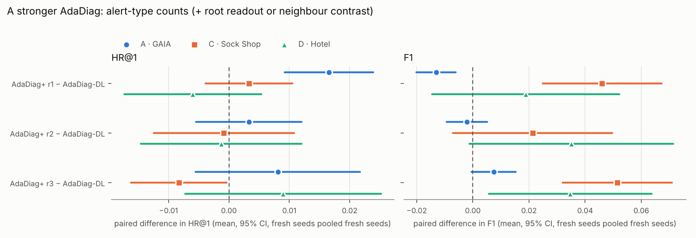

# A stronger AdaDiag (README §6.24)

Screened on development seeds 0–2 with AdaDiag-DL; each round's rule and final change were written to `PLAN.md` before its confirmation runs; round 1 is confirmed on fresh seeds 15–19, round 2 on 20–24 and round 3 on 25–29. Settings as §6.17.

**Final change:** `bag+theta`.

Rule written 2026-11-10T13:54:41, before any run.

**Rule.** Development seeds 0-2, AdaDiag-DL (v5_align), all three datasets. A variant's score is the mean over the three datasets of (dHR@1 + dF1) / 2, paired by seed against its reference. It is kept if its score is above +0.005 and no dataset loses more than 0.015 on HR@1 or on F1 against that reference. Stage A: bag, attn, selfres and ema each alone, reference AdaDiag-DL as released; the anchor is the kept candidate with the highest score (none kept: the anchor is AdaDiag-DL itself). Stage B: the anchor plus each other candidate (bag, attn, selfres, ema, root, neigh, minus the anchor), one at a time, reference the anchor. Stage C: with two or more kept additions, the anchor plus all of them is screened, reference the anchor; the final change is that combination if its score is at least the best single addition's, otherwise the anchor plus the best single addition. With one kept addition, the final change is the anchor plus it; with none, the anchor alone. If the final change is empty, nothing is confirmed. Confirmation: fresh seeds 15-19 for AdaDiag-DL and TVDiag, each as released and with the final change; paired t-tests, Holm over HR@1 and F1 x 3 datasets per comparison.

## Stage A (reference: AdaDiag-DL as released), 2026-11-10T14:48:53

| variant | GAIA dHR@1 / dF1 | Sock Shop | Hotel | score | worst | kept |
|---|---|---|---|---|---|---|
| bag | +0.024 / +0.005 | +0.007 / +0.012 | -0.013 / +0.003 | +0.0065 | -0.013 | yes |
| attn | +0.000 / +0.003 | +0.000 / -0.016 | -0.013 / -0.066 | -0.0153 | -0.066 | no |
| selfres | +0.021 / +0.000 | +0.001 / +0.000 | +0.000 / -0.071 | -0.0080 | -0.071 | no |
| ema | -0.000 / +0.002 | -0.004 / +0.001 | -0.004 / -0.006 | -0.0018 | -0.006 | no |

Anchor: `bag`.

## Stage B (reference: `bag`), 2026-11-10T15:39:05

| variant | GAIA dHR@1 / dF1 | Sock Shop | Hotel | score | worst | kept |
|---|---|---|---|---|---|---|
| bag+attn | -0.026 / -0.010 | -0.037 / +0.002 | -0.004 / -0.063 | -0.0232 | -0.063 | no |
| bag+selfres | +0.006 / -0.003 | -0.008 / -0.017 | +0.017 / -0.056 | -0.0101 | -0.056 | no |
| bag+ema | +0.002 / -0.001 | -0.010 / -0.008 | -0.004 / +0.009 | -0.0020 | -0.010 | no |
| bag+root | -0.002 / -0.013 | -0.003 / +0.040 | +0.017 / +0.014 | +0.0088 | -0.013 | yes |
| bag+neigh | -0.008 / -0.009 | -0.008 / +0.014 | +0.013 / +0.032 | +0.0056 | -0.009 | yes |

Kept additions, best first: root, neigh.

## Decision, 2026-11-10T15:47:25 (before any confirmation run)

Combination `bag+root+neigh` against `bag`: gaia: -0.025 / -0.030 | sockshop: -0.006 / +0.038 | hotel: -0.004 / -0.022; score -0.0082 (worst -0.030) against the best single addition, root, +0.0088. **Final change: `bag+root`** = `{'alert_bag': True, 'fti_readout': 'root_attn'}`.

## Round 2: rule, written 2026-11-10T16:40:47 (before its runs)

**Rule.** Round 2, added after round 1's confirmation (seeds 15-19) left two cells below AdaDiag-DL (GAIA F1 -0.009, Hotel HR@1 -0.008). The selection criterion changes from the mean score to balance, because the goal is to improve every dataset. One new candidate is screened on the development seeds 0-2: bag+rootd (the root readout with its softmax detached, so the FTI loss cannot reshape the RCL ranking). Eligible: every variant with bag screened on the development seeds (bag, bag+attn, bag+selfres, bag+ema, bag+root, bag+neigh, bag+root+neigh, bag+rootd). For each, the six development-seed differences against AdaDiag-DL (HR@1 and F1 x 3 datasets) are computed; among those with a score of at least +0.005, the winner is the one whose smallest difference is largest. It is confirmed on fresh seeds 20-24, never used before, against AdaDiag-DL and TVDiag as released, with round 1's final change alongside.

## Round 2: decision, 2026-11-10T16:50:23 (before its confirmation runs)

Differences against AdaDiag-DL on the development seeds:

| variant | GAIA dHR@1 / dF1 | Sock Shop | Hotel | score | smallest | eligible |
|---|---|---|---|---|---|---|
| bag | +0.024 / +0.005 | +0.007 / +0.012 | -0.013 / +0.003 | +0.0065 | -0.013 | yes |
| bag+attn | -0.001 / -0.005 | -0.030 / +0.014 | -0.017 / -0.060 | -0.0167 | -0.060 | no |
| bag+selfres | +0.031 / +0.002 | -0.001 / -0.004 | +0.004 / -0.053 | -0.0036 | -0.053 | no |
| bag+ema | +0.026 / +0.004 | -0.003 / +0.005 | -0.017 / +0.012 | +0.0044 | -0.017 | no |
| bag+root | +0.022 / -0.008 | +0.004 / +0.052 | +0.004 / +0.017 | +0.0152 | -0.008 | yes |
| bag+neigh | +0.016 / -0.004 | -0.001 / +0.026 | +0.000 / +0.035 | +0.0121 | -0.004 | yes |
| bag+root+neigh | -0.000 / -0.025 | +0.001 / +0.050 | -0.017 / -0.019 | -0.0017 | -0.025 | no |
| bag+rootd | +0.019 / -0.010 | +0.007 / +0.068 | +0.009 / +0.017 | +0.0181 | -0.010 | yes |

**Round 2's final change: `bag+neigh`** = `{'alert_bag': True, 'rcl_context': 'neighbour'}`.

## Round 3: rule, written 2026-11-10T18:32:55 (before its runs)

**Rule.** Round 3, the last, added after both rounds' changes were run on seeds 5-9: there AdaDiag-DL with Eq. 13's learnable theta (section 6.19) scores as high as round 1's change, and higher than AdaDiag-DL on all six cells, while theta acts on the loss weights rather than the features. Screened on the development seeds 0-2: theta alone, bag+theta, bag+root+theta and bag+neigh+theta. Eligible: these four and every variant eligible in round 2. Selection as round 2: among variants with a score of at least +0.005 against AdaDiag-DL, the one whose smallest of the six differences is largest. Confirmed on fresh seeds 25-29, never used before, against AdaDiag-DL and TVDiag as released. Whatever round 3 yields is reported; there is no round 4.

## Round 3: decision, 2026-11-10T19:55:41 (before its confirmation runs)

Differences against AdaDiag-DL on the development seeds:

| variant | GAIA dHR@1 / dF1 | Sock Shop | Hotel | score | smallest | eligible |
|---|---|---|---|---|---|---|
| bag | +0.024 / +0.005 | +0.007 / +0.012 | -0.013 / +0.003 | +0.0065 | -0.013 | yes |
| bag+attn | -0.001 / -0.005 | -0.030 / +0.014 | -0.017 / -0.060 | -0.0167 | -0.060 | no |
| bag+selfres | +0.031 / +0.002 | -0.001 / -0.004 | +0.004 / -0.053 | -0.0036 | -0.053 | no |
| bag+ema | +0.026 / +0.004 | -0.003 / +0.005 | -0.017 / +0.012 | +0.0044 | -0.017 | no |
| bag+root | +0.022 / -0.008 | +0.004 / +0.052 | +0.004 / +0.017 | +0.0152 | -0.008 | yes |
| bag+neigh | +0.016 / -0.004 | -0.001 / +0.026 | +0.000 / +0.035 | +0.0121 | -0.004 | yes |
| bag+root+neigh | -0.000 / -0.025 | +0.001 / +0.050 | -0.017 / -0.019 | -0.0017 | -0.025 | no |
| bag+rootd | +0.019 / -0.010 | +0.007 / +0.068 | +0.009 / +0.017 | +0.0181 | -0.010 | yes |
| theta | -0.000 / +0.006 | +0.017 / -0.003 | +0.000 / -0.004 | +0.0026 | -0.004 | no |
| bag+theta | +0.033 / +0.012 | +0.000 / +0.025 | +0.000 / +0.046 | +0.0194 | +0.000 | yes |
| bag+root+theta | +0.017 / -0.009 | +0.014 / +0.059 | +0.009 / +0.027 | +0.0192 | -0.009 | yes |
| bag+neigh+theta | +0.016 / +0.003 | +0.000 / +0.063 | -0.013 / +0.037 | +0.0178 | -0.013 | yes |

**Round 3's final change: `bag+theta`** = `{'alert_bag': True, 'awl_learnable': True}`.

## Round 1: fresh seeds 15–19 (mean ± sd)

| dataset | arm | HR@1 | HR@3 | Avg@3 | MRR@3 | F1 | macro-F1 | epochs |
|---|---|---|---|---|---|---|---|---|
| A · GAIA | TVDiag, published | 0.759 | 0.909 | 0.844 | 0.827 | 0.936 | — | — |
| A · GAIA | TVDiag | 0.717 ± 0.035 | 0.889 ± 0.012 | 0.816 ± 0.025 | 0.795 ± 0.026 | 0.920 ± 0.014 | 0.578 ± 0.015 | 283 |
| A · GAIA | TVDiag + round-1 change | 0.745 ± 0.014 | 0.896 ± 0.011 | 0.832 ± 0.012 | 0.814 ± 0.012 | 0.906 ± 0.004 | 0.562 ± 0.005 | 237 |
| A · GAIA | AdaDiag-DL | 0.746 ± 0.007 | 0.901 ± 0.005 | 0.836 ± 0.003 | 0.817 ± 0.004 | 0.932 ± 0.014 | 0.531 ± 0.082 | 139 |
| A · GAIA | AdaDiag+ round 1 (bag+root) | 0.765 ± 0.012 | 0.909 ± 0.004 | 0.848 ± 0.007 | 0.831 ± 0.008 | 0.922 ± 0.005 | 0.533 ± 0.021 | 113 |
| C · Sock Shop | TVDiag, published | 0.863 | 0.954 | 0.913 | 0.903 | 0.636 | — | — |
| C · Sock Shop | TVDiag | 0.869 ± 0.006 | 0.949 ± 0.005 | 0.916 ± 0.002 | 0.906 ± 0.002 | 0.578 ± 0.011 | 0.561 ± 0.013 | 280 |
| C · Sock Shop | TVDiag + round-1 change | 0.876 ± 0.012 | 0.949 ± 0.008 | 0.919 ± 0.007 | 0.910 ± 0.007 | 0.618 ± 0.040 | 0.604 ± 0.043 | 216 |
| C · Sock Shop | AdaDiag-DL | 0.868 ± 0.008 | 0.946 ± 0.005 | 0.914 ± 0.004 | 0.904 ± 0.005 | 0.588 ± 0.019 | 0.563 ± 0.020 | 179 |
| C · Sock Shop | AdaDiag+ round 1 (bag+root) | 0.876 ± 0.014 | 0.949 ± 0.002 | 0.920 ± 0.009 | 0.910 ± 0.009 | 0.631 ± 0.012 | 0.614 ± 0.012 | 154 |
| D · Hotel | TVDiag, published | 0.821 | 0.923 | 0.876 | 0.866 | 0.822 | — | — |
| D · Hotel | TVDiag | 0.818 ± 0.014 | 0.921 ± 0.006 | 0.872 ± 0.005 | 0.862 ± 0.006 | 0.781 ± 0.036 | 0.770 ± 0.039 | 149 |
| D · Hotel | TVDiag + round-1 change | 0.821 ± 0.020 | 0.913 ± 0.011 | 0.870 ± 0.012 | 0.861 ± 0.012 | 0.800 ± 0.024 | 0.789 ± 0.030 | 134 |
| D · Hotel | AdaDiag-DL | 0.823 ± 0.006 | 0.923 ± 0.000 | 0.876 ± 0.003 | 0.866 ± 0.002 | 0.787 ± 0.027 | 0.777 ± 0.028 | 153 |
| D · Hotel | AdaDiag+ round 1 (bag+root) | 0.815 ± 0.007 | 0.910 ± 0.009 | 0.867 ± 0.006 | 0.857 ± 0.006 | 0.800 ± 0.024 | 0.788 ± 0.031 | 137 |

## Round 1: paired differences (same fresh seeds 15–19)

| dataset | metric | **AdaDiag+ r1 − AdaDiag-DL** | AdaDiag+ r1 − TVDiag released | TVDiag: + change − released | AdaDiag+ r1 − TVDiag + change |
|---|---|---|---|---|---|
| A · GAIA | HR@1 | **+0.019** (p 0.01, 5/5) | +0.048 (p 0.05, 5/5) | +0.028 (p 0.13, 4/5) | **+0.020** (p 0.01, 5/5) |
| A · GAIA | HR@3 | +0.009 (p 0.05, 4/5) | **+0.020** (p 0.04, 5/5) | +0.007 (p 0.48, 4/5) | **+0.013** (p 0.02, 5/5) |
| A · GAIA | Avg@3 | **+0.012** (p 0.01, 5/5) | +0.033 (p 0.06, 5/5) | +0.017 (p 0.24, 4/5) | **+0.016** (p 0.01, 5/5) |
| A · GAIA | MRR@3 | **+0.014** (p 0.01, 5/5) | +0.036 (p 0.06, 5/5) | +0.019 (p 0.20, 4/5) | **+0.017** (p 0.01, 5/5) |
| A · GAIA | F1 | -0.009 (p 0.32, 1/5) | +0.003 (p 0.71, 3/5) | -0.014 (p 0.11, 1/5) | **+0.017**† (p 0.00, 5/5) |
| A · GAIA | macro-F1 | +0.002 (p 0.95, 1/5) | **-0.045** (p 0.00, 0/5) | -0.016 (p 0.12, 1/5) | -0.029 (p 0.05, 0/5) |
| C · Sock Shop | HR@1 | +0.007 (p 0.33, 3/5) | +0.007 (p 0.41, 3/5) | +0.007 (p 0.22, 3/5) | -0.001 (p 0.93, 1/5) |
| C · Sock Shop | HR@3 | +0.002 (p 0.30, 3/5) | -0.000 (p 1.00, 1/5) | +0.000 (p 1.00, 2/5) | -0.000 (p 1.00, 2/5) |
| C · Sock Shop | Avg@3 | +0.006 (p 0.25, 3/5) | +0.003 (p 0.52, 2/5) | +0.003 (p 0.41, 2/5) | +0.001 (p 0.92, 1/5) |
| C · Sock Shop | MRR@3 | +0.006 (p 0.27, 3/5) | +0.004 (p 0.47, 3/5) | +0.004 (p 0.29, 3/5) | +0.000 (p 1.00, 1/5) |
| C · Sock Shop | F1 | **+0.043**† (p 0.01, 5/5) | **+0.053**† (p 0.00, 5/5) | +0.039 (p 0.15, 4/5) | +0.014 (p 0.55, 4/5) |
| C · Sock Shop | macro-F1 | **+0.051** (p 0.01, 5/5) | **+0.053** (p 0.00, 5/5) | +0.043 (p 0.15, 4/5) | +0.010 (p 0.65, 4/5) |
| D · Hotel | HR@1 | -0.008 (p 0.07, 0/5) | -0.003 (p 0.62, 1/5) | +0.003 (p 0.78, 2/5) | -0.005 (p 0.48, 1/5) |
| D · Hotel | HR@3 | **-0.013** (p 0.03, 0/5) | -0.010 (p 0.10, 0/5) | -0.008 (p 0.21, 0/5) | -0.003 (p 0.37, 0/5) |
| D · Hotel | Avg@3 | **-0.009** (p 0.04, 0/5) | -0.005 (p 0.07, 0/5) | -0.002 (p 0.67, 3/5) | -0.003 (p 0.29, 2/5) |
| D · Hotel | MRR@3 | **-0.009** (p 0.03, 0/5) | **-0.005** (p 0.04, 0/5) | -0.001 (p 0.76, 2/5) | -0.004 (p 0.30, 2/5) |
| D · Hotel | F1 | +0.013 (p 0.56, 4/5) | +0.019 (p 0.47, 4/5) | +0.020 (p 0.37, 4/5) | -0.001 (p 0.94, 2/5) |
| D · Hotel | macro-F1 | +0.011 (p 0.68, 4/5) | +0.018 (p 0.55, 4/5) | +0.019 (p 0.47, 4/5) | -0.001 (p 0.92, 2/5) |

Paired t-test over seeds 15–19 (wins/seeds in brackets); **bold**: p < 0.05 uncorrected; †: survives Holm over the six primary cells of its column (HR@1 and F1 × 3 datasets).

## Round 1: HR@1 and FTI recall per failure type (align → align_plus; mean over seeds)

| dataset | failure type | n | HR@1 | FTI recall |
|---|---|---|---|---|
| A · GAIA | [access permission denied exception] | 15 | 0.13 → 0.13 | 0.00 → 0.00 |
| A · GAIA | [file moving program] | 27 | 0.89 → 0.89 | 0.66 → 0.62 |
| A · GAIA | [login failure] | 458 | 0.85 → 0.87 | 0.98 → 0.95 |
| A · GAIA | [memory_anomalies] | 426 | 0.67 → 0.69 | 1.00 → 0.99 |
| A · GAIA | [normal memory freed label] | 13 | 0.00 → 0.00 | 0.00 → 0.00 |
| C · Sock Shop | cpu | 22 | 0.92 → 0.93 | 0.69 → 0.76 |
| C · Sock Shop | memory | 34 | 0.91 → 0.92 | 0.43 → 0.54 |
| C · Sock Shop | network-corrupt | 41 | 0.92 → 0.93 | 0.61 → 0.53 |
| C · Sock Shop | network-delay | 35 | 0.74 → 0.74 | 0.70 → 0.76 |
| C · Sock Shop | network-loss | 37 | 0.72 → 0.75 | 0.52 → 0.56 |
| C · Sock Shop | pod-failure | 40 | 0.96 → 0.95 | 0.48 → 0.59 |
| C · Sock Shop | pod-kill | 32 | 0.92 → 0.93 | 0.57 → 0.62 |
| D · Hotel | container-kill | 22 | 1.00 → 1.00 | 0.64 → 0.68 |
| D · Hotel | network-delay | 14 | 0.27 → 0.23 | 0.89 → 0.84 |
| D · Hotel | network-loss | 13 | 0.72 → 0.72 | 0.88 → 0.92 |
| D · Hotel | pod-failure | 15 | 1.00 → 1.00 | 0.79 → 0.89 |
| D · Hotel | pod-kill | 14 | 1.00 → 1.00 | 0.76 → 0.64 |
## Round 2: fresh seeds 20–24 (mean ± sd)

| dataset | arm | HR@1 | HR@3 | Avg@3 | MRR@3 | F1 | macro-F1 | epochs |
|---|---|---|---|---|---|---|---|---|
| A · GAIA | TVDiag, published | 0.759 | 0.909 | 0.844 | 0.827 | 0.936 | — | — |
| A · GAIA | TVDiag | 0.731 ± 0.017 | 0.895 ± 0.006 | 0.826 ± 0.008 | 0.806 ± 0.010 | 0.921 ± 0.011 | 0.573 ± 0.006 | 282 |
| A · GAIA | AdaDiag-DL | 0.753 ± 0.008 | 0.898 ± 0.007 | 0.837 ± 0.004 | 0.819 ± 0.005 | 0.937 ± 0.006 | 0.556 ± 0.034 | 135 |
| A · GAIA | AdaDiag+ round 1 (bag+root) | 0.763 ± 0.004 | 0.904 ± 0.003 | 0.843 ± 0.003 | 0.827 ± 0.003 | 0.925 ± 0.004 | 0.561 ± 0.019 | 109 |
| A · GAIA | AdaDiag+ round 2 | 0.758 ± 0.008 | 0.904 ± 0.006 | 0.841 ± 0.006 | 0.824 ± 0.006 | 0.932 ± 0.010 | 0.524 ± 0.038 | 141 |
| C · Sock Shop | TVDiag, published | 0.863 | 0.954 | 0.913 | 0.903 | 0.636 | — | — |
| C · Sock Shop | TVDiag | 0.871 ± 0.009 | 0.946 ± 0.004 | 0.915 ± 0.005 | 0.905 ± 0.005 | 0.577 ± 0.029 | 0.549 ± 0.026 | 182 |
| C · Sock Shop | AdaDiag-DL | 0.870 ± 0.014 | 0.944 ± 0.006 | 0.915 ± 0.008 | 0.905 ± 0.009 | 0.591 ± 0.028 | 0.565 ± 0.028 | 189 |
| C · Sock Shop | AdaDiag+ round 1 (bag+root) | 0.871 ± 0.008 | 0.953 ± 0.005 | 0.918 ± 0.005 | 0.908 ± 0.005 | 0.612 ± 0.026 | 0.590 ± 0.023 | 134 |
| C · Sock Shop | AdaDiag+ round 2 | 0.873 ± 0.009 | 0.949 ± 0.003 | 0.917 ± 0.003 | 0.908 ± 0.004 | 0.602 ± 0.008 | 0.580 ± 0.009 | 166 |
| D · Hotel | TVDiag, published | 0.821 | 0.923 | 0.876 | 0.866 | 0.822 | — | — |
| D · Hotel | TVDiag | 0.836 ± 0.011 | 0.913 ± 0.006 | 0.876 ± 0.006 | 0.869 ± 0.007 | 0.805 ± 0.038 | 0.794 ± 0.035 | 154 |
| D · Hotel | AdaDiag-DL | 0.836 ± 0.006 | 0.928 ± 0.007 | 0.883 ± 0.006 | 0.875 ± 0.006 | 0.786 ± 0.040 | 0.770 ± 0.044 | 160 |
| D · Hotel | AdaDiag+ round 1 (bag+root) | 0.821 ± 0.016 | 0.918 ± 0.007 | 0.880 ± 0.010 | 0.867 ± 0.011 | 0.805 ± 0.050 | 0.794 ± 0.055 | 135 |
| D · Hotel | AdaDiag+ round 2 | 0.823 ± 0.011 | 0.921 ± 0.023 | 0.877 ± 0.015 | 0.866 ± 0.014 | 0.827 ± 0.033 | 0.819 ± 0.037 | 142 |

## Round 2: paired differences (same fresh seeds 20–24)

| dataset | metric | **AdaDiag+ r2 − AdaDiag-DL** | AdaDiag+ r2 − TVDiag released | AdaDiag+ r1 − AdaDiag-DL | AdaDiag+ r2 − r1 |
|---|---|---|---|---|---|
| A · GAIA | HR@1 | +0.005 (p 0.18, 3/5) | +0.026 (p 0.07, 5/5) | +0.010 (p 0.05, 5/5) | -0.005 (p 0.35, 1/5) |
| A · GAIA | HR@3 | +0.006 (p 0.24, 4/5) | +0.008 (p 0.16, 4/5) | +0.006 (p 0.11, 4/5) | -0.000 (p 0.92, 3/5) |
| A · GAIA | Avg@3 | +0.004 (p 0.12, 4/5) | +0.015 (p 0.05, 5/5) | +0.006 (p 0.10, 4/5) | -0.002 (p 0.58, 2/5) |
| A · GAIA | MRR@3 | +0.005 (p 0.06, 5/5) | +0.017 (p 0.05, 5/5) | +0.007 (p 0.06, 4/5) | -0.003 (p 0.47, 2/5) |
| A · GAIA | F1 | -0.005 (p 0.39, 2/5) | +0.011 (p 0.16, 4/5) | **-0.013** (p 0.03, 0/5) | **+0.007** (p 0.04, 5/5) |
| A · GAIA | macro-F1 | -0.032 (p 0.23, 2/5) | -0.048 (p 0.05, 1/5) | +0.005 (p 0.61, 3/5) | -0.036 (p 0.09, 1/5) |
| C · Sock Shop | HR@1 | +0.003 (p 0.73, 2/5) | +0.002 (p 0.77, 3/5) | +0.001 (p 0.91, 2/5) | +0.002 (p 0.63, 3/5) |
| C · Sock Shop | HR@3 | +0.005 (p 0.11, 4/5) | +0.003 (p 0.10, 3/5) | +0.008 (p 0.12, 4/5) | -0.003 (p 0.24, 0/5) |
| C · Sock Shop | Avg@3 | +0.002 (p 0.57, 1/5) | +0.002 (p 0.52, 4/5) | +0.004 (p 0.45, 3/5) | -0.002 (p 0.49, 2/5) |
| C · Sock Shop | MRR@3 | +0.003 (p 0.57, 2/5) | +0.002 (p 0.58, 3/5) | +0.004 (p 0.51, 3/5) | -0.001 (p 0.83, 3/5) |
| C · Sock Shop | F1 | +0.011 (p 0.45, 3/5) | +0.025 (p 0.13, 3/5) | +0.021 (p 0.38, 4/5) | -0.010 (p 0.34, 2/5) |
| C · Sock Shop | macro-F1 | +0.015 (p 0.38, 4/5) | +0.031 (p 0.09, 4/5) | +0.025 (p 0.30, 4/5) | -0.011 (p 0.25, 1/5) |
| D · Hotel | HR@1 | -0.013 (p 0.09, 0/5) | -0.013 (p 0.09, 0/5) | -0.015 (p 0.11, 0/5) | +0.003 (p 0.81, 1/5) |
| D · Hotel | HR@3 | -0.008 (p 0.53, 1/5) | +0.008 (p 0.50, 2/5) | -0.010 (p 0.18, 0/5) | +0.003 (p 0.81, 2/5) |
| D · Hotel | Avg@3 | -0.006 (p 0.52, 2/5) | +0.001 (p 0.92, 2/5) | -0.003 (p 0.73, 3/5) | -0.003 (p 0.71, 2/5) |
| D · Hotel | MRR@3 | -0.009 (p 0.32, 2/5) | -0.003 (p 0.73, 2/5) | -0.008 (p 0.30, 2/5) | -0.000 (p 0.96, 2/5) |
| D · Hotel | F1 | +0.041 (p 0.18, 4/5) | +0.022 (p 0.29, 4/5) | +0.020 (p 0.63, 3/5) | +0.021 (p 0.33, 3/5) |
| D · Hotel | macro-F1 | +0.049 (p 0.16, 4/5) | +0.025 (p 0.26, 4/5) | +0.024 (p 0.61, 2/5) | +0.025 (p 0.34, 3/5) |

Paired t-test over seeds 20–24 (wins/seeds in brackets); **bold**: p < 0.05 uncorrected; †: survives Holm over the six primary cells of its column (HR@1 and F1 × 3 datasets).

## Round 2: HR@1 and FTI recall per failure type (align → align_plus2; mean over seeds)

| dataset | failure type | n | HR@1 | FTI recall |
|---|---|---|---|---|
| A · GAIA | [access permission denied exception] | 15 | 0.16 → 0.19 | 0.00 → 0.00 |
| A · GAIA | [file moving program] | 27 | 0.90 → 0.84 | 0.74 → 0.56 |
| A · GAIA | [login failure] | 458 | 0.86 → 0.86 | 0.98 → 0.98 |
| A · GAIA | [memory_anomalies] | 426 | 0.67 → 0.69 | 0.99 → 0.99 |
| A · GAIA | [normal memory freed label] | 13 | 0.00 → 0.02 | 0.02 → 0.00 |
| C · Sock Shop | cpu | 22 | 0.88 → 0.93 | 0.70 → 0.77 |
| C · Sock Shop | memory | 34 | 0.89 → 0.92 | 0.48 → 0.45 |
| C · Sock Shop | network-corrupt | 41 | 0.91 → 0.93 | 0.59 → 0.64 |
| C · Sock Shop | network-delay | 35 | 0.75 → 0.74 | 0.79 → 0.77 |
| C · Sock Shop | network-loss | 37 | 0.79 → 0.74 | 0.51 → 0.46 |
| C · Sock Shop | pod-failure | 40 | 0.95 → 0.95 | 0.43 → 0.49 |
| C · Sock Shop | pod-kill | 32 | 0.91 → 0.92 | 0.54 → 0.54 |
| D · Hotel | container-kill | 22 | 1.00 → 1.00 | 0.55 → 0.70 |
| D · Hotel | network-delay | 14 | 0.34 → 0.29 | 0.86 → 0.89 |
| D · Hotel | network-loss | 13 | 0.72 → 0.71 | 0.95 → 0.97 |
| D · Hotel | pod-failure | 15 | 1.00 → 1.00 | 0.85 → 0.83 |
| D · Hotel | pod-kill | 14 | 1.00 → 1.00 | 0.74 → 0.77 |
## Round 3: fresh seeds 25–29 (mean ± sd)

| dataset | arm | HR@1 | HR@3 | Avg@3 | MRR@3 | F1 | macro-F1 | epochs |
|---|---|---|---|---|---|---|---|---|
| A · GAIA | TVDiag, published | 0.759 | 0.909 | 0.844 | 0.827 | 0.936 | — | — |
| A · GAIA | TVDiag | 0.735 ± 0.012 | 0.895 ± 0.007 | 0.826 ± 0.010 | 0.807 ± 0.010 | 0.925 ± 0.008 | 0.579 ± 0.012 | 267 |
| A · GAIA | AdaDiag-DL | 0.746 ± 0.015 | 0.902 ± 0.005 | 0.835 ± 0.009 | 0.817 ± 0.010 | 0.933 ± 0.007 | 0.531 ± 0.055 | 125 |
| A · GAIA | AdaDiag+ round 3 | 0.758 ± 0.014 | 0.909 ± 0.004 | 0.845 ± 0.008 | 0.827 ± 0.009 | 0.940 ± 0.011 | 0.568 ± 0.012 | 204 |
| C · Sock Shop | TVDiag, published | 0.863 | 0.954 | 0.913 | 0.903 | 0.636 | — | — |
| C · Sock Shop | TVDiag | 0.871 ± 0.011 | 0.949 ± 0.005 | 0.919 ± 0.006 | 0.908 ± 0.006 | 0.568 ± 0.019 | 0.550 ± 0.022 | 303 |
| C · Sock Shop | AdaDiag-DL | 0.876 ± 0.003 | 0.947 ± 0.003 | 0.919 ± 0.002 | 0.909 ± 0.001 | 0.582 ± 0.026 | 0.560 ± 0.029 | 180 |
| C · Sock Shop | AdaDiag+ round 3 | 0.872 ± 0.006 | 0.951 ± 0.006 | 0.918 ± 0.006 | 0.908 ± 0.005 | 0.624 ± 0.009 | 0.608 ± 0.012 | 340 |
| D · Hotel | TVDiag, published | 0.821 | 0.923 | 0.876 | 0.866 | 0.822 | — | — |
| D · Hotel | TVDiag | 0.836 ± 0.011 | 0.918 ± 0.007 | 0.880 ± 0.007 | 0.872 ± 0.006 | 0.785 ± 0.030 | 0.767 ± 0.035 | 156 |
| D · Hotel | AdaDiag-DL | 0.831 ± 0.011 | 0.915 ± 0.011 | 0.876 ± 0.010 | 0.868 ± 0.009 | 0.792 ± 0.047 | 0.778 ± 0.055 | 148 |
| D · Hotel | AdaDiag+ round 3 | 0.828 ± 0.007 | 0.923 ± 0.009 | 0.885 ± 0.011 | 0.873 ± 0.009 | 0.815 ± 0.024 | 0.804 ± 0.023 | 232 |

## Round 3: paired differences (same fresh seeds 25–29)

| dataset | metric | **AdaDiag+ r3 − AdaDiag-DL** | AdaDiag+ r3 − TVDiag released |
|---|---|---|---|
| A · GAIA | HR@1 | +0.012 (p 0.26, 3/5) | +0.023 (p 0.10, 4/5) |
| A · GAIA | HR@3 | +0.006 (p 0.12, 4/5) | **+0.013** (p 0.05, 4/5) |
| A · GAIA | Avg@3 | +0.010 (p 0.16, 4/5) | +0.019 (p 0.06, 4/5) |
| A · GAIA | MRR@3 | +0.010 (p 0.19, 4/5) | +0.019 (p 0.07, 4/5) |
| A · GAIA | F1 | +0.007 (p 0.34, 3/5) | **+0.016** (p 0.01, 5/5) |
| A · GAIA | macro-F1 | +0.037 (p 0.21, 4/5) | -0.011 (p 0.23, 1/5) |
| C · Sock Shop | HR@1 | -0.003 (p 0.37, 1/5) | +0.002 (p 0.78, 3/5) |
| C · Sock Shop | HR@3 | +0.004 (p 0.09, 3/5) | +0.002 (p 0.69, 2/5) |
| C · Sock Shop | Avg@3 | -0.001 (p 0.70, 1/5) | -0.001 (p 0.85, 3/5) |
| C · Sock Shop | MRR@3 | -0.001 (p 0.70, 2/5) | +0.000 (p 0.91, 3/5) |
| C · Sock Shop | F1 | **+0.042** (p 0.02, 5/5) | **+0.056**† (p 0.00, 5/5) |
| C · Sock Shop | macro-F1 | **+0.048** (p 0.02, 4/5) | **+0.058** (p 0.01, 5/5) |
| D · Hotel | HR@1 | -0.003 (p 0.62, 1/5) | -0.008 (p 0.07, 0/5) |
| D · Hotel | HR@3 | +0.008 (p 0.21, 2/5) | +0.005 (p 0.37, 1/5) |
| D · Hotel | Avg@3 | +0.009 (p 0.22, 4/5) | +0.005 (p 0.30, 3/5) |
| D · Hotel | MRR@3 | +0.005 (p 0.40, 3/5) | +0.001 (p 0.79, 3/5) |
| D · Hotel | F1 | +0.023 (p 0.31, 3/5) | +0.030 (p 0.12, 5/5) |
| D · Hotel | macro-F1 | +0.027 (p 0.30, 4/5) | +0.038 (p 0.08, 5/5) |

Paired t-test over seeds 25–29 (wins/seeds in brackets); **bold**: p < 0.05 uncorrected; †: survives Holm over the six primary cells of its column (HR@1 and F1 × 3 datasets).

## Round 3: HR@1 and FTI recall per failure type (align → align_plus3; mean over seeds)

| dataset | failure type | n | HR@1 | FTI recall |
|---|---|---|---|---|
| A · GAIA | [access permission denied exception] | 15 | 0.21 → 0.09 | 0.00 → 0.00 |
| A · GAIA | [file moving program] | 27 | 0.87 → 0.91 | 0.61 → 0.84 |
| A · GAIA | [login failure] | 458 | 0.84 → 0.84 | 0.97 → 0.98 |
| A · GAIA | [memory_anomalies] | 426 | 0.68 → 0.70 | 1.00 → 1.00 |
| A · GAIA | [normal memory freed label] | 13 | 0.00 → 0.02 | 0.00 → 0.00 |
| C · Sock Shop | cpu | 22 | 0.87 → 0.95 | 0.69 → 0.80 |
| C · Sock Shop | memory | 34 | 0.89 → 0.92 | 0.44 → 0.51 |
| C · Sock Shop | network-corrupt | 41 | 0.92 → 0.91 | 0.60 → 0.64 |
| C · Sock Shop | network-delay | 35 | 0.77 → 0.74 | 0.74 → 0.78 |
| C · Sock Shop | network-loss | 37 | 0.81 → 0.74 | 0.50 → 0.45 |
| C · Sock Shop | pod-failure | 40 | 0.96 → 0.97 | 0.46 → 0.55 |
| C · Sock Shop | pod-kill | 32 | 0.91 → 0.89 | 0.57 → 0.62 |
| D · Hotel | container-kill | 22 | 1.00 → 1.00 | 0.58 → 0.66 |
| D · Hotel | network-delay | 14 | 0.33 → 0.33 | 0.89 → 0.86 |
| D · Hotel | network-loss | 13 | 0.72 → 0.71 | 0.98 → 0.98 |
| D · Hotel | pod-failure | 15 | 0.99 → 0.99 | 0.77 → 0.84 |
| D · Hotel | pod-kill | 14 | 1.00 → 1.00 | 0.74 → 0.74 |
## All fresh seeds pooled (5–9, 15–19, 20–24, 25–29)

Each change against AdaDiag-DL and TVDiag on every fresh seed both have (round 1's change: 15 seeds; round 2's: 10; round 3's: 10). Seeds 5–9 are those of the paper-format tables (§6.17); no change was selected on them.

| dataset | metric | AdaDiag+ r1 (bag+root) − AdaDiag-DL | AdaDiag+ r2 (bag+neigh) − AdaDiag-DL | AdaDiag+ r3 (bag+theta) − AdaDiag-DL | AdaDiag+ r1 − TVDiag (re-run) | AdaDiag+ r2 − TVDiag (re-run) | AdaDiag+ r3 − TVDiag (re-run) |
|---|---|---|---|---|---|---|---|
| A · GAIA | HR@1 | **+0.017**† (p 0.00, 14/15) | +0.003 (p 0.42, 5/10) | +0.008 (p 0.21, 5/10) | **+0.037**† (p 0.00, 15/15) | **+0.019** (p 0.02, 8/10) | **+0.020**† (p 0.01, 9/10) |
| A · GAIA | HR@3 | **+0.008** (p 0.00, 12/15) | +0.004 (p 0.17, 7/10) | +0.004 (p 0.16, 6/10) | **+0.015** (p 0.00, 15/15) | **+0.008** (p 0.01, 8/10) | **+0.011** (p 0.01, 8/10) |
| A · GAIA | Avg@3 | **+0.010** (p 0.00, 13/15) | +0.003 (p 0.25, 7/10) | +0.006 (p 0.15, 6/10) | **+0.024** (p 0.00, 15/15) | **+0.012** (p 0.01, 10/10) | **+0.015** (p 0.00, 9/10) |
| A · GAIA | MRR@3 | **+0.012** (p 0.00, 13/15) | +0.003 (p 0.23, 8/10) | +0.006 (p 0.15, 7/10) | **+0.027** (p 0.00, 15/15) | **+0.014** (p 0.01, 10/10) | **+0.016** (p 0.00, 9/10) |
| A · GAIA | F1 | **-0.013**† (p 0.00, 1/15) | -0.002 (p 0.52, 6/10) | +0.007 (p 0.06, 7/10) | +0.001 (p 0.68, 11/15) | **+0.014** (p 0.02, 7/10) | **+0.019**† (p 0.00, 9/10) |
| A · GAIA | macro-F1 | -0.004 (p 0.75, 6/15) | -0.025 (p 0.05, 2/10) | **+0.030** (p 0.04, 9/10) | **-0.032** (p 0.00, 2/15) | **-0.043** (p 0.00, 1/10) | -0.004 (p 0.60, 4/10) |
| C · Sock Shop | HR@1 | +0.003 (p 0.34, 8/15) | -0.001 (p 0.88, 3/10) | **-0.008** (p 0.04, 2/10) | +0.004 (p 0.32, 9/15) | +0.000 (p 0.95, 5/10) | -0.004 (p 0.41, 4/10) |
| C · Sock Shop | HR@3 | **+0.005** (p 0.02, 9/15) | +0.003 (p 0.07, 5/10) | **+0.005** (p 0.02, 7/10) | +0.002 (p 0.26, 8/15) | +0.001 (p 0.81, 4/10) | +0.002 (p 0.52, 4/10) |
| C · Sock Shop | Avg@3 | +0.004 (p 0.05, 9/15) | +0.000 (p 0.95, 2/10) | -0.002 (p 0.33, 2/10) | +0.004 (p 0.08, 8/15) | +0.001 (p 0.82, 5/10) | -0.001 (p 0.79, 5/10) |
| C · Sock Shop | MRR@3 | +0.004 (p 0.09, 10/15) | +0.000 (p 0.92, 4/10) | -0.003 (p 0.19, 3/10) | +0.004 (p 0.12, 10/15) | +0.001 (p 0.86, 5/10) | -0.002 (p 0.68, 4/10) |
| C · Sock Shop | F1 | **+0.046**† (p 0.00, 14/15) | +0.021 (p 0.12, 7/10) | **+0.051**† (p 0.00, 10/10) | **+0.058**† (p 0.00, 14/15) | **+0.034**† (p 0.00, 8/10) | **+0.064**† (p 0.00, 10/10) |
| C · Sock Shop | macro-F1 | **+0.050** (p 0.00, 14/15) | +0.023 (p 0.11, 8/10) | **+0.055** (p 0.00, 9/10) | **+0.059** (p 0.00, 14/15) | **+0.036** (p 0.00, 9/10) | **+0.064** (p 0.00, 10/10) |
| D · Hotel | HR@1 | -0.006 (p 0.28, 2/15) | -0.001 (p 0.83, 3/10) | +0.009 (p 0.24, 4/10) | -0.007 (p 0.25, 3/15) | -0.005 (p 0.34, 2/10) | +0.003 (p 0.66, 3/10) |
| D · Hotel | HR@3 | -0.007 (p 0.15, 2/15) | +0.001 (p 0.87, 4/10) | +0.012 (p 0.08, 6/10) | -0.001 (p 0.81, 4/15) | +0.009 (p 0.26, 4/10) | +0.010 (p 0.07, 5/10) |
| D · Hotel | Avg@3 | -0.001 (p 0.81, 7/15) | +0.005 (p 0.47, 6/10) | **+0.015** (p 0.00, 9/10) | +0.001 (p 0.57, 6/15) | +0.006 (p 0.25, 6/10) | **+0.011** (p 0.01, 8/10) |
| D · Hotel | MRR@3 | -0.004 (p 0.34, 4/15) | +0.002 (p 0.71, 6/10) | **+0.012** (p 0.02, 8/10) | -0.002 (p 0.55, 6/15) | +0.003 (p 0.51, 5/10) | +0.008 (p 0.06, 7/10) |
| D · Hotel | F1 | +0.019 (p 0.24, 9/15) | +0.035 (p 0.06, 8/10) | **+0.035** (p 0.02, 7/10) | +0.017 (p 0.32, 8/15) | +0.029 (p 0.11, 8/10) | **+0.041**† (p 0.01, 10/10) |
| D · Hotel | macro-F1 | +0.019 (p 0.28, 8/15) | **+0.038** (p 0.05, 8/10) | **+0.038** (p 0.02, 8/10) | +0.015 (p 0.38, 9/15) | +0.029 (p 0.11, 8/10) | **+0.046** (p 0.00, 10/10) |

Paired t-test over the shared seeds (wins/seeds in brackets); **bold**: p < 0.05 uncorrected; †: survives Holm over the six primary cells of its column.

